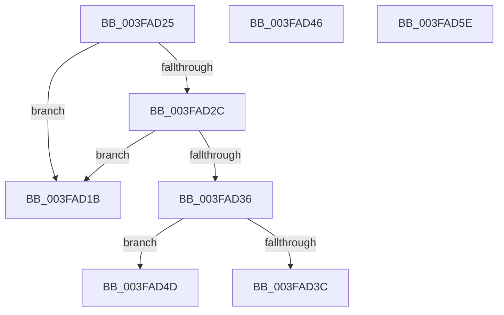

# sub_003FAD1B

- RVA: `0x003FAD1B`–`0x003FAD5F` (길이 `68` bytes)
- VA: `0x00000001403FAD1B`
- 실행 섹션: `.text`
- PDB 이름 있음: `아니요`; PDB Function 태그: `아니요`
- unwind 정보 RVA: `0x000984F4`
- 디코드: `30`개 명령, `68/68` bytes 표시
- 미해석 바이트: `0` (있으면 어셈블리에 `.byte`로 보존)

> 이 문서는 커널 이미지의 기계어와 PDB 기호를 분석해 생성했습니다. 4번과 5번은 함수 원형과 자료형을 바이너리 사용 방식에서 추정한 C 해석이며 원본 소스 복구 결과는 아닙니다.

## 1. Dependencies

- 직접 호출 지점: **1**; 고유 호출 대상: **1**
- 직접 호출자로 확인된 함수: **0**
- RIP 상대 이미지 참조: **0**

### Outgoing calls
- `0x003FAD4F` → [HalRequestSoftwareInterrupt](HalRequestSoftwareInterrupt_function_003FADA0.md) (function, `0x003FADA0`)

### Direct callers
- 이 함수 시작 RVA로 연결되는 직접 call은 확인되지 않았습니다. 간접 호출은 완전히 역산할 수 없습니다.

### Static image references
- 디코드된 RIP-relative 메모리 참조가 없습니다.

## 2. Other-region calls and transfers

- 다른 실행 섹션으로 향하는 call: **0**
- call이 아닌 외부 분기/꼬리 이동: **1**
  - `0x003FAD4B` → [sub_003FAC55 + 0xBB](Unknown_function_003FAC55.md) (`tail-transfer`)

## 3. Assembly (complete function range)

```asm
003FAD1B  32 C0                           xor al, al
003FAD1D  48 83 C4 38                     add rsp, 0x38
003FAD21  41 5F                           pop r15
003FAD23  5B                              pop rbx
003FAD24  C3                              ret
003FAD25  CC                              int3
003FAD26  80 7B 06 00                     cmp byte ptr [rbx + 6], 0
003FAD2A  74 EF                           je 0x1403fad1b
003FAD2C  80 7B 07 00                     cmp byte ptr [rbx + 7], 0
003FAD30  C6 43 06 00                     mov byte ptr [rbx + 6], 0
003FAD34  75 E5                           jne 0x1403fad1b
003FAD36  41 80 FF 02                     cmp r15b, 2
003FAD3A  73 11                           jae 0x1403fad4d
003FAD3C  B0 01                           mov al, 1
003FAD3E  48 83 C4 38                     add rsp, 0x38
003FAD42  41 5F                           pop r15
003FAD44  5B                              pop rbx
003FAD45  C3                              ret
003FAD46  CC                              int3
003FAD47  90                              nop
003FAD48  FE 4B 20                        dec byte ptr [rbx + 0x20]
003FAD4B  EB C3                           jmp 0x1403fad10
003FAD4D  B1 02                           mov cl, 2
003FAD4F  E8 4C 00 00 00                  call 0x1403fada0
003FAD54  32 C0                           xor al, al
003FAD56  48 83 C4 38                     add rsp, 0x38
003FAD5A  41 5F                           pop r15
003FAD5C  5B                              pop rbx
003FAD5D  C3                              ret
003FAD5E  CC                              int3
```

## 4. C-style interpretation (structured pseudocode)

```c
__int64 __fastcall sub_003FAD1B(void)
{
    __int64 result;
    __int64 v_rsp;

    result = 0;
    v_rsp = (v_rsp) + (56);
    return result;
}
```

## 5. (Beta) C Style

```c
void sub_003FAD1B(void)
{
    int64_t result;
    int64_t local_rsp;

    result = 0;
    local_rsp = (local_rsp) + (56);
    return result;
}
```

## 6. Execution-region graph

[열기: 2D/3D 그래프와 함수 탐색 컨트롤 패널](../../../control-panel.html?section=text&rva=0x003FAD1B&view=graph)

- 2D 그래프는 위에서 아래로 흐르고, 3D 그래프는 빈 공간을 드래그해 회전합니다. Shift+드래그는 이동, 휠은 확대·축소, 함수 노드 선택은 대상 보고서 이동입니다.

### Static fallback


