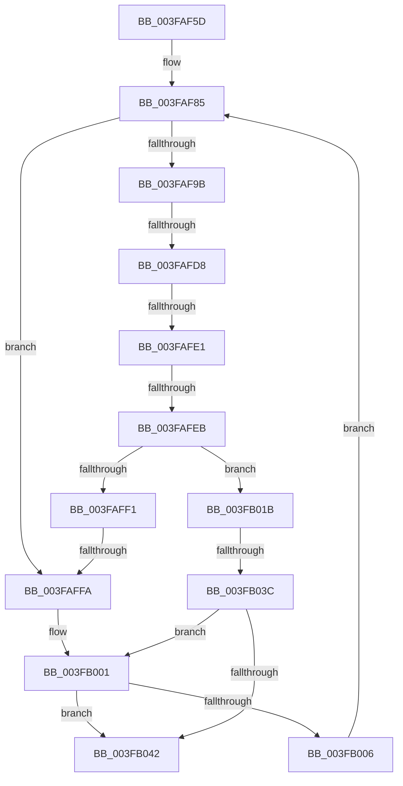

# sub_003FAF5D

- RVA: `0x003FAF5D`–`0x003FB06C` (길이 `271` bytes)
- VA: `0x00000001403FAF5D`
- 실행 섹션: `.text`
- PDB 이름 있음: `아니요`; PDB Function 태그: `아니요`
- unwind 정보 RVA: `0x0009854C`
- 디코드: `69`개 명령, `271/271` bytes 표시
- 미해석 바이트: `0` (있으면 어셈블리에 `.byte`로 보존)

> 이 문서는 커널 이미지의 기계어와 PDB 기호를 분석해 생성했습니다. 4번과 5번은 함수 원형과 자료형을 바이너리 사용 방식에서 추정한 C 해석이며 원본 소스 복구 결과는 아닙니다.

## 1. Dependencies

- 직접 호출 지점: **0**; 고유 호출 대상: **0**
- 직접 호출자로 확인된 함수: **0**
- RIP 상대 이미지 참조: **0**

### Outgoing calls
- 직접 디코드된 call 명령이 없습니다.

### Direct callers
- 이 함수 시작 RVA로 연결되는 직접 call은 확인되지 않았습니다. 간접 호출은 완전히 역산할 수 없습니다.

### Static image references
- 디코드된 RIP-relative 메모리 참조가 없습니다.

## 2. Other-region calls and transfers

- 다른 실행 섹션으로 향하는 call: **0**
- call이 아닌 외부 분기/꼬리 이동: **6**
  - `0x003FAFD2` → [sub_003FB06C + 0xC1](Unknown_function_003FB06C.md) (`tail-transfer`)
  - `0x003FAFDB` → [sub_003FB06C + 0x79](Unknown_function_003FB06C.md) (`tail-transfer`)
  - `0x003FAFE5` → [sub_003FB06C + 0x8](Unknown_function_003FB06C.md) (`tail-transfer`)
  - `0x003FAFF8` → [sub_003FB06C](Unknown_function_003FB06C.md) (`tail-transfer`)
  - `0x003FB036` → [sub_003FB06C + 0x6D](Unknown_function_003FB06C.md) (`tail-transfer`)
  - `0x003FB067` → [RtlFindClearBitsEx + 0x26](RtlFindClearBitsEx_function_003FAF30.md) (`tail-transfer`)

## 3. Assembly (complete function range)

```asm
003FAF5D  48 89 5C 24 38                  mov qword ptr [rsp + 0x38], rbx
003FAF62  48 89 6C 24 40                  mov qword ptr [rsp + 0x40], rbp
003FAF67  48 89 74 24 48                  mov qword ptr [rsp + 0x48], rsi
003FAF6C  4C 89 64 24 18                  mov qword ptr [rsp + 0x18], r12
003FAF71  4C 89 6C 24 10                  mov qword ptr [rsp + 0x10], r13
003FAF76  41 BD 40 00 00 00               mov r13d, 0x40
003FAF7C  4C 89 74 24 08                  mov qword ptr [rsp + 8], r14
003FAF81  4C 89 3C 24                     mov qword ptr [rsp], r15
003FAF85  48 8B CA                        mov rcx, rdx
003FAF88  C7 44 24 30 00 00 00 00         mov dword ptr [rsp + 0x30], 0
003FAF90  48 2B C8                        sub rcx, rax
003FAF93  48 FF C1                        inc rcx
003FAF96  49 3B CA                        cmp rcx, r10
003FAF99  72 5F                           jb 0x1403faffa
003FAF9B  4C 8B FA                        mov r15, rdx
003FAF9E  BB 01 00 00 00                  mov ebx, 1
003FAFA3  4D 2B FA                        sub r15, r10
003FAFA6  49 FF C7                        inc r15
003FAFA9  49 8B CF                        mov rcx, r15
003FAFAC  48 C1 E9 06                     shr rcx, 6
003FAFB0  4C 8D 34 CF                     lea r14, [rdi + rcx*8]
003FAFB4  48 8B C8                        mov rcx, rax
003FAFB7  48 C1 E9 06                     shr rcx, 6
003FAFBB  4C 8D 1C CF                     lea r11, [rdi + rcx*8]
003FAFBF  0F B6 C8                        movzx ecx, al
003FAFC2  80 E1 3F                        and cl, 0x3f
003FAFC5  48 D3 E3                        shl rbx, cl
003FAFC8  48 FF CB                        dec rbx
003FAFCB  49 0B 1B                        or rbx, qword ptr [r11]
003FAFCE  49 83 FA 7F                     cmp r10, 0x7f
003FAFD2  0F 87 55 01 00 00               ja 0x1403fb12d
003FAFD8  4D 3B D5                        cmp r10, r13
003FAFDB  0F 83 04 01 00 00               jae 0x1403fb0e5
003FAFE1  49 83 FA 01                     cmp r10, 1
003FAFE5  0F 87 89 00 00 00               ja 0x1403fb074
003FAFEB  48 83 FB FF                     cmp rbx, -1
003FAFEF  75 2A                           jne 0x1403fb01b
003FAFF1  49 83 C3 08                     add r11, 8
003FAFF5  4D 3B DE                        cmp r11, r14
003FAFF8  76 72                           jbe 0x1403fb06c
003FAFFA  48 C7 C6 FF FF FF FF            mov rsi, 0xffffffffffffffff
003FB001  48 85 C0                        test rax, rax
003FB004  74 3C                           je 0x1403fb042
003FB006  4B 8D 14 02                     lea rdx, [r10 + r8]
003FB00A  49 3B D1                        cmp rdx, r9
003FB00D  49 0F 47 D1                     cmova rdx, r9
003FB011  48 FF CA                        dec rdx
003FB014  33 C0                           xor eax, eax
003FB016  E9 6A FF FF FF                  jmp 0x1403faf85
003FB01B  48 F7 D3                        not rbx
003FB01E  49 8B F3                        mov rsi, r11
003FB021  48 2B F7                        sub rsi, rdi
003FB024  48 C1 FE 03                     sar rsi, 3
003FB028  48 0F BC CB                     bsf rcx, rbx
003FB02C  48 C1 E6 06                     shl rsi, 6
003FB030  48 03 F1                        add rsi, rcx
003FB033  49 3B F7                        cmp rsi, r15
003FB036  0F 87 9D 00 00 00               ja 0x1403fb0d9
003FB03C  48 83 FE FF                     cmp rsi, -1
003FB040  74 BF                           je 0x1403fb001
003FB042  4C 8B 3C 24                     mov r15, qword ptr [rsp]
003FB046  48 8B C6                        mov rax, rsi
003FB049  48 8B 74 24 48                  mov rsi, qword ptr [rsp + 0x48]
003FB04E  4C 8B 74 24 08                  mov r14, qword ptr [rsp + 8]
003FB053  4C 8B 6C 24 10                  mov r13, qword ptr [rsp + 0x10]
003FB058  4C 8B 64 24 18                  mov r12, qword ptr [rsp + 0x18]
003FB05D  48 8B 6C 24 40                  mov rbp, qword ptr [rsp + 0x40]
003FB062  48 8B 5C 24 38                  mov rbx, qword ptr [rsp + 0x38]
003FB067  E9 EA FE FF FF                  jmp 0x1403faf56
```

## 4. C-style interpretation (structured pseudocode)

```c
__int64 __fastcall sub_003FAF5D(__int64 a1, __int64 a2, __int64 a3, __int64 a4, __int64 a5, __int64 a6, __int64 a7, __int64 a8, __int64 a9)
{
    __int64 result;
    __int64 v_r11;
    __int64 v_r15;
    __int64 v_rbx;
    __int64 v_rsi;
    unsigned __int64 v_stack_p0;
    unsigned __int64 v_stack_p10;
    unsigned __int64 v_stack_p18;
    unsigned int v_stack_p30;
    unsigned __int64 v_stack_p38;
    unsigned __int64 v_stack_p40;
    unsigned __int64 v_stack_p48;
    unsigned __int64 v_stack_p8;

    v_stack_p38 = v_rbx;
    v_stack_p40 = v_rbp;
    v_stack_p48 = v_rsi;
    v_stack_p18 = v_r12;
    v_stack_p10 = v_r13;
    v_stack_p8 = v_r14;
    v_stack_p0 = v_r15;
loc_003FAF85:
    v_stack_p30 = 0;
    a1 = (a2) - (result);
    a1 = (a1) + 1;
    if (a1 < v_r10) goto loc_003FAFFA;
    v_r15 = (a2) - (v_r10);
    v_r15 = (v_r15) + 1;
    a1 = (v_r15) >> (6);
    a1 = (result) >> (6);
    a1 = (unsigned __int8)(((unsigned __int8)(result)) & (63));
    v_rbx = (1) << ((unsigned __int8)(a1));
    v_rbx = (v_rbx) - 1;
    v_rbx = (v_rbx) | (*(unsigned __int64 *)(v_rdi + a1 * 8));
    if (v_rbx != -1) goto loc_003FB01B;
    v_r11 = (v_rdi + a1 * 8) + (8);
loc_003FAFFA:
loc_003FB001:
    if (result == 0) goto loc_003FB042;
    a2 = v_r10 + a3 * 1;
    if ((v_r10 + a3 * 1) > a4) { a2 = a4; }
    a2 = (a2) - 1;
    result = 0;
    goto loc_003FAF85;
loc_003FB01B:
    v_rbx = ~(v_rbx);
    v_rsi = (v_r11) - (v_rdi);
    v_rsi = (v_rsi) >> (3);
    v_rsi = (v_rsi) << (6);
    v_rsi = (v_rsi) + (a1);
    if (v_rsi == -1) goto loc_003FB001;
loc_003FB042:
}
```

## 5. (Beta) C Style

```c
int64_t sub_003FAF5D(int64_t Arg1, int64_t Arg2, int64_t Arg3, int64_t Arg4, uint64_t Arg5, uint64_t Arg6, int64_t Arg7, int64_t Arg8, int64_t Arg9)
{
    int64_t result;
    int64_t local_r11;
    int64_t local_r15;
    int64_t local_rbx;
    int64_t local_rsi;
    uint64_t v_stack_p0;
    uint64_t v_stack_p10;
    uint64_t v_stack_p18;
    uint32_t v_stack_p30;
    uint64_t v_stack_p38;
    uint64_t v_stack_p40;
    uint64_t v_stack_p48;
    uint64_t v_stack_p8;

    v_stack_p38 = local_rbx;
    v_stack_p40 = local_rbp;
    v_stack_p48 = local_rsi;
    v_stack_p18 = local_r12;
    v_stack_p10 = local_r13;
    v_stack_p8 = local_r14;
    v_stack_p0 = local_r15;
loc_003FAF85:
    v_stack_p30 = 0;
    Arg1 = (Arg2) - (result);
    Arg1 = (Arg1) + 1;
    if (Arg1 < local_r10) goto loc_003FAFFA;
    local_r15 = (Arg2) - (local_r10);
    local_r15 = (local_r15) + 1;
    Arg1 = (local_r15) >> (6);
    Arg1 = (result) >> (6);
    Arg1 = (uint8_t)(((uint8_t)(result)) & (63));
    local_rbx = (1) << ((uint8_t)(Arg1));
    local_rbx = (local_rbx) - 1;
    local_rbx = (local_rbx) | (*(uint64_t *)(local_rdi + Arg1 * 8));
    if (local_rbx != -1) goto loc_003FB01B;
    local_r11 = (local_rdi + Arg1 * 8) + (8);
loc_003FAFFA:
loc_003FB001:
    if (result == 0) goto loc_003FB042;
    Arg2 = local_r10 + Arg3 * 1;
    if ((local_r10 + Arg3 * 1) > Arg4) { Arg2 = Arg4; }
    Arg2 = (Arg2) - 1;
    result = 0;
    goto loc_003FAF85;
loc_003FB01B:
    local_rbx = ~(local_rbx);
    local_rsi = (local_r11) - (local_rdi);
    local_rsi = (local_rsi) >> (3);
    local_rsi = (local_rsi) << (6);
    local_rsi = (local_rsi) + (Arg1);
    if (local_rsi == -1) goto loc_003FB001;
loc_003FB042:
}
```

## 6. Execution-region graph

[열기: 2D/3D 그래프와 함수 탐색 컨트롤 패널](../../../control-panel.html?section=text&rva=0x003FAF5D&view=graph)

- 2D 그래프는 위에서 아래로 흐르고, 3D 그래프는 빈 공간을 드래그해 회전합니다. Shift+드래그는 이동, 휠은 확대·축소, 함수 노드 선택은 대상 보고서 이동입니다.

### Static fallback


