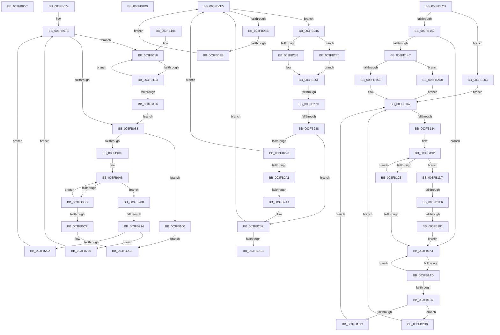

# sub_003FB06C

- RVA: `0x003FB06C`–`0x003FB2E8` (길이 `636` bytes)
- VA: `0x00000001403FB06C`
- 실행 섹션: `.text`
- PDB 이름 있음: `아니요`; PDB Function 태그: `아니요`
- unwind 정보 RVA: `0x00098578`
- 디코드: `160`개 명령, `636/636` bytes 표시
- 미해석 바이트: `0` (있으면 어셈블리에 `.byte`로 보존)

> 이 문서는 커널 이미지의 기계어와 PDB 기호를 분석해 생성했습니다. 4번과 5번은 함수 원형과 자료형을 바이너리 사용 방식에서 추정한 C 해석이며 원본 소스 복구 결과는 아닙니다.

## 1. Dependencies

- 직접 호출 지점: **0**; 고유 호출 대상: **0**
- 직접 호출자로 확인된 함수: **0**
- RIP 상대 이미지 참조: **0**

### Outgoing calls
- 직접 디코드된 call 명령이 없습니다.

### Direct callers
- 이 함수 시작 RVA로 연결되는 직접 call은 확인되지 않았습니다. 간접 호출은 완전히 역산할 수 없습니다.

### Static image references
- 디코드된 RIP-relative 메모리 참조가 없습니다.

## 2. Other-region calls and transfers

- 다른 실행 섹션으로 향하는 call: **0**
- call이 아닌 외부 분기/꼬리 이동: **14**
  - `0x003FB06F` → [sub_003FAF5D + 0x8E](Unknown_function_003FAF5D.md) (`tail-transfer`)
  - `0x003FB0D4` → [sub_003FAF5D + 0xD6](Unknown_function_003FAF5D.md) (`tail-transfer`)
  - `0x003FB0E0` → [sub_003FAF5D + 0xA4](Unknown_function_003FAF5D.md) (`tail-transfer`)
  - `0x003FB0F5` → [sub_003FAF5D + 0x9D](Unknown_function_003FAF5D.md) (`tail-transfer`)
  - `0x003FB117` → [sub_003FAF5D + 0x9D](Unknown_function_003FAF5D.md) (`tail-transfer`)
  - `0x003FB17E` → [sub_003FAF5D + 0x9D](Unknown_function_003FAF5D.md) (`tail-transfer`)
  - `0x003FB1A7` → [sub_003FAF5D + 0x9D](Unknown_function_003FAF5D.md) (`tail-transfer`)
  - `0x003FB1E0` → [sub_003FAF5D + 0xDF](Unknown_function_003FAF5D.md) (`tail-transfer`)
  - `0x003FB1FB` → [sub_003FAF5D + 0xDF](Unknown_function_003FAF5D.md) (`tail-transfer`)
  - `0x003FB20E` → [sub_003FAF5D + 0x9D](Unknown_function_003FAF5D.md) (`tail-transfer`)
  - `0x003FB276` → [sub_003FAF5D + 0x9D](Unknown_function_003FAF5D.md) (`tail-transfer`)
  - `0x003FB282` → [sub_003FAF5D + 0xDF](Unknown_function_003FAF5D.md) (`tail-transfer`)
  - `0x003FB2A4` → [sub_003FAF5D + 0xDF](Unknown_function_003FAF5D.md) (`tail-transfer`)
  - `0x003FB2CB` → [sub_003FAF5D + 0xDF](Unknown_function_003FAF5D.md) (`tail-transfer`)

## 3. Assembly (complete function range)

```asm
003FB06C  49 8B 1B                        mov rbx, qword ptr [r11]
003FB06F  E9 77 FF FF FF                  jmp 0x1403fafeb
003FB074  33 F6                           xor esi, esi
003FB076  48 C1 EA 06                     shr rdx, 6
003FB07A  4C 8D 24 D7                     lea r12, [rdi + rdx*8]
003FB07E  48 83 FB FF                     cmp rbx, -1
003FB082  0F 84 88 00 00 00               je 0x1403fb110
003FB088  48 0F BC D3                     bsf rdx, rbx
003FB08C  C7 44 24 30 00 00 00 00         mov dword ptr [rsp + 0x30], 0
003FB094  41 0F 44 D5                     cmove edx, r13d
003FB098  03 D6                           add edx, esi
003FB09A  49 3B D2                        cmp rdx, r10
003FB09D  73 61                           jae 0x1403fb100
003FB09F  48 8B F3                        mov rsi, rbx
003FB0A2  41 8B EA                        mov ebp, r10d
003FB0A5  48 F7 D6                        not rsi
003FB0A8  48 8B D6                        mov rdx, rsi
003FB0AB  8B CD                           mov ecx, ebp
003FB0AD  D1 E9                           shr ecx, 1
003FB0AF  48 D3 EA                        shr rdx, cl
003FB0B2  48 23 F2                        and rsi, rdx
003FB0B5  0F 84 50 01 00 00               je 0x1403fb20b
003FB0BB  2B E9                           sub ebp, ecx
003FB0BD  83 FD 01                        cmp ebp, 1
003FB0C0  77 E6                           ja 0x1403fb0a8
003FB0C2  48 0F BC F6                     bsf rsi, rsi
003FB0C6  4C 2B DF                        sub r11, rdi
003FB0C9  49 C1 FB 03                     sar r11, 3
003FB0CD  49 C1 E3 06                     shl r11, 6
003FB0D1  49 03 F3                        add rsi, r11
003FB0D4  E9 5A FF FF FF                  jmp 0x1403fb033
003FB0D9  48 C7 C6 FF FF FF FF            mov rsi, 0xffffffffffffffff
003FB0E0  E9 1C FF FF FF                  jmp 0x1403fb001
003FB0E5  48 85 DB                        test rbx, rbx
003FB0E8  0F 89 58 01 00 00               jns 0x1403fb246
003FB0EE  49 83 C3 08                     add r11, 8
003FB0F2  4D 3B DE                        cmp r11, r14
003FB0F5  0F 87 FF FE FF FF               ja 0x1403faffa
003FB0FB  49 8B 1B                        mov rbx, qword ptr [r11]
003FB0FE  EB E5                           jmp 0x1403fb0e5
003FB100  48 F7 DE                        neg rsi
003FB103  EB C1                           jmp 0x1403fb0c6
003FB105  66 66 66 0F 1F 84 00 00 00 00 00  nop word ptr [rax + rax]
003FB110  49 83 C3 08                     add r11, 8
003FB114  4D 3B DE                        cmp r11, r14
003FB117  0F 87 DD FE FF FF               ja 0x1403faffa
003FB11D  49 8B 1B                        mov rbx, qword ptr [r11]
003FB120  48 83 FB FF                     cmp rbx, -1
003FB124  74 EA                           je 0x1403fb110
003FB126  33 F6                           xor esi, esi
003FB128  E9 5B FF FF FF                  jmp 0x1403fb088
003FB12D  41 F6 C7 3F                     test r15b, 0x3f
003FB131  49 8D 6E 08                     lea rbp, [r14 + 8]
003FB135  49 0F 44 EE                     cmove rbp, r14
003FB139  48 85 DB                        test rbx, rbx
003FB13C  0F 84 C1 00 00 00               je 0x1403fb203
003FB142  49 83 C3 08                     add r11, 8
003FB146  49 83 3B 00                     cmp qword ptr [r11], 0
003FB14A  75 55                           jne 0x1403fb1a1
003FB14C  48 0F BD CB                     bsr rcx, rbx
003FB150  C7 44 24 30 00 00 00 00         mov dword ptr [rsp + 0x30], 0
003FB158  0F 84 72 01 00 00               je 0x1403fb2d0
003FB15E  41 BE 3F 00 00 00               mov r14d, 0x3f
003FB164  44 2B F1                        sub r14d, ecx
003FB167  49 8B F3                        mov rsi, r11
003FB16A  41 8B D6                        mov edx, r14d
003FB16D  48 2B F7                        sub rsi, rdi
003FB170  48 C1 FE 03                     sar rsi, 3
003FB174  48 C1 E6 06                     shl rsi, 6
003FB178  48 2B F2                        sub rsi, rdx
003FB17B  49 3B F7                        cmp rsi, r15
003FB17E  0F 87 76 FE FF FF               ja 0x1403faffa
003FB184  49 8B CA                        mov rcx, r10
003FB187  48 2B CA                        sub rcx, rdx
003FB18A  48 C1 E9 06                     shr rcx, 6
003FB18E  49 8D 14 CB                     lea rdx, [r11 + rcx*8]
003FB192  49 83 C3 08                     add r11, 8
003FB196  4C 3B DA                        cmp r11, rdx
003FB199  74 3C                           je 0x1403fb1d7
003FB19B  49 83 3B 00                     cmp qword ptr [r11], 0
003FB19F  74 F1                           je 0x1403fb192
003FB1A1  49 8B CB                        mov rcx, r11
003FB1A4  4C 3B DD                        cmp r11, rbp
003FB1A7  0F 87 4D FE FF FF               ja 0x1403faffa
003FB1AD  49 83 C3 08                     add r11, 8
003FB1B1  49 83 3B 00                     cmp qword ptr [r11], 0
003FB1B5  75 EA                           jne 0x1403fb1a1
003FB1B7  48 8B 09                        mov rcx, qword ptr [rcx]
003FB1BA  48 0F BD D1                     bsr rdx, rcx
003FB1BE  C7 44 24 30 00 00 00 00         mov dword ptr [rsp + 0x30], 0
003FB1C6  0F 84 0C 01 00 00               je 0x1403fb2d8
003FB1CC  41 BE 3F 00 00 00               mov r14d, 0x3f
003FB1D2  44 2B F2                        sub r14d, edx
003FB1D5  EB 90                           jmp 0x1403fb167
003FB1D7  41 8B DA                        mov ebx, r10d
003FB1DA  41 2B DE                        sub ebx, r14d
003FB1DD  83 E3 3F                        and ebx, 0x3f
003FB1E0  0F 84 56 FE FF FF               je 0x1403fb03c
003FB1E6  49 8B 0B                        mov rcx, qword ptr [r11]
003FB1E9  48 0F BC D1                     bsf rdx, rcx
003FB1ED  C7 44 24 30 00 00 00 00         mov dword ptr [rsp + 0x30], 0
003FB1F5  41 0F 44 D5                     cmove edx, r13d
003FB1F9  3B D3                           cmp edx, ebx
003FB1FB  0F 83 3B FE FF FF               jae 0x1403fb03c
003FB201  EB 9E                           jmp 0x1403fb1a1
003FB203  45 33 F6                        xor r14d, r14d
003FB206  E9 5C FF FF FF                  jmp 0x1403fb167
003FB20B  4D 3B DC                        cmp r11, r12
003FB20E  0F 84 E6 FD FF FF               je 0x1403faffa
003FB214  48 0F BD CB                     bsr rcx, rbx
003FB218  C7 44 24 30 00 00 00 00         mov dword ptr [rsp + 0x30], 0
003FB220  74 14                           je 0x1403fb236
003FB222  49 8B 5B 08                     mov rbx, qword ptr [r11 + 8]
003FB226  BE 3F 00 00 00                  mov esi, 0x3f
003FB22B  2B F1                           sub esi, ecx
003FB22D  49 83 C3 08                     add r11, 8
003FB231  E9 48 FE FF FF                  jmp 0x1403fb07e
003FB236  49 8B 5B 08                     mov rbx, qword ptr [r11 + 8]
003FB23A  49 83 C3 08                     add r11, 8
003FB23E  41 8B F5                        mov esi, r13d
003FB241  E9 38 FE FF FF                  jmp 0x1403fb07e
003FB246  48 0F BD D3                     bsr rdx, rbx
003FB24A  C7 44 24 30 00 00 00 00         mov dword ptr [rsp + 0x30], 0
003FB252  0F 84 88 00 00 00               je 0x1403fb2e0
003FB258  B9 3F 00 00 00                  mov ecx, 0x3f
003FB25D  2B CA                           sub ecx, edx
003FB25F  49 8B F3                        mov rsi, r11
003FB262  48 2B F7                        sub rsi, rdi
003FB265  48 C1 FE 03                     sar rsi, 3
003FB269  48 FF C6                        inc rsi
003FB26C  48 C1 E6 06                     shl rsi, 6
003FB270  48 2B F1                        sub rsi, rcx
003FB273  49 3B F7                        cmp rsi, r15
003FB276  0F 87 7E FD FF FF               ja 0x1403faffa
003FB27C  49 8B D2                        mov rdx, r10
003FB27F  48 2B D1                        sub rdx, rcx
003FB282  0F 84 B4 FD FF FF               je 0x1403fb03c
003FB288  49 8B 4B 08                     mov rcx, qword ptr [r11 + 8]
003FB28C  49 83 C3 08                     add r11, 8
003FB290  48 8B D9                        mov rbx, rcx
003FB293  49 3B D5                        cmp rdx, r13
003FB296  72 1A                           jb 0x1403fb2b2
003FB298  48 85 C9                        test rcx, rcx
003FB29B  0F 85 44 FE FF FF               jne 0x1403fb0e5
003FB2A1  49 2B D5                        sub rdx, r13
003FB2A4  0F 84 92 FD FF FF               je 0x1403fb03c
003FB2AA  49 8B 5B 08                     mov rbx, qword ptr [r11 + 8]
003FB2AE  49 83 C3 08                     add r11, 8
003FB2B2  48 0F BC CB                     bsf rcx, rbx
003FB2B6  C7 44 24 30 00 00 00 00         mov dword ptr [rsp + 0x30], 0
003FB2BE  41 0F 44 CD                     cmove ecx, r13d
003FB2C2  48 3B CA                        cmp rcx, rdx
003FB2C5  0F 82 1A FE FF FF               jb 0x1403fb0e5
003FB2CB  E9 6C FD FF FF                  jmp 0x1403fb03c
003FB2D0  45 8B F5                        mov r14d, r13d
003FB2D3  E9 8F FE FF FF                  jmp 0x1403fb167
003FB2D8  45 8B F5                        mov r14d, r13d
003FB2DB  E9 87 FE FF FF                  jmp 0x1403fb167
003FB2E0  41 8B CD                        mov ecx, r13d
003FB2E3  E9 77 FF FF FF                  jmp 0x1403fb25f
```

## 4. C-style interpretation (structured pseudocode)

```c
void __fastcall sub_003FB06C(__int64 a1, __int64 a2)
{
    unsigned int v_stack_p30;
}
```

## 5. (Beta) C Style

```c
void sub_003FB06C(int64_t Arg1, int64_t Arg2)
{
    uint32_t v_stack_p30;
}
```

## 6. Execution-region graph

[열기: 2D/3D 그래프와 함수 탐색 컨트롤 패널](../../../control-panel.html?section=text&rva=0x003FB06C&view=graph)

- 2D 그래프는 위에서 아래로 흐르고, 3D 그래프는 빈 공간을 드래그해 회전합니다. Shift+드래그는 이동, 휠은 확대·축소, 함수 노드 선택은 대상 보고서 이동입니다.

### Static fallback


