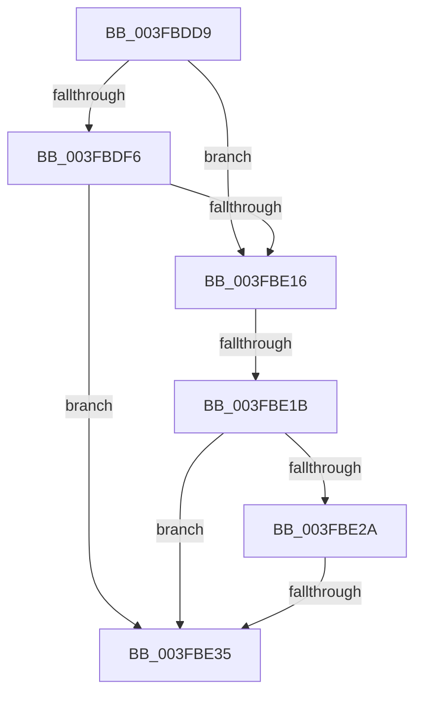

# sub_003FBDD9

- RVA: `0x003FBDD9`–`0x003FBE4B` (길이 `114` bytes)
- VA: `0x00000001403FBDD9`
- 실행 섹션: `.text`
- PDB 이름 있음: `아니요`; PDB Function 태그: `아니요`
- unwind 정보 RVA: `0x000997E8`
- 디코드: `34`개 명령, `114/114` bytes 표시
- 미해석 바이트: `0` (있으면 어셈블리에 `.byte`로 보존)

> 이 문서는 커널 이미지의 기계어와 PDB 기호를 분석해 생성했습니다. 4번과 5번은 함수 원형과 자료형을 바이너리 사용 방식에서 추정한 C 해석이며 원본 소스 복구 결과는 아닙니다.

## 1. Dependencies

- 직접 호출 지점: **1**; 고유 호출 대상: **1**
- 직접 호출자로 확인된 함수: **0**
- RIP 상대 이미지 참조: **0**

### Outgoing calls
- `0x003FBE08` → [memcmp](../6C/memcmp_function_006C6B10.md) (function, `0x006C6B10`)

### Direct callers
- 이 함수 시작 RVA로 연결되는 직접 call은 확인되지 않았습니다. 간접 호출은 완전히 역산할 수 없습니다.

### Static image references
- 디코드된 RIP-relative 메모리 참조가 없습니다.

## 2. Other-region calls and transfers

- 다른 실행 섹션으로 향하는 call: **0**
- call이 아닌 외부 분기/꼬리 이동: **3**
  - `0x003FBE19` → [sub_003FBE61](Unknown_function_003FBE61.md) (`tail-transfer`)
  - `0x003FBE33` → [sub_003FBE4B](Unknown_function_003FBE4B.md) (`tail-transfer`)
  - `0x003FBE46` → [RtlSidDominates + 0x6A](RtlSidDominates_function_003FBD50.md) (`tail-transfer`)

## 3. Assembly (complete function range)

```asm
003FBDD9  48 89 5C 24 50                  mov qword ptr [rsp + 0x50], rbx
003FBDDE  0F B7 D8                        movzx ebx, ax
003FBDE1  48 89 7C 24 58                  mov qword ptr [rsp + 0x58], rdi
003FBDE6  0F B7 F9                        movzx edi, cx
003FBDE9  66 C1 EF 08                     shr di, 8
003FBDED  66 C1 EB 08                     shr bx, 8
003FBDF1  66 3B C8                        cmp cx, ax
003FBDF4  75 20                           jne 0x1403fbe16
003FBDF6  44 0F B6 C7                     movzx r8d, dil
003FBDFA  48 8B D6                        mov rdx, rsi
003FBDFD  49 8B CE                        mov rcx, r14
003FBE00  4E 8D 04 85 08 00 00 00         lea r8, [r8*4 + 8]
003FBE08  E8 03 AD 2C 00                  call 0x1406c6b10
003FBE0D  85 C0                           test eax, eax
003FBE0F  0F 94 C0                        sete al
003FBE12  84 C0                           test al, al
003FBE14  75 1F                           jne 0x1403fbe35
003FBE16  40 84 FF                        test dil, dil
003FBE19  74 46                           je 0x1403fbe61
003FBE1B  40 0F B6 C7                     movzx eax, dil
003FBE1F  FF C8                           dec eax
003FBE21  41 8B 54 86 08                  mov edx, dword ptr [r14 + rax*4 + 8]
003FBE26  84 DB                           test bl, bl
003FBE28  74 0B                           je 0x1403fbe35
003FBE2A  0F B6 C3                        movzx eax, bl
003FBE2D  FF C8                           dec eax
003FBE2F  3B 54 86 08                     cmp edx, dword ptr [rsi + rax*4 + 8]
003FBE33  72 16                           jb 0x1403fbe4b
003FBE35  B0 01                           mov al, 1
003FBE37  48 8B 7C 24 58                  mov rdi, qword ptr [rsp + 0x58]
003FBE3C  48 8B 5C 24 50                  mov rbx, qword ptr [rsp + 0x50]
003FBE41  41 88 07                        mov byte ptr [r15], al
003FBE44  33 C0                           xor eax, eax
003FBE46  E9 6F FF FF FF                  jmp 0x1403fbdba
```

## 4. C-style interpretation (structured pseudocode)

```c
__int64 __fastcall sub_003FBDD9(unsigned __int16 a1, __int64 a2, __int64 a3, __int64 a4, __int64 a5, __int64 a6, __int64 a7, __int64 a8, __int64 a9, __int64 a10, __int64 a11)
{
    __int64 result;
    __int64 v_rbx;
    __int64 v_rdi;
    unsigned __int64 v_stack_p50;
    unsigned __int64 v_stack_p58;

    v_stack_p50 = v_rbx;
    v_stack_p58 = v_rdi;
    v_rdi = (unsigned __int16)((a1) >> (8));
    v_rbx = (unsigned __int16)(((unsigned __int16)(result)) >> (8));
    if (a1 != ((unsigned __int16)(result))) goto loc_003FBE16;
    result = memcmp(v_r14, v_rsi, (unsigned __int8)(v_rdi) * 4 + 8, a4);
    result = ((unsigned int)(result) == 0) ? 1 : 0;
    if ((unsigned __int8)(result) != 0) goto loc_003FBE35;
loc_003FBE16:
    result = (unsigned int)(((unsigned __int8)(v_rdi)) - 1);
    if ((unsigned __int8)(v_rbx) == 0) goto loc_003FBE35;
    result = (unsigned int)(((unsigned __int8)(v_rbx)) - 1);
loc_003FBE35:
    *(unsigned __int8 *)(v_r15) = 1;
    result = 0;
}
```

## 5. (Beta) C Style

```c
int64_t sub_003FBDD9(uint16_t Arg1, int64_t Arg2, int64_t Arg3, int64_t Arg4, uint64_t Arg5, uint64_t Arg6, uint64_t Arg7, uint64_t Arg8, uint64_t Arg9, int64_t Arg10, int64_t Arg11)
{
    int64_t result;
    int64_t local_rbx;
    int64_t local_rdi;
    uint64_t v_stack_p50;
    uint64_t v_stack_p58;

    v_stack_p50 = local_rbx;
    v_stack_p58 = local_rdi;
    local_rdi = (uint16_t)((Arg1) >> (8));
    local_rbx = (uint16_t)(((uint16_t)(result)) >> (8));
    if (Arg1 != ((uint16_t)(result))) goto loc_003FBE16;
    result = memcmp(local_r14, local_rsi, (uint8_t)(local_rdi) * 4 + 8, Arg4);
    result = ((uint32_t)(result) == 0) ? 1 : 0;
    if ((uint8_t)(result) != 0) goto loc_003FBE35;
loc_003FBE16:
    result = (uint32_t)(((uint8_t)(local_rdi)) - 1);
    if ((uint8_t)(local_rbx) == 0) goto loc_003FBE35;
    result = (uint32_t)(((uint8_t)(local_rbx)) - 1);
loc_003FBE35:
    *(uint8_t *)(local_r15) = 1;
    result = 0;
}
```

## 6. Execution-region graph

[열기: 2D/3D 그래프와 함수 탐색 컨트롤 패널](../../../control-panel.html?section=text&rva=0x003FBDD9&view=graph)

- 2D 그래프는 위에서 아래로 흐르고, 3D 그래프는 빈 공간을 드래그해 회전합니다. Shift+드래그는 이동, 휠은 확대·축소, 함수 노드 선택은 대상 보고서 이동입니다.

### Static fallback


