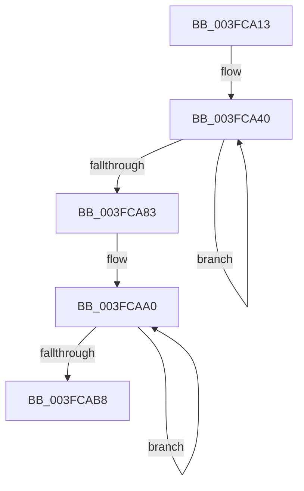

# sub_003FCA13

- RVA: `0x003FCA13`–`0x003FCAC0` (길이 `173` bytes)
- VA: `0x00000001403FCA13`
- 실행 섹션: `.text`
- PDB 이름 있음: `아니요`; PDB Function 태그: `아니요`
- unwind 정보 RVA: `0x000998E0`
- 디코드: `39`개 명령, `173/173` bytes 표시
- 미해석 바이트: `0` (있으면 어셈블리에 `.byte`로 보존)

> 이 문서는 커널 이미지의 기계어와 PDB 기호를 분석해 생성했습니다. 4번과 5번은 함수 원형과 자료형을 바이너리 사용 방식에서 추정한 C 해석이며 원본 소스 복구 결과는 아닙니다.

## 1. Dependencies

- 직접 호출 지점: **2**; 고유 호출 대상: **2**
- 직접 호출자로 확인된 함수: **0**
- RIP 상대 이미지 참조: **0**

### Outgoing calls
- `0x003FCA9B` → [EtwpLogKernelEvent](../25/EtwpLogKernelEvent_function_0025CC00.md) (function, `0x0025CC00`)
- `0x003FCAAB` → [ExpInterlockedPushEntrySList](../6B/ExpInterlockedPushEntrySList_function_006BA5B0.md) (function, `0x006BA5B0`)

### Direct callers
- 이 함수 시작 RVA로 연결되는 직접 call은 확인되지 않았습니다. 간접 호출은 완전히 역산할 수 없습니다.

### Static image references
- 디코드된 RIP-relative 메모리 참조가 없습니다.

## 2. Other-region calls and transfers

- 다른 실행 섹션으로 향하는 call: **0**
- 별도 외부 분기/꼬리 이동을 확인하지 못했습니다.

## 3. Assembly (complete function range)

```asm
003FCA13  48 89 BC 24 00 01 00 00         mov qword ptr [rsp + 0x100], rdi
003FCA1B  33 FF                           xor edi, edi
003FCA1D  48 C7 44 24 48 08 00 00 00      mov qword ptr [rsp + 0x48], 8
003FCA26  44 8B 00                        mov r8d, dword ptr [rax]
003FCA29  48 8B 90 50 05 00 00            mov rdx, qword ptr [rax + 0x550]
003FCA30  48 8D 44 24 30                  lea rax, [rsp + 0x30]
003FCA35  48 89 44 24 40                  mov qword ptr [rsp + 0x40], rax
003FCA3A  44 8D 5F 01                     lea r11d, [rdi + 1]
003FCA3E  66 90                           nop
003FCA40  41 8B 42 20                     mov eax, dword ptr [r10 + 0x20]
003FCA44  48 8D 4C 24 40                  lea rcx, [rsp + 0x40]
003FCA49  41 B9 20 00 00 00               mov r9d, 0x20
003FCA4F  41 3B C1                        cmp eax, r9d
003FCA52  44 0F 42 C8                     cmovb r9d, eax
003FCA56  41 0F B7 C3                     movzx eax, r11w
003FCA5A  48 C1 E0 04                     shl rax, 4
003FCA5E  66 41 FF C3                     inc r11w
003FCA62  48 03 C8                        add rcx, rax
003FCA65  49 8D 42 28                     lea rax, [r10 + 0x28]
003FCA69  48 89 01                        mov qword ptr [rcx], rax
003FCA6C  42 8D 04 CD 00 00 00 00         lea eax, [r9*8]
003FCA74  89 41 08                        mov dword ptr [rcx + 8], eax
003FCA77  89 79 0C                        mov dword ptr [rcx + 0xc], edi
003FCA7A  4D 8B 52 10                     mov r10, qword ptr [r10 + 0x10]
003FCA7E  4D 85 D2                        test r10, r10
003FCA81  75 BD                           jne 0x1403fca40
003FCA83  45 0F B7 CB                     movzx r9d, r11w
003FCA87  48 8D 4C 24 40                  lea rcx, [rsp + 0x40]
003FCA8C  C7 44 24 28 02 06 50 00         mov dword ptr [rsp + 0x28], 0x500602
003FCA94  66 C7 44 24 20 23 18            mov word ptr [rsp + 0x20], 0x1823
003FCA9B  E8 60 01 E6 FF                  call 0x14025cc00
003FCAA0  48 8B 7B 10                     mov rdi, qword ptr [rbx + 0x10]
003FCAA4  48 8D 4E 10                     lea rcx, [rsi + 0x10]
003FCAA8  48 8B D3                        mov rdx, rbx
003FCAAB  E8 00 DB 2B 00                  call 0x1406ba5b0
003FCAB0  48 8B DF                        mov rbx, rdi
003FCAB3  48 85 FF                        test rdi, rdi
003FCAB6  75 E8                           jne 0x1403fcaa0
003FCAB8  48 8B BC 24 00 01 00 00         mov rdi, qword ptr [rsp + 0x100]
```

## 4. C-style interpretation (structured pseudocode)

```c
__int64 __fastcall sub_003FCA13(__int64 a1, __int64 a2, __int64 a3, __int64 a4, __int64 a5, __int64 a6, __int64 a7, __int64 a8, __int64 a9, __int64 a10, __int64 a11, __int64 a12, __int64 a13, __int64 a14, __int64 a15, __int64 a16, __int64 a17, __int64 a18, __int64 a19, __int64 a20, __int64 a21, __int64 a22, __int64 a23, __int64 a24, __int64 a25, __int64 a26, __int64 a27, __int64 a28, __int64 a29, __int64 a30, __int64 a31, __int64 a32)
{
    __int64 result;
    __int64 v_r11;
    __int64 v_rdi;
    unsigned __int64 v_stack_p100;
    unsigned __int16 v_stack_p20;
    unsigned int v_stack_p28;
    unsigned __int64 v_stack_p40;
    unsigned __int64 v_stack_p48;

    v_stack_p100 = v_rdi;
    v_rdi = 0;
    v_stack_p48 = 8;
    v_stack_p40 = a6;
loc_003FCA40:
    a4 = 32;
    if (((unsigned int)((unsigned int)(*(unsigned int *)(v_r10 + 32)))) < 32) { a4 = (unsigned int)((unsigned int)(*(unsigned int *)(v_r10 + 32))); }
    result = ((unsigned __int16)(v_rdi + 1)) << (4);
    v_r11 = (unsigned __int16)((v_rdi + 1) + 1);
    a1 = (a8) + (result);
    *(unsigned __int64 *)(a1) = v_r10 + 40;
    *(unsigned int *)(a1 + 8) = (unsigned int)(a4 * 8);
    *(unsigned int *)(a1 + 12) = 0;
    if (*(unsigned __int64 *)(v_r10 + 16) != 0) goto loc_003FCA40;
    v_stack_p28 = 0x500602ULL;
    v_stack_p20 = 0x1823ULL;
    result = EtwpLogKernelEvent(a8, *(unsigned __int64 *)(result + 1360), (unsigned int)(*(unsigned int *)(result)), (unsigned __int16)(v_r11));
loc_003FCAA0:
    result = ExpInterlockedPushEntrySList(v_rsi + 16, v_rbx, (unsigned int)(*(unsigned int *)(result)), (unsigned __int16)(v_r11));
    if (*(unsigned __int64 *)(v_rbx + 16) != 0) goto loc_003FCAA0;
    return result;
}
```

## 5. (Beta) C Style

```c
int64_t sub_003FCA13(int64_t Arg1, int64_t Arg2, int64_t Arg3, int64_t Arg4, uint64_t Arg5, int64_t Arg6, uint64_t Arg7, int64_t Arg8, uint64_t Arg9, uint64_t Arg10, uint64_t Arg11, uint64_t Arg12, uint64_t Arg13, uint64_t Arg14, uint64_t Arg15, uint64_t Arg16, uint64_t Arg17, uint64_t Arg18, uint64_t Arg19, uint64_t Arg20, uint64_t Arg21, uint64_t Arg22, uint64_t Arg23, uint64_t Arg24, uint64_t Arg25, uint64_t Arg26, uint64_t Arg27, uint64_t Arg28, uint64_t Arg29, uint64_t Arg30, uint64_t Arg31, int64_t Arg32)
{
    int64_t result;
    int64_t local_r11;
    int64_t local_rdi;
    uint64_t v_stack_p100;
    uint16_t v_stack_p20;
    uint32_t v_stack_p28;
    uint64_t v_stack_p40;
    uint64_t v_stack_p48;

    v_stack_p100 = local_rdi;
    local_rdi = 0;
    v_stack_p48 = 8;
    v_stack_p40 = Arg6;
loc_003FCA40:
    Arg4 = 32;
    if (((uint32_t)((uint32_t)(*(uint32_t *)(local_r10 + 0x20)))) < 32) { Arg4 = (uint32_t)((uint32_t)(*(uint32_t *)(local_r10 + 0x20))); }
    result = ((uint16_t)(local_rdi + 1)) << (4);
    local_r11 = (uint16_t)((local_rdi + 1) + 1);
    Arg1 = (Arg8) + (result);
    *(uint64_t *)(Arg1) = local_r10 + 40;
    *(uint32_t *)(Arg1 + 0x8) = (uint32_t)(Arg4 * 8);
    *(uint32_t *)(Arg1 + 0xC) = 0;
    if (*(uint64_t *)(local_r10 + 0x10) != 0) goto loc_003FCA40;
    v_stack_p28 = 0x500602ULL;
    v_stack_p20 = 0x1823ULL;
    result = EtwpLogKernelEvent(Arg8, *(uint64_t *)(result + 0x550), (uint32_t)(*(uint32_t *)(result)), (uint16_t)(local_r11));
loc_003FCAA0:
    result = ExpInterlockedPushEntrySList(local_rsi + 16, local_rbx, (uint32_t)(*(uint32_t *)(result)), (uint16_t)(local_r11));
    if (*(uint64_t *)(local_rbx + 0x10) != 0) goto loc_003FCAA0;
    return result;
}
```

## 6. Execution-region graph

[열기: 2D/3D 그래프와 함수 탐색 컨트롤 패널](../../../control-panel.html?section=text&rva=0x003FCA13&view=graph)

- 2D 그래프는 위에서 아래로 흐르고, 3D 그래프는 빈 공간을 드래그해 회전합니다. Shift+드래그는 이동, 휠은 확대·축소, 함수 노드 선택은 대상 보고서 이동입니다.

### Static fallback


