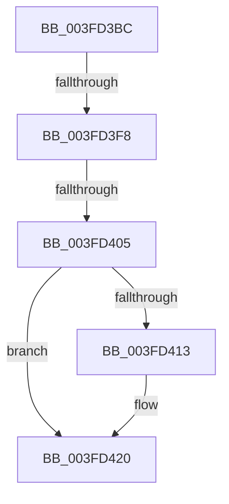

# sub_003FD3BC

- RVA: `0x003FD3BC`–`0x003FD43F` (길이 `131` bytes)
- VA: `0x00000001403FD3BC`
- 실행 섹션: `.text`
- PDB 이름 있음: `아니요`; PDB Function 태그: `아니요`
- unwind 정보 RVA: `0x000999DC`
- 디코드: `30`개 명령, `131/131` bytes 표시
- 미해석 바이트: `0` (있으면 어셈블리에 `.byte`로 보존)

> 이 문서는 커널 이미지의 기계어와 PDB 기호를 분석해 생성했습니다. 4번과 5번은 함수 원형과 자료형을 바이너리 사용 방식에서 추정한 C 해석이며 원본 소스 복구 결과는 아닙니다.

## 1. Dependencies

- 직접 호출 지점: **2**; 고유 호출 대상: **2**
- 직접 호출자로 확인된 함수: **0**
- RIP 상대 이미지 참조: **2**

### Outgoing calls
- `0x003FD3EB` → [KeAcquireSpinLockRaiseToDpc](../20/KeAcquireSpinLockRaiseToDpc_function_00208470.md) (function, `0x00208470`)
- `0x003FD41B` → [KiLowerIrqlProcessIrqlFlags](../4F/KiLowerIrqlProcessIrqlFlags_function_004F5698.md) (function, `0x004F5698`)

### Direct callers
- 이 함수 시작 RVA로 연결되는 직접 call은 확인되지 않았습니다. 간접 호출은 완전히 역산할 수 없습니다.

### Static image references
- `0x003FD3F8` → RVA `0x00FC6B06` (`ALMOSTRO`; read)
- `0x003FD40A` → RVA `0x00FC6D20` (`ALMOSTRO`; read)

## 2. Other-region calls and transfers

- 다른 실행 섹션으로 향하는 call: **0**
- call이 아닌 외부 분기/꼬리 이동: **3**
  - `0x003FD3F6` → [sub_003FD43F](Unknown_function_003FD43F.md) (`tail-transfer`)
  - `0x003FD3FF` → [sub_003FD43F + 0x77](Unknown_function_003FD43F.md) (`tail-transfer`)
  - `0x003FD43A` → [FsRtlFastCheckLockForRead + 0x24](FsRtlFastCheckLockForRead_function_003FD390.md) (`tail-transfer`)

## 3. Assembly (complete function range)

```asm
003FD3BC  48 89 6C 24 68                  mov qword ptr [rsp + 0x68], rbp
003FD3C1  48 89 74 24 70                  mov qword ptr [rsp + 0x70], rsi
003FD3C6  48 8D 73 18                     lea rsi, [rbx + 0x18]
003FD3CA  4C 89 74 24 78                  mov qword ptr [rsp + 0x78], r14
003FD3CF  48 8B CE                        mov rcx, rsi
003FD3D2  4C 8D 70 FF                     lea r14, [rax - 1]
003FD3D6  4C 89 7C 24 40                  mov qword ptr [rsp + 0x40], r15
003FD3DB  4C 8B 3A                        mov r15, qword ptr [rdx]
003FD3DE  4D 03 F7                        add r14, r15
003FD3E1  4C 89 7C 24 30                  mov qword ptr [rsp + 0x30], r15
003FD3E6  4C 89 74 24 60                  mov qword ptr [rsp + 0x60], r14
003FD3EB  E8 80 B0 E0 FF                  call 0x140208470
003FD3F0  0F B6 E8                        movzx ebp, al
003FD3F3  4C 3B 33                        cmp r14, qword ptr [rbx]
003FD3F6  73 47                           jae 0x1403fd43f
003FD3F8  F6 05 07 97 BC 00 01            test byte ptr [rip + 0xbc9707], 1
003FD3FF  0F 85 B1 00 00 00               jne 0x1403fd4b6
003FD405  F0 48 83 26 00                  lock and qword ptr [rsi], 0
003FD40A  83 3D 0F 99 BC 00 00            cmp dword ptr [rip + 0xbc990f], 0
003FD411  74 0D                           je 0x1403fd420
003FD413  40 0F B6 D5                     movzx edx, bpl
003FD417  44 0F 20 C1                     mov rcx, cr8
003FD41B  E8 78 82 0F 00                  call 0x1404f5698
003FD420  44 0F 22 C5                     mov cr8, rbp
003FD424  B0 01                           mov al, 1
003FD426  4C 8B 74 24 78                  mov r14, qword ptr [rsp + 0x78]
003FD42B  48 8B 74 24 70                  mov rsi, qword ptr [rsp + 0x70]
003FD430  48 8B 6C 24 68                  mov rbp, qword ptr [rsp + 0x68]
003FD435  4C 8B 7C 24 40                  mov r15, qword ptr [rsp + 0x40]
003FD43A  E9 75 FF FF FF                  jmp 0x1403fd3b4
```

## 4. C-style interpretation (structured pseudocode)

```c
__int64 __fastcall sub_003FD3BC(__int64 a1, __int64 a2, __int64 a3, __int64 a4, __int64 a5, __int64 a6, __int64 a7, __int64 a8, __int64 a9, __int64 a10, __int64 a11, __int64 a12, __int64 a13, __int64 a14, __int64 a15)
{
    __int64 result;
    __int64 v_r14;
    unsigned __int64 v_stack_p30;
    unsigned __int64 v_stack_p40;
    unsigned __int64 v_stack_p60;
    unsigned __int64 v_stack_p68;
    unsigned __int64 v_stack_p70;
    unsigned __int64 v_stack_p78;

    v_stack_p68 = v_rbp;
    v_stack_p70 = v_rsi;
    v_stack_p78 = v_r14;
    v_stack_p40 = v_r15;
    v_r14 = (result - 1) + (*(unsigned __int64 *)(a2));
    v_stack_p30 = *(unsigned __int64 *)(a2);
    v_stack_p60 = v_r14;
    result = KeAcquireSpinLockRaiseToDpc(v_rbx + 24, a2, a3, a4);
    if ((*(unsigned int *)(v_rip + 12359951)) != 0) {
        a2 = (unsigned __int8)((unsigned __int8)(result));
        a1 = v_cr8;
        result = KiLowerIrqlProcessIrqlFlags(a1, a2, a3, a4);
    }
}
```

## 5. (Beta) C Style

```c
int64_t sub_003FD3BC(int64_t Arg1, void *Arg2, int64_t Arg3, int64_t Arg4, uint64_t Arg5, uint64_t Arg6, uint64_t Arg7, int64_t Arg8, uint64_t Arg9, uint64_t Arg10, uint64_t Arg11, uint64_t Arg12, int64_t Arg13, int64_t Arg14, int64_t Arg15)
{
    uint8_t *arg2 = (uint8_t *)Arg2;

    int64_t result;
    int64_t local_r14;
    uint64_t v_stack_p30;
    uint64_t v_stack_p40;
    uint64_t v_stack_p60;
    uint64_t v_stack_p68;
    uint64_t v_stack_p70;
    uint64_t v_stack_p78;

    v_stack_p68 = local_rbp;
    v_stack_p70 = local_rsi;
    v_stack_p78 = local_r14;
    v_stack_p40 = local_r15;
    local_r14 = (result - 1) + (*(uint64_t *)(arg2));
    v_stack_p30 = *(uint64_t *)(arg2);
    v_stack_p60 = local_r14;
    result = KeAcquireSpinLockRaiseToDpc(local_rbx + 24, Arg2, Arg3, Arg4);
    if ((*(uint32_t *)(v_rip + 0xBC990F)) != 0) {
        Arg2 = (uint8_t)((uint8_t)(result));
        Arg1 = v_cr8;
        result = KiLowerIrqlProcessIrqlFlags(Arg1, Arg2, Arg3, Arg4);
    }
}
```

### 관측된 메모리 오프셋

구조체 형식이 확인되지 않은 접근은 인자 기준의 오프셋으로만 기록했습니다.

| 기준 인자 | 오프셋 표현 | 폭 (bit) | 접근 |
|---|---:|---:|---|
| `Arg2` | `+ 0x0` | `64` | `R` |

## 6. Execution-region graph

[열기: 2D/3D 그래프와 함수 탐색 컨트롤 패널](../../../control-panel.html?section=text&rva=0x003FD3BC&view=graph)

- 2D 그래프는 위에서 아래로 흐르고, 3D 그래프는 빈 공간을 드래그해 회전합니다. Shift+드래그는 이동, 휠은 확대·축소, 함수 노드 선택은 대상 보고서 이동입니다.

### Static fallback


