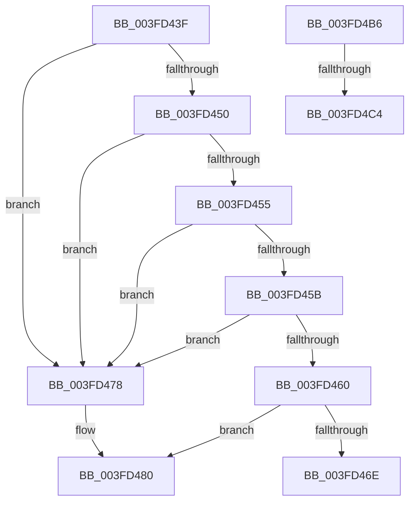

# sub_003FD43F

- RVA: `0x003FD43F`–`0x003FD4D6` (길이 `151` bytes)
- VA: `0x00000001403FD43F`
- 실행 섹션: `.text`
- PDB 이름 있음: `아니요`; PDB Function 태그: `아니요`
- unwind 정보 RVA: `0x000999FC`
- 디코드: `37`개 명령, `151/151` bytes 표시
- 미해석 바이트: `0` (있으면 어셈블리에 `.byte`로 보존)

> 이 문서는 커널 이미지의 기계어와 PDB 기호를 분석해 생성했습니다. 4번과 5번은 함수 원형과 자료형을 바이너리 사용 방식에서 추정한 C 해석이며 원본 소스 복구 결과는 아닙니다.

## 1. Dependencies

- 직접 호출 지점: **4**; 고유 호출 대상: **4**
- 직접 호출자로 확인된 함수: **0**
- RIP 상대 이미지 참조: **1**

### Outgoing calls
- `0x003FD471` → [KxReleaseSpinLock](../20/KxReleaseSpinLock_function_00206670.md) (function, `0x00206670`)
- `0x003FD49A` → [FsRtlCheckNoExclusiveConflict](../38/FsRtlCheckNoExclusiveConflict_function_0038FA54.md) (function, `0x0038FA54`)
- `0x003FD4A9` → [KeReleaseSpinLock](../39/KeReleaseSpinLock_function_00392BA0.md) (function, `0x00392BA0`)
- `0x003FD4CC` → [KiReleaseSpinLockInstrumented](../39/KiReleaseSpinLockInstrumented_function_00392EF0.md) (function, `0x00392EF0`)

### Direct callers
- 이 함수 시작 RVA로 연결되는 직접 call은 확인되지 않았습니다. 간접 호출은 완전히 역산할 수 없습니다.

### Static image references
- `0x003FD4B6` → RVA `0x00F0DE58` (`.data`; read)

## 2. Other-region calls and transfers

- 다른 실행 섹션으로 향하는 call: **0**
- call이 아닌 외부 분기/꼬리 이동: **4**
  - `0x003FD476` → [sub_003FD3BC + 0x4E](Unknown_function_003FD3BC.md) (`tail-transfer`)
  - `0x003FD4B1` → [sub_003FD3BC + 0x6A](Unknown_function_003FD3BC.md) (`tail-transfer`)
  - `0x003FD4BE` → [sub_003FD3BC + 0x49](Unknown_function_003FD3BC.md) (`tail-transfer`)
  - `0x003FD4D1` → [sub_003FD3BC + 0x4E](Unknown_function_003FD3BC.md) (`tail-transfer`)

## 3. Assembly (complete function range)

```asm
003FD43F  48 8B 94 24 80 00 00 00         mov rdx, qword ptr [rsp + 0x80]
003FD447  48 8B 42 78                     mov rax, qword ptr [rdx + 0x78]
003FD44B  48 85 C0                        test rax, rax
003FD44E  74 28                           je 0x1403fd478
003FD450  4C 3B 38                        cmp r15, qword ptr [rax]
003FD453  72 23                           jb 0x1403fd478
003FD455  4C 3B 70 28                     cmp r14, qword ptr [rax + 0x28]
003FD459  77 1D                           ja 0x1403fd478
003FD45B  39 78 14                        cmp dword ptr [rax + 0x14], edi
003FD45E  75 18                           jne 0x1403fd478
003FD460  48 8B 8C 24 88 00 00 00         mov rcx, qword ptr [rsp + 0x88]
003FD468  48 39 48 20                     cmp qword ptr [rax + 0x20], rcx
003FD46C  75 12                           jne 0x1403fd480
003FD46E  48 8B CE                        mov rcx, rsi
003FD471  E8 FA 91 E0 FF                  call 0x140206670
003FD476  EB 92                           jmp 0x1403fd40a
003FD478  48 8B 8C 24 88 00 00 00         mov rcx, qword ptr [rsp + 0x88]
003FD480  48 89 4C 24 28                  mov qword ptr [rsp + 0x28], rcx
003FD485  4C 8D 44 24 60                  lea r8, [rsp + 0x60]
003FD48A  48 89 54 24 20                  mov qword ptr [rsp + 0x20], rdx
003FD48F  44 8B CF                        mov r9d, edi
003FD492  48 8D 54 24 30                  lea rdx, [rsp + 0x30]
003FD497  48 8B CE                        mov rcx, rsi
003FD49A  E8 B5 25 F9 FF                  call 0x14038fa54
003FD49F  40 0F B6 D5                     movzx edx, bpl
003FD4A3  48 8B CE                        mov rcx, rsi
003FD4A6  0F B6 D8                        movzx ebx, al
003FD4A9  E8 F2 56 F9 FF                  call 0x140392ba0
003FD4AE  0F B6 C3                        movzx eax, bl
003FD4B1  E9 70 FF FF FF                  jmp 0x1403fd426
003FD4B6  8B 15 9C 09 B1 00               mov edx, dword ptr [rip + 0xb1099c]
003FD4BC  85 D2                           test edx, edx
003FD4BE  0F 85 41 FF FF FF               jne 0x1403fd405
003FD4C4  48 8B 54 24 58                  mov rdx, qword ptr [rsp + 0x58]
003FD4C9  48 8B CE                        mov rcx, rsi
003FD4CC  E8 1F 5A F9 FF                  call 0x140392ef0
003FD4D1  E9 34 FF FF FF                  jmp 0x1403fd40a
```

## 4. C-style interpretation (structured pseudocode)

```c
__int64 __fastcall sub_003FD43F(__int64 a1, __int64 a2, __int64 a3, __int64 a4, __int64 a5, __int64 a6, __int64 a7, __int64 a8, __int64 a9, __int64 a10, __int64 a11, __int64 a12, __int64 a13, __int64 a14, __int64 a15, __int64 a16, __int64 a17)
{
    __int64 result;
    unsigned __int64 v_stack_p20;
    unsigned __int64 v_stack_p28;
    unsigned __int64 v_stack_p58;

    if (*(unsigned __int64 *)(a16 + 120) == 0) goto loc_003FD478;
    if (v_r15 < (*(unsigned __int64 *)(*(unsigned __int64 *)(a16 + 120)))) goto loc_003FD478;
    if (v_r14 > (*(unsigned __int64 *)(*(unsigned __int64 *)(a16 + 120) + 40))) goto loc_003FD478;
    if ((*(unsigned int *)(*(unsigned __int64 *)(a16 + 120) + 20)) != ((unsigned int)(v_rdi))) goto loc_003FD478;
    if ((*(unsigned __int64 *)(*(unsigned __int64 *)(a16 + 120) + 32)) != a17) goto loc_003FD480;
    result = KxReleaseSpinLock(v_rsi, a16, a3, a4);
loc_003FD478:
loc_003FD480:
    v_stack_p28 = a17;
    v_stack_p20 = a16;
    result = FsRtlCheckNoExclusiveConflict(v_rsi, a6, a12, (unsigned int)((unsigned int)(v_rdi)));
    result = KeReleaseSpinLock(v_rsi, (unsigned __int8)(v_rbp), a12, (unsigned int)((unsigned int)(v_rdi)));
}
```

## 5. (Beta) C Style

```c
int64_t sub_003FD43F(int64_t Arg1, int64_t Arg2, int64_t Arg3, int64_t Arg4, uint64_t Arg5, int64_t Arg6, uint64_t Arg7, uint64_t Arg8, uint64_t Arg9, uint64_t Arg10, uint64_t Arg11, int64_t Arg12, uint64_t Arg13, uint64_t Arg14, uint64_t Arg15, void *Arg16, int64_t Arg17)
{
    uint8_t *arg16 = (uint8_t *)Arg16;

    int64_t result;
    uint64_t v_stack_p20;
    uint64_t v_stack_p28;
    uint64_t v_stack_p58;

    if (*(uint64_t *)(arg16 + 0x78) == 0) goto loc_003FD478;
    if (local_r15 < (*(uint64_t *)(*(uint64_t *)(arg16 + 0x78)))) goto loc_003FD478;
    if (local_r14 > (*(uint64_t *)(*(uint64_t *)(arg16 + 0x78) + 0x28))) goto loc_003FD478;
    if ((*(uint32_t *)(*(uint64_t *)(arg16 + 0x78) + 0x14)) != ((uint32_t)(local_rdi))) goto loc_003FD478;
    if ((*(uint64_t *)(*(uint64_t *)(arg16 + 0x78) + 0x20)) != Arg17) goto loc_003FD480;
    result = KxReleaseSpinLock(local_rsi, Arg16, Arg3, Arg4);
loc_003FD478:
loc_003FD480:
    v_stack_p28 = Arg17;
    v_stack_p20 = Arg16;
    result = FsRtlCheckNoExclusiveConflict(local_rsi, Arg6, Arg12, (uint32_t)((uint32_t)(local_rdi)));
    result = KeReleaseSpinLock(local_rsi, (uint8_t)(local_rbp), Arg12, (uint32_t)((uint32_t)(local_rdi)));
}
```

### 관측된 메모리 오프셋

구조체 형식이 확인되지 않은 접근은 인자 기준의 오프셋으로만 기록했습니다.

| 기준 인자 | 오프셋 표현 | 폭 (bit) | 접근 |
|---|---:|---:|---|
| `Arg16` | `+ 0x78` | `64` | `R` |

## 6. Execution-region graph

[열기: 2D/3D 그래프와 함수 탐색 컨트롤 패널](../../../control-panel.html?section=text&rva=0x003FD43F&view=graph)

- 2D 그래프는 위에서 아래로 흐르고, 3D 그래프는 빈 공간을 드래그해 회전합니다. Shift+드래그는 이동, 휠은 확대·축소, 함수 노드 선택은 대상 보고서 이동입니다.

### Static fallback


