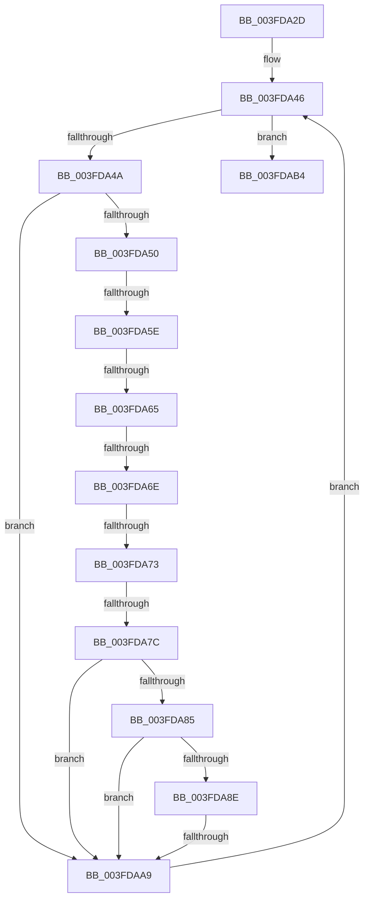

# sub_003FDA2D

- RVA: `0x003FDA2D`–`0x003FDACB` (길이 `158` bytes)
- VA: `0x00000001403FDA2D`
- 실행 섹션: `.text`
- PDB 이름 있음: `아니요`; PDB Function 태그: `아니요`
- unwind 정보 RVA: `0x00099AD4`
- 디코드: `47`개 명령, `158/158` bytes 표시
- 미해석 바이트: `0` (있으면 어셈블리에 `.byte`로 보존)

> 이 문서는 커널 이미지의 기계어와 PDB 기호를 분석해 생성했습니다. 4번과 5번은 함수 원형과 자료형을 바이너리 사용 방식에서 추정한 C 해석이며 원본 소스 복구 결과는 아닙니다.

## 1. Dependencies

- 직접 호출 지점: **1**; 고유 호출 대상: **1**
- 직접 호출자로 확인된 함수: **0**
- RIP 상대 이미지 참조: **0**

### Outgoing calls
- `0x003FDAA0` → [memcmp](../6C/memcmp_function_006C6B10.md) (function, `0x006C6B10`)

### Direct callers
- 이 함수 시작 RVA로 연결되는 직접 call은 확인되지 않았습니다. 간접 호출은 완전히 역산할 수 없습니다.

### Static image references
- 디코드된 RIP-relative 메모리 참조가 없습니다.

## 2. Other-region calls and transfers

- 다른 실행 섹션으로 향하는 call: **0**
- call이 아닌 외부 분기/꼬리 이동: **6**
  - `0x003FDA58` → [sub_003FDADF](Unknown_function_003FDADF.md) (`tail-transfer`)
  - `0x003FDA63` → [sub_003FDADF](Unknown_function_003FDADF.md) (`tail-transfer`)
  - `0x003FDA68` → [sub_003FDADF + 0x1F](Unknown_function_003FDADF.md) (`tail-transfer`)
  - `0x003FDA71` → [sub_003FDACC + 0x4](Unknown_function_003FDACC.md) (`tail-transfer`)
  - `0x003FDA76` → [sub_003FDADF + 0x24](Unknown_function_003FDADF.md) (`tail-transfer`)
  - `0x003FDAA7` → [sub_003FDACC](Unknown_function_003FDACC.md) (`tail-transfer`)

## 3. Assembly (complete function range)

```asm
003FDA2D  48 89 5C 24 30                  mov qword ptr [rsp + 0x30], rbx
003FDA32  48 8D 59 08                     lea rbx, [rcx + 8]
003FDA36  48 89 74 24 38                  mov qword ptr [rsp + 0x38], rsi
003FDA3B  0F B7 71 04                     movzx esi, word ptr [rcx + 4]
003FDA3F  48 89 7C 24 40                  mov qword ptr [rsp + 0x40], rdi
003FDA44  33 FF                           xor edi, edi
003FDA46  3B FE                           cmp edi, esi
003FDA48  73 6A                           jae 0x1403fdab4
003FDA4A  F6 43 01 08                     test byte ptr [rbx + 1], 8
003FDA4E  75 59                           jne 0x1403fdaa9
003FDA50  0F B6 0B                        movzx ecx, byte ptr [rbx]
003FDA53  8D 41 FB                        lea eax, [rcx - 5]
003FDA56  3C 03                           cmp al, 3
003FDA58  0F 86 81 00 00 00               jbe 0x1403fdadf
003FDA5E  8D 41 F5                        lea eax, [rcx - 0xb]
003FDA61  3C 01                           cmp al, 1
003FDA63  76 7A                           jbe 0x1403fdadf
003FDA65  80 F9 0F                        cmp cl, 0xf
003FDA68  0F 83 90 00 00 00               jae 0x1403fdafe
003FDA6E  80 F9 04                        cmp cl, 4
003FDA71  74 5D                           je 0x1403fdad0
003FDA73  80 F9 0B                        cmp cl, 0xb
003FDA76  0F 83 87 00 00 00               jae 0x1403fdb03
003FDA7C  48 8D 4B 08                     lea rcx, [rbx + 8]
003FDA80  48 85 C9                        test rcx, rcx
003FDA83  74 24                           je 0x1403fdaa9
003FDA85  0F B7 01                        movzx eax, word ptr [rcx]
003FDA88  66 3B 45 00                     cmp ax, word ptr [rbp]
003FDA8C  75 1B                           jne 0x1403fdaa9
003FDA8E  44 8B C0                        mov r8d, eax
003FDA91  48 8B D5                        mov rdx, rbp
003FDA94  49 C1 E8 08                     shr r8, 8
003FDA98  4E 8D 04 85 08 00 00 00         lea r8, [r8*4 + 8]
003FDAA0  E8 6B 90 2C 00                  call 0x1406c6b10
003FDAA5  85 C0                           test eax, eax
003FDAA7  74 23                           je 0x1403fdacc
003FDAA9  0F B7 43 02                     movzx eax, word ptr [rbx + 2]
003FDAAD  FF C7                           inc edi
003FDAAF  48 03 D8                        add rbx, rax
003FDAB2  EB 92                           jmp 0x1403fda46
003FDAB4  32 C0                           xor al, al
003FDAB6  48 8B 74 24 38                  mov rsi, qword ptr [rsp + 0x38]
003FDABB  48 8B 5C 24 30                  mov rbx, qword ptr [rsp + 0x30]
003FDAC0  48 8B 7C 24 40                  mov rdi, qword ptr [rsp + 0x40]
003FDAC5  48 83 C4 20                     add rsp, 0x20
003FDAC9  5D                              pop rbp
003FDACA  C3                              ret
```

## 4. C-style interpretation (structured pseudocode)

```c
__int64 __fastcall sub_003FDA2D(__int64 a1, __int64 a2, __int64 a3, __int64 a4, __int64 a5, __int64 a6, __int64 a7, __int64 a8)
{
    __int64 result;
    __int64 v_rbx;
    __int64 v_rdi;
    __int64 v_rsp;
    unsigned __int64 v_stack_p30;
    unsigned __int64 v_stack_p38;
    unsigned __int64 v_stack_p40;

    v_stack_p30 = v_rbx;
    v_stack_p38 = v_rsi;
    v_stack_p40 = v_rdi;
    v_rdi = 0;
loc_003FDA46:
    if (0 >= ((unsigned int)(*(unsigned __int16 *)(a1 + 4)))) goto loc_003FDAB4;
    if (((*(unsigned __int8 *)(a1 + 8 + 1)) & (8)) != 0) goto loc_003FDAA9;
    if (a1 + 8 + 8 == 0) goto loc_003FDAA9;
    if (((unsigned __int16)(*(unsigned __int16 *)(a1 + 8 + 8))) != (*(unsigned __int16 *)(v_rbp))) goto loc_003FDAA9;
    a3 = ((unsigned int)((unsigned int)(*(unsigned __int16 *)(a1 + 8 + 8)))) >> (8);
    result = memcmp(a1 + 8 + 8, v_rbp, a3 * 4 + 8, a4);
loc_003FDAA9:
    v_rdi = (unsigned int)((v_rdi) + 1);
    v_rbx = (a1 + 8) + (*(unsigned __int16 *)(a1 + 8 + 2));
    goto loc_003FDA46;
loc_003FDAB4:
    result = 0;
    v_rsp = (v_rsp) + (32);
    return result;
}
```

## 5. (Beta) C Style

```c
int64_t sub_003FDA2D(void *Arg1, int64_t Arg2, int64_t Arg3, int64_t Arg4, uint64_t Arg5, int64_t Arg6, int64_t Arg7, int64_t Arg8)
{
    uint8_t *arg1 = (uint8_t *)Arg1;

    int64_t result;
    int64_t local_rbx;
    int64_t local_rdi;
    int64_t local_rsp;
    uint64_t v_stack_p30;
    uint64_t v_stack_p38;
    uint64_t v_stack_p40;

    v_stack_p30 = local_rbx;
    v_stack_p38 = local_rsi;
    v_stack_p40 = local_rdi;
    local_rdi = 0;
loc_003FDA46:
    if (0 >= ((uint32_t)(*(uint16_t *)(arg1 + 0x4)))) goto loc_003FDAB4;
    if (((*(uint8_t *)(arg1 + 0x8 + 0x1)) & (8)) != 0) goto loc_003FDAA9;
    if (Arg1 + 8 + 8 == 0) goto loc_003FDAA9;
    if (((uint16_t)(*(uint16_t *)(arg1 + 0x8 + 0x8))) != (*(uint16_t *)(local_rbp))) goto loc_003FDAA9;
    Arg3 = ((uint32_t)((uint32_t)(*(uint16_t *)(arg1 + 0x8 + 0x8)))) >> (8);
    result = memcmp(Arg1 + 8 + 8, local_rbp, Arg3 * 4 + 8, Arg4);
loc_003FDAA9:
    local_rdi = (uint32_t)((local_rdi) + 1);
    local_rbx = (Arg1 + 8) + (*(uint16_t *)(arg1 + 0x8 + 0x2));
    goto loc_003FDA46;
loc_003FDAB4:
    result = 0;
    local_rsp = (local_rsp) + (32);
    return result;
}
```

### 관측된 메모리 오프셋

구조체 형식이 확인되지 않은 접근은 인자 기준의 오프셋으로만 기록했습니다.

| 기준 인자 | 오프셋 표현 | 폭 (bit) | 접근 |
|---|---:|---:|---|
| `Arg1` | `+ 0x0` | `8` | `R` |
| `Arg1` | `+ 0x1` | `8` | `R` |
| `Arg1` | `+ 0x2` | `16` | `R` |
| `Arg1` | `+ 0x4` | `16` | `R` |
| `Arg1` | `+ 0x8` | `64` | `R` |

## 6. Execution-region graph

[열기: 2D/3D 그래프와 함수 탐색 컨트롤 패널](../../../control-panel.html?section=text&rva=0x003FDA2D&view=graph)

- 2D 그래프는 위에서 아래로 흐르고, 3D 그래프는 빈 공간을 드래그해 회전합니다. Shift+드래그는 이동, 휠은 확대·축소, 함수 노드 선택은 대상 보고서 이동입니다.

### Static fallback


