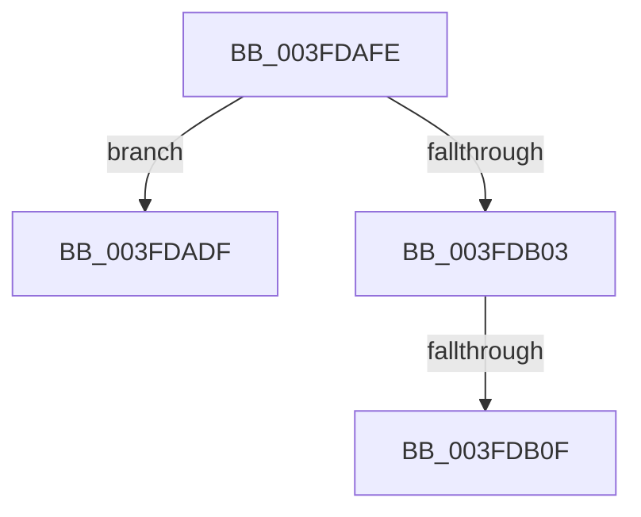

# sub_003FDADF

- RVA: `0x003FDADF`–`0x003FDB11` (길이 `50` bytes)
- VA: `0x00000001403FDADF`
- 실행 섹션: `.text`
- PDB 이름 있음: `아니요`; PDB Function 태그: `아니요`
- unwind 정보 RVA: `0x00099B34`
- 디코드: `16`개 명령, `50/50` bytes 표시
- 미해석 바이트: `0` (있으면 어셈블리에 `.byte`로 보존)

> 이 문서는 커널 이미지의 기계어와 PDB 기호를 분석해 생성했습니다. 4번과 5번은 함수 원형과 자료형을 바이너리 사용 방식에서 추정한 C 해석이며 원본 소스 복구 결과는 아닙니다.

## 1. Dependencies

- 직접 호출 지점: **0**; 고유 호출 대상: **0**
- 직접 호출자로 확인된 함수: **0**
- RIP 상대 이미지 참조: **0**

### Outgoing calls
- 직접 디코드된 call 명령이 없습니다.

### Direct callers
- 이 함수 시작 RVA로 연결되는 직접 call은 확인되지 않았습니다. 간접 호출은 완전히 역산할 수 없습니다.

### Static image references
- 디코드된 RIP-relative 메모리 참조가 없습니다.

## 2. Other-region calls and transfers

- 다른 실행 섹션으로 향하는 call: **0**
- call이 아닌 외부 분기/꼬리 이동: **3**
  - `0x003FDAFC` → [sub_003FDA2D + 0x53](Unknown_function_003FDA2D.md) (`tail-transfer`)
  - `0x003FDB09` → [sub_003FDA2D + 0x4F](Unknown_function_003FDA2D.md) (`tail-transfer`)
  - `0x003FDB0F` → [sub_003FDA2D + 0x7C](Unknown_function_003FDA2D.md) (`tail-transfer`)

## 3. Assembly (complete function range)

```asm
003FDADF  8B 4B 08                        mov ecx, dword ptr [rbx + 8]
003FDAE2  8B C1                           mov eax, ecx
003FDAE4  83 E0 02                        and eax, 2
003FDAE7  83 E1 01                        and ecx, 1
003FDAEA  48 C1 E0 03                     shl rax, 3
003FDAEE  48 83 C8 0C                     or rax, 0xc
003FDAF2  48 C1 E1 04                     shl rcx, 4
003FDAF6  48 03 C3                        add rax, rbx
003FDAF9  48 03 C8                        add rcx, rax
003FDAFC  EB 82                           jmp 0x1403fda80
003FDAFE  80 F9 10                        cmp cl, 0x10
003FDB01  76 DC                           jbe 0x1403fdadf
003FDB03  80 E9 0D                        sub cl, 0xd
003FDB06  80 F9 01                        cmp cl, 1
003FDB09  0F 86 6D FF FF FF               jbe 0x1403fda7c
003FDB0F  EB 98                           jmp 0x1403fdaa9
```

## 4. C-style interpretation (structured pseudocode)

```c
__int64 __fastcall sub_003FDADF(void)
{
    __int64 result;

    result = (unsigned int)(((unsigned int)((unsigned int)((unsigned int)(*(unsigned int *)(v_rbx + 8))))) & (2));
    a1 = (unsigned int)(((unsigned int)(*(unsigned int *)(v_rbx + 8))) & (1));
    result = (result) << (3);
    result = (result) | (12);
    a1 = (a1) << (4);
    result = (result) + (v_rbx);
    a1 = (a1) + (result);
}
```

## 5. (Beta) C Style

```c
void sub_003FDADF(void)
{
    int64_t result;

    result = (uint32_t)(((uint32_t)((uint32_t)((uint32_t)(*(uint32_t *)(local_rbx + 0x8))))) & (2));
    a1 = (uint32_t)(((uint32_t)(*(uint32_t *)(local_rbx + 0x8))) & (1));
    result = (result) << (3);
    result = (result) | (12);
    a1 = (a1) << (4);
    result = (result) + (local_rbx);
    a1 = (a1) + (result);
}
```

## 6. Execution-region graph

[열기: 2D/3D 그래프와 함수 탐색 컨트롤 패널](../../../control-panel.html?section=text&rva=0x003FDADF&view=graph)

- 2D 그래프는 위에서 아래로 흐르고, 3D 그래프는 빈 공간을 드래그해 회전합니다. Shift+드래그는 이동, 휠은 확대·축소, 함수 노드 선택은 대상 보고서 이동입니다.

### Static fallback


