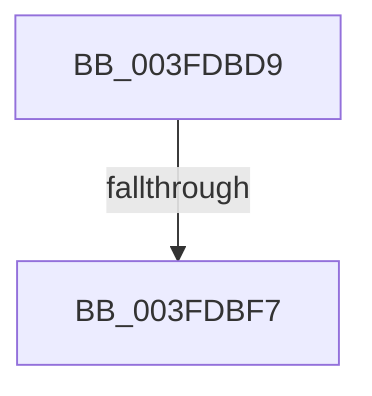

# sub_003FDBD9

- RVA: `0x003FDBD9`–`0x003FDC19` (길이 `64` bytes)
- VA: `0x00000001403FDBD9`
- 실행 섹션: `.text`
- PDB 이름 있음: `아니요`; PDB Function 태그: `아니요`
- unwind 정보 RVA: `0x00099CE0`
- 디코드: `14`개 명령, `64/64` bytes 표시
- 미해석 바이트: `0` (있으면 어셈블리에 `.byte`로 보존)

> 이 문서는 커널 이미지의 기계어와 PDB 기호를 분석해 생성했습니다. 4번과 5번은 함수 원형과 자료형을 바이너리 사용 방식에서 추정한 C 해석이며 원본 소스 복구 결과는 아닙니다.

## 1. Dependencies

- 직접 호출 지점: **0**; 고유 호출 대상: **0**
- 직접 호출자로 확인된 함수: **0**
- RIP 상대 이미지 참조: **3**

### Outgoing calls
- 직접 디코드된 call 명령이 없습니다.

### Direct callers
- 이 함수 시작 RVA로 연결되는 직접 call은 확인되지 않았습니다. 간접 호출은 완전히 역산할 수 없습니다.

### Static image references
- `0x003FDBE8` → RVA `0x00F8F9A0` (`.data`; read)
- `0x003FDBF7` → RVA `0x00E0A841` (`.data`; read)
- `0x003FDC07` → RVA `0x00E0A843` (`.data`; read)

## 2. Other-region calls and transfers

- 다른 실행 섹션으로 향하는 call: **0**
- call이 아닌 외부 분기/꼬리 이동: **2**
  - `0x003FDBF1` → [sub_003FDD7A](Unknown_function_003FDD7A.md) (`tail-transfer`)
  - `0x003FDC13` → [sub_003FDCC3](Unknown_function_003FDCC3.md) (`tail-transfer`)

## 3. Assembly (complete function range)

```asm
003FDBD9  48 89 6C 24 30                  mov qword ptr [rsp + 0x30], rbp
003FDBDE  48 89 74 24 38                  mov qword ptr [rsp + 0x38], rsi
003FDBE3  48 89 7C 24 48                  mov qword ptr [rsp + 0x48], rdi
003FDBE8  8B 3D B2 1D B9 00               mov edi, dword ptr [rip + 0xb91db2]
003FDBEE  83 FF 01                        cmp edi, 1
003FDBF1  0F 84 83 01 00 00               je 0x1403fdd7a
003FDBF7  0F B6 05 43 CC A0 00            movzx eax, byte ptr [rip + 0xa0cc43]
003FDBFE  BE 3F 00 00 00                  mov esi, 0x3f
003FDC03  8B EE                           mov ebp, esi
003FDC05  2B E8                           sub ebp, eax
003FDC07  0F B6 05 35 CC A0 00            movzx eax, byte ptr [rip + 0xa0cc35]
003FDC0E  2B F0                           sub esi, eax
003FDC10  45 85 E4                        test r12d, r12d
003FDC13  0F 84 AA 00 00 00               je 0x1403fdcc3
```

## 4. C-style interpretation (structured pseudocode)

```c
__int64 __fastcall sub_003FDBD9(void)
{
    __int64 v_rbp;
    __int64 v_rsi;
    unsigned __int64 v_stack_p30;
    unsigned __int64 v_stack_p38;
    unsigned __int64 v_stack_p48;

    v_stack_p30 = v_rbp;
    v_stack_p38 = v_rsi;
    v_stack_p48 = v_rdi;
    v_rbp = (unsigned int)((63) - ((unsigned int)(*(unsigned __int8 *)(v_rip + 10538051))));
    v_rsi = (unsigned int)((63) - ((unsigned int)(*(unsigned __int8 *)(v_rip + 10538037))));
}
```

## 5. (Beta) C Style

```c
void sub_003FDBD9(void)
{
    int64_t local_rbp;
    int64_t local_rsi;
    uint64_t v_stack_p30;
    uint64_t v_stack_p38;
    uint64_t v_stack_p48;

    v_stack_p30 = local_rbp;
    v_stack_p38 = local_rsi;
    v_stack_p48 = local_rdi;
    local_rbp = (uint32_t)((63) - ((uint32_t)(*(uint8_t *)(v_rip + 0xA0CC43))));
    local_rsi = (uint32_t)((63) - ((uint32_t)(*(uint8_t *)(v_rip + 0xA0CC35))));
}
```

## 6. Execution-region graph

[열기: 2D/3D 그래프와 함수 탐색 컨트롤 패널](../../../control-panel.html?section=text&rva=0x003FDBD9&view=graph)

- 2D 그래프는 위에서 아래로 흐르고, 3D 그래프는 빈 공간을 드래그해 회전합니다. Shift+드래그는 이동, 휠은 확대·축소, 함수 노드 선택은 대상 보고서 이동입니다.

### Static fallback


