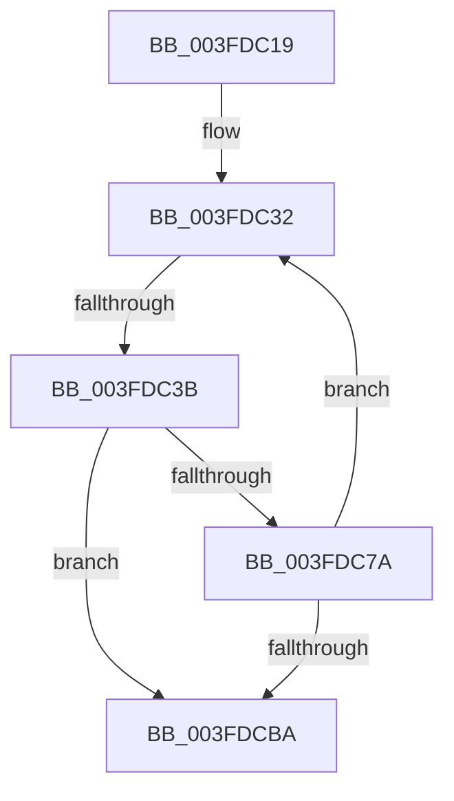

# sub_003FDC19

- RVA: `0x003FDC19`–`0x003FDCC3` (길이 `170` bytes)
- VA: `0x00000001403FDC19`
- 실행 섹션: `.text`
- PDB 이름 있음: `아니요`; PDB Function 태그: `아니요`
- unwind 정보 RVA: `0x00099CFC`
- 디코드: `45`개 명령, `170/170` bytes 표시
- 미해석 바이트: `0` (있으면 어셈블리에 `.byte`로 보존)

> 이 문서는 커널 이미지의 기계어와 PDB 기호를 분석해 생성했습니다. 4번과 5번은 함수 원형과 자료형을 바이너리 사용 방식에서 추정한 C 해석이며 원본 소스 복구 결과는 아닙니다.

## 1. Dependencies

- 직접 호출 지점: **0**; 고유 호출 대상: **0**
- 직접 호출자로 확인된 함수: **0**
- RIP 상대 이미지 참조: **0**

### Outgoing calls
- 직접 디코드된 call 명령이 없습니다.

### Direct callers
- 이 함수 시작 RVA로 연결되는 직접 call은 확인되지 않았습니다. 간접 호출은 완전히 역산할 수 없습니다.

### Static image references
- 디코드된 RIP-relative 메모리 참조가 없습니다.

## 2. Other-region calls and transfers

- 다른 실행 섹션으로 향하는 call: **0**
- call이 아닌 외부 분기/꼬리 이동: **1**
  - `0x003FDC35` → [sub_003FDCE2](Unknown_function_003FDCE2.md) (`tail-transfer`)

## 3. Assembly (complete function range)

```asm
003FDC19  4C 89 34 24                     mov qword ptr [rsp], r14
003FDC1D  41 B8 00 16 00 00               mov r8d, 0x1600
003FDC23  41 BE 01 03 01 C0               mov r14d, 0xc0010301
003FDC29  4C 89 6C 24 08                  mov qword ptr [rsp + 8], r13
003FDC2E  49 83 C2 10                     add r10, 0x10
003FDC32  83 FF 02                        cmp edi, 2
003FDC35  0F 85 A7 00 00 00               jne 0x1403fdce2
003FDC3B  41 8D 88 00 FF FF FF            lea ecx, [r8 - 0x100]
003FDC42  0F 32                           rdmsr
003FDC44  48 C1 E2 20                     shl rdx, 0x20
003FDC48  41 8B C8                        mov ecx, r8d
003FDC4B  48 0B C2                        or rax, rdx
003FDC4E  4C 8B C8                        mov r9, rax
003FDC51  0F 32                           rdmsr
003FDC53  48 C1 E2 20                     shl rdx, 0x20
003FDC57  41 8D 88 00 FC FF FF            lea ecx, [r8 - 0x400]
003FDC5E  48 0B C2                        or rax, rdx
003FDC61  48 8B D8                        mov rbx, rax
003FDC64  0F 32                           rdmsr
003FDC66  48 C1 E2 20                     shl rdx, 0x20
003FDC6A  48 0B C2                        or rax, rdx
003FDC6D  4C 8B D8                        mov r11, rax
003FDC70  48 8B 54 24 40                  mov rdx, qword ptr [rsp + 0x40]
003FDC75  4D 85 C9                        test r9, r9
003FDC78  74 40                           je 0x1403fdcba
003FDC7A  8B CD                           mov ecx, ebp
003FDC7C  4D 89 1A                        mov qword ptr [r10], r11
003FDC7F  41 FF C0                        inc r8d
003FDC82  49 8B C1                        mov rax, r9
003FDC85  48 D3 E0                        shl rax, cl
003FDC88  41 83 C6 02                     add r14d, 2
003FDC8C  48 D3 F8                        sar rax, cl
003FDC8F  8B CE                           mov ecx, esi
003FDC91  49 89 42 F0                     mov qword ptr [r10 - 0x10], rax
003FDC95  48 8B C3                        mov rax, rbx
003FDC98  48 D3 E0                        shl rax, cl
003FDC9B  48 D3 F8                        sar rax, cl
003FDC9E  49 89 42 F8                     mov qword ptr [r10 - 8], rax
003FDCA2  49 83 C2 18                     add r10, 0x18
003FDCA6  41 83 07 18                     add dword ptr [r15], 0x18
003FDCAA  41 8D 80 00 EA FF FF            lea eax, [r8 - 0x1600]
003FDCB1  41 3B C4                        cmp eax, r12d
003FDCB4  0F 82 78 FF FF FF               jb 0x1403fdc32
003FDCBA  4C 8B 6C 24 08                  mov r13, qword ptr [rsp + 8]
003FDCBF  4C 8B 34 24                     mov r14, qword ptr [rsp]
```

## 4. C-style interpretation (structured pseudocode)

```c
__int64 __fastcall sub_003FDC19(__int64 a1, __int64 a2, __int64 a3, __int64 a4, __int64 a5, __int64 a6, __int64 a7, __int64 a8)
{
    __int64 result;
    __int64 v_r10;
    __int64 v_r14;
    unsigned __int64 v_stack_p0;
    unsigned __int64 v_stack_p8;

    v_stack_p0 = v_r14;
    v_stack_p8 = v_r13;
    v_r10 = (v_r10) + (16);
loc_003FDC32:
    a2 = (a2) << (32);
    result = (result) | (a2);
    a2 = (a2) << (32);
    result = (result) | (a2);
    a2 = (a2) << (32);
    result = (result) | (a2);
    if (result == 0) goto loc_003FDCBA;
    *(unsigned __int64 *)(v_r10) = result;
    a3 = (unsigned int)(((unsigned int)(0x1600ULL)) + 1);
    result = (result) << ((unsigned __int8)((unsigned int)((unsigned int)(v_rbp))));
    v_r14 = (unsigned int)(((unsigned int)(0xC0010301ULL)) + (2));
    result = (result) >> ((unsigned __int8)((unsigned int)((unsigned int)(v_rbp))));
    *(unsigned __int64 *)(v_r10 - 16) = result;
    result = (result) << ((unsigned __int8)((unsigned int)((unsigned int)(v_rsi))));
    result = (result) >> ((unsigned __int8)((unsigned int)((unsigned int)(v_rsi))));
    *(unsigned __int64 *)(v_r10 - 8) = result;
    v_r10 = (v_r10) + (24);
    if (((unsigned int)(a3 - 5632)) < ((unsigned int)(v_r12))) goto loc_003FDC32;
loc_003FDCBA:
    return a3 - 5632;
}
```

## 5. (Beta) C Style

```c
int64_t sub_003FDC19(int64_t Arg1, int64_t Arg2, int64_t Arg3, int64_t Arg4, uint64_t Arg5, uint64_t Arg6, uint64_t Arg7, int64_t Arg8)
{
    int64_t result;
    int64_t local_r10;
    int64_t local_r14;
    uint64_t v_stack_p0;
    uint64_t v_stack_p8;

    v_stack_p0 = local_r14;
    v_stack_p8 = local_r13;
    local_r10 = (local_r10) + (16);
loc_003FDC32:
    Arg2 = (Arg2) << (32);
    result = (result) | (Arg2);
    Arg2 = (Arg2) << (32);
    result = (result) | (Arg2);
    Arg2 = (Arg2) << (32);
    result = (result) | (Arg2);
    if (result == 0) goto loc_003FDCBA;
    *(uint64_t *)(local_r10) = result;
    Arg3 = (uint32_t)(((uint32_t)(0x1600ULL)) + 1);
    result = (result) << ((uint8_t)((uint32_t)((uint32_t)(local_rbp))));
    local_r14 = (uint32_t)(((uint32_t)(0xC0010301ULL)) + (2));
    result = (result) >> ((uint8_t)((uint32_t)((uint32_t)(local_rbp))));
    *(uint64_t *)(local_r10 - 0x10) = result;
    result = (result) << ((uint8_t)((uint32_t)((uint32_t)(local_rsi))));
    result = (result) >> ((uint8_t)((uint32_t)((uint32_t)(local_rsi))));
    *(uint64_t *)(local_r10 - 0x8) = result;
    local_r10 = (local_r10) + (24);
    if (((uint32_t)(Arg3 - 5632)) < ((uint32_t)(local_r12))) goto loc_003FDC32;
loc_003FDCBA:
    return Arg3 - 5632;
}
```

## 6. Execution-region graph

[열기: 2D/3D 그래프와 함수 탐색 컨트롤 패널](../../../control-panel.html?section=text&rva=0x003FDC19&view=graph)

- 2D 그래프는 위에서 아래로 흐르고, 3D 그래프는 빈 공간을 드래그해 회전합니다. Shift+드래그는 이동, 휠은 확대·축소, 함수 노드 선택은 대상 보고서 이동입니다.

### Static fallback


