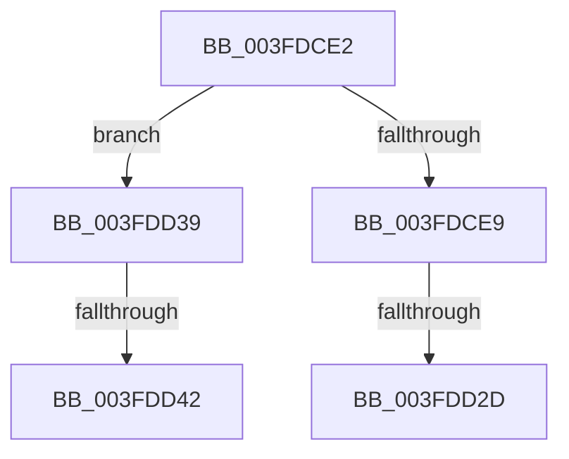

# sub_003FDCE2

- RVA: `0x003FDCE2`–`0x003FDD66` (길이 `132` bytes)
- VA: `0x00000001403FDCE2`
- 실행 섹션: `.text`
- PDB 이름 있음: `아니요`; PDB Function 태그: `아니요`
- unwind 정보 RVA: `0x00099D48`
- 디코드: `36`개 명령, `132/132` bytes 표시
- 미해석 바이트: `0` (있으면 어셈블리에 `.byte`로 보존)

> 이 문서는 커널 이미지의 기계어와 PDB 기호를 분석해 생성했습니다. 4번과 5번은 함수 원형과 자료형을 바이너리 사용 방식에서 추정한 C 해석이며 원본 소스 복구 결과는 아닙니다.

## 1. Dependencies

- 직접 호출 지점: **0**; 고유 호출 대상: **0**
- 직접 호출자로 확인된 함수: **0**
- RIP 상대 이미지 참조: **1**

### Outgoing calls
- 직접 디코드된 call 명령이 없습니다.

### Direct callers
- 이 함수 시작 RVA로 연결되는 직접 call은 확인되지 않았습니다. 간접 호출은 완전히 역산할 수 없습니다.

### Static image references
- `0x003FDD1D` → RVA `0x00E11810` (`.data`; read)

## 2. Other-region calls and transfers

- 다른 실행 섹션으로 향하는 call: **0**
- call이 아닌 외부 분기/꼬리 이동: **4**
  - `0x003FDD27` → [sub_003FDC19 + 0x57](Unknown_function_003FDC19.md) (`tail-transfer`)
  - `0x003FDD34` → [sub_003FDC19 + 0x4B](Unknown_function_003FDC19.md) (`tail-transfer`)
  - `0x003FDD3C` → [sub_003FDC19 + 0x5C](Unknown_function_003FDC19.md) (`tail-transfer`)
  - `0x003FDD61` → [sub_003FDC19 + 0x57](Unknown_function_003FDC19.md) (`tail-transfer`)

## 3. Assembly (complete function range)

```asm
003FDCE2  8B CF                           mov ecx, edi
003FDCE4  83 E9 01                        sub ecx, 1
003FDCE7  75 50                           jne 0x1403fdd39
003FDCE9  8B C2                           mov eax, edx
003FDCEB  33 D2                           xor edx, edx
003FDCED  41 2B C0                        sub eax, r8d
003FDCF0  05 00 16 00 00                  add eax, 0x1600
003FDCF5  41 F7 F4                        div r12d
003FDCF8  44 8B EA                        mov r13d, edx
003FDCFB  8D 8A 80 06 00 00               lea ecx, [rdx + 0x680]
003FDD01  0F 32                           rdmsr
003FDD03  48 C1 E2 20                     shl rdx, 0x20
003FDD07  41 8D 8D C0 06 00 00            lea ecx, [r13 + 0x6c0]
003FDD0E  48 0B C2                        or rax, rdx
003FDD11  4C 8B C8                        mov r9, rax
003FDD14  0F 32                           rdmsr
003FDD16  48 C1 E2 20                     shl rdx, 0x20
003FDD1A  48 0B C2                        or rax, rdx
003FDD1D  80 3D EC 3A A1 00 00            cmp byte ptr [rip + 0xa13aec], 0
003FDD24  48 8B D8                        mov rbx, rax
003FDD27  0F 84 43 FF FF FF               je 0x1403fdc70
003FDD2D  41 8D 8D C0 0D 00 00            lea ecx, [r13 + 0xdc0]
003FDD34  E9 2B FF FF FF                  jmp 0x1403fdc64
003FDD39  83 F9 02                        cmp ecx, 2
003FDD3C  0F 85 33 FF FF FF               jne 0x1403fdc75
003FDD42  41 8D 4E FF                     lea ecx, [r14 - 1]
003FDD46  0F 32                           rdmsr
003FDD48  48 C1 E2 20                     shl rdx, 0x20
003FDD4C  41 8B CE                        mov ecx, r14d
003FDD4F  48 0B C2                        or rax, rdx
003FDD52  4C 8B C8                        mov r9, rax
003FDD55  0F 32                           rdmsr
003FDD57  48 C1 E2 20                     shl rdx, 0x20
003FDD5B  48 0B C2                        or rax, rdx
003FDD5E  48 8B D8                        mov rbx, rax
003FDD61  E9 0A FF FF FF                  jmp 0x1403fdc70
```

## 4. C-style interpretation (structured pseudocode)

```c
__int64 __fastcall sub_003FDCE2(__int64 a1, int a2, int a3)
{
    __int64 result;

    a1 = (unsigned int)(((unsigned int)((unsigned int)(v_rdi))) - (1));
    if (condition_is_not_equal) goto loc_003FDD39;
    a2 = 0;
    result = (unsigned int)(((unsigned int)(a2)) - (a3));
    result = (unsigned int)((result) + (0x1600ULL));
    a2 = (a2) << (32);
    result = (result) | (a2);
    a2 = (a2) << (32);
    result = (result) | (a2);
loc_003FDD39:
    a2 = (a2) << (32);
    result = (result) | (a2);
    a2 = (a2) << (32);
    result = (result) | (a2);
}
```

## 5. (Beta) C Style

```c
int64_t sub_003FDCE2(int64_t Arg1, int32_t Arg2, int32_t Arg3)
{
    int64_t result;

    Arg1 = (uint32_t)(((uint32_t)((uint32_t)(local_rdi))) - (1));
    if (condition_is_not_equal) goto loc_003FDD39;
    Arg2 = 0;
    result = (uint32_t)(((uint32_t)(Arg2)) - (Arg3));
    result = (uint32_t)((result) + (0x1600ULL));
    Arg2 = (Arg2) << (32);
    result = (result) | (Arg2);
    Arg2 = (Arg2) << (32);
    result = (result) | (Arg2);
loc_003FDD39:
    Arg2 = (Arg2) << (32);
    result = (result) | (Arg2);
    Arg2 = (Arg2) << (32);
    result = (result) | (Arg2);
}
```

## 6. Execution-region graph

[열기: 2D/3D 그래프와 함수 탐색 컨트롤 패널](../../../control-panel.html?section=text&rva=0x003FDCE2&view=graph)

- 2D 그래프는 위에서 아래로 흐르고, 3D 그래프는 빈 공간을 드래그해 회전합니다. Shift+드래그는 이동, 휠은 확대·축소, 함수 노드 선택은 대상 보고서 이동입니다.

### Static fallback


