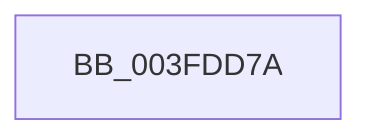

# sub_003FDD7A

- RVA: `0x003FDD7A`–`0x003FDD99` (길이 `31` bytes)
- VA: `0x00000001403FDD7A`
- 실행 섹션: `.text`
- PDB 이름 있음: `아니요`; PDB Function 태그: `아니요`
- unwind 정보 RVA: `0x00099D94`
- 디코드: `8`개 명령, `31/31` bytes 표시
- 미해석 바이트: `0` (있으면 어셈블리에 `.byte`로 보존)

> 이 문서는 커널 이미지의 기계어와 PDB 기호를 분석해 생성했습니다. 4번과 5번은 함수 원형과 자료형을 바이너리 사용 방식에서 추정한 C 해석이며 원본 소스 복구 결과는 아닙니다.

## 1. Dependencies

- 직접 호출 지점: **0**; 고유 호출 대상: **0**
- 직접 호출자로 확인된 함수: **0**
- RIP 상대 이미지 참조: **0**

### Outgoing calls
- 직접 디코드된 call 명령이 없습니다.

### Direct callers
- 이 함수 시작 RVA로 연결되는 직접 call은 확인되지 않았습니다. 간접 호출은 완전히 역산할 수 없습니다.

### Static image references
- 디코드된 RIP-relative 메모리 참조가 없습니다.

## 2. Other-region calls and transfers

- 다른 실행 섹션으로 향하는 call: **0**
- call이 아닌 외부 분기/꼬리 이동: **1**
  - `0x003FDD94` → [sub_003FDBD9 + 0x1E](Unknown_function_003FDBD9.md) (`tail-transfer`)

## 3. Assembly (complete function range)

```asm
003FDD7A  B9 C9 01 00 00                  mov ecx, 0x1c9
003FDD7F  0F 32                           rdmsr
003FDD81  48 C1 E2 20                     shl rdx, 0x20
003FDD85  48 0B D0                        or rdx, rax
003FDD88  41 8D 44 24 FF                  lea eax, [r12 - 1]
003FDD8D  23 D0                           and edx, eax
003FDD8F  48 89 54 24 40                  mov qword ptr [rsp + 0x40], rdx
003FDD94  E9 5E FE FF FF                  jmp 0x1403fdbf7
```

## 4. C-style interpretation (structured pseudocode)

```c
__int64 __fastcall sub_003FDD7A(__int64 a1, __int64 a2)
{
    unsigned __int64 v_stack_p40;

    a2 = (a2) << (32);
    a2 = (a2) | (result);
    a2 = (unsigned int)((a2) & ((unsigned int)(v_r12 - 1)));
    v_stack_p40 = a2;
}
```

## 5. (Beta) C Style

```c
int64_t sub_003FDD7A(int64_t Arg1, int64_t Arg2)
{
    uint64_t v_stack_p40;

    Arg2 = (Arg2) << (32);
    Arg2 = (Arg2) | (result);
    Arg2 = (uint32_t)((Arg2) & ((uint32_t)(local_r12 - 1)));
    v_stack_p40 = Arg2;
}
```

## 6. Execution-region graph

[열기: 2D/3D 그래프와 함수 탐색 컨트롤 패널](../../../control-panel.html?section=text&rva=0x003FDD7A&view=graph)

- 2D 그래프는 위에서 아래로 흐르고, 3D 그래프는 빈 공간을 드래그해 회전합니다. Shift+드래그는 이동, 휠은 확대·축소, 함수 노드 선택은 대상 보고서 이동입니다.

### Static fallback


