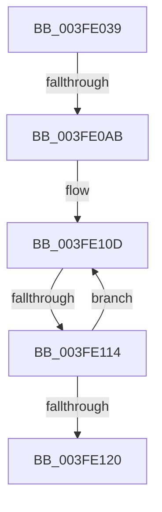

# sub_003FE039

- RVA: `0x003FE039`–`0x003FE14C` (길이 `275` bytes)
- VA: `0x00000001403FE039`
- 실행 섹션: `.text`
- PDB 이름 있음: `아니요`; PDB Function 태그: `아니요`
- unwind 정보 RVA: `0x00099DD8`
- 디코드: `76`개 명령, `275/275` bytes 표시
- 미해석 바이트: `0` (있으면 어셈블리에 `.byte`로 보존)

> 이 문서는 커널 이미지의 기계어와 PDB 기호를 분석해 생성했습니다. 4번과 5번은 함수 원형과 자료형을 바이너리 사용 방식에서 추정한 C 해석이며 원본 소스 복구 결과는 아닙니다.

## 1. Dependencies

- 직접 호출 지점: **0**; 고유 호출 대상: **0**
- 직접 호출자로 확인된 함수: **0**
- RIP 상대 이미지 참조: **0**

### Outgoing calls
- 직접 디코드된 call 명령이 없습니다.

### Direct callers
- 이 함수 시작 RVA로 연결되는 직접 call은 확인되지 않았습니다. 간접 호출은 완전히 역산할 수 없습니다.

### Static image references
- 디코드된 RIP-relative 메모리 참조가 없습니다.

## 2. Other-region calls and transfers

- 다른 실행 섹션으로 향하는 call: **0**
- call이 아닌 외부 분기/꼬리 이동: **2**
  - `0x003FE0A5` → [sub_003FE14D](Unknown_function_003FE14D.md) (`tail-transfer`)
  - `0x003FE112` → [sub_003FE14D](Unknown_function_003FE14D.md) (`tail-transfer`)

## 3. Assembly (complete function range)

```asm
003FE039  48 89 5C 24 20                  mov qword ptr [rsp + 0x20], rbx
003FE03E  49 C7 C2 FF FF FF FF            mov r10, 0xffffffffffffffff
003FE045  41 8B 5B 04                     mov ebx, dword ptr [r11 + 4]
003FE049  8B CB                           mov ecx, ebx
003FE04B  48 89 6C 24 28                  mov qword ptr [rsp + 0x28], rbp
003FE050  83 E1 1F                        and ecx, 0x1f
003FE053  48 89 74 24 30                  mov qword ptr [rsp + 0x30], rsi
003FE058  4C 89 64 24 38                  mov qword ptr [rsp + 0x38], r12
003FE05D  4C 89 74 24 08                  mov qword ptr [rsp + 8], r14
003FE062  49 D3 E2                        shl r10, cl
003FE065  4C 89 3C 24                     mov qword ptr [rsp], r15
003FE069  4D 8B CA                        mov r9, r10
003FE06C  4C 23 CA                        and r9, rdx
003FE06F  C1 EB 05                        shr ebx, 5
003FE072  49 8B F1                        mov rsi, r9
003FE075  4D 8B C1                        mov r8, r9
003FE078  49 8B E9                        mov rbp, r9
003FE07B  48 C1 EE 38                     shr rsi, 0x38
003FE07F  4D 8B F1                        mov r14, r9
003FE082  49 C1 E8 30                     shr r8, 0x30
003FE086  4D 8B F9                        mov r15, r9
003FE089  48 C1 ED 28                     shr rbp, 0x28
003FE08D  4D 8B E1                        mov r12, r9
003FE090  49 C1 EE 20                     shr r14, 0x20
003FE094  49 8B D1                        mov rdx, r9
003FE097  49 C1 EF 18                     shr r15, 0x18
003FE09B  49 C1 EC 10                     shr r12, 0x10
003FE09F  48 C1 EA 08                     shr rdx, 8
003FE0A3  85 DB                           test ebx, ebx
003FE0A5  0F 84 A2 00 00 00               je 0x1403fe14d
003FE0AB  41 0F B6 C1                     movzx eax, r9b
003FE0AF  48 05 CB 5D B1 00               add rax, 0xb15dcb
003FE0B5  48 6B C8 25                     imul rcx, rax, 0x25
003FE0B9  0F B6 C2                        movzx eax, dl
003FE0BC  48 03 C8                        add rcx, rax
003FE0BF  41 0F B6 C4                     movzx eax, r12b
003FE0C3  48 6B D1 25                     imul rdx, rcx, 0x25
003FE0C7  48 03 D0                        add rdx, rax
003FE0CA  41 0F B6 C7                     movzx eax, r15b
003FE0CE  48 6B CA 25                     imul rcx, rdx, 0x25
003FE0D2  48 03 C8                        add rcx, rax
003FE0D5  41 0F B6 C6                     movzx eax, r14b
003FE0D9  48 6B D1 25                     imul rdx, rcx, 0x25
003FE0DD  48 03 D0                        add rdx, rax
003FE0E0  40 0F B6 C5                     movzx eax, bpl
003FE0E4  48 6B CA 25                     imul rcx, rdx, 0x25
003FE0E8  48 03 C8                        add rcx, rax
003FE0EB  41 0F B6 C0                     movzx eax, r8b
003FE0EF  48 6B D1 25                     imul rdx, rcx, 0x25
003FE0F3  8D 4B FF                        lea ecx, [rbx - 1]
003FE0F6  48 03 D0                        add rdx, rax
003FE0F9  48 6B C2 25                     imul rax, rdx, 0x25
003FE0FD  48 03 C6                        add rax, rsi
003FE100  8B C0                           mov eax, eax
003FE102  48 23 C8                        and rcx, rax
003FE105  49 8B 43 08                     mov rax, qword ptr [r11 + 8]
003FE109  48 8D 04 C8                     lea rax, [rax + rcx*8]
003FE10D  48 8B 00                        mov rax, qword ptr [rax]
003FE110  A8 01                           test al, 1
003FE112  75 39                           jne 0x1403fe14d
003FE114  48 8B 48 08                     mov rcx, qword ptr [rax + 8]
003FE118  49 23 CA                        and rcx, r10
003FE11B  4C 3B C9                        cmp r9, rcx
003FE11E  75 ED                           jne 0x1403fe10d
003FE120  48 8B 48 10                     mov rcx, qword ptr [rax + 0x10]
003FE124  B0 01                           mov al, 1
003FE126  48 89 0F                        mov qword ptr [rdi], rcx
003FE129  4C 8B 3C 24                     mov r15, qword ptr [rsp]
003FE12D  4C 8B 74 24 08                  mov r14, qword ptr [rsp + 8]
003FE132  4C 8B 64 24 38                  mov r12, qword ptr [rsp + 0x38]
003FE137  48 8B 74 24 30                  mov rsi, qword ptr [rsp + 0x30]
003FE13C  48 8B 6C 24 28                  mov rbp, qword ptr [rsp + 0x28]
003FE141  48 8B 5C 24 20                  mov rbx, qword ptr [rsp + 0x20]
003FE146  48 83 C4 10                     add rsp, 0x10
003FE14A  5F                              pop rdi
003FE14B  C3                              ret
```

## 4. C-style interpretation (structured pseudocode)

```c
__int64 __fastcall sub_003FE039(__int64 a1, __int64 a2, __int64 a3, __int64 a4, __int64 a5, __int64 a6, __int64 a7)
{
    __int64 result;
    __int64 v_r10;
    __int64 v_r12;
    __int64 v_r14;
    __int64 v_r15;
    __int64 v_rbp;
    __int64 v_rbx;
    __int64 v_rsi;
    __int64 v_rsp;
    unsigned __int64 v_stack_p0;
    unsigned __int64 v_stack_p20;
    unsigned __int64 v_stack_p28;
    unsigned __int64 v_stack_p30;
    unsigned __int64 v_stack_p38;
    unsigned __int64 v_stack_p8;

    v_stack_p20 = v_rbx;
    v_stack_p28 = v_rbp;
    a1 = (unsigned int)(((unsigned int)((unsigned int)((unsigned int)(*(unsigned int *)(v_r11 + 4))))) & (31));
    v_stack_p30 = v_rsi;
    v_stack_p38 = v_r12;
    v_stack_p8 = v_r14;
    v_r10 = (-1) << ((unsigned __int8)(a1));
    v_stack_p0 = v_r15;
    a4 = (v_r10) & (a2);
    v_rbx = (unsigned int)(((unsigned int)(*(unsigned int *)(v_r11 + 4))) >> (5));
    v_rsi = (a4) >> (56);
    a3 = (a4) >> (48);
    v_rbp = (a4) >> (40);
    v_r14 = (a4) >> (32);
    v_r15 = (a4) >> (24);
    v_r12 = (a4) >> (16);
    a2 = (a4) >> (8);
    result = ((unsigned __int8)(a4)) + (0xB15DCBULL);
    a1 = (a1) * (result);
    a1 = (a1) + ((unsigned __int8)(a2));
    a2 = (a2) * (a1);
    a2 = (a2) + ((unsigned __int8)(v_r12));
    a1 = (a1) * (a2);
    a1 = (a1) + ((unsigned __int8)(v_r15));
    a2 = (a2) * (a1);
    a2 = (a2) + ((unsigned __int8)(v_r14));
    a1 = (a1) * (a2);
    a1 = (a1) + ((unsigned __int8)(v_rbp));
    a2 = (a2) * (a1);
    a2 = (a2) + ((unsigned __int8)(a3));
    result = ((unsigned __int8)(a3)) * (a2);
    result = (result) + (v_rsi);
    a1 = (v_rbx - 1) & ((unsigned int)((unsigned int)(result)));
loc_003FE10D:
    a1 = (*(unsigned __int64 *)(*(unsigned __int64 *)(*(unsigned __int64 *)(v_r11 + 8) + a1 * 8) + 8)) & (v_r10);
    if (a4 != a1) goto loc_003FE10D;
    *(unsigned __int64 *)(v_rdi) = *(unsigned __int64 *)(*(unsigned __int64 *)(*(unsigned __int64 *)(v_r11 + 8) + a1 * 8) + 16);
    v_rsp = (v_rsp) + (16);
    return 1;
}
```

## 5. (Beta) C Style

```c
int64_t sub_003FE039(int64_t Arg1, int64_t Arg2, int64_t Arg3, int64_t Arg4, int64_t Arg5, int64_t Arg6, int64_t Arg7)
{
    int64_t result;
    int64_t local_r10;
    int64_t local_r12;
    int64_t local_r14;
    int64_t local_r15;
    int64_t local_rbp;
    int64_t local_rbx;
    int64_t local_rsi;
    int64_t local_rsp;
    uint64_t v_stack_p0;
    uint64_t v_stack_p20;
    uint64_t v_stack_p28;
    uint64_t v_stack_p30;
    uint64_t v_stack_p38;
    uint64_t v_stack_p8;

    v_stack_p20 = local_rbx;
    v_stack_p28 = local_rbp;
    Arg1 = (uint32_t)(((uint32_t)((uint32_t)((uint32_t)(*(uint32_t *)(local_r11 + 0x4))))) & (31));
    v_stack_p30 = local_rsi;
    v_stack_p38 = local_r12;
    v_stack_p8 = local_r14;
    local_r10 = (-1) << ((uint8_t)(Arg1));
    v_stack_p0 = local_r15;
    Arg4 = (local_r10) & (Arg2);
    local_rbx = (uint32_t)(((uint32_t)(*(uint32_t *)(local_r11 + 0x4))) >> (5));
    local_rsi = (Arg4) >> (56);
    Arg3 = (Arg4) >> (48);
    local_rbp = (Arg4) >> (40);
    local_r14 = (Arg4) >> (32);
    local_r15 = (Arg4) >> (24);
    local_r12 = (Arg4) >> (16);
    Arg2 = (Arg4) >> (8);
    result = ((uint8_t)(Arg4)) + (0xB15DCBULL);
    Arg1 = (Arg1) * (result);
    Arg1 = (Arg1) + ((uint8_t)(Arg2));
    Arg2 = (Arg2) * (Arg1);
    Arg2 = (Arg2) + ((uint8_t)(local_r12));
    Arg1 = (Arg1) * (Arg2);
    Arg1 = (Arg1) + ((uint8_t)(local_r15));
    Arg2 = (Arg2) * (Arg1);
    Arg2 = (Arg2) + ((uint8_t)(local_r14));
    Arg1 = (Arg1) * (Arg2);
    Arg1 = (Arg1) + ((uint8_t)(local_rbp));
    Arg2 = (Arg2) * (Arg1);
    Arg2 = (Arg2) + ((uint8_t)(Arg3));
    result = ((uint8_t)(Arg3)) * (Arg2);
    result = (result) + (local_rsi);
    Arg1 = (local_rbx - 1) & ((uint32_t)((uint32_t)(result)));
loc_003FE10D:
    Arg1 = (*(uint64_t *)(*(uint64_t *)(*(uint64_t *)(local_r11 + 0x8) + Arg1 * 8) + 0x8)) & (local_r10);
    if (Arg4 != Arg1) goto loc_003FE10D;
    *(uint64_t *)(local_rdi) = *(uint64_t *)(*(uint64_t *)(*(uint64_t *)(local_r11 + 0x8) + Arg1 * 8) + 0x10);
    local_rsp = (local_rsp) + (16);
    return 1;
}
```

## 6. Execution-region graph

[열기: 2D/3D 그래프와 함수 탐색 컨트롤 패널](../../../control-panel.html?section=text&rva=0x003FE039&view=graph)

- 2D 그래프는 위에서 아래로 흐르고, 3D 그래프는 빈 공간을 드래그해 회전합니다. Shift+드래그는 이동, 휠은 확대·축소, 함수 노드 선택은 대상 보고서 이동입니다.

### Static fallback


