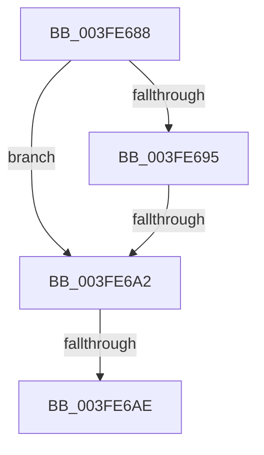

# sub_003FE688

- RVA: `0x003FE688`–`0x003FE6C2` (길이 `58` bytes)
- VA: `0x00000001403FE688`
- 실행 섹션: `.text`
- PDB 이름 있음: `아니요`; PDB Function 태그: `아니요`
- unwind 정보 RVA: `0x00099ED4`
- 디코드: `13`개 명령, `58/58` bytes 표시
- 미해석 바이트: `0` (있으면 어셈블리에 `.byte`로 보존)

> 이 문서는 커널 이미지의 기계어와 PDB 기호를 분석해 생성했습니다. 4번과 5번은 함수 원형과 자료형을 바이너리 사용 방식에서 추정한 C 해석이며 원본 소스 복구 결과는 아닙니다.

## 1. Dependencies

- 직접 호출 지점: **0**; 고유 호출 대상: **0**
- 직접 호출자로 확인된 함수: **0**
- RIP 상대 이미지 참조: **0**

### Outgoing calls
- 직접 디코드된 call 명령이 없습니다.

### Direct callers
- 이 함수 시작 RVA로 연결되는 직접 call은 확인되지 않았습니다. 간접 호출은 완전히 역산할 수 없습니다.

### Static image references
- 디코드된 RIP-relative 메모리 참조가 없습니다.

## 2. Other-region calls and transfers

- 다른 실행 섹션으로 향하는 call: **0**
- call이 아닌 외부 분기/꼬리 이동: **3**
  - `0x003FE69C` → [sub_003FE849](Unknown_function_003FE849.md) (`tail-transfer`)
  - `0x003FE6A8` → [sub_003FE849 + 0x48](Unknown_function_003FE849.md) (`tail-transfer`)
  - `0x003FE6BC` → [sub_003FE6C2 + 0x180](Unknown_function_003FE6C2.md) (`tail-transfer`)

## 3. Assembly (complete function range)

```asm
003FE688  48 89 5C 24 48                  mov qword ptr [rsp + 0x48], rbx
003FE68D  4C 8B DA                        mov r11, rdx
003FE690  40 38 39                        cmp byte ptr [rcx], dil
003FE693  74 0D                           je 0x1403fe6a2
003FE695  0F B6 4A 22                     movzx ecx, byte ptr [rdx + 0x22]
003FE699  F6 C1 10                        test cl, 0x10
003FE69C  0F 84 A7 01 00 00               je 0x1403fe849
003FE6A2  49 0F BA 63 28 35               bt qword ptr [r11 + 0x28], 0x35
003FE6A8  0F 82 E3 01 00 00               jb 0x1403fe891
003FE6AE  49 8B 43 18                     mov rax, qword ptr [r11 + 0x18]
003FE6B2  48 0F BA E0 3E                  bt rax, 0x3e
003FE6B7  48 8B 5C 24 48                  mov rbx, qword ptr [rsp + 0x48]
003FE6BC  0F 82 80 01 00 00               jb 0x1403fe842
```

## 4. C-style interpretation (structured pseudocode)

```c
__int64 __fastcall sub_003FE688(__int64 a1, __int64 a2, __int64 a3, __int64 a4, __int64 a5, __int64 a6, __int64 a7, __int64 a8, __int64 a9)
{
    unsigned __int64 v_stack_p48;

    v_stack_p48 = v_rbx;
    if ((*(unsigned __int8 *)(a1)) == ((unsigned __int8)(v_rdi))) goto loc_003FE6A2;
loc_003FE6A2:
}
```

## 5. (Beta) C Style

```c
int64_t sub_003FE688(void *Arg1, void *Arg2, int64_t Arg3, int64_t Arg4, uint64_t Arg5, uint64_t Arg6, uint64_t Arg7, uint64_t Arg8, int64_t Arg9)
{
    uint8_t *arg1 = (uint8_t *)Arg1;
    uint8_t *arg2 = (uint8_t *)Arg2;

    uint64_t v_stack_p48;

    v_stack_p48 = local_rbx;
    if ((*(uint8_t *)(arg1)) == ((uint8_t)(local_rdi))) goto loc_003FE6A2;
loc_003FE6A2:
}
```

### 관측된 메모리 오프셋

구조체 형식이 확인되지 않은 접근은 인자 기준의 오프셋으로만 기록했습니다.

| 기준 인자 | 오프셋 표현 | 폭 (bit) | 접근 |
|---|---:|---:|---|
| `Arg1` | `+ 0x0` | `8` | `R` |
| `Arg2` | `+ 0x18` | `64` | `R` |
| `Arg2` | `+ 0x22` | `8` | `R` |
| `Arg2` | `+ 0x28` | `64` | `R` |

## 6. Execution-region graph

[열기: 2D/3D 그래프와 함수 탐색 컨트롤 패널](../../../control-panel.html?section=text&rva=0x003FE688&view=graph)

- 2D 그래프는 위에서 아래로 흐르고, 3D 그래프는 빈 공간을 드래그해 회전합니다. Shift+드래그는 이동, 휠은 확대·축소, 함수 노드 선택은 대상 보고서 이동입니다.

### Static fallback


