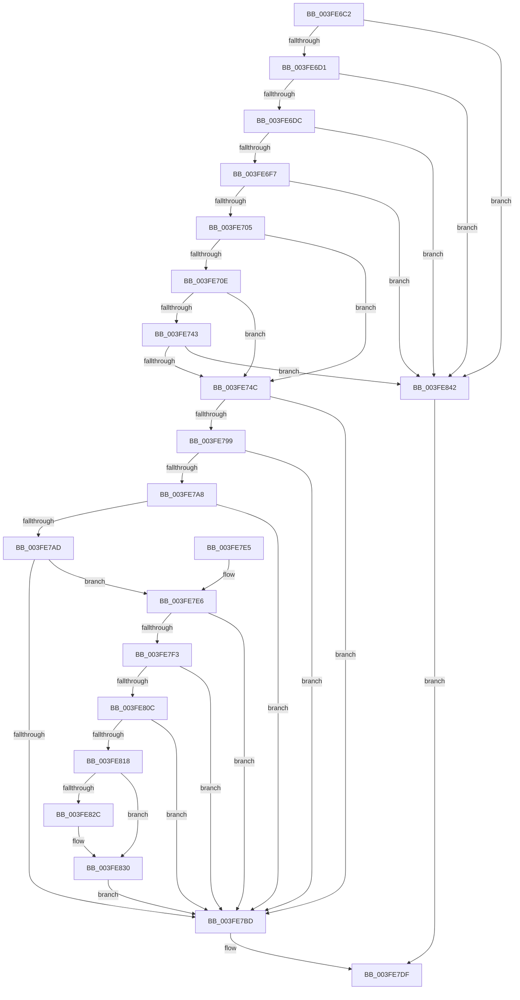

# sub_003FE6C2

- RVA: `0x003FE6C2`–`0x003FE849` (길이 `391` bytes)
- VA: `0x00000001403FE6C2`
- 실행 섹션: `.text`
- PDB 이름 있음: `아니요`; PDB Function 태그: `아니요`
- unwind 정보 RVA: `0x00099EE8`
- 디코드: `92`개 명령, `391/391` bytes 표시
- 미해석 바이트: `0` (있으면 어셈블리에 `.byte`로 보존)

> 이 문서는 커널 이미지의 기계어와 PDB 기호를 분석해 생성했습니다. 4번과 5번은 함수 원형과 자료형을 바이너리 사용 방식에서 추정한 C 해석이며 원본 소스 복구 결과는 아닙니다.

## 1. Dependencies

- 직접 호출 지점: **0**; 고유 호출 대상: **0**
- 직접 호출자로 확인된 함수: **0**
- RIP 상대 이미지 참조: **3**

### Outgoing calls
- 직접 디코드된 call 명령이 없습니다.

### Direct callers
- 이 함수 시작 RVA로 연결되는 직접 call은 확인되지 않았습니다. 간접 호출은 완전히 역산할 수 없습니다.

### Static image references
- `0x003FE705` → RVA `0x00E3CBE6` (`.data`; read)
- `0x003FE730` → RVA `0x00E3D240` (`.data`; read)
- `0x003FE7E6` → RVA `0x00FC6A88` (`ALMOSTRO`; read)

## 2. Other-region calls and transfers

- 다른 실행 섹션으로 향하는 call: **0**
- 별도 외부 분기/꼬리 이동을 확인하지 못했습니다.

## 3. Assembly (complete function range)

```asm
003FE6C2  41 8B 43 20                     mov eax, dword ptr [r11 + 0x20]
003FE6C6  C1 E8 18                        shr eax, 0x18
003FE6C9  A8 40                           test al, 0x40
003FE6CB  0F 85 71 01 00 00               jne 0x1403fe842
003FE6D1  41 F6 43 23 10                  test byte ptr [r11 + 0x23], 0x10
003FE6D6  0F 85 66 01 00 00               jne 0x1403fe842
003FE6DC  49 8B 43 18                     mov rax, qword ptr [r11 + 0x18]
003FE6E0  48 B9 FF FF FF FF FF FF FF 3F   movabs rcx, 0x3fffffffffffffff
003FE6EA  48 23 C1                        and rax, rcx
003FE6ED  48 83 F8 01                     cmp rax, 1
003FE6F1  0F 85 4B 01 00 00               jne 0x1403fe842
003FE6F7  41 8B 43 20                     mov eax, dword ptr [r11 + 0x20]
003FE6FB  66 83 F8 01                     cmp ax, 1
003FE6FF  0F 85 3D 01 00 00               jne 0x1403fe842
003FE705  40 38 3D DA E4 A3 00            cmp byte ptr [rip + 0xa3e4da], dil
003FE70C  74 3E                           je 0x1403fe74c
003FE70E  48 B8 00 00 00 00 00 DE FF FF   movabs rax, 0xffffde0000000000
003FE718  49 8B CB                        mov rcx, r11
003FE71B  48 2B C8                        sub rcx, rax
003FE71E  48 B8 AB AA AA AA AA AA AA AA   movabs rax, 0xaaaaaaaaaaaaaaab
003FE728  48 C1 F9 04                     sar rcx, 4
003FE72C  48 0F AF C8                     imul rcx, rax
003FE730  48 8B 05 09 EB A3 00            mov rax, qword ptr [rip + 0xa3eb09]
003FE737  48 C1 E9 09                     shr rcx, 9
003FE73B  0F B6 14 48                     movzx edx, byte ptr [rax + rcx*2]
003FE73F  84 D2                           test dl, dl
003FE741  74 09                           je 0x1403fe74c
003FE743  80 FA 0A                        cmp dl, 0xa
003FE746  0F 85 F6 00 00 00               jne 0x1403fe842
003FE74C  49 8B 43 18                     mov rax, qword ptr [r11 + 0x18]
003FE750  48 8D 48 FF                     lea rcx, [rax - 1]
003FE754  48 8B D1                        mov rdx, rcx
003FE757  48 33 D0                        xor rdx, rax
003FE75A  48 B8 00 00 00 00 00 00 00 C0   movabs rax, 0xc000000000000000
003FE764  48 23 D0                        and rdx, rax
003FE767  48 33 D1                        xor rdx, rcx
003FE76A  49 89 53 18                     mov qword ptr [r11 + 0x18], rdx
003FE76E  41 8B 43 20                     mov eax, dword ptr [r11 + 0x20]
003FE772  89 44 24 30                     mov dword ptr [rsp + 0x30], eax
003FE776  66 89 7C 24 30                  mov word ptr [rsp + 0x30], di
003FE77B  8B 44 24 30                     mov eax, dword ptr [rsp + 0x30]
003FE77F  41 89 43 20                     mov dword ptr [r11 + 0x20], eax
003FE783  49 83 C3 10                     add r11, 0x10
003FE787  49 8B 0B                        mov rcx, qword ptr [r11]
003FE78A  48 B8 00 D0 BE 7D FB F6 FF FF   movabs rax, 0xfffff6fb7dbed000
003FE794  4C 3B D8                        cmp r11, rax
003FE797  72 24                           jb 0x1403fe7bd
003FE799  48 B8 F8 D7 BE 7D FB F6 FF FF   movabs rax, 0xfffff6fb7dbed7f8
003FE7A3  4C 3B D8                        cmp r11, rax
003FE7A6  77 15                           ja 0x1403fe7bd
003FE7A8  F6 C1 01                        test cl, 1
003FE7AB  74 10                           je 0x1403fe7bd
003FE7AD  F6 C1 42                        test cl, 0x42
003FE7B0  0F 95 C2                        setne dl
003FE7B3  F6 C1 20                        test cl, 0x20
003FE7B6  0F 95 C0                        setne al
003FE7B9  84 D0                           test al, dl
003FE7BB  74 29                           je 0x1403fe7e6
003FE7BD  48 0F BA E1 0A                  bt rcx, 0xa
003FE7C2  48 C7 C0 F7 FF FF FF            mov rax, 0xfffffffffffffff7
003FE7C9  48 C7 C2 FF F7 FF FF            mov rdx, 0xfffffffffffff7ff
003FE7D0  48 0F 42 C2                     cmovb rax, rdx
003FE7D4  48 23 C1                        and rax, rcx
003FE7D7  49 89 03                        mov qword ptr [r11], rax
003FE7DA  B8 01 00 00 00                  mov eax, 1
003FE7DF  48 83 C4 20                     add rsp, 0x20
003FE7E3  5F                              pop rdi
003FE7E4  C3                              ret
003FE7E5  CC                              int3
003FE7E6  48 F7 05 97 82 BC 00 00 00 60 00  test qword ptr [rip + 0xbc8297], 0x600000
003FE7F1  74 CA                           je 0x1403fe7bd
003FE7F3  65 48 8B 04 25 88 01 00 00      mov rax, qword ptr gs:[0x188]
003FE7FC  48 8B 90 B8 00 00 00            mov rdx, qword ptr [rax + 0xb8]
003FE803  80 BA 60 01 00 00 01            cmp byte ptr [rdx + 0x160], 1
003FE80A  74 B1                           je 0x1403fe7bd
003FE80C  4C 8B 82 08 05 00 00            mov r8, qword ptr [rdx + 0x508]
003FE813  4D 85 C0                        test r8, r8
003FE816  74 A5                           je 0x1403fe7bd
003FE818  49 8B C3                        mov rax, r11
003FE81B  48 C1 E8 03                     shr rax, 3
003FE81F  25 FF 01 00 00                  and eax, 0x1ff
003FE824  49 8B 04 C0                     mov rax, qword ptr [r8 + rax*8]
003FE828  A8 20                           test al, 0x20
003FE82A  74 04                           je 0x1403fe830
003FE82C  48 83 C9 20                     or rcx, 0x20
003FE830  48 8B D1                        mov rdx, rcx
003FE833  48 83 C9 42                     or rcx, 0x42
003FE837  A8 42                           test al, 0x42
003FE839  48 0F 44 CA                     cmove rcx, rdx
003FE83D  E9 7B FF FF FF                  jmp 0x1403fe7bd
003FE842  B8 02 00 00 00                  mov eax, 2
003FE847  EB 96                           jmp 0x1403fe7df
```

## 4. C-style interpretation (structured pseudocode)

```c
__int64 __fastcall sub_003FE6C2(__int64 a1, __int64 a2, __int64 a3, __int64 a4, __int64 a5, unsigned int a6)
{
    __int64 result;
    __int64 v_r11;
    __int64 v_rsp;
    unsigned int v_stack_p30;

    result = (unsigned int)(((unsigned int)(*(unsigned int *)(v_r11 + 32))) >> (24));
    if ((((unsigned __int8)(result)) & (64)) != 0) goto loc_003FE842;
    if (((*(unsigned __int8 *)(v_r11 + 35)) & (16)) != 0) goto loc_003FE842;
    result = (*(unsigned __int64 *)(v_r11 + 24)) & (a1);
    if (result != 1) goto loc_003FE842;
    if (((unsigned __int16)((unsigned int)(*(unsigned int *)(v_r11 + 32)))) != 1) goto loc_003FE842;
    if ((*(unsigned __int8 *)(v_rip + 10740954)) == ((unsigned __int8)(v_rdi))) goto loc_003FE74C;
    a1 = (v_r11) - ((unsigned int)(*(unsigned int *)(v_r11 + 32)));
    a1 = (a1) >> (4);
    a1 = (a1) * ((unsigned int)(*(unsigned int *)(v_r11 + 32)));
    a1 = (a1) >> (9);
    if ((unsigned __int8)(*(unsigned __int8 *)(*(unsigned __int64 *)(v_rip + 10742537) + a1 * 2)) == 0) goto loc_003FE74C;
    if (((unsigned __int8)(*(unsigned __int8 *)(*(unsigned __int64 *)(v_rip + 10742537) + a1 * 2))) != 10) goto loc_003FE842;
loc_003FE74C:
    a2 = (*(unsigned __int64 *)(v_r11 + 24) - 1) ^ (*(unsigned __int64 *)(v_r11 + 24));
    a2 = (a2) & (*(unsigned __int64 *)(v_r11 + 24));
    a2 = (a2) ^ (*(unsigned __int64 *)(v_r11 + 24) - 1);
    *(unsigned __int64 *)(v_r11 + 24) = a2;
    v_stack_p30 = (unsigned int)((unsigned int)(*(unsigned int *)(v_r11 + 32)));
    v_stack_p30 = (unsigned __int16)(v_rdi);
    *(unsigned int *)(v_r11 + 32) = (unsigned int)((unsigned int)(a6));
    v_r11 = (v_r11) + (16);
    if (v_r11 < ((unsigned int)(a6))) goto loc_003FE7BD;
    if (v_r11 > ((unsigned int)(a6))) goto loc_003FE7BD;
    if ((((unsigned __int8)(*(unsigned __int64 *)(v_r11))) & (1)) == 0) goto loc_003FE7BD;
    a2 = ((((unsigned __int8)(*(unsigned __int64 *)(v_r11))) & (66)) != 0) ? 1 : 0;
    result = ((((unsigned __int8)(*(unsigned __int64 *)(v_r11))) & (32)) != 0) ? 1 : 0;
    if ((((unsigned __int8)(result)) & ((unsigned __int8)(a2))) == 0) goto loc_003FE7E6;
loc_003FE7BD:
    result = -9;
    if (condition_is_below) { result = 0xFFFFFFFFFFFFF7FFULL; }
    result = (result) & (*(unsigned __int64 *)(v_r11));
    *(unsigned __int64 *)(v_r11) = result;
loc_003FE7DF:
    v_rsp = (v_rsp) + (32);
    return 1;
loc_003FE7E6:
    if (((*(unsigned __int64 *)(v_rip + 12354199)) & (0x600000ULL)) == 0) goto loc_003FE7BD;
    if ((*(unsigned __int8 *)(*(unsigned __int64 *)(*(unsigned __int64 *)(gs_base + (0 + 392)) + 184) + 352)) == 1) goto loc_003FE7BD;
    if (*(unsigned __int64 *)(*(unsigned __int64 *)(*(unsigned __int64 *)(gs_base + (0 + 392)) + 184) + 1288) == 0) goto loc_003FE7BD;
    result = (v_r11) >> (3);
    result = (unsigned int)((result) & (511));
    if ((((unsigned __int8)(*(unsigned __int64 *)(*(unsigned __int64 *)(*(unsigned __int64 *)(*(unsigned __int64 *)(gs_base + (0 + 392)) + 184) + 1288) + result * 8))) & (32)) != 0) {
        a1 = (*(unsigned __int64 *)(v_r11)) | (32);
    }
    a1 = (a1) | (66);
    if ((((unsigned __int8)(*(unsigned __int64 *)(*(unsigned __int64 *)(*(unsigned __int64 *)(*(unsigned __int64 *)(gs_base + (0 + 392)) + 184) + 1288) + result * 8))) & (66)) == 0) { a1 = a1; }
    goto loc_003FE7BD;
loc_003FE842:
    goto loc_003FE7DF;
}
```

## 5. (Beta) C Style

```c
int64_t sub_003FE6C2(int64_t Arg1, int64_t Arg2, int64_t Arg3, int64_t Arg4, uint64_t Arg5, uint32_t Arg6)
{
    int64_t result;
    int64_t local_r11;
    int64_t local_rsp;
    uint32_t v_stack_p30;

    result = (uint32_t)(((uint32_t)(*(uint32_t *)(local_r11 + 0x20))) >> (24));
    if ((((uint8_t)(result)) & (64)) != 0) goto loc_003FE842;
    if (((*(uint8_t *)(local_r11 + 0x23)) & (16)) != 0) goto loc_003FE842;
    result = (*(uint64_t *)(local_r11 + 0x18)) & (Arg1);
    if (result != 1) goto loc_003FE842;
    if (((uint16_t)((uint32_t)(*(uint32_t *)(local_r11 + 0x20)))) != 1) goto loc_003FE842;
    if ((*(uint8_t *)(v_rip + 0xA3E4DA)) == ((uint8_t)(local_rdi))) goto loc_003FE74C;
    Arg1 = (local_r11) - ((uint32_t)(*(uint32_t *)(local_r11 + 0x20)));
    Arg1 = (Arg1) >> (4);
    Arg1 = (Arg1) * ((uint32_t)(*(uint32_t *)(local_r11 + 0x20)));
    Arg1 = (Arg1) >> (9);
    if ((uint8_t)(*(uint8_t *)(*(uint64_t *)(v_rip + 0xA3EB09) + Arg1 * 2)) == 0) goto loc_003FE74C;
    if (((uint8_t)(*(uint8_t *)(*(uint64_t *)(v_rip + 0xA3EB09) + Arg1 * 2))) != 10) goto loc_003FE842;
loc_003FE74C:
    Arg2 = (*(uint64_t *)(local_r11 + 0x18) - 1) ^ (*(uint64_t *)(local_r11 + 0x18));
    Arg2 = (Arg2) & (*(uint64_t *)(local_r11 + 0x18));
    Arg2 = (Arg2) ^ (*(uint64_t *)(local_r11 + 0x18) - 1);
    *(uint64_t *)(local_r11 + 0x18) = Arg2;
    v_stack_p30 = (uint32_t)((uint32_t)(*(uint32_t *)(local_r11 + 0x20)));
    v_stack_p30 = (uint16_t)(local_rdi);
    *(uint32_t *)(local_r11 + 0x20) = (uint32_t)((uint32_t)(Arg6));
    local_r11 = (local_r11) + (16);
    if (local_r11 < ((uint32_t)(Arg6))) goto loc_003FE7BD;
    if (local_r11 > ((uint32_t)(Arg6))) goto loc_003FE7BD;
    if ((((uint8_t)(*(uint64_t *)(local_r11))) & (1)) == 0) goto loc_003FE7BD;
    Arg2 = ((((uint8_t)(*(uint64_t *)(local_r11))) & (66)) != 0) ? 1 : 0;
    result = ((((uint8_t)(*(uint64_t *)(local_r11))) & (32)) != 0) ? 1 : 0;
    if ((((uint8_t)(result)) & ((uint8_t)(Arg2))) == 0) goto loc_003FE7E6;
loc_003FE7BD:
    result = -9;
    if (condition_is_below) { result = 0xFFFFFFFFFFFFF7FFULL; }
    result = (result) & (*(uint64_t *)(local_r11));
    *(uint64_t *)(local_r11) = result;
loc_003FE7DF:
    local_rsp = (local_rsp) + (32);
    return 1;
loc_003FE7E6:
    if (((*(uint64_t *)(v_rip + 0xBC8297)) & (0x600000ULL)) == 0) goto loc_003FE7BD;
    if ((*(uint8_t *)(*(uint64_t *)(*(uint64_t *)(gs_base + (0 + 0x188)) + 0xB8) + 0x160)) == 1) goto loc_003FE7BD;
    if (*(uint64_t *)(*(uint64_t *)(*(uint64_t *)(gs_base + (0 + 0x188)) + 0xB8) + 0x508) == 0) goto loc_003FE7BD;
    result = (local_r11) >> (3);
    result = (uint32_t)((result) & (511));
    if ((((uint8_t)(*(uint64_t *)(*(uint64_t *)(*(uint64_t *)(*(uint64_t *)(gs_base + (0 + 0x188)) + 0xB8) + 0x508) + result * 8))) & (32)) != 0) {
        Arg1 = (*(uint64_t *)(local_r11)) | (32);
    }
    Arg1 = (Arg1) | (66);
    if ((((uint8_t)(*(uint64_t *)(*(uint64_t *)(*(uint64_t *)(*(uint64_t *)(gs_base + (0 + 0x188)) + 0xB8) + 0x508) + result * 8))) & (66)) == 0) { Arg1 = Arg1; }
    goto loc_003FE7BD;
loc_003FE842:
    goto loc_003FE7DF;
}
```

## 6. Execution-region graph

[열기: 2D/3D 그래프와 함수 탐색 컨트롤 패널](../../../control-panel.html?section=text&rva=0x003FE6C2&view=graph)

- 2D 그래프는 위에서 아래로 흐르고, 3D 그래프는 빈 공간을 드래그해 회전합니다. Shift+드래그는 이동, 휠은 확대·축소, 함수 노드 선택은 대상 보고서 이동입니다.

### Static fallback


