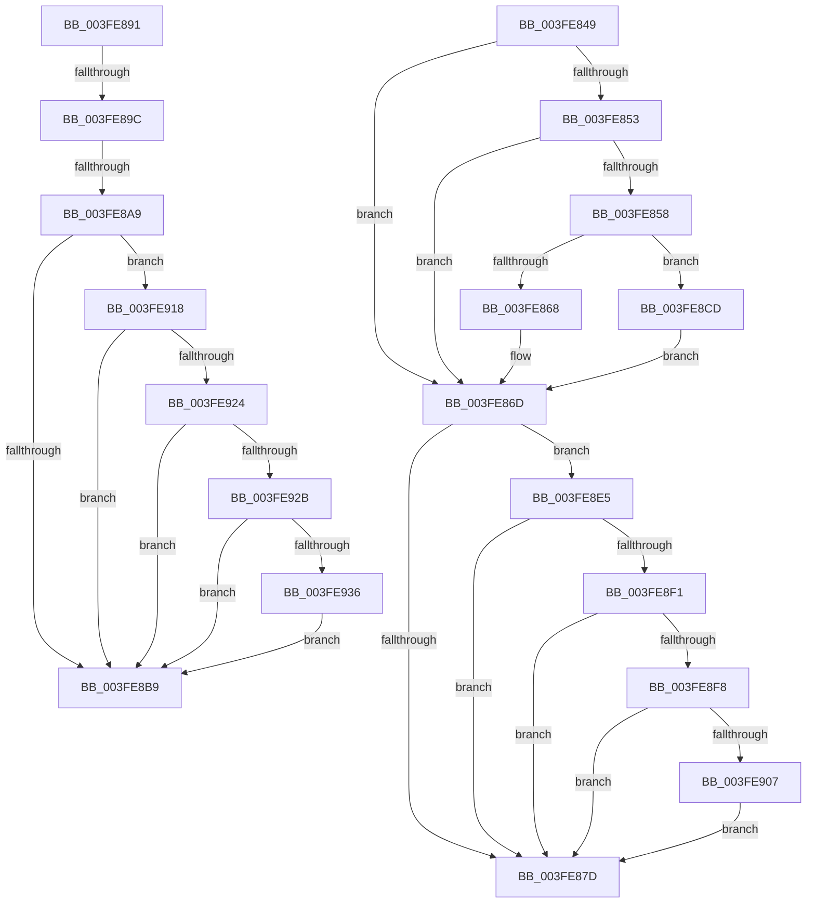

# sub_003FE849

- RVA: `0x003FE849`–`0x003FE947` (길이 `254` bytes)
- VA: `0x00000001403FE849`
- 실행 섹션: `.text`
- PDB 이름 있음: `아니요`; PDB Function 태그: `아니요`
- unwind 정보 RVA: `0x00099EFC`
- 디코드: `69`개 명령, `254/254` bytes 표시
- 미해석 바이트: `0` (있으면 어셈블리에 `.byte`로 보존)

> 이 문서는 커널 이미지의 기계어와 PDB 기호를 분석해 생성했습니다. 4번과 5번은 함수 원형과 자료형을 바이너리 사용 방식에서 추정한 C 해석이며 원본 소스 복구 결과는 아닙니다.

## 1. Dependencies

- 직접 호출 지점: **3**; 고유 호출 대상: **2**
- 직접 호출자로 확인된 함수: **0**
- RIP 상대 이미지 참조: **1**

### Outgoing calls
- `0x003FE8DE` → [MiClearPageFileReservation](../32/MiClearPageFileReservation_function_0032B68C.md) (function, `0x0032B68C`)
- `0x003FE8E8` → [MiCanPfnOriginalPteBeLost](../37/MiCanPfnOriginalPteBeLost_function_00373D3C.md) (function, `0x00373D3C`)
- `0x003FE91B` → [MiCanPfnOriginalPteBeLost](../37/MiCanPfnOriginalPteBeLost_function_00373D3C.md) (function, `0x00373D3C`)

### Direct callers
- 이 함수 시작 RVA로 연결되는 직접 call은 확인되지 않았습니다. 간접 호출은 완전히 역산할 수 없습니다.

### Static image references
- `0x003FE89C` → RVA `0x00E2DC40` (`.data`; read)

## 2. Other-region calls and transfers

- 다른 실행 섹션으로 향하는 call: **0**
- call이 아닌 외부 분기/꼬리 이동: **4**
  - `0x003FE88C` → [sub_003FE688 + 0x1A](Unknown_function_003FE688.md) (`tail-transfer`)
  - `0x003FE896` → [sub_003FE688 + 0x26](Unknown_function_003FE688.md) (`tail-transfer`)
  - `0x003FE8A3` → [sub_003FE688 + 0x26](Unknown_function_003FE688.md) (`tail-transfer`)
  - `0x003FE8C8` → [sub_003FE688 + 0x26](Unknown_function_003FE688.md) (`tail-transfer`)

## 3. Assembly (complete function range)

```asm
003FE849  8B 42 10                        mov eax, dword ptr [rdx + 0x10]
003FE84C  48 0F BA E0 0A                  bt rax, 0xa
003FE851  72 1A                           jb 0x1403fe86d
003FE853  F6 C1 08                        test cl, 8
003FE856  75 15                           jne 0x1403fe86d
003FE858  48 8B 42 10                     mov rax, qword ptr [rdx + 0x10]
003FE85C  48 89 44 24 38                  mov qword ptr [rsp + 0x38], rax
003FE861  C0 E8 02                        shr al, 2
003FE864  A8 01                           test al, 1
003FE866  75 65                           jne 0x1403fe8cd
003FE868  48 89 7C 24 38                  mov qword ptr [rsp + 0x38], rdi
003FE86D  41 8B 5B 20                     mov ebx, dword ptr [r11 + 0x20]
003FE871  89 5C 24 30                     mov dword ptr [rsp + 0x30], ebx
003FE875  C1 EB 10                        shr ebx, 0x10
003FE878  F6 C3 08                        test bl, 8
003FE87B  75 68                           jne 0x1403fe8e5
003FE87D  80 CB 10                        or bl, 0x10
003FE880  88 5C 24 32                     mov byte ptr [rsp + 0x32], bl
003FE884  8B 44 24 30                     mov eax, dword ptr [rsp + 0x30]
003FE888  41 89 43 20                     mov dword ptr [r11 + 0x20], eax
003FE88C  E9 11 FE FF FF                  jmp 0x1403fe6a2
003FE891  41 F6 43 22 10                  test byte ptr [r11 + 0x22], 0x10
003FE896  0F 84 12 FE FF FF               je 0x1403fe6ae
003FE89C  40 38 3D 9D F3 A2 00            cmp byte ptr [rip + 0xa2f39d], dil
003FE8A3  0F 84 05 FE FF FF               je 0x1403fe6ae
003FE8A9  41 8B 5B 20                     mov ebx, dword ptr [r11 + 0x20]
003FE8AD  89 5C 24 30                     mov dword ptr [rsp + 0x30], ebx
003FE8B1  C1 EB 10                        shr ebx, 0x10
003FE8B4  F6 C3 08                        test bl, 8
003FE8B7  75 5F                           jne 0x1403fe918
003FE8B9  80 E3 EF                        and bl, 0xef
003FE8BC  88 5C 24 32                     mov byte ptr [rsp + 0x32], bl
003FE8C0  8B 44 24 30                     mov eax, dword ptr [rsp + 0x30]
003FE8C4  41 89 43 20                     mov dword ptr [r11 + 0x20], eax
003FE8C8  E9 E1 FD FF FF                  jmp 0x1403fe6ae
003FE8CD  48 8B 42 10                     mov rax, qword ptr [rdx + 0x10]
003FE8D1  48 8D 4C 24 38                  lea rcx, [rsp + 0x38]
003FE8D6  48 83 E0 FB                     and rax, 0xfffffffffffffffb
003FE8DA  48 89 42 10                     mov qword ptr [rdx + 0x10], rax
003FE8DE  E8 A9 CD F2 FF                  call 0x14032b68c
003FE8E3  EB 88                           jmp 0x1403fe86d
003FE8E5  49 8B CB                        mov rcx, r11
003FE8E8  E8 4F 54 F7 FF                  call 0x140373d3c
003FE8ED  85 C0                           test eax, eax
003FE8EF  74 8C                           je 0x1403fe87d
003FE8F1  41 F6 43 22 10                  test byte ptr [r11 + 0x22], 0x10
003FE8F6  75 85                           jne 0x1403fe87d
003FE8F8  41 8B 43 10                     mov eax, dword ptr [r11 + 0x10]
003FE8FC  C0 E8 02                        shr al, 2
003FE8FF  A8 01                           test al, 1
003FE901  0F 84 76 FF FF FF               je 0x1403fe87d
003FE907  49 8B 43 10                     mov rax, qword ptr [r11 + 0x10]
003FE90B  48 83 E0 FB                     and rax, 0xfffffffffffffffb
003FE90F  49 89 43 10                     mov qword ptr [r11 + 0x10], rax
003FE913  E9 65 FF FF FF                  jmp 0x1403fe87d
003FE918  49 8B CB                        mov rcx, r11
003FE91B  E8 1C 54 F7 FF                  call 0x140373d3c
003FE920  85 C0                           test eax, eax
003FE922  74 95                           je 0x1403fe8b9
003FE924  41 F6 43 22 10                  test byte ptr [r11 + 0x22], 0x10
003FE929  75 8E                           jne 0x1403fe8b9
003FE92B  41 8B 43 10                     mov eax, dword ptr [r11 + 0x10]
003FE92F  C0 E8 02                        shr al, 2
003FE932  A8 01                           test al, 1
003FE934  74 83                           je 0x1403fe8b9
003FE936  49 8B 43 10                     mov rax, qword ptr [r11 + 0x10]
003FE93A  48 83 E0 FB                     and rax, 0xfffffffffffffffb
003FE93E  49 89 43 10                     mov qword ptr [r11 + 0x10], rax
003FE942  E9 72 FF FF FF                  jmp 0x1403fe8b9
```

## 4. C-style interpretation (structured pseudocode)

```c
__int64 __fastcall sub_003FE849(unsigned __int8 a1, __int64 a2, __int64 a3, __int64 a4, __int64 a5, unsigned int a6, __int64 a7)
{
    __int64 result;
    __int64 v_rbx;
    unsigned int v_stack_p30;
    unsigned __int8 v_stack_p32;
    unsigned __int64 v_stack_p38;

    if (condition_is_below) goto loc_003FE86D;
    if (((a1) & (8)) != 0) goto loc_003FE86D;
    v_stack_p38 = *(unsigned __int64 *)(a2 + 16);
    result = (unsigned __int8)((*(unsigned __int64 *)(a2 + 16)) >> (2));
    if ((((unsigned __int8)(result)) & (1)) != 0) goto loc_003FE8CD;
    v_stack_p38 = v_rdi;
loc_003FE86D:
    v_stack_p30 = (unsigned int)((unsigned int)(*(unsigned int *)(v_r11 + 32)));
    v_rbx = (unsigned int)(((unsigned int)(*(unsigned int *)(v_r11 + 32))) >> (16));
    if ((((unsigned __int8)(v_rbx)) & (8)) != 0) goto loc_003FE8E5;
loc_003FE87D:
    v_rbx = (unsigned __int8)((v_rbx) | (16));
    v_stack_p32 = (unsigned __int8)(v_rbx);
    *(unsigned int *)(v_r11 + 32) = (unsigned int)((unsigned int)(a6));
loc_003FE8CD:
    result = (*(unsigned __int64 *)(a2 + 16)) & (-5);
    *(unsigned __int64 *)(a2 + 16) = result;
    result = MiClearPageFileReservation(a7, a2, a3, a4);
    goto loc_003FE86D;
loc_003FE8E5:
    result = MiCanPfnOriginalPteBeLost(v_r11, a2, a3, a4);
    if ((unsigned int)(result) == 0) goto loc_003FE87D;
    if (((*(unsigned __int8 *)(v_r11 + 34)) & (16)) != 0) goto loc_003FE87D;
    result = (unsigned __int8)(((unsigned int)(*(unsigned int *)(v_r11 + 16))) >> (2));
    if ((((unsigned __int8)(result)) & (1)) == 0) goto loc_003FE87D;
    result = (*(unsigned __int64 *)(v_r11 + 16)) & (-5);
    *(unsigned __int64 *)(v_r11 + 16) = result;
    goto loc_003FE87D;
}
```

## 5. (Beta) C Style

```c
int64_t sub_003FE849(uint8_t Arg1, void *Arg2, int64_t Arg3, int64_t Arg4, uint64_t Arg5, uint32_t Arg6, int64_t Arg7)
{
    uint8_t *arg2 = (uint8_t *)Arg2;

    int64_t result;
    int64_t local_rbx;
    uint32_t v_stack_p30;
    uint8_t v_stack_p32;
    uint64_t v_stack_p38;

    if (condition_is_below) goto loc_003FE86D;
    if (((Arg1) & (8)) != 0) goto loc_003FE86D;
    v_stack_p38 = *(uint64_t *)(arg2 + 0x10);
    result = (uint8_t)((*(uint64_t *)(arg2 + 0x10)) >> (2));
    if ((((uint8_t)(result)) & (1)) != 0) goto loc_003FE8CD;
    v_stack_p38 = local_rdi;
loc_003FE86D:
    v_stack_p30 = (uint32_t)((uint32_t)(*(uint32_t *)(local_r11 + 0x20)));
    local_rbx = (uint32_t)(((uint32_t)(*(uint32_t *)(local_r11 + 0x20))) >> (16));
    if ((((uint8_t)(local_rbx)) & (8)) != 0) goto loc_003FE8E5;
loc_003FE87D:
    local_rbx = (uint8_t)((local_rbx) | (16));
    v_stack_p32 = (uint8_t)(local_rbx);
    *(uint32_t *)(local_r11 + 0x20) = (uint32_t)((uint32_t)(Arg6));
loc_003FE8CD:
    result = (*(uint64_t *)(arg2 + 0x10)) & (-5);
    *(uint64_t *)(arg2 + 0x10) = result;
    result = MiClearPageFileReservation(Arg7, Arg2, Arg3, Arg4);
    goto loc_003FE86D;
loc_003FE8E5:
    result = MiCanPfnOriginalPteBeLost(local_r11, Arg2, Arg3, Arg4);
    if ((uint32_t)(result) == 0) goto loc_003FE87D;
    if (((*(uint8_t *)(local_r11 + 0x22)) & (16)) != 0) goto loc_003FE87D;
    result = (uint8_t)(((uint32_t)(*(uint32_t *)(local_r11 + 0x10))) >> (2));
    if ((((uint8_t)(result)) & (1)) == 0) goto loc_003FE87D;
    result = (*(uint64_t *)(local_r11 + 0x10)) & (-5);
    *(uint64_t *)(local_r11 + 0x10) = result;
    goto loc_003FE87D;
}
```

### 관측된 메모리 오프셋

구조체 형식이 확인되지 않은 접근은 인자 기준의 오프셋으로만 기록했습니다.

| 기준 인자 | 오프셋 표현 | 폭 (bit) | 접근 |
|---|---:|---:|---|
| `Arg2` | `+ 0x10` | `32` | `R` |
| `Arg2` | `+ 0x10` | `64` | `R` |
| `Arg2` | `+ 0x10` | `64` | `W` |

## 6. Execution-region graph

[열기: 2D/3D 그래프와 함수 탐색 컨트롤 패널](../../../control-panel.html?section=text&rva=0x003FE849&view=graph)

- 2D 그래프는 위에서 아래로 흐르고, 3D 그래프는 빈 공간을 드래그해 회전합니다. Shift+드래그는 이동, 휠은 확대·축소, 함수 노드 선택은 대상 보고서 이동입니다.

### Static fallback


