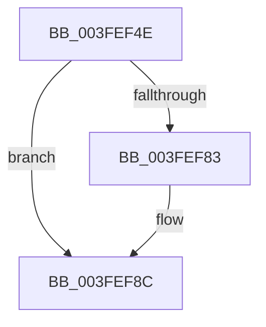

# sub_003FEF4E

- RVA: `0x003FEF4E`–`0x003FEF9C` (길이 `78` bytes)
- VA: `0x00000001403FEF4E`
- 실행 섹션: `.text`
- PDB 이름 있음: `아니요`; PDB Function 태그: `아니요`
- unwind 정보 RVA: `0x00099F7C`
- 디코드: `23`개 명령, `78/78` bytes 표시
- 미해석 바이트: `0` (있으면 어셈블리에 `.byte`로 보존)

> 이 문서는 커널 이미지의 기계어와 PDB 기호를 분석해 생성했습니다. 4번과 5번은 함수 원형과 자료형을 바이너리 사용 방식에서 추정한 C 해석이며 원본 소스 복구 결과는 아닙니다.

## 1. Dependencies

- 직접 호출 지점: **1**; 고유 호출 대상: **1**
- 직접 호출자로 확인된 함수: **0**
- RIP 상대 이미지 참조: **0**

### Outgoing calls
- `0x003FEF6E` → [memcpy](../6C/memcpy_function_006C6840.md) (function, `0x006C6840`)

### Direct callers
- 이 함수 시작 RVA로 연결되는 직접 call은 확인되지 않았습니다. 간접 호출은 완전히 역산할 수 없습니다.

### Static image references
- 디코드된 RIP-relative 메모리 참조가 없습니다.

## 2. Other-region calls and transfers

- 다른 실행 섹션으로 향하는 call: **0**
- 별도 외부 분기/꼬리 이동을 확인하지 못했습니다.

## 3. Assembly (complete function range)

```asm
003FEF4E  48 89 74 24 30                  mov qword ptr [rsp + 0x30], rsi
003FEF53  49 8B D1                        mov rdx, r9
003FEF56  48 8B 71 08                     mov rsi, qword ptr [rcx + 8]
003FEF5A  41 0F 46 C0                     cmovbe eax, r8d
003FEF5E  48 89 7C 24 38                  mov qword ptr [rsp + 0x38], rdi
003FEF63  8B F8                           mov edi, eax
003FEF65  66 89 39                        mov word ptr [rcx], di
003FEF68  48 8B CE                        mov rcx, rsi
003FEF6B  44 8B C0                        mov r8d, eax
003FEF6E  E8 CD 78 2C 00                  call 0x1406c6840
003FEF73  0F B7 0B                        movzx ecx, word ptr [rbx]
003FEF76  0F B7 43 02                     movzx eax, word ptr [rbx + 2]
003FEF7A  48 83 C1 02                     add rcx, 2
003FEF7E  48 3B C8                        cmp rcx, rax
003FEF81  77 09                           ja 0x1403fef8c
003FEF83  48 D1 EF                        shr rdi, 1
003FEF86  33 C0                           xor eax, eax
003FEF88  66 89 04 7E                     mov word ptr [rsi + rdi*2], ax
003FEF8C  48 8B 74 24 30                  mov rsi, qword ptr [rsp + 0x30]
003FEF91  48 8B 7C 24 38                  mov rdi, qword ptr [rsp + 0x38]
003FEF96  48 83 C4 20                     add rsp, 0x20
003FEF9A  5B                              pop rbx
003FEF9B  C3                              ret
```

## 4. C-style interpretation (structured pseudocode)

```c
__int64 __fastcall sub_003FEF4E(__int64 a1, __int64 a2, int a3, __int64 a4, __int64 a5, __int64 a6, __int64 a7)
{
    __int64 result;
    __int64 v_rdi;
    __int64 v_rsp;
    unsigned __int64 v_stack_p30;
    unsigned __int64 v_stack_p38;

    v_stack_p30 = v_rsi;
    if (condition_is_below_or_equal) { result = a3; }
    v_stack_p38 = v_rdi;
    *(unsigned __int16 *)(a1) = (unsigned __int16)((unsigned int)((unsigned int)(result)));
    result = memcpy(*(unsigned __int64 *)(a1 + 8), a4, (unsigned int)((unsigned int)(result)), a4);
    a1 = (*(unsigned __int16 *)(v_rbx)) + (2);
    result = *(unsigned __int16 *)(v_rbx + 2);
    v_rdi = (unsigned int)((unsigned int)(result));
    if (a1 <= (*(unsigned __int16 *)(v_rbx + 2))) {
        v_rdi = ((unsigned int)((unsigned int)(result))) >> (1);
        result = 0;
        *(unsigned __int16 *)(*(unsigned __int64 *)(a1 + 8) + v_rdi * 2) = 0;
    }
    v_rsp = (v_rsp) + (32);
    return result;
}
```

## 5. (Beta) C Style

```c
int64_t sub_003FEF4E(void *Arg1, int64_t Arg2, int32_t Arg3, int64_t Arg4, uint64_t Arg5, int64_t Arg6, int64_t Arg7)
{
    uint8_t *arg1 = (uint8_t *)Arg1;

    int64_t result;
    int64_t local_rdi;
    int64_t local_rsp;
    uint64_t v_stack_p30;
    uint64_t v_stack_p38;

    v_stack_p30 = local_rsi;
    if (condition_is_below_or_equal) { result = Arg3; }
    v_stack_p38 = local_rdi;
    *(uint16_t *)(arg1) = (uint16_t)((uint32_t)((uint32_t)(result)));
    result = memcpy(*(uint64_t *)(arg1 + 0x8), Arg4, (uint32_t)((uint32_t)(result)), Arg4);
    Arg1 = (*(uint16_t *)(local_rbx)) + (2);
    result = *(uint16_t *)(local_rbx + 0x2);
    local_rdi = (uint32_t)((uint32_t)(result));
    if (Arg1 <= (*(uint16_t *)(local_rbx + 0x2))) {
        local_rdi = ((uint32_t)((uint32_t)(result))) >> (1);
        result = 0;
        *(uint16_t *)(*(uint64_t *)(arg1 + 0x8) + local_rdi * 2) = 0;
    }
    local_rsp = (local_rsp) + (32);
    return result;
}
```

### 관측된 메모리 오프셋

구조체 형식이 확인되지 않은 접근은 인자 기준의 오프셋으로만 기록했습니다.

| 기준 인자 | 오프셋 표현 | 폭 (bit) | 접근 |
|---|---:|---:|---|
| `Arg1` | `+ 0x0` | `16` | `W` |
| `Arg1` | `+ 0x8` | `64` | `R` |

## 6. Execution-region graph

[열기: 2D/3D 그래프와 함수 탐색 컨트롤 패널](../../../control-panel.html?section=text&rva=0x003FEF4E&view=graph)

- 2D 그래프는 위에서 아래로 흐르고, 3D 그래프는 빈 공간을 드래그해 회전합니다. Shift+드래그는 이동, 휠은 확대·축소, 함수 노드 선택은 대상 보고서 이동입니다.

### Static fallback


