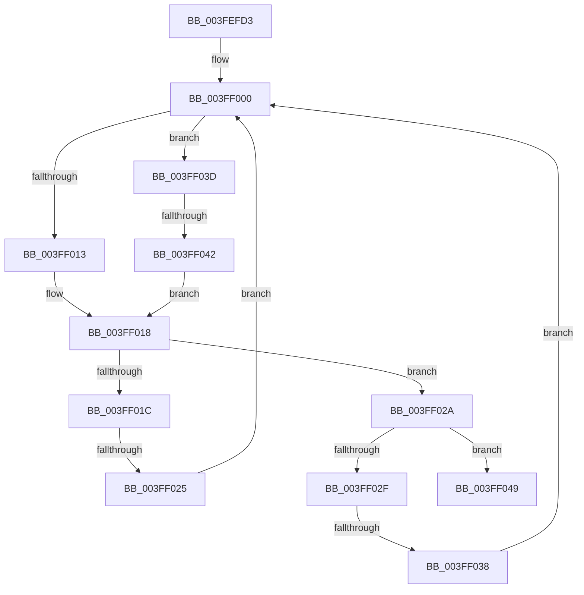

# sub_003FEFD3

- RVA: `0x003FEFD3`–`0x003FF05D` (길이 `138` bytes)
- VA: `0x00000001403FEFD3`
- 실행 섹션: `.text`
- PDB 이름 있음: `아니요`; PDB Function 태그: `아니요`
- unwind 정보 RVA: `0x00099FBC`
- 디코드: `36`개 명령, `138/138` bytes 표시
- 미해석 바이트: `0` (있으면 어셈블리에 `.byte`로 보존)

> 이 문서는 커널 이미지의 기계어와 PDB 기호를 분석해 생성했습니다. 4번과 5번은 함수 원형과 자료형을 바이너리 사용 방식에서 추정한 C 해석이며 원본 소스 복구 결과는 아닙니다.

## 1. Dependencies

- 직접 호출 지점: **2**; 고유 호출 대상: **2**
- 직접 호출자로 확인된 함수: **0**
- RIP 상대 이미지 참조: **3**

### Outgoing calls
- `0x003FF013` → [PiDmCompareObjects](../../page/9A/PiDmCompareObjects_function_009A2AD0.md) (function, `0x009A2AD0`)
- `0x003FF042` → [PnpCompareInstancePath](../../page/9A/PnpCompareInstancePath_function_009A9B60.md) (function, `0x009A9B60`)

### Direct callers
- 이 함수 시작 RVA로 연결되는 직접 call은 확인되지 않았습니다. 간접 호출은 완전히 역산할 수 없습니다.

### Static image references
- `0x003FEFD8` → RVA `0x00A11280` (`PiPnpRtlObjectEventCompareObjects`; read)
- `0x003FEFE4` → RVA `0x009A2AD0` (`PiDmCompareObjects`; read)
- `0x003FEFF0` → RVA `0x009A9B60` (`PnpCompareInstancePath`; read)

## 2. Other-region calls and transfers

- 다른 실행 섹션으로 향하는 call: **2**
  - `0x003FF013` → [PiDmCompareObjects](../../page/9A/PiDmCompareObjects_function_009A2AD0.md) (`.text` → `PAGE`)
  - `0x003FF042` → [PnpCompareInstancePath](../../page/9A/PnpCompareInstancePath_function_009A9B60.md) (`.text` → `PAGE`)
- call이 아닌 외부 분기/꼬리 이동: **3**
  - `0x003FF023` → [sub_003FF07D + 0x7](Unknown_function_003FF07D.md) (`tail-transfer`)
  - `0x003FF036` → [sub_003FF07D](Unknown_function_003FF07D.md) (`tail-transfer`)
  - `0x003FF040` → [sub_003FF07D + 0xE](Unknown_function_003FF07D.md) (`tail-transfer`)

## 3. Assembly (complete function range)

```asm
003FEFD3  4C 89 64 24 40                  mov qword ptr [rsp + 0x40], r12
003FEFD8  4C 8D 25 A1 22 61 00            lea r12, [rip + 0x6122a1]
003FEFDF  4C 89 74 24 48                  mov qword ptr [rsp + 0x48], r14
003FEFE4  4C 8D 35 E5 3A 5A 00            lea r14, [rip + 0x5a3ae5]
003FEFEB  4C 89 7C 24 50                  mov qword ptr [rsp + 0x50], r15
003FEFF0  4C 8D 3D 69 AB 5A 00            lea r15, [rip + 0x5aab69]
003FEFF7  66 0F 1F 84 00 00 00 00 00      nop word ptr [rax + rax]
003FF000  48 8B 47 48                     mov rax, qword ptr [rdi + 0x48]
003FF004  4C 8D 43 20                     lea r8, [rbx + 0x20]
003FF008  48 8B D5                        mov rdx, rbp
003FF00B  48 8B CF                        mov rcx, rdi
003FF00E  49 3B C6                        cmp rax, r14
003FF011  75 2A                           jne 0x1403ff03d
003FF013  E8 B8 3A 5A 00                  call 0x1409a2ad0
003FF018  85 C0                           test eax, eax
003FF01A  75 0E                           jne 0x1403ff02a
003FF01C  48 8B 43 08                     mov rax, qword ptr [rbx + 8]
003FF020  48 85 C0                        test rax, rax
003FF023  74 5F                           je 0x1403ff084
003FF025  48 8B D8                        mov rbx, rax
003FF028  EB D6                           jmp 0x1403ff000
003FF02A  83 F8 01                        cmp eax, 1
003FF02D  75 1A                           jne 0x1403ff049
003FF02F  48 8B 43 10                     mov rax, qword ptr [rbx + 0x10]
003FF033  48 85 C0                        test rax, rax
003FF036  74 45                           je 0x1403ff07d
003FF038  48 8B D8                        mov rbx, rax
003FF03B  EB C3                           jmp 0x1403ff000
003FF03D  49 3B C7                        cmp rax, r15
003FF040  75 49                           jne 0x1403ff08b
003FF042  E8 19 AB 5A 00                  call 0x1409a9b60
003FF047  EB CF                           jmp 0x1403ff018
003FF049  B8 01 00 00 00                  mov eax, 1
003FF04E  4C 8B 74 24 48                  mov r14, qword ptr [rsp + 0x48]
003FF053  4C 8B 64 24 40                  mov r12, qword ptr [rsp + 0x40]
003FF058  4C 8B 7C 24 50                  mov r15, qword ptr [rsp + 0x50]
```

## 4. C-style interpretation (structured pseudocode)

```c
__int64 __fastcall sub_003FEFD3(__int64 a1, __int64 a2, __int64 a3, __int64 a4, __int64 a5, __int64 a6, __int64 a7, __int64 a8, __int64 a9, __int64 a10)
{
    __int64 result;
    unsigned __int64 v_stack_p40;
    unsigned __int64 v_stack_p48;
    unsigned __int64 v_stack_p50;

    v_stack_p40 = v_r12;
    v_stack_p48 = v_r14;
    v_stack_p50 = v_r15;
loc_003FF000:
    if ((*(unsigned __int64 *)(v_rdi + 72)) != (v_rip + 5913317)) goto loc_003FF03D;
    result = PiDmCompareObjects(v_rdi, v_rbp, v_rbx + 32, a4);
loc_003FF018:
    if ((unsigned int)(result) != 0) goto loc_003FF02A;
    goto loc_003FF000;
loc_003FF02A:
    if (((unsigned int)(*(unsigned __int64 *)(v_rbx + 8))) != 1) goto loc_003FF049;
    goto loc_003FF000;
loc_003FF03D:
    result = PnpCompareInstancePath(v_rdi, v_rbp, v_rbx + 32, a4);
    goto loc_003FF018;
loc_003FF049:
    return 1;
}
```

## 5. (Beta) C Style

```c
int64_t sub_003FEFD3(int64_t Arg1, int64_t Arg2, int64_t Arg3, int64_t Arg4, uint64_t Arg5, uint64_t Arg6, uint64_t Arg7, int64_t Arg8, int64_t Arg9, int64_t Arg10)
{
    int64_t result;
    uint64_t v_stack_p40;
    uint64_t v_stack_p48;
    uint64_t v_stack_p50;

    v_stack_p40 = local_r12;
    v_stack_p48 = local_r14;
    v_stack_p50 = local_r15;
loc_003FF000:
    if ((*(uint64_t *)(local_rdi + 0x48)) != (v_rip + 5913317)) goto loc_003FF03D;
    result = PiDmCompareObjects(local_rdi, local_rbp, local_rbx + 32, Arg4);
loc_003FF018:
    if ((uint32_t)(result) != 0) goto loc_003FF02A;
    goto loc_003FF000;
loc_003FF02A:
    if (((uint32_t)(*(uint64_t *)(local_rbx + 0x8))) != 1) goto loc_003FF049;
    goto loc_003FF000;
loc_003FF03D:
    result = PnpCompareInstancePath(local_rdi, local_rbp, local_rbx + 32, Arg4);
    goto loc_003FF018;
loc_003FF049:
    return 1;
}
```

## 6. Execution-region graph

[열기: 2D/3D 그래프와 함수 탐색 컨트롤 패널](../../../control-panel.html?section=text&rva=0x003FEFD3&view=graph)

- 2D 그래프는 위에서 아래로 흐르고, 3D 그래프는 빈 공간을 드래그해 회전합니다. Shift+드래그는 이동, 휠은 확대·축소, 함수 노드 선택은 대상 보고서 이동입니다.

### Static fallback


