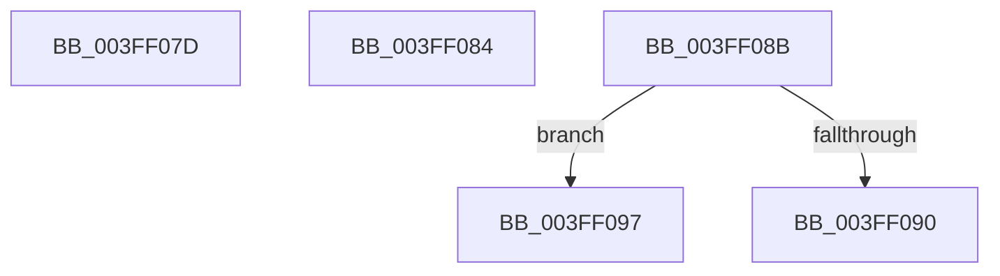

# sub_003FF07D

- RVA: `0x003FF07D`–`0x003FF0A1` (길이 `36` bytes)
- VA: `0x00000001403FF07D`
- 실행 섹션: `.text`
- PDB 이름 있음: `아니요`; PDB Function 태그: `아니요`
- unwind 정보 RVA: `0x00099FEC`
- 디코드: `10`개 명령, `36/36` bytes 표시
- 미해석 바이트: `0` (있으면 어셈블리에 `.byte`로 보존)

> 이 문서는 커널 이미지의 기계어와 PDB 기호를 분석해 생성했습니다. 4번과 5번은 함수 원형과 자료형을 바이너리 사용 방식에서 추정한 C 해석이며 원본 소스 복구 결과는 아닙니다.

## 1. Dependencies

- 직접 호출 지점: **2**; 고유 호출 대상: **2**
- 직접 호출자로 확인된 함수: **0**
- RIP 상대 이미지 참조: **0**

### Outgoing calls
- `0x003FF090` → [PiPnpRtlObjectEventCompareObjects](../../page/A1/PiPnpRtlObjectEventCompareObjects_function_00A11280.md) (function, `0x00A11280`)
- `0x003FF097` → [guard_dispatch_icall](../6B/guard_dispatch_icall_function_006BAAD0.md) (function, `0x006BAAD0`)

### Direct callers
- 이 함수 시작 RVA로 연결되는 직접 call은 확인되지 않았습니다. 간접 호출은 완전히 역산할 수 없습니다.

### Static image references
- 디코드된 RIP-relative 메모리 참조가 없습니다.

## 2. Other-region calls and transfers

- 다른 실행 섹션으로 향하는 call: **1**
  - `0x003FF090` → [PiPnpRtlObjectEventCompareObjects](../../page/A1/PiPnpRtlObjectEventCompareObjects_function_00A11280.md) (`.text` → `PAGE`)
- call이 아닌 외부 분기/꼬리 이동: **4**
  - `0x003FF082` → [sub_003FEFD3 + 0x7B](Unknown_function_003FEFD3.md) (`tail-transfer`)
  - `0x003FF089` → [sub_003FEFD3 + 0x7B](Unknown_function_003FEFD3.md) (`tail-transfer`)
  - `0x003FF095` → [sub_003FEFD3 + 0x45](Unknown_function_003FEFD3.md) (`tail-transfer`)
  - `0x003FF09C` → [sub_003FEFD3 + 0x45](Unknown_function_003FEFD3.md) (`tail-transfer`)

## 3. Assembly (complete function range)

```asm
003FF07D  B8 03 00 00 00                  mov eax, 3
003FF082  EB CA                           jmp 0x1403ff04e
003FF084  B8 02 00 00 00                  mov eax, 2
003FF089  EB C3                           jmp 0x1403ff04e
003FF08B  49 3B C4                        cmp rax, r12
003FF08E  75 07                           jne 0x1403ff097
003FF090  E8 EB 21 61 00                  call 0x140a11280
003FF095  EB 81                           jmp 0x1403ff018
003FF097  E8 34 BA 2B 00                  call 0x1406baad0
003FF09C  E9 77 FF FF FF                  jmp 0x1403ff018
```

## 4. C-style interpretation (structured pseudocode)

```c
__int64 __fastcall sub_003FF07D(void)
{
}
```

## 5. (Beta) C Style

```c
void sub_003FF07D(void)
{
}
```

## 6. Execution-region graph

[열기: 2D/3D 그래프와 함수 탐색 컨트롤 패널](../../../control-panel.html?section=text&rva=0x003FF07D&view=graph)

- 2D 그래프는 위에서 아래로 흐르고, 3D 그래프는 빈 공간을 드래그해 회전합니다. Shift+드래그는 이동, 휠은 확대·축소, 함수 노드 선택은 대상 보고서 이동입니다.

### Static fallback


