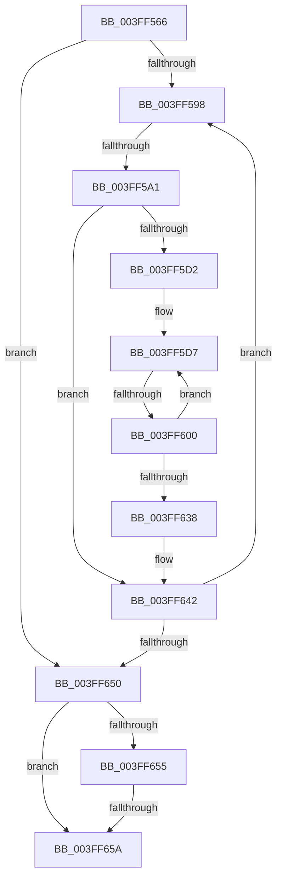

# sub_003FF566

- RVA: `0x003FF566`–`0x003FF679` (길이 `275` bytes)
- VA: `0x00000001403FF566`
- 실행 섹션: `.text`
- PDB 이름 있음: `아니요`; PDB Function 태그: `아니요`
- unwind 정보 RVA: `0x0009A030`
- 디코드: `76`개 명령, `275/275` bytes 표시
- 미해석 바이트: `0` (있으면 어셈블리에 `.byte`로 보존)

> 이 문서는 커널 이미지의 기계어와 PDB 기호를 분석해 생성했습니다. 4번과 5번은 함수 원형과 자료형을 바이너리 사용 방식에서 추정한 C 해석이며 원본 소스 복구 결과는 아닙니다.

## 1. Dependencies

- 직접 호출 지점: **0**; 고유 호출 대상: **0**
- 직접 호출자로 확인된 함수: **0**
- RIP 상대 이미지 참조: **0**

### Outgoing calls
- 직접 디코드된 call 명령이 없습니다.

### Direct callers
- 이 함수 시작 RVA로 연결되는 직접 call은 확인되지 않았습니다. 간접 호출은 완전히 역산할 수 없습니다.

### Static image references
- 디코드된 RIP-relative 메모리 참조가 없습니다.

## 2. Other-region calls and transfers

- 다른 실행 섹션으로 향하는 call: **0**
- call이 아닌 외부 분기/꼬리 이동: **4**
  - `0x003FF59B` → [sub_003FF6D6](Unknown_function_003FF6D6.md) (`tail-transfer`)
  - `0x003FF5FA` → [sub_003FF6A6](Unknown_function_003FF6A6.md) (`tail-transfer`)
  - `0x003FF658` → [sub_003FF6D6](Unknown_function_003FF6D6.md) (`tail-transfer`)
  - `0x003FF677` → [sub_003FF6B4](Unknown_function_003FF6B4.md) (`tail-transfer`)

## 3. Assembly (complete function range)

```asm
003FF566  48 89 68 18                     mov qword ptr [rax + 0x18], rbp
003FF56A  48 89 78 E0                     mov qword ptr [rax - 0x20], rdi
003FF56E  4C 89 68 D8                     mov qword ptr [rax - 0x28], r13
003FF572  4C 8B 69 58                     mov r13, qword ptr [rcx + 0x58]
003FF576  4C 89 70 D0                     mov qword ptr [rax - 0x30], r14
003FF57A  4C 8D 76 10                     lea r14, [rsi + 0x10]
003FF57E  4C 89 78 C8                     mov qword ptr [rax - 0x38], r15
003FF582  48 8B 41 30                     mov rax, qword ptr [rcx + 0x30]
003FF586  48 89 4E 08                     mov qword ptr [rsi + 8], rcx
003FF58A  48 89 5C 24 78                  mov qword ptr [rsp + 0x78], rbx
003FF58F  45 85 C0                        test r8d, r8d
003FF592  0F 84 B8 00 00 00               je 0x1403ff650
003FF598  48 85 C0                        test rax, rax
003FF59B  0F 84 35 01 00 00               je 0x1403ff6d6
003FF5A1  8B 48 28                        mov ecx, dword ptr [rax + 0x28]
003FF5A4  45 8B C8                        mov r9d, r8d
003FF5A7  2B CA                           sub ecx, edx
003FF5A9  41 3B C8                        cmp ecx, r8d
003FF5AC  44 0F 46 C9                     cmovbe r9d, ecx
003FF5B0  03 50 2C                        add edx, dword ptr [rax + 0x2c]
003FF5B3  44 8B FA                        mov r15d, edx
003FF5B6  8B FA                           mov edi, edx
003FF5B8  49 C1 EF 0C                     shr r15, 0xc
003FF5BC  45 2B C1                        sub r8d, r9d
003FF5BF  49 83 C7 06                     add r15, 6
003FF5C3  81 E7 FF 0F 00 00               and edi, 0xfff
003FF5C9  4E 8D 3C F8                     lea r15, [rax + r15*8]
003FF5CD  45 85 C9                        test r9d, r9d
003FF5D0  74 70                           je 0x1403ff642
003FF5D2  4C 8B 54 24 78                  mov r10, qword ptr [rsp + 0x78]
003FF5D7  49 8B 2F                        mov rbp, qword ptr [r15]
003FF5DA  8B CF                           mov ecx, edi
003FF5DC  48 C1 E5 0C                     shl rbp, 0xc
003FF5E0  48 03 E9                        add rbp, rcx
003FF5E3  B9 00 10 00 00                  mov ecx, 0x1000
003FF5E8  2B CF                           sub ecx, edi
003FF5EA  41 8B F9                        mov edi, r9d
003FF5ED  41 3B C9                        cmp ecx, r9d
003FF5F0  0F 46 F9                        cmovbe edi, ecx
003FF5F3  49 8D 4A 01                     lea rcx, [r10 + 1]
003FF5F7  48 3B E9                        cmp rbp, rcx
003FF5FA  0F 84 A6 00 00 00               je 0x1403ff6a6
003FF600  41 8B CB                        mov ecx, r11d
003FF603  41 FF C3                        inc r11d
003FF606  4C 8D 71 01                     lea r14, [rcx + 1]
003FF60A  4E 8D 34 71                     lea r14, [rcx + r14*2]
003FF60E  4E 8D 34 F6                     lea r14, [rsi + r14*8]
003FF612  49 89 2E                        mov qword ptr [r14], rbp
003FF615  41 89 5E 08                     mov dword ptr [r14 + 8], ebx
003FF619  49 89 5E 10                     mov qword ptr [r14 + 0x10], rbx
003FF61D  41 01 7E 08                     add dword ptr [r14 + 8], edi
003FF621  44 2B CF                        sub r9d, edi
003FF624  44 8B D7                        mov r10d, edi
003FF627  49 83 C7 08                     add r15, 8
003FF62B  49 FF CA                        dec r10
003FF62E  8B FB                           mov edi, ebx
003FF630  4C 03 D5                        add r10, rbp
003FF633  45 85 C9                        test r9d, r9d
003FF636  75 9F                           jne 0x1403ff5d7
003FF638  4C 89 54 24 78                  mov qword ptr [rsp + 0x78], r10
003FF63D  4C 8B 54 24 70                  mov r10, qword ptr [rsp + 0x70]
003FF642  48 8B 00                        mov rax, qword ptr [rax]
003FF645  8B D3                           mov edx, ebx
003FF647  45 85 C0                        test r8d, r8d
003FF64A  0F 85 48 FF FF FF               jne 0x1403ff598
003FF650  48 85 C0                        test rax, rax
003FF653  75 05                           jne 0x1403ff65a
003FF655  45 85 C0                        test r8d, r8d
003FF658  75 7C                           jne 0x1403ff6d6
003FF65A  4C 8B 7C 24 30                  mov r15, qword ptr [rsp + 0x30]
003FF65F  4C 8B 74 24 38                  mov r14, qword ptr [rsp + 0x38]
003FF664  48 8B 7C 24 48                  mov rdi, qword ptr [rsp + 0x48]
003FF669  48 8B AC 24 80 00 00 00         mov rbp, qword ptr [rsp + 0x80]
003FF671  44 89 1E                        mov dword ptr [rsi], r11d
003FF674  4D 85 ED                        test r13, r13
003FF677  75 3B                           jne 0x1403ff6b4
```

## 4. C-style interpretation (structured pseudocode)

```c
__int64 __fastcall sub_003FF566(__int64 a1, int a2, int a3, __int64 a4, __int64 a5, __int64 a6, __int64 a7, __int64 a8, __int64 a9, __int64 a10, __int64 a11, __int64 a12, __int64 a13, __int64 a14, __int64 a15, __int64 a16)
{
    __int64 v_r10;
    __int64 v_r11;
    __int64 v_r15;
    __int64 v_rbp;
    __int64 v_rdi;
    unsigned __int64 v_stack_p78;

    *(unsigned __int64 *)(result + 24) = v_rbp;
    *(unsigned __int64 *)(result - 32) = v_rdi;
    *(unsigned __int64 *)(result - 40) = v_r13;
    *(unsigned __int64 *)(result - 48) = v_r14;
    *(unsigned __int64 *)(result - 56) = v_r15;
    *(unsigned __int64 *)(v_rsi + 8) = a1;
    v_stack_p78 = v_rbx;
    if (a3 == 0) goto loc_003FF650;
loc_003FF598:
    a1 = (unsigned int)(((unsigned int)(*(unsigned int *)(*(unsigned __int64 *)(a1 + 48) + 40))) - (a2));
    a4 = (unsigned int)(a3);
    if (((unsigned int)(a1)) <= a3) { a4 = (unsigned int)(a1); }
    a2 = (unsigned int)((a2) + (*(unsigned int *)(*(unsigned __int64 *)(a1 + 48) + 44)));
    v_r15 = ((unsigned int)(a2)) >> (12);
    a3 = (unsigned int)((a3) - ((unsigned int)(a4)));
    v_r15 = (v_r15) + (6);
    v_rdi = (unsigned int)(((unsigned int)(a2)) & (0xFFFULL));
    if ((unsigned int)(a4) == 0) goto loc_003FF642;
loc_003FF5D7:
    v_rbp = (*(unsigned __int64 *)(*(unsigned __int64 *)(a1 + 48) + v_r15 * 8)) << (12);
    v_rbp = (v_rbp) + ((unsigned int)((unsigned int)(v_rdi)));
    a1 = (unsigned int)(((unsigned int)(0x1000ULL)) - ((unsigned int)(v_rdi)));
    v_rdi = (unsigned int)((unsigned int)(a4));
    if (((unsigned int)(a1)) <= ((unsigned int)(a4))) { v_rdi = (unsigned int)(a1); }
    v_r11 = (unsigned int)((v_r11) + 1);
    *(unsigned __int64 *)(v_rsi + (unsigned int)((unsigned int)(v_r11)) + (unsigned int)((unsigned int)(v_r11)) + 1 * 2 * 8) = v_rbp;
    *(unsigned int *)(v_rsi + (unsigned int)((unsigned int)(v_r11)) + (unsigned int)((unsigned int)(v_r11)) + 1 * 2 * 8 + 8) = (unsigned int)(v_rbx);
    *(unsigned __int64 *)(v_rsi + (unsigned int)((unsigned int)(v_r11)) + (unsigned int)((unsigned int)(v_r11)) + 1 * 2 * 8 + 16) = v_rbx;
    a4 = (unsigned int)((a4) - ((unsigned int)(v_rdi)));
    v_r15 = (*(unsigned __int64 *)(a1 + 48) + v_r15 * 8) + (8);
    v_r10 = ((unsigned int)((unsigned int)(v_rdi))) - 1;
    v_r10 = (v_r10) + (v_rbp);
    if ((unsigned int)(a4) != 0) goto loc_003FF5D7;
    v_stack_p78 = v_r10;
loc_003FF642:
    if (a3 != 0) goto loc_003FF598;
loc_003FF650:
    if (*(unsigned __int64 *)(*(unsigned __int64 *)(a1 + 48)) != 0) goto loc_003FF65A;
loc_003FF65A:
    *(unsigned int *)(v_rsi) = (unsigned int)(v_r11);
}
```

## 5. (Beta) C Style

```c
int64_t sub_003FF566(void *Arg1, int32_t Arg2, int32_t Arg3, int64_t Arg4, uint64_t Arg5, int64_t Arg6, int64_t Arg7, uint64_t Arg8, int64_t Arg9, uint64_t Arg10, uint64_t Arg11, uint64_t Arg12, uint64_t Arg13, int64_t Arg14, int64_t Arg15, int64_t Arg16)
{
    uint8_t *arg1 = (uint8_t *)Arg1;

    int64_t local_r10;
    int64_t local_r11;
    int64_t local_r15;
    int64_t local_rbp;
    int64_t local_rdi;
    uint64_t v_stack_p78;

    *(uint64_t *)(result + 0x18) = local_rbp;
    *(uint64_t *)(result - 0x20) = local_rdi;
    *(uint64_t *)(result - 0x28) = local_r13;
    *(uint64_t *)(result - 0x30) = local_r14;
    *(uint64_t *)(result - 0x38) = local_r15;
    *(void **)(local_rsi + 0x8) = Arg1;
    v_stack_p78 = local_rbx;
    if (Arg3 == 0) goto loc_003FF650;
loc_003FF598:
    Arg1 = (uint32_t)(((uint32_t)(*(uint32_t *)(*(uint64_t *)(arg1 + 0x30) + 0x28))) - (Arg2));
    Arg4 = (uint32_t)(Arg3);
    if (((uint32_t)(Arg1)) <= Arg3) { Arg4 = (uint32_t)(Arg1); }
    Arg2 = (uint32_t)((Arg2) + (*(uint32_t *)(*(uint64_t *)(arg1 + 0x30) + 0x2C)));
    local_r15 = ((uint32_t)(Arg2)) >> (12);
    Arg3 = (uint32_t)((Arg3) - ((uint32_t)(Arg4)));
    local_r15 = (local_r15) + (6);
    local_rdi = (uint32_t)(((uint32_t)(Arg2)) & (0xFFFULL));
    if ((uint32_t)(Arg4) == 0) goto loc_003FF642;
loc_003FF5D7:
    local_rbp = (*(uint64_t *)(*(uint64_t *)(arg1 + 0x30) + local_r15 * 8)) << (12);
    local_rbp = (local_rbp) + ((uint32_t)((uint32_t)(local_rdi)));
    Arg1 = (uint32_t)(((uint32_t)(0x1000ULL)) - ((uint32_t)(local_rdi)));
    local_rdi = (uint32_t)((uint32_t)(Arg4));
    if (((uint32_t)(Arg1)) <= ((uint32_t)(Arg4))) { local_rdi = (uint32_t)(Arg1); }
    local_r11 = (uint32_t)((local_r11) + 1);
    *(uint64_t *)(local_rsi + (uint32_t)((uint32_t)(local_r11)) + (uint32_t)((uint32_t)(local_r11)) + 0x1 * 2 * 8) = local_rbp;
    *(uint32_t *)(local_rsi + (uint32_t)((uint32_t)(local_r11)) + (uint32_t)((uint32_t)(local_r11)) + 0x1 * 2 * 8 + 0x8) = (uint32_t)(local_rbx);
    *(uint64_t *)(local_rsi + (uint32_t)((uint32_t)(local_r11)) + (uint32_t)((uint32_t)(local_r11)) + 0x1 * 2 * 8 + 0x10) = local_rbx;
    Arg4 = (uint32_t)((Arg4) - ((uint32_t)(local_rdi)));
    local_r15 = (*(uint64_t *)(arg1 + 0x30) + local_r15 * 8) + (8);
    local_r10 = ((uint32_t)((uint32_t)(local_rdi))) - 1;
    local_r10 = (local_r10) + (local_rbp);
    if ((uint32_t)(Arg4) != 0) goto loc_003FF5D7;
    v_stack_p78 = local_r10;
loc_003FF642:
    if (Arg3 != 0) goto loc_003FF598;
loc_003FF650:
    if (*(uint64_t *)(*(uint64_t *)(arg1 + 0x30)) != 0) goto loc_003FF65A;
loc_003FF65A:
    *(uint32_t *)(local_rsi) = (uint32_t)(local_r11);
}
```

### 관측된 메모리 오프셋

구조체 형식이 확인되지 않은 접근은 인자 기준의 오프셋으로만 기록했습니다.

| 기준 인자 | 오프셋 표현 | 폭 (bit) | 접근 |
|---|---:|---:|---|
| `Arg1` | `+ 0x30` | `64` | `R` |
| `Arg1` | `+ 0x58` | `64` | `R` |

## 6. Execution-region graph

[열기: 2D/3D 그래프와 함수 탐색 컨트롤 패널](../../../control-panel.html?section=text&rva=0x003FF566&view=graph)

- 2D 그래프는 위에서 아래로 흐르고, 3D 그래프는 빈 공간을 드래그해 회전합니다. Shift+드래그는 이동, 휠은 확대·축소, 함수 노드 선택은 대상 보고서 이동입니다.

### Static fallback


