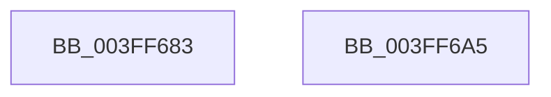

# sub_003FF683

- RVA: `0x003FF683`–`0x003FF6A6` (길이 `35` bytes)
- VA: `0x00000001403FF683`
- 실행 섹션: `.text`
- PDB 이름 있음: `아니요`; PDB Function 태그: `아니요`
- unwind 정보 RVA: `0x0009A068`
- 디코드: `13`개 명령, `35/35` bytes 표시
- 미해석 바이트: `0` (있으면 어셈블리에 `.byte`로 보존)

> 이 문서는 커널 이미지의 기계어와 PDB 기호를 분석해 생성했습니다. 4번과 5번은 함수 원형과 자료형을 바이너리 사용 방식에서 추정한 C 해석이며 원본 소스 복구 결과는 아닙니다.

## 1. Dependencies

- 직접 호출 지점: **1**; 고유 호출 대상: **1**
- 직접 호출자로 확인된 함수: **0**
- RIP 상대 이미지 참조: **0**

### Outgoing calls
- `0x003FF695` → [guard_dispatch_icall](../6B/guard_dispatch_icall_function_006BAAD0.md) (function, `0x006BAAD0`)

### Direct callers
- 이 함수 시작 RVA로 연결되는 직접 call은 확인되지 않았습니다. 간접 호출은 완전히 역산할 수 없습니다.

### Static image references
- 디코드된 RIP-relative 메모리 참조가 없습니다.

## 2. Other-region calls and transfers

- 다른 실행 섹션으로 향하는 call: **0**
- 별도 외부 분기/꼬리 이동을 확인하지 못했습니다.

## 3. Assembly (complete function range)

```asm
003FF683  4D 8B 4A 48                     mov r9, qword ptr [r10 + 0x48]
003FF687  4C 8B C6                        mov r8, rsi
003FF68A  49 8B 52 28                     mov rdx, qword ptr [r10 + 0x28]
003FF68E  49 8B C4                        mov rax, r12
003FF691  49 8B 4A 20                     mov rcx, qword ptr [r10 + 0x20]
003FF695  E8 36 B4 2B 00                  call 0x1406baad0
003FF69A  8B C3                           mov eax, ebx
003FF69C  48 83 C4 50                     add rsp, 0x50
003FF6A0  41 5C                           pop r12
003FF6A2  5E                              pop rsi
003FF6A3  5B                              pop rbx
003FF6A4  C3                              ret
003FF6A5  CC                              int3
```

## 4. C-style interpretation (structured pseudocode)

```c
__int64 __fastcall sub_003FF683(void)
{
    __int64 result;
    __int64 v_rsp;

    result = guard_dispatch_icall(*(unsigned __int64 *)(v_r10 + 32), *(unsigned __int64 *)(v_r10 + 40), v_rsi, *(unsigned __int64 *)(v_r10 + 72));
    v_rsp = (v_rsp) + (80);
    return (unsigned int)((unsigned int)(v_rbx));
}
```

## 5. (Beta) C Style

```c
void sub_003FF683(void)
{
    int64_t result;
    int64_t local_rsp;

    result = guard_dispatch_icall(*(uint64_t *)(local_r10 + 0x20), *(uint64_t *)(local_r10 + 0x28), local_rsi, *(uint64_t *)(local_r10 + 0x48));
    local_rsp = (local_rsp) + (80);
    return (uint32_t)((uint32_t)(local_rbx));
}
```

## 6. Execution-region graph

[열기: 2D/3D 그래프와 함수 탐색 컨트롤 패널](../../../control-panel.html?section=text&rva=0x003FF683&view=graph)

- 2D 그래프는 위에서 아래로 흐르고, 3D 그래프는 빈 공간을 드래그해 회전합니다. Shift+드래그는 이동, 휠은 확대·축소, 함수 노드 선택은 대상 보고서 이동입니다.

### Static fallback


