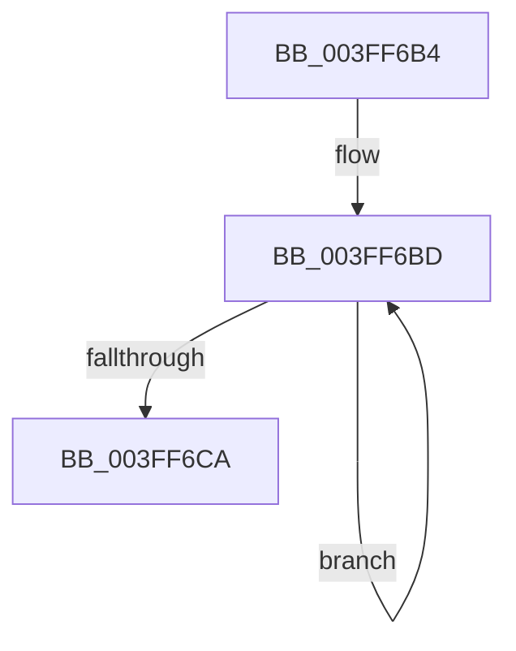

# sub_003FF6B4

- RVA: `0x003FF6B4`–`0x003FF6D6` (길이 `34` bytes)
- VA: `0x00000001403FF6B4`
- 실행 섹션: `.text`
- PDB 이름 있음: `아니요`; PDB Function 태그: `아니요`
- unwind 정보 RVA: `0x0009A0A0`
- 디코드: `10`개 명령, `34/34` bytes 표시
- 미해석 바이트: `0` (있으면 어셈블리에 `.byte`로 보존)

> 이 문서는 커널 이미지의 기계어와 PDB 기호를 분석해 생성했습니다. 4번과 5번은 함수 원형과 자료형을 바이너리 사용 방식에서 추정한 C 해석이며 원본 소스 복구 결과는 아닙니다.

## 1. Dependencies

- 직접 호출 지점: **0**; 고유 호출 대상: **0**
- 직접 호출자로 확인된 함수: **0**
- RIP 상대 이미지 참조: **0**

### Outgoing calls
- 직접 디코드된 call 명령이 없습니다.

### Direct callers
- 이 함수 시작 RVA로 연결되는 직접 call은 확인되지 않았습니다. 간접 호출은 완전히 역산할 수 없습니다.

### Static image references
- 디코드된 RIP-relative 메모리 참조가 없습니다.

## 2. Other-region calls and transfers

- 다른 실행 섹션으로 향하는 call: **0**
- call이 아닌 외부 분기/꼬리 이동: **1**
  - `0x003FF6D4` → [sub_003FF679](Unknown_function_003FF679.md) (`tail-transfer`)

## 3. Assembly (complete function range)

```asm
003FF6B4  41 0F 0D 4D 00                  prefetchw byte ptr [r13]
003FF6B9  41 8B 45 00                     mov eax, dword ptr [r13]
003FF6BD  8B C8                           mov ecx, eax
003FF6BF  83 C9 01                        or ecx, 1
003FF6C2  F0 41 0F B1 4D 00               lock cmpxchg dword ptr [r13], ecx
003FF6C8  75 F3                           jne 0x1403ff6bd
003FF6CA  A8 02                           test al, 2
003FF6CC  B8 20 01 00 C0                  mov eax, 0xc0000120
003FF6D1  0F 45 D8                        cmovne ebx, eax
003FF6D4  EB A3                           jmp 0x1403ff679
```

## 4. C-style interpretation (structured pseudocode)

```c
__int64 __fastcall sub_003FF6B4(void)
{
    __int64 v_rbx;

loc_003FF6BD:
    a1 = (unsigned int)(((unsigned int)((unsigned int)((unsigned int)(*(unsigned int *)(v_r13))))) | (1));
    if (condition_is_not_equal) goto loc_003FF6BD;
    if ((((unsigned __int8)((unsigned int)(*(unsigned int *)(v_r13)))) & (2)) != 0) { v_rbx = (unsigned int)((unsigned int)(0xC0000120ULL)); }
}
```

## 5. (Beta) C Style

```c
void sub_003FF6B4(void)
{
    int64_t local_rbx;

loc_003FF6BD:
    a1 = (uint32_t)(((uint32_t)((uint32_t)((uint32_t)(*(uint32_t *)(local_r13))))) | (1));
    if (condition_is_not_equal) goto loc_003FF6BD;
    if ((((uint8_t)((uint32_t)(*(uint32_t *)(local_r13)))) & (2)) != 0) { local_rbx = (uint32_t)((uint32_t)(0xC0000120ULL)); }
}
```

## 6. Execution-region graph

[열기: 2D/3D 그래프와 함수 탐색 컨트롤 패널](../../../control-panel.html?section=text&rva=0x003FF6B4&view=graph)

- 2D 그래프는 위에서 아래로 흐르고, 3D 그래프는 빈 공간을 드래그해 회전합니다. Shift+드래그는 이동, 휠은 확대·축소, 함수 노드 선택은 대상 보고서 이동입니다.

### Static fallback


