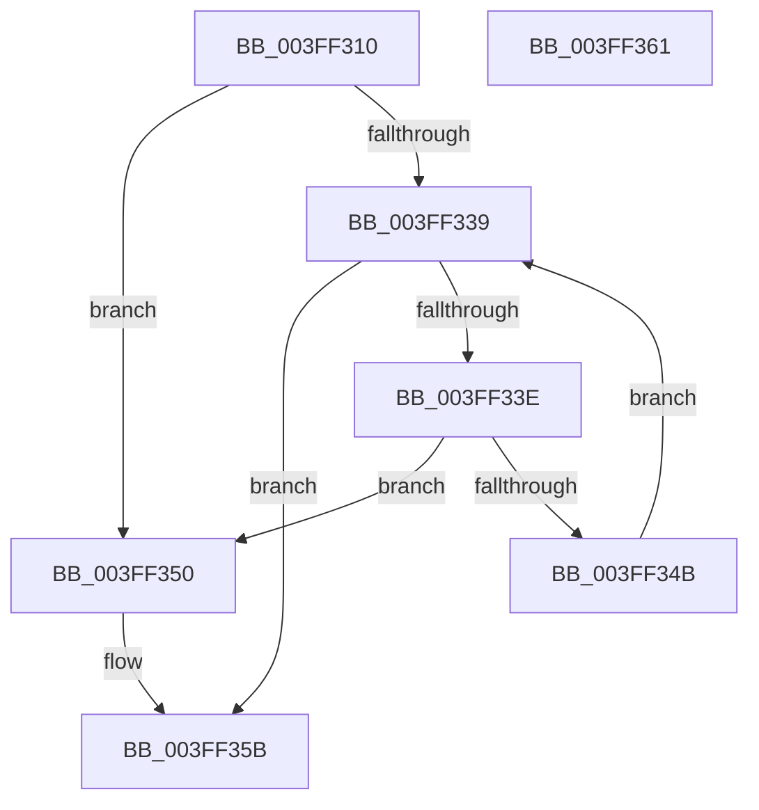

# VfPtMiscPoolNotification

- RVA: `0x003FF310`–`0x003FF362` (길이 `82` bytes)
- VA: `0x00000001403FF310`
- 실행 섹션: `.text`
- PDB 이름 있음: `예`; PDB Function 태그: `아니요`
- unwind 정보 RVA: `0x0005CF00`
- 디코드: `26`개 명령, `82/82` bytes 표시
- 미해석 바이트: `0` (있으면 어셈블리에 `.byte`로 보존)

> 이 문서는 커널 이미지의 기계어와 PDB 기호를 분석해 생성했습니다. 4번과 5번은 함수 원형과 자료형을 바이너리 사용 방식에서 추정한 C 해석이며 원본 소스 복구 결과는 아닙니다.

## 1. Dependencies

- 직접 호출 지점: **1**; 고유 호출 대상: **1**
- 직접 호출자로 확인된 함수: **21**
- RIP 상대 이미지 참조: **2**

### Outgoing calls
- `0x003FF356` → [ViPtLogPoolTraceWrapper](../../pagevrfy/B9/ViPtLogPoolTraceWrapper_function_00B92100.md) (function, `0x00B92100`)

### Direct callers
- [sub_0029EBBD](../29/Unknown_function_0029EBBD.md) at `0x0029EBCE`
- [IoAllocateMdl](../29/IoAllocateMdl_function_0029EBF0.md) at `0x0029EE39`
- [MiAllocateContiguousMemory](../3E/MiAllocateContiguousMemory_function_003E9FDC.md) at `0x003EA646`
- [MiAllocatePagesForMdl](../3E/MiAllocatePagesForMdl_function_003EABEC.md) at `0x003EAE2C`
- [MmFreeContiguousMemory](MmFreeContiguousMemory_function_003F6F60.md) at `0x003F714E`
- [IopAllocateMdl](IopAllocateMdl_function_003FF0B0.md) at `0x003FF300`
- [MmAllocateMappingAddressEx](../../page/A7/MmAllocateMappingAddressEx_function_00A726B0.md) at `0x00A72869`
- [VfPtIoAllocateMdl_Exit](../../pagevrfy/B9/VfPtIoAllocateMdl_Exit_function_00B9C1C0.md) at `0x00B9C1F3`
- [VfPtMmAllocateContiguousMemoryEx_Exit](../../pagevrfy/B9/VfPtMmAllocateContiguousMemoryEx_Exit_function_00B9C210.md) at `0x00B9C23E`
- [VfPtMmAllocateContiguousMemorySpecifyCacheNode_Exit](../../pagevrfy/B9/VfPtMmAllocateContiguousMemorySpecifyCacheNode_Exit_function_00B9C250.md) at `0x00B9C278`
- [VfPtMmAllocateContiguousMemory_Exit](../../pagevrfy/B9/VfPtMmAllocateContiguousMemory_Exit_function_00B9C290.md) at `0x00B9C2B8`
- [VfPtMmAllocateMappingAddressEx_Exit](../../pagevrfy/B9/VfPtMmAllocateMappingAddressEx_Exit_function_00B9C2D0.md) at `0x00B9C2F6`
- [VfPtMmAllocateMappingAddress_Exit](../../pagevrfy/B9/VfPtMmAllocateMappingAddress_Exit_function_00B9C310.md) at `0x00B9C336`
- [VfPtMmAllocateNodePagesForMdlEx_Exit](../../pagevrfy/B9/VfPtMmAllocateNodePagesForMdlEx_Exit_function_00B9C350.md) at `0x00B9C379`
- [VfPtMmAllocateNonCachedMemory_Exit](../../pagevrfy/B9/VfPtMmAllocateNonCachedMemory_Exit_function_00B9C390.md) at `0x00B9C3B8`
- [VfPtMmAllocatePagesForMdlEx_Exit](../../pagevrfy/B9/VfPtMmAllocatePagesForMdlEx_Exit_function_00B9C3D0.md) at `0x00B9C3F9`
- [VfPtMmAllocatePagesForMdl_Exit](../../pagevrfy/B9/VfPtMmAllocatePagesForMdl_Exit_function_00B9C410.md) at `0x00B9C439`
- [VfPtMmCreateMdl_Exit](../../pagevrfy/B9/VfPtMmCreateMdl_Exit_function_00B9C450.md) at `0x00B9C479`
- [VfPtMmFreeContiguousMemory_Entry](../../pagevrfy/B9/VfPtMmFreeContiguousMemory_Entry_function_00B9C490.md) at `0x00B9C4B6`
- [VfPtMmFreeMappingAddress_Entry](../../pagevrfy/B9/VfPtMmFreeMappingAddress_Entry_function_00B9C4D0.md) at `0x00B9C4F4`
- [VfPtMmFreeNonCachedMemory_Entry](../../pagevrfy/B9/VfPtMmFreeNonCachedMemory_Entry_function_00B9C510.md) at `0x00B9C538`

### Static image references
- `0x003FF31C` → RVA `0x00E0EA70` (`.data`; read)
- `0x003FF33E` → RVA `0x00E681D8` (`.data`; read)

## 2. Other-region calls and transfers

- 다른 실행 섹션으로 향하는 call: **1**
  - `0x003FF356` → [ViPtLogPoolTraceWrapper](../../pagevrfy/B9/ViPtLogPoolTraceWrapper_function_00B92100.md) (`.text` → `PAGEVRFY`)
- 별도 외부 분기/꼬리 이동을 확인하지 못했습니다.

## 3. Assembly (complete function range)

```asm
003FF310  40 53                           push rbx
003FF312  48 83 EC 20                     sub rsp, 0x20
003FF316  45 33 D2                        xor r10d, r10d
003FF319  45 8B D8                        mov r11d, r8d
003FF31C  44 8B 05 4D F7 A0 00            mov r8d, dword ptr [rip + 0xa0f74d]
003FF323  41 F6 D9                        neg r9b
003FF326  45 1B C9                        sbb r9d, r9d
003FF329  41 F7 D9                        neg r9d
003FF32C  41 83 C1 02                     add r9d, 2
003FF330  41 8D 40 FF                     lea eax, [r8 - 1]
003FF334  83 F8 09                        cmp eax, 9
003FF337  77 17                           ja 0x1403ff350
003FF339  45 3B D0                        cmp r10d, r8d
003FF33C  73 1D                           jae 0x1403ff35b
003FF33E  48 8D 1D 93 8E A6 00            lea rbx, [rip + 0xa68e93]
003FF345  46 39 1C 93                     cmp dword ptr [rbx + r10*4], r11d
003FF349  74 05                           je 0x1403ff350
003FF34B  41 FF C2                        inc r10d
003FF34E  EB E9                           jmp 0x1403ff339
003FF350  4C 8B C2                        mov r8, rdx
003FF353  41 8B D3                        mov edx, r11d
003FF356  E8 A5 2D 79 00                  call 0x140b92100
003FF35B  48 83 C4 20                     add rsp, 0x20
003FF35F  5B                              pop rbx
003FF360  C3                              ret
003FF361  CC                              int3
```

## 4. C-style interpretation (structured pseudocode)

```c
__int64 __fastcall VfPtMiscPoolNotification(__int64 a1, __int64 a2, int a3, unsigned __int8 a4)
{
    __int64 result;
    __int64 v_r10;
    __int64 v_rsp;

    v_rsp = (v_rsp) - (32);
    v_r10 = 0;
    a4 = (unsigned __int8)(-(a4));
    a4 = (unsigned int)(-(a4));
    a4 = (unsigned int)((a4) + (2));
    if (((unsigned int)((unsigned int)(*(unsigned int *)(v_rip + 10549069)) - 1)) > 9) goto loc_003FF350;
loc_003FF339:
    if (0 >= ((unsigned int)((unsigned int)(*(unsigned int *)(v_rip + 10549069))))) goto loc_003FF35B;
    if ((*(unsigned int *)(v_rip + 10915475 + v_r10 * 4)) == ((unsigned int)((unsigned int)(a3)))) goto loc_003FF350;
    v_r10 = (unsigned int)((v_r10) + 1);
    goto loc_003FF339;
loc_003FF350:
    result = ViPtLogPoolTraceWrapper(a1, (unsigned int)((unsigned int)((unsigned int)(a3))), a2, a4);
loc_003FF35B:
    v_rsp = (v_rsp) + (32);
    return result;
}
```

## 5. (Beta) C Style

```c
int64_t VfPtMiscPoolNotification(int64_t Arg1, int64_t Arg2, int32_t Arg3, uint8_t Arg4)
{
    int64_t result;
    int64_t local_r10;
    int64_t local_rsp;

    local_rsp = (local_rsp) - (32);
    local_r10 = 0;
    Arg4 = (uint8_t)(-(Arg4));
    Arg4 = (uint32_t)(-(Arg4));
    Arg4 = (uint32_t)((Arg4) + (2));
    if (((uint32_t)((uint32_t)(*(uint32_t *)(v_rip + 0xA0F74D)) - 1)) > 9) goto loc_003FF350;
loc_003FF339:
    if (0 >= ((uint32_t)((uint32_t)(*(uint32_t *)(v_rip + 0xA0F74D))))) goto loc_003FF35B;
    if ((*(uint32_t *)(v_rip + 0xA68E93 + local_r10 * 4)) == ((uint32_t)((uint32_t)(Arg3)))) goto loc_003FF350;
    local_r10 = (uint32_t)((local_r10) + 1);
    goto loc_003FF339;
loc_003FF350:
    result = ViPtLogPoolTraceWrapper(Arg1, (uint32_t)((uint32_t)((uint32_t)(Arg3))), Arg2, Arg4);
loc_003FF35B:
    local_rsp = (local_rsp) + (32);
    return result;
}
```

## 6. Execution-region graph

[열기: 2D/3D 그래프와 함수 탐색 컨트롤 패널](../../../control-panel.html?section=text&rva=0x003FF310&view=graph)

- 2D 그래프는 위에서 아래로 흐르고, 3D 그래프는 빈 공간을 드래그해 회전합니다. Shift+드래그는 이동, 휠은 확대·축소, 함수 노드 선택은 대상 보고서 이동입니다.

### Static fallback


