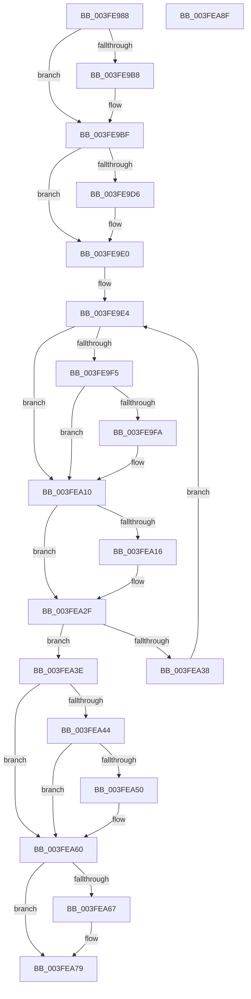

# wil_details_FeatureStateCache_ReevaluateCachedFeatureEnabledState

- RVA: `0x003FE988`–`0x003FEA90` (길이 `264` bytes)
- VA: `0x00000001403FE988`
- 실행 섹션: `.text`
- PDB 이름 있음: `예`; PDB Function 태그: `아니요`
- unwind 정보 RVA: `0x00099F10`
- 디코드: `84`개 명령, `264/264` bytes 표시
- 미해석 바이트: `0` (있으면 어셈블리에 `.byte`로 보존)

> 이 문서는 커널 이미지의 기계어와 PDB 기호를 분석해 생성했습니다. 4번과 5번은 함수 원형과 자료형을 바이너리 사용 방식에서 추정한 C 해석이며 원본 소스 복구 결과는 아닙니다.

## 1. Dependencies

- 직접 호출 지점: **3**; 고유 호출 대상: **2**
- 직접 호출자로 확인된 함수: **6**
- RIP 상대 이미지 참조: **2**

### Outgoing calls
- `0x003FE9B8` → [guard_dispatch_icall](../6B/guard_dispatch_icall_function_006BAAD0.md) (function, `0x006BAAD0`)
- `0x003FE9C7` → [wil_details_GetCurrentFeatureEnabledState](wil_details_GetCurrentFeatureEnabledState_function_003FEA98.md) (function, `0x003FEA98`)
- `0x003FEA5B` → [guard_dispatch_icall](../6B/guard_dispatch_icall_function_006BAAD0.md) (function, `0x006BAAD0`)

### Direct callers
- [wil_details_FeatureStateCache_GetCachedFeatureEnabledState](wil_details_FeatureStateCache_GetCachedFeatureEnabledState_function_003FE950.md) at `0x003FE97A`
- [wil_details_IsEnabledFallback](../4D/wil_details_IsEnabledFallback_function_004DAEFC.md) at `0x004DAF2E`
- [Feature_Sx_PEP_Notification_Synchronization__private_ReportUsageFallback](../5C/Feature_Sx_PEP_Notification_Synchronization__private_ReportUsageFallback_function_005CF074.md) at `0x005CF099`
- [Feature_CFR_Child_KM_C__private_ReportUsageFallback](../66/Feature_CFR_Child_KM_C__private_ReportUsageFallback_function_0066B5AC.md) at `0x0066B5D1`
- [Feature_CFR_Parent_KM_C__private_ReportUsageFallback](../66/Feature_CFR_Parent_KM_C__private_ReportUsageFallback_function_0066B61C.md) at `0x0066B641`
- [Feature_VelTest_KM_ControlledByProxy_DBD_1__private_ReportUsageFallback](../66/Feature_VelTest_KM_ControlledByProxy_DBD_1__private_ReportUsageFallback_function_0066B6E0.md) at `0x0066B705`

### Static image references
- `0x003FE998` → RVA `0x00E0F508` (`.data`; read)
- `0x003FEA44` → RVA `0x00E0F3F8` (`.data`; read)

## 2. Other-region calls and transfers

- 다른 실행 섹션으로 향하는 call: **0**
- 별도 외부 분기/꼬리 이동을 확인하지 못했습니다.

## 3. Assembly (complete function range)

```asm
003FE988  48 89 5C 24 18                  mov qword ptr [rsp + 0x18], rbx
003FE98D  55                              push rbp
003FE98E  56                              push rsi
003FE98F  57                              push rdi
003FE990  41 56                           push r14
003FE992  41 57                           push r15
003FE994  48 83 EC 20                     sub rsp, 0x20
003FE998  48 8B 05 69 0B A1 00            mov rax, qword ptr [rip + 0xa10b69]
003FE99F  33 ED                           xor ebp, ebp
003FE9A1  21 6C 24 50                     and dword ptr [rsp + 0x50], ebp
003FE9A5  4D 8B F0                        mov r14, r8
003FE9A8  48 89 54 24 58                  mov qword ptr [rsp + 0x58], rdx
003FE9AD  48 8B FA                        mov rdi, rdx
003FE9B0  4C 8B F9                        mov r15, rcx
003FE9B3  48 85 C0                        test rax, rax
003FE9B6  74 07                           je 0x1403fe9bf
003FE9B8  E8 13 C1 2B 00                  call 0x1406baad0
003FE9BD  8B E8                           mov ebp, eax
003FE9BF  48 8D 54 24 50                  lea rdx, [rsp + 0x50]
003FE9C4  49 8B CE                        mov rcx, r14
003FE9C7  E8 CC 00 00 00                  call 0x1403fea98
003FE9CC  41 80 7E 1C 00                  cmp byte ptr [r14 + 0x1c], 0
003FE9D1  48 8B D8                        mov rbx, rax
003FE9D4  75 0A                           jne 0x1403fe9e0
003FE9D6  8B CD                           mov ecx, ebp
003FE9D8  F7 D9                           neg ecx
003FE9DA  1B D2                           sbb edx, edx
003FE9DC  21 54 24 50                     and dword ptr [rsp + 0x50], edx
003FE9E0  8B C7                           mov eax, edi
003FE9E2  8B CF                           mov ecx, edi
003FE9E4  0F BA E8 12                     bts eax, 0x12
003FE9E8  83 7C 24 50 00                  cmp dword ptr [rsp + 0x50], 0
003FE9ED  8B F0                           mov esi, eax
003FE9EF  89 44 24 58                     mov dword ptr [rsp + 0x58], eax
003FE9F3  74 1B                           je 0x1403fea10
003FE9F5  F6 C1 02                        test cl, 2
003FE9F8  75 16                           jne 0x1403fea10
003FE9FA  81 E6 3E F6 FF FF               and esi, 0xfffff63e
003FEA00  8B C3                           mov eax, ebx
003FEA02  25 C1 09 00 00                  and eax, 0x9c1
003FEA07  0B F0                           or esi, eax
003FEA09  83 CE 02                        or esi, 2
003FEA0C  89 74 24 58                     mov dword ptr [rsp + 0x58], esi
003FEA10  40 F6 C7 04                     test dil, 4
003FEA14  75 19                           jne 0x1403fea2f
003FEA16  8B C6                           mov eax, esi
003FEA18  8B CB                           mov ecx, ebx
003FEA1A  81 E1 00 04 00 00               and ecx, 0x400
003FEA20  0F BA F0 0A                     btr eax, 0xa
003FEA24  8B F1                           mov esi, ecx
003FEA26  0B F0                           or esi, eax
003FEA28  83 CE 04                        or esi, 4
003FEA2B  89 74 24 58                     mov dword ptr [rsp + 0x58], esi
003FEA2F  8B C7                           mov eax, edi
003FEA31  F0 41 0F B1 37                  lock cmpxchg dword ptr [r15], esi
003FEA36  74 06                           je 0x1403fea3e
003FEA38  8B F8                           mov edi, eax
003FEA3A  8B C8                           mov ecx, eax
003FEA3C  EB A6                           jmp 0x1403fe9e4
003FEA3E  40 F6 C7 04                     test dil, 4
003FEA42  75 1C                           jne 0x1403fea60
003FEA44  48 8B 05 AD 09 A1 00            mov rax, qword ptr [rip + 0xa109ad]
003FEA4B  48 85 C0                        test rax, rax
003FEA4E  74 10                           je 0x1403fea60
003FEA50  41 0F B6 56 1C                  movzx edx, byte ptr [r14 + 0x1c]
003FEA55  44 8B C5                        mov r8d, ebp
003FEA58  49 8B CF                        mov rcx, r15
003FEA5B  E8 70 C0 2B 00                  call 0x1406baad0
003FEA60  83 7C 24 50 00                  cmp dword ptr [rsp + 0x50], 0
003FEA65  75 12                           jne 0x1403fea79
003FEA67  81 E3 C1 09 00 00               and ebx, 0x9c1
003FEA6D  81 E6 3E F6 FF FF               and esi, 0xfffff63e
003FEA73  0B DE                           or ebx, esi
003FEA75  89 5C 24 58                     mov dword ptr [rsp + 0x58], ebx
003FEA79  48 8B 44 24 58                  mov rax, qword ptr [rsp + 0x58]
003FEA7E  48 8B 5C 24 60                  mov rbx, qword ptr [rsp + 0x60]
003FEA83  48 83 C4 20                     add rsp, 0x20
003FEA87  41 5F                           pop r15
003FEA89  41 5E                           pop r14
003FEA8B  5F                              pop rdi
003FEA8C  5E                              pop rsi
003FEA8D  5D                              pop rbp
003FEA8E  C3                              ret
003FEA8F  CC                              int3
```

## 4. C-style interpretation (structured pseudocode)

```c
__int64 __fastcall wil_details_FeatureStateCache_ReevaluateCachedFeatureEnabledState(__int64 a1, __int64 a2, __int64 a3)
{
    __int64 result;
    __int64 v_rbp;
    __int64 v_rbx;
    __int64 v_rsi;
    __int64 v_rsp;
    unsigned __int64 v_stack_p10;
    unsigned __int64 v_stack_p18;
    unsigned int v_stack_p8;

    v_stack_p18 = v_rbx;
    v_rsp = (v_rsp) - (32);
    v_rbp = 0;
    v_stack_p10 = a2;
    result = *(unsigned __int64 *)(v_rip + 10554217);
    if (*(unsigned __int64 *)(v_rip + 10554217) != 0) {
        result = guard_dispatch_icall(a1, a2, a3, a4);
        v_rbp = (unsigned int)(result);
    }
    result = wil_details_GetCurrentFeatureEnabledState(a3, v_stack_p8, a3, a4);
    if ((*(unsigned __int8 *)(a3 + 28)) == 0) {
        a1 = (unsigned int)(v_rbp);
        a1 = (unsigned int)(-(a1));
    }
loc_003FE9E4:
    v_stack_p10 = (unsigned int)((unsigned int)((unsigned int)(a2)));
    if (v_stack_p8 == 0) goto loc_003FEA10;
    result = (unsigned int)((unsigned int)(a2));
    v_rsi = (unsigned int)((unsigned int)((unsigned int)((unsigned int)(a2))));
    if ((((unsigned __int8)((unsigned int)((unsigned int)(a2)))) & (2)) == 0) {
        v_rsi = (unsigned int)(((unsigned int)((unsigned int)((unsigned int)((unsigned int)(a2))))) & (0xFFFFF63EULL));
        result = (unsigned int)(result);
        result = (unsigned int)((result) & (0x9C1ULL));
        v_rsi = (unsigned int)((v_rsi) | ((unsigned int)(result)));
        v_rsi = (unsigned int)((v_rsi) | (2));
        v_stack_p10 = (unsigned int)(v_rsi);
    }
    if ((((unsigned __int8)(a2)) & (4)) == 0) {
        result = (unsigned int)(v_rsi);
        a1 = (unsigned int)(result);
        a1 = (unsigned int)((a1) & (0x400ULL));
        v_rsi = (unsigned int)(a1);
        v_rsi = (unsigned int)((v_rsi) | ((unsigned int)(result)));
        v_rsi = (unsigned int)((v_rsi) | (4));
        v_stack_p10 = (unsigned int)(v_rsi);
    }
    if (condition_is_equal) goto loc_003FEA3E;
    goto loc_003FE9E4;
loc_003FEA3E:
    if ((((unsigned __int8)((unsigned int)((unsigned int)((unsigned int)((unsigned int)(a2)))))) & (4)) != 0) goto loc_003FEA60;
    result = *(unsigned __int64 *)(v_rip + 10553773);
    if (*(unsigned __int64 *)(v_rip + 10553773) != 0) {
        a2 = *(unsigned __int8 *)(a3 + 28);
        a3 = (unsigned int)(v_rbp);
        a1 = a1;
        result = guard_dispatch_icall(a1, a2, a3, a4);
    }
    v_rbx = result;
    if (v_stack_p8 == 0) {
        v_rbx = (unsigned int)((result) & (0x9C1ULL));
        v_rsi = (unsigned int)((v_rsi) & (0xFFFFF63EULL));
        v_rbx = (unsigned int)((v_rbx) | ((unsigned int)(v_rsi)));
        v_stack_p10 = (unsigned int)(v_rbx);
    }
    v_rsp = (v_rsp) + (32);
    return v_stack_p10;
}
```

## 5. (Beta) C Style

```c
int64_t wil_details_FeatureStateCache_ReevaluateCachedFeatureEnabledState(void *Arg1, int64_t Arg2, void *Arg3)
{
    uint8_t *arg1 = (uint8_t *)Arg1;
    uint8_t *arg3 = (uint8_t *)Arg3;

    int64_t result;
    int64_t local_rbp;
    int64_t local_rbx;
    int64_t local_rsi;
    int64_t local_rsp;
    uint64_t v_stack_p10;
    uint64_t v_stack_p18;
    uint32_t v_stack_p8;

    v_stack_p18 = local_rbx;
    local_rsp = (local_rsp) - (32);
    local_rbp = 0;
    v_stack_p10 = Arg2;
    result = *(uint64_t *)(v_rip + 0xA10B69);
    if (*(uint64_t *)(v_rip + 0xA10B69) != 0) {
        result = guard_dispatch_icall(Arg1, Arg2, Arg3, a4);
        local_rbp = (uint32_t)(result);
    }
    result = wil_details_GetCurrentFeatureEnabledState(Arg3, v_stack_p8, Arg3, a4);
    if ((*(uint8_t *)(arg3 + 0x1C)) == 0) {
        Arg1 = (uint32_t)(local_rbp);
        Arg1 = (uint32_t)(-(Arg1));
    }
loc_003FE9E4:
    v_stack_p10 = (uint32_t)((uint32_t)((uint32_t)(Arg2)));
    if (v_stack_p8 == 0) goto loc_003FEA10;
    result = (uint32_t)((uint32_t)(Arg2));
    local_rsi = (uint32_t)((uint32_t)((uint32_t)((uint32_t)(Arg2))));
    if ((((uint8_t)((uint32_t)((uint32_t)(Arg2)))) & (2)) == 0) {
        local_rsi = (uint32_t)(((uint32_t)((uint32_t)((uint32_t)((uint32_t)(Arg2))))) & (0xFFFFF63EULL));
        result = (uint32_t)(result);
        result = (uint32_t)((result) & (0x9C1ULL));
        local_rsi = (uint32_t)((local_rsi) | ((uint32_t)(result)));
        local_rsi = (uint32_t)((local_rsi) | (2));
        v_stack_p10 = (uint32_t)(local_rsi);
    }
    if ((((uint8_t)(Arg2)) & (4)) == 0) {
        result = (uint32_t)(local_rsi);
        Arg1 = (uint32_t)(result);
        Arg1 = (uint32_t)((Arg1) & (0x400ULL));
        local_rsi = (uint32_t)(Arg1);
        local_rsi = (uint32_t)((local_rsi) | ((uint32_t)(result)));
        local_rsi = (uint32_t)((local_rsi) | (4));
        v_stack_p10 = (uint32_t)(local_rsi);
    }
    if (condition_is_equal) goto loc_003FEA3E;
    goto loc_003FE9E4;
loc_003FEA3E:
    if ((((uint8_t)((uint32_t)((uint32_t)((uint32_t)((uint32_t)(Arg2)))))) & (4)) != 0) goto loc_003FEA60;
    result = *(uint64_t *)(v_rip + 0xA109AD);
    if (*(uint64_t *)(v_rip + 0xA109AD) != 0) {
        Arg2 = *(uint8_t *)(arg3 + 0x1C);
        Arg3 = (uint32_t)(local_rbp);
        Arg1 = Arg1;
        result = guard_dispatch_icall(Arg1, Arg2, Arg3, a4);
    }
    local_rbx = result;
    if (v_stack_p8 == 0) {
        local_rbx = (uint32_t)((result) & (0x9C1ULL));
        local_rsi = (uint32_t)((local_rsi) & (0xFFFFF63EULL));
        local_rbx = (uint32_t)((local_rbx) | ((uint32_t)(local_rsi)));
        v_stack_p10 = (uint32_t)(local_rbx);
    }
    local_rsp = (local_rsp) + (32);
    return v_stack_p10;
}
```

### 관측된 메모리 오프셋

구조체 형식이 확인되지 않은 접근은 인자 기준의 오프셋으로만 기록했습니다.

| 기준 인자 | 오프셋 표현 | 폭 (bit) | 접근 |
|---|---:|---:|---|
| `Arg1` | `+ 0x0` | `32` | `R` |
| `Arg3` | `+ 0x1C` | `8` | `R` |

## 6. Execution-region graph

[열기: 2D/3D 그래프와 함수 탐색 컨트롤 패널](../../../control-panel.html?section=text&rva=0x003FE988&view=graph)

- 2D 그래프는 위에서 아래로 흐르고, 3D 그래프는 빈 공간을 드래그해 회전합니다. Shift+드래그는 이동, 휠은 확대·축소, 함수 노드 선택은 대상 보고서 이동입니다.

### Static fallback


