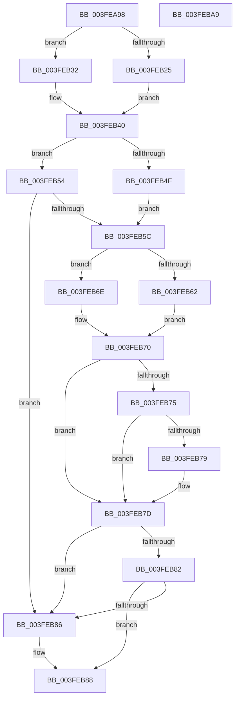

# wil_details_GetCurrentFeatureEnabledState

- RVA: `0x003FEA98`–`0x003FEBAA` (길이 `274` bytes)
- VA: `0x00000001403FEA98`
- 실행 섹션: `.text`
- PDB 이름 있음: `예`; PDB Function 태그: `아니요`
- unwind 정보 RVA: `0x00099F28`
- 디코드: `95`개 명령, `274/274` bytes 표시
- 미해석 바이트: `0` (있으면 어셈블리에 `.byte`로 보존)

> 이 문서는 커널 이미지의 기계어와 PDB 기호를 분석해 생성했습니다. 4번과 5번은 함수 원형과 자료형을 바이너리 사용 방식에서 추정한 C 해석이며 원본 소스 복구 결과는 아닙니다.

## 1. Dependencies

- 직접 호출 지점: **2**; 고유 호출 대상: **2**
- 직접 호출자로 확인된 함수: **1**
- RIP 상대 이미지 참조: **0**

### Outgoing calls
- `0x003FEADF` → [wil_RtlStagingConfig_QueryFeatureState](../../page/AC/wil_RtlStagingConfig_QueryFeatureState_function_00AC069C.md) (function, `0x00AC069C`)
- `0x003FEB65` → [wil_details_AreDependenciesEnabled](../53/wil_details_AreDependenciesEnabled_function_0053E664.md) (function, `0x0053E664`)

### Direct callers
- [wil_details_FeatureStateCache_ReevaluateCachedFeatureEnabledState](wil_details_FeatureStateCache_ReevaluateCachedFeatureEnabledState_function_003FE988.md) at `0x003FE9C7`

### Static image references
- 디코드된 RIP-relative 메모리 참조가 없습니다.

## 2. Other-region calls and transfers

- 다른 실행 섹션으로 향하는 call: **1**
  - `0x003FEADF` → [wil_RtlStagingConfig_QueryFeatureState](../../page/AC/wil_RtlStagingConfig_QueryFeatureState_function_00AC069C.md) (`.text` → `PAGE`)
- 별도 외부 분기/꼬리 이동을 확인하지 못했습니다.

## 3. Assembly (complete function range)

```asm
003FEA98  4C 8B DC                        mov r11, rsp
003FEA9B  49 89 5B 10                     mov qword ptr [r11 + 0x10], rbx
003FEA9F  49 89 6B 18                     mov qword ptr [r11 + 0x18], rbp
003FEAA3  56                              push rsi
003FEAA4  57                              push rdi
003FEAA5  41 56                           push r14
003FEAA7  48 83 EC 40                     sub rsp, 0x40
003FEAAB  8A 41 1C                        mov al, byte ptr [rcx + 0x1c]
003FEAAE  45 33 C0                        xor r8d, r8d
003FEAB1  4C 8B CA                        mov r9, rdx
003FEAB4  2C 02                           sub al, 2
003FEAB6  8B 51 18                        mov edx, dword ptr [rcx + 0x18]
003FEAB9  0F 57 C0                        xorps xmm0, xmm0
003FEABC  48 8B E9                        mov rbp, rcx
003FEABF  49 8D 4B C8                     lea rcx, [r11 - 0x38]
003FEAC3  41 8D 70 01                     lea esi, [r8 + 1]
003FEAC7  40 3A C6                        cmp al, sil
003FEACA  41 89 31                        mov dword ptr [r9], esi
003FEACD  0F 11 44 24 20                  movups xmmword ptr [rsp + 0x20], xmm0
003FEAD2  41 0F 96 C0                     setbe r8b
003FEAD6  33 C0                           xor eax, eax
003FEAD8  45 33 C9                        xor r9d, r9d
003FEADB  49 89 43 D8                     mov qword ptr [r11 - 0x28], rax
003FEADF  E8 B8 1B 6C 00                  call 0x140ac069c
003FEAE4  48 83 64 24 60 00               and qword ptr [rsp + 0x60], 0
003FEAEA  8D 7E 3F                        lea edi, [rsi + 0x3f]
003FEAED  8B 4C 24 30                     mov ecx, dword ptr [rsp + 0x30]
003FEAF1  F7 D9                           neg ecx
003FEAF3  8B 4C 24 34                     mov ecx, dword ptr [rsp + 0x34]
003FEAF7  1B D2                           sbb edx, edx
003FEAF9  81 E2 00 04 00 00               and edx, 0x400
003FEAFF  F7 D9                           neg ecx
003FEB01  45 1B C0                        sbb r8d, r8d
003FEB04  41 81 E0 00 08 00 00            and r8d, 0x800
003FEB0B  44 0B C2                        or r8d, edx
003FEB0E  F7 D8                           neg eax
003FEB10  1B C0                           sbb eax, eax
003FEB12  23 44 24 20                     and eax, dword ptr [rsp + 0x20]
003FEB16  83 E0 03                        and eax, 3
003FEB19  8B C8                           mov ecx, eax
003FEB1B  C1 E1 07                        shl ecx, 7
003FEB1E  41 0B C8                        or ecx, r8d
003FEB21  85 C0                           test eax, eax
003FEB23  75 0D                           jne 0x1403feb32
003FEB25  8A 45 1F                        mov al, byte ptr [rbp + 0x1f]
003FEB28  F6 D8                           neg al
003FEB2A  1B DB                           sbb ebx, ebx
003FEB2C  23 DF                           and ebx, edi
003FEB2E  0B D9                           or ebx, ecx
003FEB30  EB 0E                           jmp 0x1403feb40
003FEB32  33 C0                           xor eax, eax
003FEB34  8B D9                           mov ebx, ecx
003FEB36  83 7C 24 20 02                  cmp dword ptr [rsp + 0x20], 2
003FEB3B  0F 44 C7                        cmove eax, edi
003FEB3E  0B D8                           or ebx, eax
003FEB40  BA 00 0C 00 00                  mov edx, 0xc00
003FEB45  8B C3                           mov eax, ebx
003FEB47  23 C2                           and eax, edx
003FEB49  33 C9                           xor ecx, ecx
003FEB4B  3B C2                           cmp eax, edx
003FEB4D  75 05                           jne 0x1403feb54
003FEB4F  44 8B F6                        mov r14d, esi
003FEB52  EB 08                           jmp 0x1403feb5c
003FEB54  45 33 F6                        xor r14d, r14d
003FEB57  40 84 DF                        test dil, bl
003FEB5A  74 2A                           je 0x1403feb86
003FEB5C  48 39 4D 20                     cmp qword ptr [rbp + 0x20], rcx
003FEB60  74 0C                           je 0x1403feb6e
003FEB62  48 8B CD                        mov rcx, rbp
003FEB65  E8 FA FA 13 00                  call 0x14053e664
003FEB6A  8B C8                           mov ecx, eax
003FEB6C  EB 02                           jmp 0x1403feb70
003FEB6E  8B CE                           mov ecx, esi
003FEB70  45 85 F6                        test r14d, r14d
003FEB73  74 08                           je 0x1403feb7d
003FEB75  85 C9                           test ecx, ecx
003FEB77  75 04                           jne 0x1403feb7d
003FEB79  0F BA F3 0A                     btr ebx, 0xa
003FEB7D  40 84 DF                        test dil, bl
003FEB80  74 04                           je 0x1403feb86
003FEB82  85 C9                           test ecx, ecx
003FEB84  75 02                           jne 0x1403feb88
003FEB86  33 F6                           xor esi, esi
003FEB88  48 8B 6C 24 70                  mov rbp, qword ptr [rsp + 0x70]
003FEB8D  83 E3 FE                        and ebx, 0xfffffffe
003FEB90  0B DE                           or ebx, esi
003FEB92  89 5C 24 60                     mov dword ptr [rsp + 0x60], ebx
003FEB96  48 8B 44 24 60                  mov rax, qword ptr [rsp + 0x60]
003FEB9B  48 8B 5C 24 68                  mov rbx, qword ptr [rsp + 0x68]
003FEBA0  48 83 C4 40                     add rsp, 0x40
003FEBA4  41 5E                           pop r14
003FEBA6  5F                              pop rdi
003FEBA7  5E                              pop rsi
003FEBA8  C3                              ret
003FEBA9  CC                              int3
```

## 4. C-style interpretation (structured pseudocode)

```c
__int64 __fastcall wil_details_GetCurrentFeatureEnabledState(__int64 a1, __int64 a2, int a3)
{
    __int64 result;
    __int64 v_r14;
    __int64 v_rbx;
    __int64 v_rsi;
    __int64 v_rsp;
    unsigned int v_stack_m24;
    unsigned int v_stack_m28;
    unsigned __int64 v_stack_m38;
    unsigned __int64 v_stack_p10;
    unsigned __int64 v_stack_p18;
    unsigned __int64 v_stack_p8;

    *(unsigned __int64 *)(v_rsp + 16) = v_rbx;
    *(unsigned __int64 *)(v_rsp + 24) = v_rbp;
    v_rsp = (v_rsp) - (64);
    a3 = 0;
    result = (unsigned __int8)((*(unsigned __int8 *)(a1 + 28)) - (2));
    *(unsigned int *)(a2) = (unsigned int)(a3 + 1);
    v_stack_m38 = v_xmm0;
    a3 = (((unsigned __int8)(result)) <= ((unsigned __int8)(a3 + 1))) ? 1 : 0;
    result = 0;
    a4 = 0;
    *(unsigned __int64 *)(v_rsp - 40) = 0;
    result = wil_RtlStagingConfig_QueryFeatureState(v_rsp - 56, (unsigned int)(*(unsigned int *)(a1 + 24)), a3, a4);
    a1 = (unsigned int)(-((unsigned int)(v_stack_m28)));
    a2 = (unsigned int)(((unsigned int)(*(unsigned int *)(a1 + 24))) & (0x400ULL));
    a1 = (unsigned int)(-((unsigned int)(v_stack_m24)));
    a3 = (unsigned int)((a3) & (0x800ULL));
    a3 = (unsigned int)((a3) | ((unsigned int)(a2)));
    result = (unsigned int)(-(result));
    result = (unsigned int)((result) & (v_stack_m38));
    result = (unsigned int)((result) & (3));
    a1 = (unsigned int)(((unsigned int)((unsigned int)(result))) << (7));
    a1 = (unsigned int)((a1) | (a3));
    if ((unsigned int)(result) != 0) goto loc_003FEB32;
    result = (unsigned __int8)(-(*(unsigned __int8 *)(a1 + 31)));
    v_rbx = (unsigned int)((v_rbx) & ((unsigned int)(a3 + 1 + 63)));
    v_rbx = (unsigned int)((v_rbx) | ((unsigned int)(a1)));
    goto loc_003FEB40;
loc_003FEB32:
    result = 0;
    if (v_stack_m38 == 2) { result = (unsigned int)(a3 + 1 + 63); }
    v_rbx = (unsigned int)(((unsigned int)((unsigned int)(a1))) | ((unsigned int)(result)));
loc_003FEB40:
    result = (unsigned int)(((unsigned int)((unsigned int)(v_rbx))) & ((unsigned int)((unsigned int)(0xC00ULL))));
    a1 = 0;
    if (((unsigned int)(result)) != ((unsigned int)((unsigned int)(0xC00ULL)))) goto loc_003FEB54;
    goto loc_003FEB5C;
loc_003FEB54:
    v_r14 = 0;
    if ((((unsigned __int8)(a3 + 1 + 63)) & ((unsigned __int8)(v_rbx))) == 0) goto loc_003FEB86;
loc_003FEB5C:
    if ((*(unsigned __int64 *)(a1 + 32)) == 0) goto loc_003FEB6E;
    result = wil_details_AreDependenciesEnabled(0, (unsigned int)(0xC00ULL), a3, a4);
    goto loc_003FEB70;
loc_003FEB6E:
loc_003FEB70:
    if (0 == 0) goto loc_003FEB7D;
    if ((unsigned int)((unsigned int)((unsigned int)(a3 + 1))) == 0) {
    }
    if ((((unsigned __int8)(a3 + 1 + 63)) & ((unsigned __int8)(v_rbx))) == 0) goto loc_003FEB86;
    v_rsi = a3 + 1;
    if ((unsigned int)((unsigned int)((unsigned int)(a3 + 1))) == 0) {
        v_rsi = 0;
    }
    v_rbx = (unsigned int)((v_rbx) & (0xFFFFFFFEULL));
    v_rbx = (unsigned int)((v_rbx) | (0));
    v_stack_p8 = (unsigned int)(v_rbx);
    v_rsp = (v_rsp) + (64);
    return v_stack_p8;
}
```

## 5. (Beta) C Style

```c
int64_t wil_details_GetCurrentFeatureEnabledState(void *Arg1, void *Arg2, int32_t Arg3)
{
    uint8_t *arg1 = (uint8_t *)Arg1;
    uint8_t *arg2 = (uint8_t *)Arg2;

    int64_t result;
    int64_t local_r14;
    int64_t local_rbx;
    int64_t local_rsi;
    int64_t local_rsp;
    uint32_t v_stack_m24;
    uint32_t v_stack_m28;
    uint64_t v_stack_m38;
    uint64_t v_stack_p10;
    uint64_t v_stack_p18;
    uint64_t v_stack_p8;

    *(uint64_t *)(local_rsp + 0x10) = local_rbx;
    *(uint64_t *)(local_rsp + 0x18) = local_rbp;
    local_rsp = (local_rsp) - (64);
    Arg3 = 0;
    result = (uint8_t)((*(uint8_t *)(arg1 + 0x1C)) - (2));
    *(uint32_t *)(arg2) = (uint32_t)(Arg3 + 1);
    v_stack_m38 = v_xmm0;
    Arg3 = (((uint8_t)(result)) <= ((uint8_t)(Arg3 + 1))) ? 1 : 0;
    result = 0;
    a4 = 0;
    *(uint64_t *)(local_rsp - 0x28) = 0;
    result = wil_RtlStagingConfig_QueryFeatureState(local_rsp - 56, (uint32_t)(*(uint32_t *)(arg1 + 0x18)), Arg3, a4);
    Arg1 = (uint32_t)(-((uint32_t)(v_stack_m28)));
    Arg2 = (uint32_t)(((uint32_t)(*(uint32_t *)(arg1 + 0x18))) & (0x400ULL));
    Arg1 = (uint32_t)(-((uint32_t)(v_stack_m24)));
    Arg3 = (uint32_t)((Arg3) & (0x800ULL));
    Arg3 = (uint32_t)((Arg3) | ((uint32_t)(Arg2)));
    result = (uint32_t)(-(result));
    result = (uint32_t)((result) & (v_stack_m38));
    result = (uint32_t)((result) & (3));
    Arg1 = (uint32_t)(((uint32_t)((uint32_t)(result))) << (7));
    Arg1 = (uint32_t)((Arg1) | (Arg3));
    if ((uint32_t)(result) != 0) goto loc_003FEB32;
    result = (uint8_t)(-(*(uint8_t *)(arg1 + 0x1F)));
    local_rbx = (uint32_t)((local_rbx) & ((uint32_t)(Arg3 + 1 + 63)));
    local_rbx = (uint32_t)((local_rbx) | ((uint32_t)(Arg1)));
    goto loc_003FEB40;
loc_003FEB32:
    result = 0;
    if (v_stack_m38 == 2) { result = (uint32_t)(Arg3 + 1 + 63); }
    local_rbx = (uint32_t)(((uint32_t)((uint32_t)(Arg1))) | ((uint32_t)(result)));
loc_003FEB40:
    result = (uint32_t)(((uint32_t)((uint32_t)(local_rbx))) & ((uint32_t)((uint32_t)(0xC00ULL))));
    Arg1 = 0;
    if (((uint32_t)(result)) != ((uint32_t)((uint32_t)(0xC00ULL)))) goto loc_003FEB54;
    goto loc_003FEB5C;
loc_003FEB54:
    local_r14 = 0;
    if ((((uint8_t)(Arg3 + 1 + 63)) & ((uint8_t)(local_rbx))) == 0) goto loc_003FEB86;
loc_003FEB5C:
    if ((*(uint64_t *)(arg1 + 0x20)) == 0) goto loc_003FEB6E;
    result = wil_details_AreDependenciesEnabled(0, (uint32_t)(0xC00ULL), Arg3, a4);
    goto loc_003FEB70;
loc_003FEB6E:
loc_003FEB70:
    if (0 == 0) goto loc_003FEB7D;
    if ((uint32_t)((uint32_t)((uint32_t)(Arg3 + 1))) == 0) {
    }
    if ((((uint8_t)(Arg3 + 1 + 63)) & ((uint8_t)(local_rbx))) == 0) goto loc_003FEB86;
    local_rsi = Arg3 + 1;
    if ((uint32_t)((uint32_t)((uint32_t)(Arg3 + 1))) == 0) {
        local_rsi = 0;
    }
    local_rbx = (uint32_t)((local_rbx) & (0xFFFFFFFEULL));
    local_rbx = (uint32_t)((local_rbx) | (0));
    v_stack_p8 = (uint32_t)(local_rbx);
    local_rsp = (local_rsp) + (64);
    return v_stack_p8;
}
```

### 관측된 메모리 오프셋

구조체 형식이 확인되지 않은 접근은 인자 기준의 오프셋으로만 기록했습니다.

| 기준 인자 | 오프셋 표현 | 폭 (bit) | 접근 |
|---|---:|---:|---|
| `Arg1` | `+ 0x18` | `32` | `R` |
| `Arg1` | `+ 0x1C` | `8` | `R` |
| `Arg1` | `+ 0x1F` | `8` | `R` |
| `Arg1` | `+ 0x20` | `64` | `R` |
| `Arg2` | `+ 0x0` | `32` | `W` |

## 6. Execution-region graph

[열기: 2D/3D 그래프와 함수 탐색 컨트롤 패널](../../../control-panel.html?section=text&rva=0x003FEA98&view=graph)

- 2D 그래프는 위에서 아래로 흐르고, 3D 그래프는 빈 공간을 드래그해 회전합니다. Shift+드래그는 이동, 휠은 확대·축소, 함수 노드 선택은 대상 보고서 이동입니다.

### Static fallback


