# AdtpBuildAccessReasonAuditStringInternal

- RVA: `0x0040F344`–`0x0040F8D8` (길이 `1,428` bytes)
- VA: `0x000000014040F344`
- 실행 섹션: `.text`
- PDB 이름 있음: `예`; PDB Function 태그: `예`
- unwind 정보 RVA: `0x0009BACC`
- 디코드: `351`개 명령, `1,428/1,428` bytes 표시
- 미해석 바이트: `0` (있으면 어셈블리에 `.byte`로 보존)

> 이 문서는 커널 이미지의 기계어와 PDB 기호를 분석해 생성했습니다. 4번과 5번은 함수 원형과 자료형을 바이너리 사용 방식에서 추정한 C 해석이며 원본 소스 복구 결과는 아닙니다.

## 1. Dependencies

- 직접 호출 지점: **24**; 고유 호출 대상: **13**
- 직접 호출자로 확인된 함수: **1**
- RIP 상대 이미지 참조: **4**

### Outgoing calls
- `0x0040F42E` → [AdtpFormatPrefix](AdtpFormatPrefix_function_0040F8E0.md) (function, `0x0040F8E0`)
- `0x0040F45B` → [AdtpFormatPrefix](AdtpFormatPrefix_function_0040F8E0.md) (function, `0x0040F8E0`)
- `0x0040F488` → [AdtpFormatPrefix](AdtpFormatPrefix_function_0040F8E0.md) (function, `0x0040F8E0`)
- `0x0040F4B5` → [AdtpFormatPrefix](AdtpFormatPrefix_function_0040F8E0.md) (function, `0x0040F8E0`)
- `0x0040F4DE` → [AdtpFormatPrefix](AdtpFormatPrefix_function_0040F8E0.md) (function, `0x0040F8E0`)
- `0x0040F507` → [AdtpFormatPrefix](AdtpFormatPrefix_function_0040F8E0.md) (function, `0x0040F8E0`)
- `0x0040F530` → [AdtpFormatPrefix](AdtpFormatPrefix_function_0040F8E0.md) (function, `0x0040F8E0`)
- `0x0040F571` → [_security_check_cookie](../6A/_security_check_cookie_function_006AC640.md) (function, `0x006AC640`)
- `0x0040F5BC` → [AdtpBuildAccessesString](../../page/A8/AdtpBuildAccessesString_function_00A8898C.md) (function, `0x00A8898C`)
- `0x0040F67B` → [RtlGetAce](RtlGetAce_function_0040FAF0.md) (function, `0x0040FAF0`)
- `0x0040F6A4` → [ExAllocatePool2](../../poolcode/B8/ExAllocatePool2_function_00B820F0.md) (function, `0x00B820F0`)
- `0x0040F6BE` → [RtlCreateAcl](../../page/91/RtlCreateAcl_function_00916F00.md) (function, `0x00916F00`)
- `0x0040F6E3` → [RtlAddAce](../../page/92/RtlAddAce_function_00929D70.md) (function, `0x00929D70`)
- `0x0040F6FB` → [RtlCreateSecurityDescriptor](../../page/9F/RtlCreateSecurityDescriptor_function_009F1DF0.md) (function, `0x009F1DF0`)
- `0x0040F716` → [RtlSetDaclSecurityDescriptor](../../page/9E/RtlSetDaclSecurityDescriptor_function_009EC210.md) (function, `0x009EC210`)
- `0x0040F745` → [LocalConvertSDToStringSD_Rev1](../../page/92/LocalConvertSDToStringSD_Rev1_function_00924428.md) (function, `0x00924428`)
- `0x0040F7A5` → [RtlStringCbPrintfW](RtlStringCbPrintfW_function_0040FB40.md) (function, `0x0040FB40`)
- `0x0040F7CD` → [ExFreePoolWithTag](../../poolcode/B8/ExFreePoolWithTag_function_00B82870.md) (function, `0x00B82870`)
- `0x0040F834` → [StringCchPrintfW](../47/StringCchPrintfW_function_0047BAD0.md) (function, `0x0047BAD0`)
- `0x0040F871` → [ExAllocatePool2](../../poolcode/B8/ExAllocatePool2_function_00B820F0.md) (function, `0x00B820F0`)
- `0x0040F8AA` → [ExFreePoolWithTag](../../poolcode/B8/ExFreePoolWithTag_function_00B82870.md) (function, `0x00B82870`)
- `0x0040F8B6` → [ExFreePoolWithTag](../../poolcode/B8/ExFreePoolWithTag_function_00B82870.md) (function, `0x00B82870`)
- `0x0040F8C2` → [ExFreePoolWithTag](../../poolcode/B8/ExFreePoolWithTag_function_00B82870.md) (function, `0x00B82870`)
- `0x0040F8CE` → [ExFreePoolWithTag](../../poolcode/B8/ExFreePoolWithTag_function_00B82870.md) (function, `0x00B82870`)

### Direct callers
- [AdtpBuildAccessReasonAuditString](AdtpBuildAccessReasonAuditString_function_0040EE04.md) at `0x0040F0BA`
- [AdtpBuildAccessReasonAuditString](AdtpBuildAccessReasonAuditString_function_0040EE04.md) at `0x0040F1A6`

### Static image references
- `0x0040F360` → RVA `0x00E0A740` (`.data`; read)
- `0x0040F795` → RVA `0x00019A00` (`.rdata`; read)
- `0x0040F824` → RVA `0x000419A8` (`.rdata`; read)
- `0x0040F83F` → RVA `0x0001A748` (`.rdata`; read)

## 2. Other-region calls and transfers

- 다른 실행 섹션으로 향하는 call: **13**
  - `0x0040F5BC` → [AdtpBuildAccessesString](../../page/A8/AdtpBuildAccessesString_function_00A8898C.md) (`.text` → `PAGE`)
  - `0x0040F6A4` → [ExAllocatePool2](../../poolcode/B8/ExAllocatePool2_function_00B820F0.md) (`.text` → `POOLCODE`)
  - `0x0040F6BE` → [RtlCreateAcl](../../page/91/RtlCreateAcl_function_00916F00.md) (`.text` → `PAGE`)
  - `0x0040F6E3` → [RtlAddAce](../../page/92/RtlAddAce_function_00929D70.md) (`.text` → `PAGE`)
  - `0x0040F6FB` → [RtlCreateSecurityDescriptor](../../page/9F/RtlCreateSecurityDescriptor_function_009F1DF0.md) (`.text` → `PAGE`)
  - `0x0040F716` → [RtlSetDaclSecurityDescriptor](../../page/9E/RtlSetDaclSecurityDescriptor_function_009EC210.md) (`.text` → `PAGE`)
  - `0x0040F745` → [LocalConvertSDToStringSD_Rev1](../../page/92/LocalConvertSDToStringSD_Rev1_function_00924428.md) (`.text` → `PAGE`)
  - `0x0040F7CD` → [ExFreePoolWithTag](../../poolcode/B8/ExFreePoolWithTag_function_00B82870.md) (`.text` → `POOLCODE`)
  - `0x0040F871` → [ExAllocatePool2](../../poolcode/B8/ExAllocatePool2_function_00B820F0.md) (`.text` → `POOLCODE`)
  - `0x0040F8AA` → [ExFreePoolWithTag](../../poolcode/B8/ExFreePoolWithTag_function_00B82870.md) (`.text` → `POOLCODE`)
  - `0x0040F8B6` → [ExFreePoolWithTag](../../poolcode/B8/ExFreePoolWithTag_function_00B82870.md) (`.text` → `POOLCODE`)
  - `0x0040F8C2` → [ExFreePoolWithTag](../../poolcode/B8/ExFreePoolWithTag_function_00B82870.md) (`.text` → `POOLCODE`)
  - `0x0040F8CE` → [ExFreePoolWithTag](../../poolcode/B8/ExFreePoolWithTag_function_00B82870.md) (`.text` → `POOLCODE`)
- call이 아닌 외부 분기/꼬리 이동: **7**
  - `0x0040F5F6` → [sub_006ECA3A + 0x32D](../6E/Unknown_function_006ECA3A.md) (`tail-transfer`)
  - `0x0040F5FC` → [sub_006ECA3A + 0x65](../6E/Unknown_function_006ECA3A.md) (`tail-transfer`)
  - `0x0040F610` → [sub_006ECA3A + 0x8](../6E/Unknown_function_006ECA3A.md) (`tail-transfer`)
  - `0x0040F7F2` → [sub_006ECA3A](../6E/Unknown_function_006ECA3A.md) (`tail-transfer`)
  - `0x0040F859` → [sub_006ECA3A + 0x258](../6E/Unknown_function_006ECA3A.md) (`tail-transfer`)
  - `0x0040F881` → [sub_006ECA3A + 0x26B](../6E/Unknown_function_006ECA3A.md) (`tail-transfer`)
  - `0x0040F896` → [sub_006ECA3A + 0x3A7](../6E/Unknown_function_006ECA3A.md) (`tail-transfer`)

## 3. Assembly (complete function range)

```asm
0040F344  40 55                           push rbp
0040F346  53                              push rbx
0040F347  56                              push rsi
0040F348  57                              push rdi
0040F349  41 54                           push r12
0040F34B  41 55                           push r13
0040F34D  41 56                           push r14
0040F34F  41 57                           push r15
0040F351  48 8D AC 24 68 FE FF FF         lea rbp, [rsp - 0x198]
0040F359  48 81 EC 98 02 00 00            sub rsp, 0x298
0040F360  48 8B 05 D9 B3 9F 00            mov rax, qword ptr [rip + 0x9fb3d9]
0040F367  48 33 C4                        xor rax, rsp
0040F36A  48 89 85 80 01 00 00            mov qword ptr [rbp + 0x180], rax
0040F371  48 8B 85 10 02 00 00            mov rax, qword ptr [rbp + 0x210]
0040F378  0F 57 C0                        xorps xmm0, xmm0
0040F37B  8B BD 00 02 00 00               mov edi, dword ptr [rbp + 0x200]
0040F381  0F 57 C9                        xorps xmm1, xmm1
0040F384  48 89 45 30                     mov qword ptr [rbp + 0x30], rax
0040F388  4C 8B E1                        mov r12, rcx
0040F38B  48 8B 85 38 02 00 00            mov rax, qword ptr [rbp + 0x238]
0040F392  4C 8B EA                        mov r13, rdx
0040F395  48 8B 8D 18 02 00 00            mov rcx, qword ptr [rbp + 0x218]
0040F39C  33 D2                           xor edx, edx
0040F39E  48 89 45 20                     mov qword ptr [rbp + 0x20], rax
0040F3A2  4D 8B F8                        mov r15, r8
0040F3A5  48 89 4D 28                     mov qword ptr [rbp + 0x28], rcx
0040F3A9  8B C2                           mov eax, edx
0040F3AB  4C 89 4D 80                     mov qword ptr [rbp - 0x80], r9
0040F3AF  44 8B F2                        mov r14d, edx
0040F3B2  8D 4A 01                        lea ecx, [rdx + 1]
0040F3B5  88 54 24 50                     mov byte ptr [rsp + 0x50], dl
0040F3B9  0F 11 45 90                     movups xmmword ptr [rbp - 0x70], xmm0
0040F3BD  48 89 54 24 68                  mov qword ptr [rsp + 0x68], rdx
0040F3C2  0F 11 4D D0                     movups xmmword ptr [rbp - 0x30], xmm1
0040F3C6  48 89 54 24 70                  mov qword ptr [rsp + 0x70], rdx
0040F3CB  0F 11 45 E0                     movups xmmword ptr [rbp - 0x20], xmm0
0040F3CF  0F 11 4D F0                     movups xmmword ptr [rbp - 0x10], xmm1
0040F3D3  0F 11 45 00                     movups xmmword ptr [rbp], xmm0
0040F3D7  0F 11 4D B0                     movups xmmword ptr [rbp - 0x50], xmm1
0040F3DB  0F 11 45 C0                     movups xmmword ptr [rbp - 0x40], xmm0
0040F3DF  0F 11 4D 40                     movups xmmword ptr [rbp + 0x40], xmm1
0040F3E3  0F 11 45 10                     movups xmmword ptr [rbp + 0x10], xmm0
0040F3E7  0F 11 4C 24 58                  movups xmmword ptr [rsp + 0x58], xmm1
0040F3EC  0F 11 45 A0                     movups xmmword ptr [rbp - 0x60], xmm0
0040F3F0  83 F8 20                        cmp eax, 0x20
0040F3F3  0F 82 F7 03 00 00               jb 0x14040f7f0
0040F3F9  48 8D 85 88 00 00 00            lea rax, [rbp + 0x88]
0040F400  C7 45 40 00 00 14 00            mov dword ptr [rbp + 0x40], 0x140000
0040F407  48 89 45 48                     mov qword ptr [rbp + 0x48], rax
0040F40B  48 8D 4D 90                     lea rcx, [rbp - 0x70]
0040F40F  48 8D 85 A0 00 00 00            lea rax, [rbp + 0xa0]
0040F416  C7 45 90 00 00 1E 00            mov dword ptr [rbp - 0x70], 0x1e0000
0040F41D  41 B0 01                        mov r8b, 1
0040F420  48 89 45 98                     mov qword ptr [rbp - 0x68], rax
0040F424  BA 09 07 00 00                  mov edx, 0x709
0040F429  BE 14 00 00 00                  mov esi, 0x14
0040F42E  E8 AD 04 00 00                  call 0x14040f8e0
0040F433  8B D8                           mov ebx, eax
0040F435  85 C0                           test eax, eax
0040F437  0F 88 00 01 00 00               js 0x14040f53d
0040F43D  48 8D 85 C0 00 00 00            lea rax, [rbp + 0xc0]
0040F444  C7 45 D0 00 00 1E 00            mov dword ptr [rbp - 0x30], 0x1e0000
0040F44B  41 B0 01                        mov r8b, 1
0040F44E  48 89 45 D8                     mov qword ptr [rbp - 0x28], rax
0040F452  BA 0A 07 00 00                  mov edx, 0x70a
0040F457  48 8D 4D D0                     lea rcx, [rbp - 0x30]
0040F45B  E8 80 04 00 00                  call 0x14040f8e0
0040F460  8B D8                           mov ebx, eax
0040F462  85 C0                           test eax, eax
0040F464  0F 88 D3 00 00 00               js 0x14040f53d
0040F46A  48 8D 85 E0 00 00 00            lea rax, [rbp + 0xe0]
0040F471  C7 45 E0 00 00 1E 00            mov dword ptr [rbp - 0x20], 0x1e0000
0040F478  41 B0 01                        mov r8b, 1
0040F47B  48 89 45 E8                     mov qword ptr [rbp - 0x18], rax
0040F47F  BA 13 07 00 00                  mov edx, 0x713
0040F484  48 8D 4D E0                     lea rcx, [rbp - 0x20]
0040F488  E8 53 04 00 00                  call 0x14040f8e0
0040F48D  8B D8                           mov ebx, eax
0040F48F  85 C0                           test eax, eax
0040F491  0F 88 A6 00 00 00               js 0x14040f53d
0040F497  48 8D 85 00 01 00 00            lea rax, [rbp + 0x100]
0040F49E  C7 45 F0 00 00 1E 00            mov dword ptr [rbp - 0x10], 0x1e0000
0040F4A5  41 B0 01                        mov r8b, 1
0040F4A8  48 89 45 F8                     mov qword ptr [rbp - 8], rax
0040F4AC  BA 14 07 00 00                  mov edx, 0x714
0040F4B1  48 8D 4D F0                     lea rcx, [rbp - 0x10]
0040F4B5  E8 26 04 00 00                  call 0x14040f8e0
0040F4BA  8B D8                           mov ebx, eax
0040F4BC  85 C0                           test eax, eax
0040F4BE  78 7D                           js 0x14040f53d
0040F4C0  48 8D 85 20 01 00 00            lea rax, [rbp + 0x120]
0040F4C7  C7 45 00 00 00 1E 00            mov dword ptr [rbp], 0x1e0000
0040F4CE  41 B0 01                        mov r8b, 1
0040F4D1  48 89 45 08                     mov qword ptr [rbp + 8], rax
0040F4D5  BA 12 07 00 00                  mov edx, 0x712
0040F4DA  48 8D 4D 00                     lea rcx, [rbp]
0040F4DE  E8 FD 03 00 00                  call 0x14040f8e0
0040F4E3  8B D8                           mov ebx, eax
0040F4E5  85 C0                           test eax, eax
0040F4E7  78 54                           js 0x14040f53d
0040F4E9  48 8D 85 40 01 00 00            lea rax, [rbp + 0x140]
0040F4F0  C7 45 B0 00 00 1E 00            mov dword ptr [rbp - 0x50], 0x1e0000
0040F4F7  45 33 C0                        xor r8d, r8d
0040F4FA  48 89 45 B8                     mov qword ptr [rbp - 0x48], rax
0040F4FE  BA 16 07 00 00                  mov edx, 0x716
0040F503  48 8D 4D B0                     lea rcx, [rbp - 0x50]
0040F507  E8 D4 03 00 00                  call 0x14040f8e0
0040F50C  8B D8                           mov ebx, eax
0040F50E  85 C0                           test eax, eax
0040F510  78 2B                           js 0x14040f53d
0040F512  48 8D 85 60 01 00 00            lea rax, [rbp + 0x160]
0040F519  C7 45 C0 00 00 1E 00            mov dword ptr [rbp - 0x40], 0x1e0000
0040F520  45 33 C0                        xor r8d, r8d
0040F523  48 89 45 C8                     mov qword ptr [rbp - 0x38], rax
0040F527  BA 18 07 00 00                  mov edx, 0x718
0040F52C  48 8D 4D C0                     lea rcx, [rbp - 0x40]
0040F530  E8 AB 03 00 00                  call 0x14040f8e0
0040F535  33 C9                           xor ecx, ecx
0040F537  8B D8                           mov ebx, eax
0040F539  85 C0                           test eax, eax
0040F53B  79 4E                           jns 0x14040f58b
0040F53D  48 8B 4D A8                     mov rcx, qword ptr [rbp - 0x58]
0040F541  48 85 C9                        test rcx, rcx
0040F544  0F 85 6A 03 00 00               jne 0x14040f8b4
0040F54A  48 8B 4D 18                     mov rcx, qword ptr [rbp + 0x18]
0040F54E  48 85 C9                        test rcx, rcx
0040F551  0F 85 69 03 00 00               jne 0x14040f8c0
0040F557  48 8B 4C 24 60                  mov rcx, qword ptr [rsp + 0x60]
0040F55C  48 85 C9                        test rcx, rcx
0040F55F  0F 85 67 03 00 00               jne 0x14040f8cc
0040F565  8B C3                           mov eax, ebx
0040F567  48 8B 8D 80 01 00 00            mov rcx, qword ptr [rbp + 0x180]
0040F56E  48 33 CC                        xor rcx, rsp
0040F571  E8 CA D0 29 00                  call 0x1406ac640
0040F576  48 81 C4 98 02 00 00            add rsp, 0x298
0040F57D  41 5F                           pop r15
0040F57F  41 5E                           pop r14
0040F581  41 5D                           pop r13
0040F583  41 5C                           pop r12
0040F585  5F                              pop rdi
0040F586  5E                              pop rsi
0040F587  5B                              pop rbx
0040F588  5D                              pop rbp
0040F589  C3                              ret
0040F58A  CC                              int3
0040F58B  48 8D 44 24 50                  lea rax, [rsp + 0x50]
0040F590  41 B9 02 00 00 00               mov r9d, 2
0040F596  48 89 44 24 40                  mov qword ptr [rsp + 0x40], rax
0040F59B  44 8B C7                        mov r8d, edi
0040F59E  48 89 4C 24 38                  mov qword ptr [rsp + 0x38], rcx
0040F5A3  48 8D 45 10                     lea rax, [rbp + 0x10]
0040F5A7  48 89 4C 24 30                  mov qword ptr [rsp + 0x30], rcx
0040F5AC  49 8B D5                        mov rdx, r13
0040F5AF  48 89 4C 24 28                  mov qword ptr [rsp + 0x28], rcx
0040F5B4  49 8B CC                        mov rcx, r12
0040F5B7  48 89 44 24 20                  mov qword ptr [rsp + 0x20], rax
0040F5BC  E8 CB 93 67 00                  call 0x140a8898c
0040F5C1  45 33 E4                        xor r12d, r12d
0040F5C4  8B D8                           mov ebx, eax
0040F5C6  85 C0                           test eax, eax
0040F5C8  0F 88 6F FF FF FF               js 0x14040f53d
0040F5CE  44 0F B7 6D 10                  movzx r13d, word ptr [rbp + 0x10]
0040F5D3  48 8B 55 30                     mov rdx, qword ptr [rbp + 0x30]
0040F5D7  41 8B C5                        mov eax, r13d
0040F5DA  D1 E8                           shr eax, 1
0040F5DC  89 45 88                        mov dword ptr [rbp - 0x78], eax
0040F5DF  41 8B C6                        mov eax, r14d
0040F5E2  41 BE 00 00 20 00               mov r14d, 0x200000
0040F5E8  8B 14 82                        mov edx, dword ptr [rdx + rax*4]
0040F5EB  8B FA                           mov edi, edx
0040F5ED  81 E7 00 00 FF 00               and edi, 0xff0000
0040F5F3  41 3B FE                        cmp edi, r14d
0040F5F6  0F 87 6B D7 2D 00               ja 0x1406ecd67
0040F5FC  0F 84 9D D4 2D 00               je 0x1406eca9f
0040F602  85 FF                           test edi, edi
0040F604  0F 84 87 02 00 00               je 0x14040f891
0040F60A  81 FF 00 00 04 00               cmp edi, 0x40000
0040F610  0F 85 2C D4 2D 00               jne 0x1406eca42
0040F616  33 C0                           xor eax, eax
0040F618  4C 89 64 24 68                  mov qword ptr [rsp + 0x68], r12
0040F61D  48 89 85 80 00 00 00            mov qword ptr [rbp + 0x80], rax
0040F624  0F 57 C0                        xorps xmm0, xmm0
0040F627  8D 87 00 00 FF FF               lea eax, [rdi - 0x10000]
0040F62D  0F B7 D2                        movzx edx, dx
0040F630  A9 FF FF FE FF                  test eax, 0xfffeffff
0040F635  0F 11 45 60                     movups xmmword ptr [rbp + 0x60], xmm0
0040F639  4C 0F 45 7D 80                  cmovne r15, qword ptr [rbp - 0x80]
0040F63E  0F 11 45 70                     movups xmmword ptr [rbp + 0x70], xmm0
0040F642  49 8B 07                        mov rax, qword ptr [r15]
0040F645  80 38 01                        cmp byte ptr [rax], 1
0040F648  0F 85 B3 01 00 00               jne 0x14040f801
0040F64E  0F B7 48 02                     movzx ecx, word ptr [rax + 2]
0040F652  F6 C1 04                        test cl, 4
0040F655  0F 84 8D 01 00 00               je 0x14040f7e8
0040F65B  66 85 C9                        test cx, cx
0040F65E  0F 89 73 01 00 00               jns 0x14040f7d7
0040F664  8B 48 10                        mov ecx, dword ptr [rax + 0x10]
0040F667  85 C9                           test ecx, ecx
0040F669  0F 84 71 01 00 00               je 0x14040f7e0
0040F66F  4C 8D 34 08                     lea r14, [rax + rcx]
0040F673  4C 8D 44 24 68                  lea r8, [rsp + 0x68]
0040F678  49 8B CE                        mov rcx, r14
0040F67B  E8 70 04 00 00                  call 0x14040faf0
0040F680  8B D8                           mov ebx, eax
0040F682  85 C0                           test eax, eax
0040F684  0F 88 B3 FE FF FF               js 0x14040f53d
0040F68A  4C 8B 7C 24 68                  mov r15, qword ptr [rsp + 0x68]
0040F68F  B9 00 01 00 00                  mov ecx, 0x100
0040F694  41 B8 53 65 41 6B               mov r8d, 0x6b416553
0040F69A  41 0F B7 5F 02                  movzx ebx, word ptr [r15 + 2]
0040F69F  83 C3 08                        add ebx, 8
0040F6A2  8B D3                           mov edx, ebx
0040F6A4  E8 47 2A 77 00                  call 0x140b820f0
0040F6A9  48 8B F0                        mov rsi, rax
0040F6AC  48 85 C0                        test rax, rax
0040F6AF  0F 84 E6 01 00 00               je 0x14040f89b
0040F6B5  45 0F B6 06                     movzx r8d, byte ptr [r14]
0040F6B9  8B D3                           mov edx, ebx
0040F6BB  48 8B C8                        mov rcx, rax
0040F6BE  E8 3D 78 50 00                  call 0x140916f00
0040F6C3  8B D8                           mov ebx, eax
0040F6C5  85 C0                           test eax, eax
0040F6C7  0F 88 FB 00 00 00               js 0x14040f7c8
0040F6CD  41 0F B7 47 02                  movzx eax, word ptr [r15 + 2]
0040F6D2  4D 8B CF                        mov r9, r15
0040F6D5  41 0F B6 16                     movzx edx, byte ptr [r14]
0040F6D9  45 33 C0                        xor r8d, r8d
0040F6DC  48 8B CE                        mov rcx, rsi
0040F6DF  89 44 24 20                     mov dword ptr [rsp + 0x20], eax
0040F6E3  E8 88 A6 51 00                  call 0x140929d70
0040F6E8  8B D8                           mov ebx, eax
0040F6EA  85 C0                           test eax, eax
0040F6EC  0F 88 D6 00 00 00               js 0x14040f7c8
0040F6F2  BA 01 00 00 00                  mov edx, 1
0040F6F7  48 8D 4D 60                     lea rcx, [rbp + 0x60]
0040F6FB  E8 F0 26 5E 00                  call 0x1409f1df0
0040F700  8B D8                           mov ebx, eax
0040F702  85 C0                           test eax, eax
0040F704  0F 88 BE 00 00 00               js 0x14040f7c8
0040F70A  45 33 C9                        xor r9d, r9d
0040F70D  48 8D 4D 60                     lea rcx, [rbp + 0x60]
0040F711  4C 8B C6                        mov r8, rsi
0040F714  B2 01                           mov dl, 1
0040F716  E8 F5 CA 5D 00                  call 0x1409ec210
0040F71B  8B D8                           mov ebx, eax
0040F71D  85 C0                           test eax, eax
0040F71F  0F 88 A3 00 00 00               js 0x14040f7c8
0040F725  48 8D 44 24 68                  lea rax, [rsp + 0x68]
0040F72A  48 89 44 24 30                  mov qword ptr [rsp + 0x30], rax
0040F72F  4C 8D 4D 60                     lea r9, [rbp + 0x60]
0040F733  48 8D 44 24 70                  lea rax, [rsp + 0x70]
0040F738  48 89 44 24 28                  mov qword ptr [rsp + 0x28], rax
0040F73D  C7 44 24 20 04 00 00 00         mov dword ptr [rsp + 0x20], 4
0040F745  E8 DE 4C 51 00                  call 0x140924428
0040F74A  8B D8                           mov ebx, eax
0040F74C  85 C0                           test eax, eax
0040F74E  0F 8F B7 00 00 00               jg 0x14040f80b
0040F754  4C 8B 64 24 70                  mov r12, qword ptr [rsp + 0x70]
0040F759  33 C0                           xor eax, eax
0040F75B  4C 89 64 24 68                  mov qword ptr [rsp + 0x68], r12
0040F760  85 DB                           test ebx, ebx
0040F762  0F 88 B1 00 00 00               js 0x14040f819
0040F768  4D 8B FC                        mov r15, r12
0040F76B  49 83 CE FF                     or r14, 0xffffffffffffffff
0040F76F  49 8B CE                        mov rcx, r14
0040F772  48 FF C1                        inc rcx
0040F775  66 41 39 04 4F                  cmp word ptr [r15 + rcx*2], ax
0040F77A  75 F6                           jne 0x14040f772
0040F77C  FF C1                           inc ecx
0040F77E  8B C1                           mov eax, ecx
0040F780  48 03 C0                        add rax, rax
0040F783  48 3D FF FF 00 00               cmp rax, 0xffff
0040F789  0F 86 CF 00 00 00               jbe 0x14040f85e
0040F78F  41 B9 24 07 00 00               mov r9d, 0x724
0040F795  4C 8D 05 64 A2 C0 FF            lea r8, [rip - 0x3f5d9c]
0040F79C  BA 10 00 00 00                  mov edx, 0x10
0040F7A1  48 8D 4D 40                     lea rcx, [rbp + 0x40]
0040F7A5  E8 96 03 00 00                  call 0x14040fb40
0040F7AA  8B D8                           mov ebx, eax
0040F7AC  33 C0                           xor eax, eax
0040F7AE  85 DB                           test ebx, ebx
0040F7B0  0F 89 9B 00 00 00               jns 0x14040f851
0040F7B6  4D 85 E4                        test r12, r12
0040F7B9  0F 85 E6 00 00 00               jne 0x14040f8a5
0040F7BF  48 85 F6                        test rsi, rsi
0040F7C2  0F 84 75 FD FF FF               je 0x14040f53d
0040F7C8  33 D2                           xor edx, edx
0040F7CA  48 8B CE                        mov rcx, rsi
0040F7CD  E8 9E 30 77 00                  call 0x140b82870
0040F7D2  E9 66 FD FF FF                  jmp 0x14040f53d
0040F7D7  4C 8B 70 20                     mov r14, qword ptr [rax + 0x20]
0040F7DB  E9 93 FE FF FF                  jmp 0x14040f673
0040F7E0  4D 8B F4                        mov r14, r12
0040F7E3  E9 8B FE FF FF                  jmp 0x14040f673
0040F7E8  41 8B DC                        mov ebx, r12d
0040F7EB  E9 4D FD FF FF                  jmp 0x14040f53d
0040F7F0  85 CF                           test edi, ecx
0040F7F2  0F 85 42 D2 2D 00               jne 0x1406eca3a
0040F7F8  FF C0                           inc eax
0040F7FA  03 C9                           add ecx, ecx
0040F7FC  E9 EF FB FF FF                  jmp 0x14040f3f0
0040F801  BB 58 00 00 C0                  mov ebx, 0xc0000058
0040F806  E9 32 FD FF FF                  jmp 0x14040f53d
0040F80B  0F B7 D8                        movzx ebx, ax
0040F80E  81 CB 00 00 07 C0               or ebx, 0xc0070000
0040F814  E9 3B FF FF FF                  jmp 0x14040f754
0040F819  81 FB 17 00 00 C0               cmp ebx, 0xc0000017
0040F81F  74 95                           je 0x14040f7b6
0040F821  44 8B CB                        mov r9d, ebx
0040F824  4C 8D 05 7D 21 C3 FF            lea r8, [rip - 0x3cde83]
0040F82B  BA 10 00 00 00                  mov edx, 0x10
0040F830  48 8D 4D 40                     lea rcx, [rbp + 0x40]
0040F834  E8 97 C2 06 00                  call 0x14047bad0
0040F839  85 C0                           test eax, eax
0040F83B  4C 8D 7D 40                     lea r15, [rbp + 0x40]
0040F83F  48 8D 0D 02 AF C0 FF            lea rcx, [rip - 0x3f50fe]
0040F846  4C 0F 48 F9                     cmovs r15, rcx
0040F84A  33 C0                           xor eax, eax
0040F84C  E9 1A FF FF FF                  jmp 0x14040f76b
0040F851  4C 8D 7D 40                     lea r15, [rbp + 0x40]
0040F855  48 8D 4D 40                     lea rcx, [rbp + 0x40]
0040F859  E9 34 D4 2D 00                  jmp 0x1406ecc92
0040F85E  8D 59 1B                        lea ebx, [rcx + 0x1b]
0040F861  41 B8 53 65 41 6B               mov r8d, 0x6b416553
0040F867  8B D3                           mov edx, ebx
0040F869  B9 00 01 00 00                  mov ecx, 0x100
0040F86E  48 03 D2                        add rdx, rdx
0040F871  E8 7A 28 77 00                  call 0x140b820f0
0040F876  45 33 F6                        xor r14d, r14d
0040F879  48 89 44 24 60                  mov qword ptr [rsp + 0x60], rax
0040F87E  48 85 C0                        test rax, rax
0040F881  0F 85 1E D4 2D 00               jne 0x1406ecca5
0040F887  BB 17 00 00 C0                  mov ebx, 0xc0000017
0040F88C  E9 25 FF FF FF                  jmp 0x14040f7b6
0040F891  BB 11 07 00 00                  mov ebx, 0x711
0040F896  E9 46 D5 2D 00                  jmp 0x1406ecde1
0040F89B  BB 17 00 00 C0                  mov ebx, 0xc0000017
0040F8A0  E9 98 FC FF FF                  jmp 0x14040f53d
0040F8A5  33 D2                           xor edx, edx
0040F8A7  49 8B CC                        mov rcx, r12
0040F8AA  E8 C1 2F 77 00                  call 0x140b82870
0040F8AF  E9 0B FF FF FF                  jmp 0x14040f7bf
0040F8B4  33 D2                           xor edx, edx
0040F8B6  E8 B5 2F 77 00                  call 0x140b82870
0040F8BB  E9 8A FC FF FF                  jmp 0x14040f54a
0040F8C0  33 D2                           xor edx, edx
0040F8C2  E8 A9 2F 77 00                  call 0x140b82870
0040F8C7  E9 8B FC FF FF                  jmp 0x14040f557
0040F8CC  33 D2                           xor edx, edx
0040F8CE  E8 9D 2F 77 00                  call 0x140b82870
0040F8D3  E9 8D FC FF FF                  jmp 0x14040f565
```

## 4. C-style interpretation (structured pseudocode)

```c
__int64 __fastcall AdtpBuildAccessReasonAuditStringInternal(__int64 a1, __int64 a2, __int64 a3, __int64 a4, unsigned int a5, __int64 a6, __int64 a7, __int64 a8, __int64 a9, __int64 a10, __int64 a11, __int64 a12)
{
    __int64 result;
    __int64 v_r12;
    __int64 v_r14;
    __int64 v_r15;
    __int64 v_rbx;
    __int64 v_rdi;
    __int64 v_rsp;
    unsigned __int64 v_stack_m118;
    unsigned __int64 v_stack_m138;
    unsigned __int64 v_stack_m150;
    unsigned __int64 v_stack_m158;
    unsigned __int64 v_stack_m168;
    unsigned __int64 v_stack_m178;
    unsigned __int64 v_stack_m190;
    unsigned __int64 v_stack_m198;
    unsigned __int64 v_stack_m1A8;
    unsigned __int64 v_stack_m1B0;
    unsigned __int64 v_stack_m1B8;
    unsigned __int64 v_stack_m1C0;
    unsigned __int64 v_stack_m1C8;
    unsigned __int64 v_stack_m1D0;
    unsigned __int64 v_stack_m1D8;
    unsigned __int64 v_stack_m1E0;
    unsigned __int64 v_stack_m1E8;
    unsigned __int64 v_stack_m1F0;
    unsigned __int64 v_stack_m1F8;
    unsigned __int64 v_stack_m200;
    unsigned __int64 v_stack_m208;
    unsigned __int64 v_stack_m210;
    unsigned __int64 v_stack_m218;
    unsigned __int64 v_stack_m220;
    unsigned __int64 v_stack_m228;
    unsigned __int64 v_stack_m230;
    unsigned __int64 v_stack_m238;
    unsigned __int64 v_stack_m240;
    unsigned __int64 v_stack_m248;
    unsigned int v_stack_m250;
    unsigned __int64 v_stack_m258;
    unsigned __int64 v_stack_m268;
    unsigned __int64 v_stack_m270;
    unsigned __int64 v_stack_m278;
    unsigned __int64 v_stack_m280;
    unsigned __int8 v_stack_m288;
    unsigned __int64 v_stack_m58;
    unsigned __int64 v_stack_m78;
    unsigned __int64 v_stack_m98;
    unsigned __int64 v_stack_mB8;
    unsigned __int64 v_stack_mD8;
    unsigned __int64 v_stack_mF8;
    unsigned __int64 v_stack_p20;
    unsigned __int64 v_stack_p28;
    unsigned __int64 v_stack_p30;
    unsigned __int64 v_stack_p38;
    unsigned __int64 v_stack_p40;
    unsigned __int64 v_stack_p50;
    unsigned __int64 v_stack_p60;
    unsigned __int64 v_stack_p68;
    unsigned __int64 v_stack_p70;

    v_rsp = (v_rsp) - (664);
    result = (*(unsigned __int64 *)(v_rip + 10466265)) ^ (v_rsp);
    v_stack_m58 = result;
    v_stack_m1A8 = a7;
    a2 = 0;
    v_stack_m1B8 = a12;
    v_stack_m1B0 = a8;
    v_stack_m258 = a4;
    v_stack_m288 = 0;
    v_stack_m248 = v_xmm0;
    v_stack_m270 = 0;
    v_stack_m208 = v_xmm1;
    v_stack_m268 = 0;
    v_stack_m1F8 = v_xmm0;
    v_stack_m1E8 = v_xmm1;
    v_stack_m1D8 = v_xmm0;
    v_stack_m228 = v_xmm1;
    v_stack_m218 = v_xmm0;
    v_stack_m198 = v_xmm1;
    v_stack_m1C8 = v_xmm0;
    v_stack_m280 = v_xmm1;
    v_stack_m238 = v_xmm0;
loc_0040F3F0:
    if (0 < 32) goto loc_0040F7F0;
    v_stack_m198 = 0x140000ULL;
    v_stack_m190 = v_stack_m150;
    v_stack_m248 = 0x1E0000ULL;
    v_stack_m240 = v_stack_m138;
    result = AdtpFormatPrefix(v_stack_m248, (unsigned int)(0x709ULL), 1, a4);
    if (sign_flag) goto loc_0040F53D;
    v_stack_m208 = 0x1E0000ULL;
    v_stack_m200 = v_stack_m118;
    result = AdtpFormatPrefix(v_stack_m208, (unsigned int)(0x70AULL), 1, a4);
    if (sign_flag) goto loc_0040F53D;
    v_stack_m1F8 = 0x1E0000ULL;
    v_stack_m1F0 = v_stack_mF8;
    result = AdtpFormatPrefix(v_stack_m1F8, (unsigned int)(0x713ULL), 1, a4);
    if (sign_flag) goto loc_0040F53D;
    v_stack_m1E8 = 0x1E0000ULL;
    v_stack_m1E0 = v_stack_mD8;
    result = AdtpFormatPrefix(v_stack_m1E8, (unsigned int)(0x714ULL), 1, a4);
    if (sign_flag) goto loc_0040F53D;
    v_stack_m1D8 = 0x1E0000ULL;
    v_stack_m1D0 = v_stack_mB8;
    result = AdtpFormatPrefix(v_stack_m1D8, (unsigned int)(0x712ULL), 1, a4);
    if (sign_flag) goto loc_0040F53D;
    v_stack_m228 = 0x1E0000ULL;
    a3 = 0;
    v_stack_m220 = v_stack_m98;
    result = AdtpFormatPrefix(v_stack_m228, (unsigned int)(0x716ULL), a3, a4);
    if (sign_flag) goto loc_0040F53D;
    v_stack_m218 = 0x1E0000ULL;
    a3 = 0;
    v_stack_m210 = v_stack_m78;
    result = AdtpFormatPrefix(v_stack_m218, (unsigned int)(0x718ULL), a3, a4);
    a1 = 0;
    if (!sign_flag) goto loc_0040F58B;
loc_0040F53D:
    if (v_stack_m230 != 0) goto loc_0040F8B4;
loc_0040F54A:
    if (v_stack_m1C0 != 0) goto loc_0040F8C0;
loc_0040F557:
    if (v_stack_m278 != 0) goto loc_0040F8CC;
loc_0040F565:
    a1 = (v_stack_m58) ^ (v_rsp);
    result = _security_check_cookie(a1, (unsigned int)(0x718ULL), a3, a4);
    v_rsp = (v_rsp) + (664);
    return result;
loc_0040F58B:
    v_stack_p40 = v_stack_p50;
    v_stack_p38 = a1;
    v_stack_p30 = a1;
    v_stack_p28 = a1;
    v_stack_p20 = v_stack_m1C8;
    result = AdtpBuildAccessesString(a1, 0, (unsigned int)((unsigned int)((unsigned int)(a5))), 2);
    v_r12 = 0;
    if (sign_flag) goto loc_0040F53D;
    result = (unsigned int)(((unsigned int)((unsigned int)(v_stack_m1C8))) >> (1));
    v_stack_m250 = (unsigned int)(result);
    v_rdi = (unsigned int)(((unsigned int)((unsigned int)((unsigned int)(*(unsigned int *)(v_stack_m1A8 + 0 * 4))))) & (0xFF0000ULL));
    if ((unsigned int)(v_rdi) == 0) goto loc_0040F891;
    result = 0;
    v_stack_p68 = 0;
    v_stack_m158 = 0;
    v_stack_m178 = v_xmm0;
    if ((((unsigned int)(v_rdi - 65536)) & (0xFFFEFFFFULL)) != 0) { a3 = v_stack_m258; }
    v_stack_m168 = v_xmm0;
    if ((*(unsigned __int8 *)(*(unsigned __int64 *)(a3))) != 1) goto loc_0040F801;
    if ((((unsigned __int8)(*(unsigned __int16 *)(*(unsigned __int64 *)(a3) + 2))) & (4)) == 0) goto loc_0040F7E8;
    if (!sign_flag) goto loc_0040F7D7;
    if ((unsigned int)((unsigned int)(*(unsigned int *)(*(unsigned __int64 *)(a3) + 16))) == 0) goto loc_0040F7E0;
loc_0040F673:
    result = RtlGetAce(*(unsigned __int64 *)(a3) + (unsigned int)(*(unsigned int *)(*(unsigned __int64 *)(a3) + 16)) * 1, (unsigned __int16)((unsigned int)(*(unsigned int *)(v_stack_m1A8 + 0 * 4))), v_stack_p68, 2);
    if (sign_flag) goto loc_0040F53D;
    v_rbx = (unsigned int)((*(unsigned __int16 *)(v_stack_p68 + 2)) + (8));
    result = ExAllocatePool2(256, (unsigned int)((unsigned int)(v_rbx)), (unsigned int)(0x6B416553ULL), 2);
    if (result == 0) goto loc_0040F89B;
    result = RtlCreateAcl(result, (unsigned int)((unsigned int)(v_rbx)), *(unsigned __int8 *)(*(unsigned __int64 *)(a3) + (unsigned int)(*(unsigned int *)(*(unsigned __int64 *)(a3) + 16)) * 1), 2);
    if (sign_flag) goto loc_0040F7C8;
    a3 = 0;
    v_stack_p20 = (unsigned int)(*(unsigned __int16 *)(v_stack_p68 + 2));
    result = RtlAddAce(result, *(unsigned __int8 *)(*(unsigned __int64 *)(a3) + (unsigned int)(*(unsigned int *)(*(unsigned __int64 *)(a3) + 16)) * 1), a3, v_stack_p68);
    if (sign_flag) goto loc_0040F7C8;
    result = RtlCreateSecurityDescriptor(v_stack_m178, 1, a3, v_stack_p68);
    if (sign_flag) goto loc_0040F7C8;
    a4 = 0;
    result = RtlSetDaclSecurityDescriptor(v_stack_m178, 1, result, a4);
    if (sign_flag) goto loc_0040F7C8;
    v_stack_p30 = v_stack_p68;
    v_stack_p28 = v_stack_p70;
    v_stack_p20 = 4;
    result = LocalConvertSDToStringSD_Rev1(v_stack_m178, 1, result, v_stack_m178);
    if (condition_is_greater) goto loc_0040F80B;
loc_0040F754:
    result = 0;
    v_stack_p68 = v_stack_p70;
    if (sign_flag) goto loc_0040F819;
loc_0040F76B:
    v_r14 = (*(unsigned __int64 *)(a3) + (unsigned int)(*(unsigned int *)(*(unsigned __int64 *)(a3) + 16)) * 1) | (-1);
loc_0040F772:
    a1 = (v_r14) + 1;
    if ((*(unsigned __int16 *)(v_stack_p70 + a1 * 2)) != 0) goto loc_0040F772;
    a1 = (unsigned int)((a1) + 1);
    result = ((unsigned int)((unsigned int)(a1))) + ((unsigned int)((unsigned int)(a1)));
    if (result <= 0xFFFFULL) goto loc_0040F85E;
    result = RtlStringCbPrintfW(v_stack_m198, 16, v_rip - 4152732, (unsigned int)(0x724ULL));
    result = 0;
    if (!sign_flag) goto loc_0040F851;
loc_0040F7B6:
    if (v_stack_p70 != 0) goto loc_0040F8A5;
loc_0040F7BF:
    if (0 == 0) goto loc_0040F53D;
loc_0040F7C8:
    a2 = 0;
    result = ExFreePoolWithTag(0, a2, v_rip - 4152732, (unsigned int)(0x724ULL));
    goto loc_0040F53D;
loc_0040F7D7:
    goto loc_0040F673;
loc_0040F7E0:
    goto loc_0040F673;
loc_0040F7E8:
    goto loc_0040F53D;
loc_0040F7F0:
    result = (unsigned int)((result) + 1);
    a1 = (unsigned int)((0) + (0));
    goto loc_0040F3F0;
loc_0040F801:
    goto loc_0040F53D;
loc_0040F80B:
    v_rbx = (unsigned int)(((unsigned __int16)(result)) | (0xC0070000ULL));
    goto loc_0040F754;
loc_0040F819:
    if (((unsigned int)(v_rbx)) == 0xC0000017ULL) goto loc_0040F7B6;
    result = StringCchPrintfW(v_stack_m198, 16, v_rip - 3989123, (unsigned int)((unsigned int)(v_rbx)));
    v_r15 = v_stack_m198;
    if (sign_flag) { v_r15 = v_rip - 4149502; }
    result = 0;
    goto loc_0040F76B;
loc_0040F851:
loc_0040F85E:
    a2 = ((unsigned int)((unsigned int)(v_stack_m198 + 27))) + ((unsigned int)((unsigned int)(v_stack_m198 + 27)));
    result = ExAllocatePool2(256, a2, (unsigned int)(0x6B416553ULL), (unsigned int)((unsigned int)(v_rbx)));
    v_r14 = 0;
    v_stack_p60 = result;
    goto loc_0040F7B6;
loc_0040F891:
loc_0040F89B:
    goto loc_0040F53D;
loc_0040F8A5:
    a2 = 0;
    result = ExFreePoolWithTag(v_stack_p70, a2, (unsigned int)(0x6B416553ULL), (unsigned int)((unsigned int)(v_rbx)));
    goto loc_0040F7BF;
loc_0040F8B4:
    a2 = 0;
    result = ExFreePoolWithTag(v_stack_p70, a2, (unsigned int)(0x6B416553ULL), (unsigned int)((unsigned int)(v_rbx)));
    goto loc_0040F54A;
loc_0040F8C0:
    a2 = 0;
    result = ExFreePoolWithTag(v_stack_p70, a2, (unsigned int)(0x6B416553ULL), (unsigned int)((unsigned int)(v_rbx)));
    goto loc_0040F557;
loc_0040F8CC:
    a2 = 0;
    result = ExFreePoolWithTag(v_stack_p70, a2, (unsigned int)(0x6B416553ULL), (unsigned int)((unsigned int)(v_rbx)));
    goto loc_0040F565;
}
```

## 5. (Beta) C Style

```c
int64_t AdtpBuildAccessReasonAuditStringInternal(int64_t Arg1, int64_t Arg2, int64_t Arg3, int64_t Arg4, uint32_t Arg5, uint64_t Arg6, int64_t Arg7, int64_t Arg8, uint64_t Arg9, uint64_t Arg10, uint64_t Arg11, int64_t Arg12)
{
    int64_t result;
    int64_t local_r12;
    int64_t local_r14;
    int64_t local_r15;
    int64_t local_rbx;
    int64_t local_rdi;
    int64_t local_rsp;
    uint64_t v_stack_m118;
    uint64_t v_stack_m138;
    uint64_t v_stack_m150;
    uint64_t v_stack_m158;
    uint64_t v_stack_m168;
    uint64_t v_stack_m178;
    uint64_t v_stack_m190;
    uint64_t v_stack_m198;
    uint64_t v_stack_m1A8;
    uint64_t v_stack_m1B0;
    uint64_t v_stack_m1B8;
    uint64_t v_stack_m1C0;
    uint64_t v_stack_m1C8;
    uint64_t v_stack_m1D0;
    uint64_t v_stack_m1D8;
    uint64_t v_stack_m1E0;
    uint64_t v_stack_m1E8;
    uint64_t v_stack_m1F0;
    uint64_t v_stack_m1F8;
    uint64_t v_stack_m200;
    uint64_t v_stack_m208;
    uint64_t v_stack_m210;
    uint64_t v_stack_m218;
    uint64_t v_stack_m220;
    uint64_t v_stack_m228;
    uint64_t v_stack_m230;
    uint64_t v_stack_m238;
    uint64_t v_stack_m240;
    uint64_t v_stack_m248;
    uint32_t v_stack_m250;
    uint64_t v_stack_m258;
    uint64_t v_stack_m268;
    uint64_t v_stack_m270;
    uint64_t v_stack_m278;
    uint64_t v_stack_m280;
    uint8_t v_stack_m288;
    uint64_t v_stack_m58;
    uint64_t v_stack_m78;
    uint64_t v_stack_m98;
    uint64_t v_stack_mB8;
    uint64_t v_stack_mD8;
    uint64_t v_stack_mF8;
    uint64_t v_stack_p20;
    uint64_t v_stack_p28;
    uint64_t v_stack_p30;
    uint64_t v_stack_p38;
    uint64_t v_stack_p40;
    uint64_t v_stack_p50;
    uint64_t v_stack_p60;
    uint64_t v_stack_p68;
    uint64_t v_stack_p70;

    local_rsp = (local_rsp) - (664);
    result = (*(uint64_t *)(v_rip + 0x9FB3D9)) ^ (local_rsp);
    v_stack_m58 = result;
    v_stack_m1A8 = Arg7;
    Arg2 = 0;
    v_stack_m1B8 = Arg12;
    v_stack_m1B0 = Arg8;
    v_stack_m258 = Arg4;
    v_stack_m288 = 0;
    v_stack_m248 = v_xmm0;
    v_stack_m270 = 0;
    v_stack_m208 = v_xmm1;
    v_stack_m268 = 0;
    v_stack_m1F8 = v_xmm0;
    v_stack_m1E8 = v_xmm1;
    v_stack_m1D8 = v_xmm0;
    v_stack_m228 = v_xmm1;
    v_stack_m218 = v_xmm0;
    v_stack_m198 = v_xmm1;
    v_stack_m1C8 = v_xmm0;
    v_stack_m280 = v_xmm1;
    v_stack_m238 = v_xmm0;
loc_0040F3F0:
    if (0 < 32) goto loc_0040F7F0;
    v_stack_m198 = 0x140000ULL;
    v_stack_m190 = v_stack_m150;
    v_stack_m248 = 0x1E0000ULL;
    v_stack_m240 = v_stack_m138;
    result = AdtpFormatPrefix(v_stack_m248, (uint32_t)(0x709ULL), 1, Arg4);
    if (sign_flag) goto loc_0040F53D;
    v_stack_m208 = 0x1E0000ULL;
    v_stack_m200 = v_stack_m118;
    result = AdtpFormatPrefix(v_stack_m208, (uint32_t)(0x70AULL), 1, Arg4);
    if (sign_flag) goto loc_0040F53D;
    v_stack_m1F8 = 0x1E0000ULL;
    v_stack_m1F0 = v_stack_mF8;
    result = AdtpFormatPrefix(v_stack_m1F8, (uint32_t)(0x713ULL), 1, Arg4);
    if (sign_flag) goto loc_0040F53D;
    v_stack_m1E8 = 0x1E0000ULL;
    v_stack_m1E0 = v_stack_mD8;
    result = AdtpFormatPrefix(v_stack_m1E8, (uint32_t)(0x714ULL), 1, Arg4);
    if (sign_flag) goto loc_0040F53D;
    v_stack_m1D8 = 0x1E0000ULL;
    v_stack_m1D0 = v_stack_mB8;
    result = AdtpFormatPrefix(v_stack_m1D8, (uint32_t)(0x712ULL), 1, Arg4);
    if (sign_flag) goto loc_0040F53D;
    v_stack_m228 = 0x1E0000ULL;
    Arg3 = 0;
    v_stack_m220 = v_stack_m98;
    result = AdtpFormatPrefix(v_stack_m228, (uint32_t)(0x716ULL), Arg3, Arg4);
    if (sign_flag) goto loc_0040F53D;
    v_stack_m218 = 0x1E0000ULL;
    Arg3 = 0;
    v_stack_m210 = v_stack_m78;
    result = AdtpFormatPrefix(v_stack_m218, (uint32_t)(0x718ULL), Arg3, Arg4);
    Arg1 = 0;
    if (!sign_flag) goto loc_0040F58B;
loc_0040F53D:
    if (v_stack_m230 != 0) goto loc_0040F8B4;
loc_0040F54A:
    if (v_stack_m1C0 != 0) goto loc_0040F8C0;
loc_0040F557:
    if (v_stack_m278 != 0) goto loc_0040F8CC;
loc_0040F565:
    Arg1 = (v_stack_m58) ^ (local_rsp);
    result = _security_check_cookie(Arg1, (uint32_t)(0x718ULL), Arg3, Arg4);
    local_rsp = (local_rsp) + (664);
    return result;
loc_0040F58B:
    v_stack_p40 = v_stack_p50;
    v_stack_p38 = Arg1;
    v_stack_p30 = Arg1;
    v_stack_p28 = Arg1;
    v_stack_p20 = v_stack_m1C8;
    result = AdtpBuildAccessesString(Arg1, 0, (uint32_t)((uint32_t)((uint32_t)(Arg5))), 2);
    local_r12 = 0;
    if (sign_flag) goto loc_0040F53D;
    result = (uint32_t)(((uint32_t)((uint32_t)(v_stack_m1C8))) >> (1));
    v_stack_m250 = (uint32_t)(result);
    local_rdi = (uint32_t)(((uint32_t)((uint32_t)((uint32_t)(*(uint32_t *)(v_stack_m1A8 + 0x0 * 4))))) & (0xFF0000ULL));
    if ((uint32_t)(local_rdi) == 0) goto loc_0040F891;
    result = 0;
    v_stack_p68 = 0;
    v_stack_m158 = 0;
    v_stack_m178 = v_xmm0;
    if ((((uint32_t)(local_rdi - 65536)) & (0xFFFEFFFFULL)) != 0) { Arg3 = v_stack_m258; }
    v_stack_m168 = v_xmm0;
    if ((*(uint8_t *)(*(uint64_t *)(Arg3))) != 1) goto loc_0040F801;
    if ((((uint8_t)(*(uint16_t *)(*(uint64_t *)(Arg3) + 0x2))) & (4)) == 0) goto loc_0040F7E8;
    if (!sign_flag) goto loc_0040F7D7;
    if ((uint32_t)((uint32_t)(*(uint32_t *)(*(uint64_t *)(Arg3) + 0x10))) == 0) goto loc_0040F7E0;
loc_0040F673:
    result = RtlGetAce(*(uint64_t *)(Arg3) + (uint32_t)(*(uint32_t *)(*(uint64_t *)(Arg3) + 0x10)) * 1, (uint16_t)((uint32_t)(*(uint32_t *)(v_stack_m1A8 + 0x0 * 4))), v_stack_p68, 2);
    if (sign_flag) goto loc_0040F53D;
    local_rbx = (uint32_t)((*(uint16_t *)(v_stack_p68 + 0x2)) + (8));
    result = ExAllocatePool2(256, (uint32_t)((uint32_t)(local_rbx)), (uint32_t)(0x6B416553ULL), 2);
    if (result == 0) goto loc_0040F89B;
    result = RtlCreateAcl(result, (uint32_t)((uint32_t)(local_rbx)), *(uint8_t *)(*(uint64_t *)(Arg3) + (uint32_t)(*(uint32_t *)(*(uint64_t *)(Arg3) + 0x10)) * 1), 2);
    if (sign_flag) goto loc_0040F7C8;
    Arg3 = 0;
    v_stack_p20 = (uint32_t)(*(uint16_t *)(v_stack_p68 + 0x2));
    result = RtlAddAce(result, *(uint8_t *)(*(uint64_t *)(Arg3) + (uint32_t)(*(uint32_t *)(*(uint64_t *)(Arg3) + 0x10)) * 1), Arg3, v_stack_p68);
    if (sign_flag) goto loc_0040F7C8;
    result = RtlCreateSecurityDescriptor(v_stack_m178, 1, Arg3, v_stack_p68);
    if (sign_flag) goto loc_0040F7C8;
    Arg4 = 0;
    result = RtlSetDaclSecurityDescriptor(v_stack_m178, 1, result, Arg4);
    if (sign_flag) goto loc_0040F7C8;
    v_stack_p30 = v_stack_p68;
    v_stack_p28 = v_stack_p70;
    v_stack_p20 = 4;
    result = LocalConvertSDToStringSD_Rev1(v_stack_m178, 1, result, v_stack_m178);
    if (condition_is_greater) goto loc_0040F80B;
loc_0040F754:
    result = 0;
    v_stack_p68 = v_stack_p70;
    if (sign_flag) goto loc_0040F819;
loc_0040F76B:
    local_r14 = (*(uint64_t *)(Arg3) + (uint32_t)(*(uint32_t *)(*(uint64_t *)(Arg3) + 0x10)) * 1) | (-1);
loc_0040F772:
    Arg1 = (local_r14) + 1;
    if ((*(uint16_t *)(v_stack_p70 + Arg1 * 2)) != 0) goto loc_0040F772;
    Arg1 = (uint32_t)((Arg1) + 1);
    result = ((uint32_t)((uint32_t)(Arg1))) + ((uint32_t)((uint32_t)(Arg1)));
    if (result <= 0xFFFFULL) goto loc_0040F85E;
    result = RtlStringCbPrintfW(v_stack_m198, 16, v_rip - 4152732, (uint32_t)(0x724ULL));
    result = 0;
    if (!sign_flag) goto loc_0040F851;
loc_0040F7B6:
    if (v_stack_p70 != 0) goto loc_0040F8A5;
loc_0040F7BF:
    if (0 == 0) goto loc_0040F53D;
loc_0040F7C8:
    Arg2 = 0;
    result = ExFreePoolWithTag(0, Arg2, v_rip - 4152732, (uint32_t)(0x724ULL));
    goto loc_0040F53D;
loc_0040F7D7:
    goto loc_0040F673;
loc_0040F7E0:
    goto loc_0040F673;
loc_0040F7E8:
    goto loc_0040F53D;
loc_0040F7F0:
    result = (uint32_t)((result) + 1);
    Arg1 = (uint32_t)((0) + (0));
    goto loc_0040F3F0;
loc_0040F801:
    goto loc_0040F53D;
loc_0040F80B:
    local_rbx = (uint32_t)(((uint16_t)(result)) | (0xC0070000ULL));
    goto loc_0040F754;
loc_0040F819:
    if (((uint32_t)(local_rbx)) == 0xC0000017ULL) goto loc_0040F7B6;
    result = StringCchPrintfW(v_stack_m198, 16, v_rip - 3989123, (uint32_t)((uint32_t)(local_rbx)));
    local_r15 = v_stack_m198;
    if (sign_flag) { local_r15 = v_rip - 4149502; }
    result = 0;
    goto loc_0040F76B;
loc_0040F851:
loc_0040F85E:
    Arg2 = ((uint32_t)((uint32_t)(v_stack_m198 + 27))) + ((uint32_t)((uint32_t)(v_stack_m198 + 27)));
    result = ExAllocatePool2(256, Arg2, (uint32_t)(0x6B416553ULL), (uint32_t)((uint32_t)(local_rbx)));
    local_r14 = 0;
    v_stack_p60 = result;
    goto loc_0040F7B6;
loc_0040F891:
loc_0040F89B:
    goto loc_0040F53D;
loc_0040F8A5:
    Arg2 = 0;
    result = ExFreePoolWithTag(v_stack_p70, Arg2, (uint32_t)(0x6B416553ULL), (uint32_t)((uint32_t)(local_rbx)));
    goto loc_0040F7BF;
loc_0040F8B4:
    Arg2 = 0;
    result = ExFreePoolWithTag(v_stack_p70, Arg2, (uint32_t)(0x6B416553ULL), (uint32_t)((uint32_t)(local_rbx)));
    goto loc_0040F54A;
loc_0040F8C0:
    Arg2 = 0;
    result = ExFreePoolWithTag(v_stack_p70, Arg2, (uint32_t)(0x6B416553ULL), (uint32_t)((uint32_t)(local_rbx)));
    goto loc_0040F557;
loc_0040F8CC:
    Arg2 = 0;
    result = ExFreePoolWithTag(v_stack_p70, Arg2, (uint32_t)(0x6B416553ULL), (uint32_t)((uint32_t)(local_rbx)));
    goto loc_0040F565;
}
```

## 6. Execution-region graph

[열기: 2D/3D 그래프와 함수 탐색 컨트롤 패널](../../../control-panel.html?section=text&rva=0x0040F344&view=graph)

- 2D 그래프는 위에서 아래로 흐르고, 3D 그래프는 빈 공간을 드래그해 회전합니다. Shift+드래그는 이동, 휠은 확대·축소, 함수 노드 선택은 대상 보고서 이동입니다.

### Static fallback

```mermaid
flowchart TD
  bb_0040F344[BB_0040F344]
  bb_0040F3F0[BB_0040F3F0]
  bb_0040F3F9[BB_0040F3F9]
  bb_0040F43D[BB_0040F43D]
  bb_0040F46A[BB_0040F46A]
  bb_0040F497[BB_0040F497]
  bb_0040F4C0[BB_0040F4C0]
  bb_0040F4E9[BB_0040F4E9]
  bb_0040F512[BB_0040F512]
  bb_0040F53D[BB_0040F53D]
  bb_0040F54A[BB_0040F54A]
  bb_0040F557[BB_0040F557]
  bb_0040F565[BB_0040F565]
  bb_0040F58A[BB_0040F58A]
  bb_0040F58B[BB_0040F58B]
  bb_0040F5CE[BB_0040F5CE]
  bb_0040F5FC[BB_0040F5FC]
  bb_0040F602[BB_0040F602]
  bb_0040F60A[BB_0040F60A]
  bb_0040F616[BB_0040F616]
  bb_0040F64E[BB_0040F64E]
  bb_0040F65B[BB_0040F65B]
  bb_0040F664[BB_0040F664]
  bb_0040F66F[BB_0040F66F]
  bb_0040F673[BB_0040F673]
  bb_0040F68A[BB_0040F68A]
  bb_0040F6B5[BB_0040F6B5]
  bb_0040F6CD[BB_0040F6CD]
  bb_0040F6F2[BB_0040F6F2]
  bb_0040F70A[BB_0040F70A]
  bb_0040F725[BB_0040F725]
  bb_0040F754[BB_0040F754]
  bb_0040F768[BB_0040F768]
  bb_0040F76B[BB_0040F76B]
  bb_0040F772[BB_0040F772]
  bb_0040F77C[BB_0040F77C]
  bb_0040F78F[BB_0040F78F]
  bb_0040F7B6[BB_0040F7B6]
  bb_0040F7BF[BB_0040F7BF]
  bb_0040F7C8[BB_0040F7C8]
  bb_0040F7D7[BB_0040F7D7]
  bb_0040F7E0[BB_0040F7E0]
  bb_0040F7E8[BB_0040F7E8]
  bb_0040F7F0[BB_0040F7F0]
  bb_0040F7F8[BB_0040F7F8]
  bb_0040F801[BB_0040F801]
  bb_0040F80B[BB_0040F80B]
  bb_0040F819[BB_0040F819]
  bb_0040F821[BB_0040F821]
  bb_0040F851[BB_0040F851]
  bb_0040F85E[BB_0040F85E]
  bb_0040F887[BB_0040F887]
  bb_0040F891[BB_0040F891]
  bb_0040F89B[BB_0040F89B]
  bb_0040F8A5[BB_0040F8A5]
  bb_0040F8B4[BB_0040F8B4]
  bb_0040F8C0[BB_0040F8C0]
  bb_0040F8CC[BB_0040F8CC]
  bb_0040F344 -->|flow| bb_0040F3F0
  bb_0040F3F0 -->|branch| bb_0040F7F0
  bb_0040F3F0 -->|fallthrough| bb_0040F3F9
  bb_0040F3F9 -->|branch| bb_0040F53D
  bb_0040F3F9 -->|fallthrough| bb_0040F43D
  bb_0040F43D -->|branch| bb_0040F53D
  bb_0040F43D -->|fallthrough| bb_0040F46A
  bb_0040F46A -->|branch| bb_0040F53D
  bb_0040F46A -->|fallthrough| bb_0040F497
  bb_0040F497 -->|branch| bb_0040F53D
  bb_0040F497 -->|fallthrough| bb_0040F4C0
  bb_0040F4C0 -->|branch| bb_0040F53D
  bb_0040F4C0 -->|fallthrough| bb_0040F4E9
  bb_0040F4E9 -->|branch| bb_0040F53D
  bb_0040F4E9 -->|fallthrough| bb_0040F512
  bb_0040F512 -->|branch| bb_0040F58B
  bb_0040F512 -->|fallthrough| bb_0040F53D
  bb_0040F53D -->|branch| bb_0040F8B4
  bb_0040F53D -->|fallthrough| bb_0040F54A
  bb_0040F54A -->|branch| bb_0040F8C0
  bb_0040F54A -->|fallthrough| bb_0040F557
  bb_0040F557 -->|branch| bb_0040F8CC
  bb_0040F557 -->|fallthrough| bb_0040F565
  bb_0040F58A -->|flow| bb_0040F58B
  bb_0040F58B -->|branch| bb_0040F53D
  bb_0040F58B -->|fallthrough| bb_0040F5CE
  bb_0040F5CE -->|fallthrough| bb_0040F5FC
  bb_0040F5FC -->|fallthrough| bb_0040F602
  bb_0040F602 -->|branch| bb_0040F891
  bb_0040F602 -->|fallthrough| bb_0040F60A
  bb_0040F60A -->|fallthrough| bb_0040F616
  bb_0040F616 -->|branch| bb_0040F801
  bb_0040F616 -->|fallthrough| bb_0040F64E
  bb_0040F64E -->|branch| bb_0040F7E8
  bb_0040F64E -->|fallthrough| bb_0040F65B
  bb_0040F65B -->|branch| bb_0040F7D7
  bb_0040F65B -->|fallthrough| bb_0040F664
  bb_0040F664 -->|branch| bb_0040F7E0
  bb_0040F664 -->|fallthrough| bb_0040F66F
  bb_0040F66F -->|flow| bb_0040F673
  bb_0040F673 -->|branch| bb_0040F53D
  bb_0040F673 -->|fallthrough| bb_0040F68A
  bb_0040F68A -->|branch| bb_0040F89B
  bb_0040F68A -->|fallthrough| bb_0040F6B5
  bb_0040F6B5 -->|branch| bb_0040F7C8
  bb_0040F6B5 -->|fallthrough| bb_0040F6CD
  bb_0040F6CD -->|branch| bb_0040F7C8
  bb_0040F6CD -->|fallthrough| bb_0040F6F2
  bb_0040F6F2 -->|branch| bb_0040F7C8
  bb_0040F6F2 -->|fallthrough| bb_0040F70A
  bb_0040F70A -->|branch| bb_0040F7C8
  bb_0040F70A -->|fallthrough| bb_0040F725
  bb_0040F725 -->|branch| bb_0040F80B
  bb_0040F725 -->|fallthrough| bb_0040F754
  bb_0040F754 -->|branch| bb_0040F819
  bb_0040F754 -->|fallthrough| bb_0040F768
  bb_0040F768 -->|flow| bb_0040F76B
  bb_0040F76B -->|flow| bb_0040F772
  bb_0040F772 -->|branch| bb_0040F772
  bb_0040F772 -->|fallthrough| bb_0040F77C
  bb_0040F77C -->|branch| bb_0040F85E
  bb_0040F77C -->|fallthrough| bb_0040F78F
  bb_0040F78F -->|branch| bb_0040F851
  bb_0040F78F -->|fallthrough| bb_0040F7B6
  bb_0040F7B6 -->|branch| bb_0040F8A5
  bb_0040F7B6 -->|fallthrough| bb_0040F7BF
  bb_0040F7BF -->|branch| bb_0040F53D
  bb_0040F7BF -->|fallthrough| bb_0040F7C8
  bb_0040F7C8 -->|branch| bb_0040F53D
  bb_0040F7D7 -->|branch| bb_0040F673
  bb_0040F7E0 -->|branch| bb_0040F673
  bb_0040F7E8 -->|branch| bb_0040F53D
  bb_0040F7F0 -->|fallthrough| bb_0040F7F8
  bb_0040F7F8 -->|branch| bb_0040F3F0
  bb_0040F801 -->|branch| bb_0040F53D
  bb_0040F80B -->|branch| bb_0040F754
  bb_0040F819 -->|branch| bb_0040F7B6
  bb_0040F819 -->|fallthrough| bb_0040F821
  bb_0040F821 -->|branch| bb_0040F76B
  bb_0040F85E -->|fallthrough| bb_0040F887
  bb_0040F887 -->|branch| bb_0040F7B6
  bb_0040F89B -->|branch| bb_0040F53D
  bb_0040F8A5 -->|branch| bb_0040F7BF
  bb_0040F8B4 -->|branch| bb_0040F54A
  bb_0040F8C0 -->|branch| bb_0040F557
  bb_0040F8CC -->|branch| bb_0040F565
```


