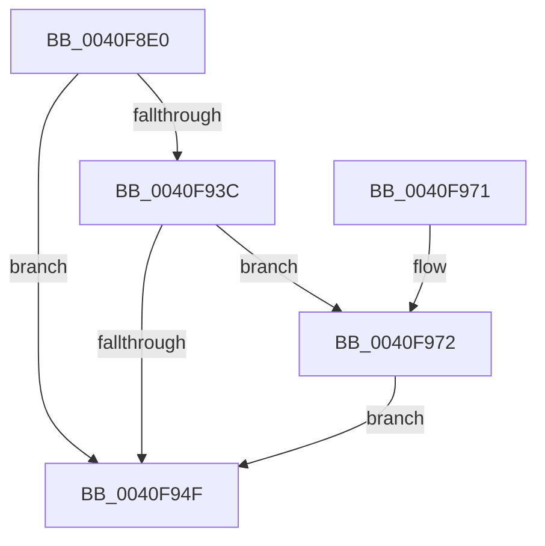

# AdtpFormatPrefix

- RVA: `0x0040F8E0`–`0x0040F983` (길이 `163` bytes)
- VA: `0x000000014040F8E0`
- 실행 섹션: `.text`
- PDB 이름 있음: `예`; PDB Function 태그: `아니요`
- unwind 정보 RVA: `0x0009BB00`
- 디코드: `42`개 명령, `163/163` bytes 표시
- 미해석 바이트: `0` (있으면 어셈블리에 `.byte`로 보존)

> 이 문서는 커널 이미지의 기계어와 PDB 기호를 분석해 생성했습니다. 4번과 5번은 함수 원형과 자료형을 바이너리 사용 방식에서 추정한 C 해석이며 원본 소스 복구 결과는 아닙니다.

## 1. Dependencies

- 직접 호출 지점: **5**; 고유 호출 대상: **4**
- 직접 호출자로 확인된 함수: **2**
- RIP 상대 이미지 참조: **3**

### Outgoing calls
- `0x0040F922` → [RtlAppendUnicodeToString](RtlAppendUnicodeToString_function_0040F990.md) (function, `0x0040F990`)
- `0x0040F933` → [RtlIntegerToUnicodeString](../../page/91/RtlIntegerToUnicodeString_function_0091D3E0.md) (function, `0x0091D3E0`)
- `0x0040F944` → [RtlAppendUnicodeStringToString](RtlAppendUnicodeStringToString_function_0040FA50.md) (function, `0x0040FA50`)
- `0x0040F957` → [_security_check_cookie](../6A/_security_check_cookie_function_006AC640.md) (function, `0x006AC640`)
- `0x0040F97C` → [RtlAppendUnicodeToString](RtlAppendUnicodeToString_function_0040F990.md) (function, `0x0040F990`)

### Direct callers
- [AdtpBuildAccessReasonAuditStringInternal](AdtpBuildAccessReasonAuditStringInternal_function_0040F344.md) at `0x0040F42E`
- [AdtpBuildAccessReasonAuditStringInternal](AdtpBuildAccessReasonAuditStringInternal_function_0040F344.md) at `0x0040F45B`
- [AdtpBuildAccessReasonAuditStringInternal](AdtpBuildAccessReasonAuditStringInternal_function_0040F344.md) at `0x0040F488`
- [AdtpBuildAccessReasonAuditStringInternal](AdtpBuildAccessReasonAuditStringInternal_function_0040F344.md) at `0x0040F4B5`
- [AdtpBuildAccessReasonAuditStringInternal](AdtpBuildAccessReasonAuditStringInternal_function_0040F344.md) at `0x0040F4DE`
- [AdtpBuildAccessReasonAuditStringInternal](AdtpBuildAccessReasonAuditStringInternal_function_0040F344.md) at `0x0040F507`
- [AdtpBuildAccessReasonAuditStringInternal](AdtpBuildAccessReasonAuditStringInternal_function_0040F344.md) at `0x0040F530`
- [AdtpBuildStagingReasonAuditStringInternal](../69/AdtpBuildStagingReasonAuditStringInternal_function_0069DA44.md) at `0x0069DBEB`

### Static image references
- `0x0040F8F4` → RVA `0x00E0A740` (`.data`; read)
- `0x0040F914` → RVA `0x000134F8` (`.rdata`; read)
- `0x0040F972` → RVA `0x000419BC` (`.rdata`; read)

## 2. Other-region calls and transfers

- 다른 실행 섹션으로 향하는 call: **1**
  - `0x0040F933` → [RtlIntegerToUnicodeString](../../page/91/RtlIntegerToUnicodeString_function_0091D3E0.md) (`.text` → `PAGE`)
- 별도 외부 분기/꼬리 이동을 확인하지 못했습니다.

## 3. Assembly (complete function range)

```asm
0040F8E0  4C 8B DC                        mov r11, rsp
0040F8E3  49 89 5B 10                     mov qword ptr [r11 + 0x10], rbx
0040F8E7  49 89 6B 18                     mov qword ptr [r11 + 0x18], rbp
0040F8EB  49 89 73 20                     mov qword ptr [r11 + 0x20], rsi
0040F8EF  57                              push rdi
0040F8F0  48 83 EC 50                     sub rsp, 0x50
0040F8F4  48 8B 05 45 AE 9F 00            mov rax, qword ptr [rip + 0x9fae45]
0040F8FB  48 33 C4                        xor rax, rsp
0040F8FE  48 89 44 24 48                  mov qword ptr [rsp + 0x48], rax
0040F903  8B DA                           mov ebx, edx
0040F905  49 C7 43 C8 00 00 14 00         mov qword ptr [r11 - 0x38], 0x140000
0040F90D  49 8D 43 D8                     lea rax, [r11 - 0x28]
0040F911  41 8A F0                        mov sil, r8b
0040F914  48 8D 15 DD 3B C0 FF            lea rdx, [rip - 0x3fc423]
0040F91B  49 89 43 D0                     mov qword ptr [r11 - 0x30], rax
0040F91F  48 8B F9                        mov rdi, rcx
0040F922  E8 69 00 00 00                  call 0x14040f990
0040F927  4C 8D 44 24 20                  lea r8, [rsp + 0x20]
0040F92C  BA 0A 00 00 00                  mov edx, 0xa
0040F931  8B CB                           mov ecx, ebx
0040F933  E8 A8 DA 50 00                  call 0x14091d3e0
0040F938  85 C0                           test eax, eax
0040F93A  78 13                           js 0x14040f94f
0040F93C  48 8D 54 24 20                  lea rdx, [rsp + 0x20]
0040F941  48 8B CF                        mov rcx, rdi
0040F944  E8 07 01 00 00                  call 0x14040fa50
0040F949  40 80 FE 01                     cmp sil, 1
0040F94D  74 23                           je 0x14040f972
0040F94F  48 8B 4C 24 48                  mov rcx, qword ptr [rsp + 0x48]
0040F954  48 33 CC                        xor rcx, rsp
0040F957  E8 E4 CC 29 00                  call 0x1406ac640
0040F95C  48 8B 5C 24 68                  mov rbx, qword ptr [rsp + 0x68]
0040F961  48 8B 6C 24 70                  mov rbp, qword ptr [rsp + 0x70]
0040F966  48 8B 74 24 78                  mov rsi, qword ptr [rsp + 0x78]
0040F96B  48 83 C4 50                     add rsp, 0x50
0040F96F  5F                              pop rdi
0040F970  C3                              ret
0040F971  CC                              int3
0040F972  48 8D 15 43 20 C3 FF            lea rdx, [rip - 0x3cdfbd]
0040F979  48 8B CF                        mov rcx, rdi
0040F97C  E8 0F 00 00 00                  call 0x14040f990
0040F981  EB CC                           jmp 0x14040f94f
```

## 4. C-style interpretation (structured pseudocode)

```c
__int64 __fastcall AdtpFormatPrefix(__int64 a1, int a2, unsigned __int8 a3)
{
    __int64 result;
    __int64 v_rsp;
    unsigned __int64 v_stack_m10;
    unsigned __int64 v_stack_m38;
    unsigned __int64 v_stack_p10;
    unsigned __int64 v_stack_p18;
    unsigned __int64 v_stack_p20;

    *(unsigned __int64 *)(v_rsp + 16) = v_rbx;
    *(unsigned __int64 *)(v_rsp + 24) = v_rbp;
    *(unsigned __int64 *)(v_rsp + 32) = v_rsi;
    v_rsp = (v_rsp) - (80);
    result = (*(unsigned __int64 *)(v_rip + 10464837)) ^ (v_rsp);
    v_stack_m10 = result;
    *(unsigned __int64 *)(v_rsp - 56) = 0x140000ULL;
    *(unsigned __int64 *)(v_rsp - 48) = v_rsp - 40;
    result = RtlAppendUnicodeToString(a1, v_rip - 4178979, a3, a4);
    result = RtlIntegerToUnicodeString((unsigned int)((unsigned int)((unsigned int)(a2))), 10, v_stack_m38, a4);
    if (sign_flag) goto loc_0040F94F;
    result = RtlAppendUnicodeStringToString(a1, v_stack_m38, v_stack_m38, a4);
    if (a3 == 1) goto loc_0040F972;
loc_0040F94F:
    a1 = (v_stack_m10) ^ (v_rsp);
    result = _security_check_cookie(a1, v_stack_m38, v_stack_m38, a4);
    v_rsp = (v_rsp) + (80);
    return result;
loc_0040F972:
    result = RtlAppendUnicodeToString(a1, v_rip - 3989437, v_stack_m38, a4);
    goto loc_0040F94F;
}
```

## 5. (Beta) C Style

```c
int64_t AdtpFormatPrefix(int64_t Arg1, int32_t Arg2, uint8_t Arg3)
{
    int64_t result;
    int64_t local_rsp;
    uint64_t v_stack_m10;
    uint64_t v_stack_m38;
    uint64_t v_stack_p10;
    uint64_t v_stack_p18;
    uint64_t v_stack_p20;

    *(uint64_t *)(local_rsp + 0x10) = local_rbx;
    *(uint64_t *)(local_rsp + 0x18) = local_rbp;
    *(uint64_t *)(local_rsp + 0x20) = local_rsi;
    local_rsp = (local_rsp) - (80);
    result = (*(uint64_t *)(v_rip + 0x9FAE45)) ^ (local_rsp);
    v_stack_m10 = result;
    *(uint64_t *)(local_rsp - 0x38) = 0x140000ULL;
    *(uint64_t *)(local_rsp - 0x30) = local_rsp - 40;
    result = RtlAppendUnicodeToString(Arg1, v_rip - 4178979, Arg3, a4);
    result = RtlIntegerToUnicodeString((uint32_t)((uint32_t)((uint32_t)(Arg2))), 10, v_stack_m38, a4);
    if (sign_flag) goto loc_0040F94F;
    result = RtlAppendUnicodeStringToString(Arg1, v_stack_m38, v_stack_m38, a4);
    if (Arg3 == 1) goto loc_0040F972;
loc_0040F94F:
    Arg1 = (v_stack_m10) ^ (local_rsp);
    result = _security_check_cookie(Arg1, v_stack_m38, v_stack_m38, a4);
    local_rsp = (local_rsp) + (80);
    return result;
loc_0040F972:
    result = RtlAppendUnicodeToString(Arg1, v_rip - 3989437, v_stack_m38, a4);
    goto loc_0040F94F;
}
```

## 6. Execution-region graph

[열기: 2D/3D 그래프와 함수 탐색 컨트롤 패널](../../../control-panel.html?section=text&rva=0x0040F8E0&view=graph)

- 2D 그래프는 위에서 아래로 흐르고, 3D 그래프는 빈 공간을 드래그해 회전합니다. Shift+드래그는 이동, 휠은 확대·축소, 함수 노드 선택은 대상 보고서 이동입니다.

### Static fallback


