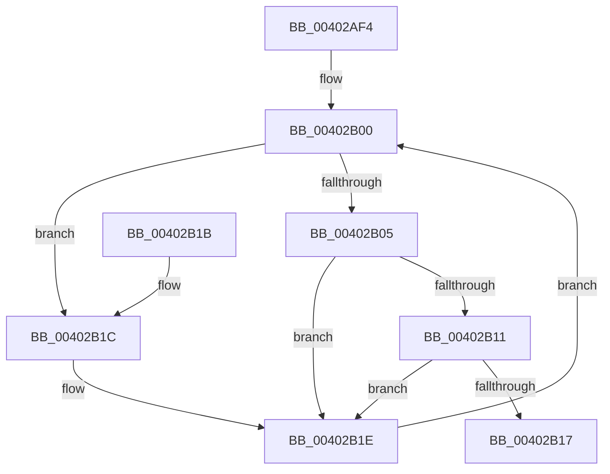

# CcFindBitmapRangeToClean

- RVA: `0x00402AF4`–`0x00402B23` (길이 `47` bytes)
- VA: `0x0000000140402AF4`
- 실행 섹션: `.text`
- PDB 이름 있음: `예`; PDB Function 태그: `아니요`
- unwind 정보 RVA: `0x000DB714`
- 디코드: `17`개 명령, `47/47` bytes 표시
- 미해석 바이트: `0` (있으면 어셈블리에 `.byte`로 보존)

> 이 문서는 커널 이미지의 기계어와 PDB 기호를 분석해 생성했습니다. 4번과 5번은 함수 원형과 자료형을 바이너리 사용 방식에서 추정한 C 해석이며 원본 소스 복구 결과는 아닙니다.

## 1. Dependencies

- 직접 호출 지점: **0**; 고유 호출 대상: **0**
- 직접 호출자로 확인된 함수: **2**
- RIP 상대 이미지 참조: **0**

### Outgoing calls
- 직접 디코드된 call 명령이 없습니다.

### Direct callers
- [CcAcquireByteRangeForWrite](CcAcquireByteRangeForWrite_function_00401E74.md) at `0x004021B9`
- [CcAcquireByteRangeForWrite](CcAcquireByteRangeForWrite_function_00401E74.md) at `0x00402342`
- [CcGetFlushedValidData](CcGetFlushedValidData_function_00402920.md) at `0x004029B9`

### Static image references
- 디코드된 RIP-relative 메모리 참조가 없습니다.

## 2. Other-region calls and transfers

- 다른 실행 섹션으로 향하는 call: **0**
- 별도 외부 분기/꼬리 이동을 확인하지 못했습니다.

## 3. Assembly (complete function range)

```asm
00402AF4  48 83 49 28 FF                  or qword ptr [rcx + 0x28], 0xffffffffffffffff
00402AF9  4C 8D 41 10                     lea r8, [rcx + 0x10]
00402AFD  49 8B 08                        mov rcx, qword ptr [r8]
00402B00  49 3B C8                        cmp rcx, r8
00402B03  74 17                           je 0x140402b1c
00402B05  8B 41 1C                        mov eax, dword ptr [rcx + 0x1c]
00402B08  48 03 41 10                     add rax, qword ptr [rcx + 0x10]
00402B0C  48 3B D0                        cmp rdx, rax
00402B0F  7F 0D                           jg 0x140402b1e
00402B11  83 79 20 00                     cmp dword ptr [rcx + 0x20], 0
00402B15  74 07                           je 0x140402b1e
00402B17  48 8B C1                        mov rax, rcx
00402B1A  C3                              ret
00402B1B  CC                              int3
00402B1C  33 D2                           xor edx, edx
00402B1E  48 8B 09                        mov rcx, qword ptr [rcx]
00402B21  EB DD                           jmp 0x140402b00
```

## 4. C-style interpretation (structured pseudocode)

```c
__int64 __fastcall CcFindBitmapRangeToClean(__int64 a1, __int64 a2)
{
    __int64 result;

loc_00402B00:
    if ((*(unsigned __int64 *)(a1 + 16)) == (a1 + 16)) goto loc_00402B1C;
    result = ((unsigned int)(*(unsigned int *)(*(unsigned __int64 *)(a1 + 16) + 28))) + (*(unsigned __int64 *)(*(unsigned __int64 *)(a1 + 16) + 16));
    if (a2 > result) goto loc_00402B1E;
    if ((*(unsigned int *)(*(unsigned __int64 *)(a1 + 16) + 32)) == 0) goto loc_00402B1E;
    return *(unsigned __int64 *)(a1 + 16);
loc_00402B1C:
    a2 = 0;
loc_00402B1E:
    goto loc_00402B00;
}
```

## 5. (Beta) C Style

```c
int64_t CcFindBitmapRangeToClean(void *Arg1, int64_t Arg2)
{
    uint8_t *arg1 = (uint8_t *)Arg1;

    int64_t result;

loc_00402B00:
    if ((*(uint64_t *)(arg1 + 0x10)) == (Arg1 + 16)) goto loc_00402B1C;
    result = ((uint32_t)(*(uint32_t *)(*(uint64_t *)(arg1 + 0x10) + 0x1C))) + (*(uint64_t *)(*(uint64_t *)(arg1 + 0x10) + 0x10));
    if (Arg2 > result) goto loc_00402B1E;
    if ((*(uint32_t *)(*(uint64_t *)(arg1 + 0x10) + 0x20)) == 0) goto loc_00402B1E;
    return *(uint64_t *)(arg1 + 0x10);
loc_00402B1C:
    Arg2 = 0;
loc_00402B1E:
    goto loc_00402B00;
}
```

### 관측된 메모리 오프셋

구조체 형식이 확인되지 않은 접근은 인자 기준의 오프셋으로만 기록했습니다.

| 기준 인자 | 오프셋 표현 | 폭 (bit) | 접근 |
|---|---:|---:|---|
| `Arg1` | `+ 0x0` | `64` | `R` |
| `Arg1` | `+ 0x10` | `64` | `R` |
| `Arg1` | `+ 0x28` | `64` | `R/W` |

## 6. Execution-region graph

[열기: 2D/3D 그래프와 함수 탐색 컨트롤 패널](../../../control-panel.html?section=text&rva=0x00402AF4&view=graph)

- 2D 그래프는 위에서 아래로 흐르고, 3D 그래프는 빈 공간을 드래그해 회전합니다. Shift+드래그는 이동, 휠은 확대·축소, 함수 노드 선택은 대상 보고서 이동입니다.

### Static fallback


