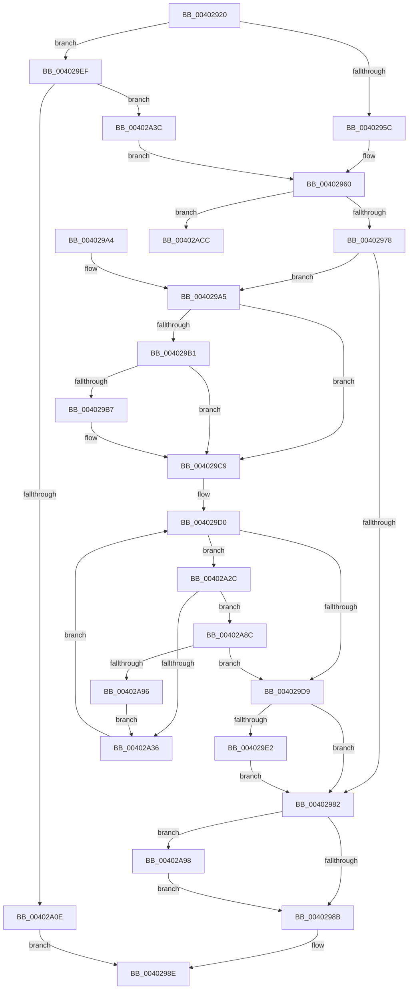

# CcGetFlushedValidData

- RVA: `0x00402920`–`0x00402AEB` (길이 `459` bytes)
- VA: `0x0000000140402920`
- 실행 섹션: `.text`
- PDB 이름 있음: `예`; PDB Function 태그: `아니요`
- unwind 정보 RVA: `0x0009A690`
- 디코드: `112`개 명령, `459/459` bytes 표시
- 미해석 바이트: `0` (있으면 어셈블리에 `.byte`로 보존)

> 이 문서는 커널 이미지의 기계어와 PDB 기호를 분석해 생성했습니다. 4번과 5번은 함수 원형과 자료형을 바이너리 사용 방식에서 추정한 C 해석이며 원본 소스 복구 결과는 아닙니다.

## 1. Dependencies

- 직접 호출 지점: **16**; 고유 호출 대상: **10**
- 직접 호출자로 확인된 함수: **1**
- RIP 상대 이미지 참조: **1**

### Outgoing calls
- `0x0040296A` → [CcGetPartitionForSectionObject](../38/CcGetPartitionForSectionObject_function_0038B740.md) (function, `0x0038B740`)
- `0x004029B9` → [CcFindBitmapRangeToClean](CcFindBitmapRangeToClean_function_00402AF4.md) (function, `0x00402AF4`)
- `0x004029EF` → [KeRcuReadLock](../38/KeRcuReadLock_function_0038A1A0.md) (function, `0x0038A1A0`)
- `0x00402A00` → [KeAcquireInStackQueuedSpinLock](../27/KeAcquireInStackQueuedSpinLock_function_002757A0.md) (function, `0x002757A0`)
- `0x00402A13` → [KeReleaseInStackQueuedSpinLock](../34/KeReleaseInStackQueuedSpinLock_function_00342CE0.md) (function, `0x00342CE0`)
- `0x00402A18` → [KeRcuReadUnlock](../38/KeRcuReadUnlock_function_0038A070.md) (function, `0x0038A070`)
- `0x00402A4F` → [KeAcquireInStackQueuedSpinLock](../27/KeAcquireInStackQueuedSpinLock_function_002757A0.md) (function, `0x002757A0`)
- `0x00402A67` → [KeReleaseInStackQueuedSpinLock](../34/KeReleaseInStackQueuedSpinLock_function_00342CE0.md) (function, `0x00342CE0`)
- `0x00402A71` → [KeReleaseInStackQueuedSpinLock](../34/KeReleaseInStackQueuedSpinLock_function_00342CE0.md) (function, `0x00342CE0`)
- `0x00402A76` → [KeRcuReadUnlock](../38/KeRcuReadUnlock_function_0038A070.md) (function, `0x0038A070`)
- `0x00402A82` → [ExAcquireFastMutex](../20/ExAcquireFastMutex_function_0020E5A0.md) (function, `0x0020E5A0`)
- `0x00402A9F` → [ExReleaseFastMutex](../25/ExReleaseFastMutex_function_002519C0.md) (function, `0x002519C0`)
- `0x00402AB0` → [KeAcquireInStackQueuedSpinLock](../27/KeAcquireInStackQueuedSpinLock_function_002757A0.md) (function, `0x002757A0`)
- `0x00402AB8` → [CcDecrementOpenCount](../38/CcDecrementOpenCount_function_0038B75C.md) (function, `0x0038B75C`)
- `0x00402AC2` → [KeReleaseInStackQueuedSpinLock](../34/KeReleaseInStackQueuedSpinLock_function_00342CE0.md) (function, `0x00342CE0`)
- `0x00402AE5` → [KeBugCheckEx](../4F/KeBugCheckEx_function_004FD660.md) (function, `0x004FD660`)

### Direct callers
- [CcWriteBehindPostProcess](../35/CcWriteBehindPostProcess_function_00357BB4.md) at `0x00357DC4`

### Static image references
- `0x004029F9` → RVA `0x00E11CC0` (`.data`; read)

## 2. Other-region calls and transfers

- 다른 실행 섹션으로 향하는 call: **0**
- 별도 외부 분기/꼬리 이동을 확인하지 못했습니다.

## 3. Assembly (complete function range)

```asm
00402920  4C 8B DC                        mov r11, rsp
00402923  49 89 5B 08                     mov qword ptr [r11 + 8], rbx
00402927  49 89 6B 10                     mov qword ptr [r11 + 0x10], rbp
0040292B  49 89 73 18                     mov qword ptr [r11 + 0x18], rsi
0040292F  57                              push rdi
00402930  48 83 EC 60                     sub rsp, 0x60
00402934  33 C0                           xor eax, eax
00402936  0F 57 C0                        xorps xmm0, xmm0
00402939  0F 57 C9                        xorps xmm1, xmm1
0040293C  40 8A EA                        mov bpl, dl
0040293F  48 8B D9                        mov rbx, rcx
00402942  0F 11 44 24 48                  movups xmmword ptr [rsp + 0x48], xmm0
00402947  49 89 43 F0                     mov qword ptr [r11 - 0x10], rax
0040294B  0F 11 4C 24 30                  movups xmmword ptr [rsp + 0x30], xmm1
00402950  49 89 43 D8                     mov qword ptr [r11 - 0x28], rax
00402954  84 D2                           test dl, dl
00402956  0F 84 93 00 00 00               je 0x1404029ef
0040295C  48 8B 79 08                     mov rdi, qword ptr [rcx + 8]
00402960  48 8B B7 18 02 00 00            mov rsi, qword ptr [rdi + 0x218]
00402967  48 8B CB                        mov rcx, rbx
0040296A  E8 D1 8D F8 FF                  call 0x14038b740
0040296F  48 3B C6                        cmp rax, rsi
00402972  0F 85 54 01 00 00               jne 0x140402acc
00402978  83 7F 70 00                     cmp dword ptr [rdi + 0x70], 0
0040297C  48 8B 5F 30                     mov rbx, qword ptr [rdi + 0x30]
00402980  75 23                           jne 0x1404029a5
00402982  40 84 ED                        test bpl, bpl
00402985  0F 84 0D 01 00 00               je 0x140402a98
0040298B  48 8B C3                        mov rax, rbx
0040298E  4C 8D 5C 24 60                  lea r11, [rsp + 0x60]
00402993  49 8B 5B 10                     mov rbx, qword ptr [r11 + 0x10]
00402997  49 8B 6B 18                     mov rbp, qword ptr [r11 + 0x18]
0040299B  49 8B 73 20                     mov rsi, qword ptr [r11 + 0x20]
0040299F  49 8B E3                        mov rsp, r11
004029A2  5F                              pop rdi
004029A3  C3                              ret
004029A4  CC                              int3
004029A5  48 8B 8F A8 00 00 00            mov rcx, qword ptr [rdi + 0xa8]
004029AC  48 85 C9                        test rcx, rcx
004029AF  74 18                           je 0x1404029c9
004029B1  83 79 08 00                     cmp dword ptr [rcx + 8], 0
004029B5  74 12                           je 0x1404029c9
004029B7  33 D2                           xor edx, edx
004029B9  E8 36 01 00 00                  call 0x140402af4
004029BE  8B 58 18                        mov ebx, dword ptr [rax + 0x18]
004029C1  48 03 58 10                     add rbx, qword ptr [rax + 0x10]
004029C5  48 C1 E3 0C                     shl rbx, 0xc
004029C9  48 8D 57 10                     lea rdx, [rdi + 0x10]
004029CD  48 8B 02                        mov rax, qword ptr [rdx]
004029D0  48 8D 48 F0                     lea rcx, [rax - 0x10]
004029D4  48 3B C2                        cmp rax, rdx
004029D7  75 53                           jne 0x140402a2c
004029D9  48 8D 41 10                     lea rax, [rcx + 0x10]
004029DD  48 3B C2                        cmp rax, rdx
004029E0  74 A0                           je 0x140402982
004029E2  48 8B 41 08                     mov rax, qword ptr [rcx + 8]
004029E6  48 3B C3                        cmp rax, rbx
004029E9  48 0F 4C D8                     cmovl rbx, rax
004029ED  EB 93                           jmp 0x140402982
004029EF  E8 AC 77 F8 FF                  call 0x14038a1a0
004029F4  48 8D 54 24 48                  lea rdx, [rsp + 0x48]
004029F9  48 8D 0D C0 F2 A0 00            lea rcx, [rip + 0xa0f2c0]
00402A00  E8 9B 2D E7 FF                  call 0x1402757a0
00402A05  48 8B 7B 08                     mov rdi, qword ptr [rbx + 8]
00402A09  48 85 FF                        test rdi, rdi
00402A0C  75 2E                           jne 0x140402a3c
00402A0E  48 8D 4C 24 48                  lea rcx, [rsp + 0x48]
00402A13  E8 C8 02 F4 FF                  call 0x140342ce0
00402A18  E8 53 76 F8 FF                  call 0x14038a070
00402A1D  48 B8 FF FF FF FF FF FF FF 7F   movabs rax, 0x7fffffffffffffff
00402A27  E9 62 FF FF FF                  jmp 0x14040298e
00402A2C  B8 FD 02 00 00                  mov eax, 0x2fd
00402A31  66 39 01                        cmp word ptr [rcx], ax
00402A34  74 56                           je 0x140402a8c
00402A36  48 8B 41 10                     mov rax, qword ptr [rcx + 0x10]
00402A3A  EB 94                           jmp 0x1404029d0
00402A3C  48 8B 8F 18 02 00 00            mov rcx, qword ptr [rdi + 0x218]
00402A43  48 8D 54 24 30                  lea rdx, [rsp + 0x30]
00402A48  48 81 C1 00 03 00 00            add rcx, 0x300
00402A4F  E8 4C 2D E7 FF                  call 0x1402757a0
00402A54  8B 47 04                        mov eax, dword ptr [rdi + 4]
00402A57  48 8D 4C 24 30                  lea rcx, [rsp + 0x30]
00402A5C  FF C0                           inc eax
00402A5E  89 47 04                        mov dword ptr [rdi + 4], eax
00402A61  FF 87 20 02 00 00               inc dword ptr [rdi + 0x220]
00402A67  E8 74 02 F4 FF                  call 0x140342ce0
00402A6C  48 8D 4C 24 48                  lea rcx, [rsp + 0x48]
00402A71  E8 6A 02 F4 FF                  call 0x140342ce0
00402A76  E8 F5 75 F8 FF                  call 0x14038a070
00402A7B  48 8D 8F 20 01 00 00            lea rcx, [rdi + 0x120]
00402A82  E8 19 BB E0 FF                  call 0x14020e5a0
00402A87  E9 D4 FE FF FF                  jmp 0x140402960
00402A8C  80 79 02 00                     cmp byte ptr [rcx + 2], 0
00402A90  0F 85 43 FF FF FF               jne 0x1404029d9
00402A96  EB 9E                           jmp 0x140402a36
00402A98  48 8D 8F 20 01 00 00            lea rcx, [rdi + 0x120]
00402A9F  E8 1C EF E4 FF                  call 0x1402519c0
00402AA4  48 8D 8E 00 03 00 00            lea rcx, [rsi + 0x300]
00402AAB  48 8D 54 24 30                  lea rdx, [rsp + 0x30]
00402AB0  E8 EB 2C E7 FF                  call 0x1402757a0
00402AB5  48 8B CF                        mov rcx, rdi
00402AB8  E8 9F 8C F8 FF                  call 0x14038b75c
00402ABD  48 8D 4C 24 30                  lea rcx, [rsp + 0x30]
00402AC2  E8 19 02 F4 FF                  call 0x140342ce0
00402AC7  E9 BF FE FF FF                  jmp 0x14040298b
00402ACC  48 83 64 24 20 00               and qword ptr [rsp + 0x20], 0
00402AD2  45 33 C9                        xor r9d, r9d
00402AD5  BA 47 24 00 00                  mov edx, 0x2447
00402ADA  49 C7 C0 20 04 00 C0            mov r8, 0xffffffffc0000420
00402AE1  41 8D 49 34                     lea ecx, [r9 + 0x34]
00402AE5  E8 76 AB 0F 00                  call 0x1404fd660
00402AEA  CC                              int3
```

## 4. C-style interpretation (structured pseudocode)

```c
__int64 __fastcall CcGetFlushedValidData(__int64 a1, int a2, __int64 a3, int a4)
{
    __int64 result;
    __int64 v_rbx;
    __int64 v_rsp;
    unsigned __int64 v_stack_m18;
    unsigned __int64 v_stack_m20;
    unsigned __int64 v_stack_m30;
    unsigned __int64 v_stack_m38;
    unsigned __int64 v_stack_m40;
    unsigned __int64 v_stack_m8;

    *(unsigned __int64 *)(v_rsp + 8) = v_rbx;
    *(unsigned __int64 *)(v_rsp + 16) = v_rbp;
    *(unsigned __int64 *)(v_rsp + 24) = v_rsi;
    v_rsp = (v_rsp) - (96);
    result = 0;
    v_stack_m20 = v_xmm0;
    *(unsigned __int64 *)(v_rsp - 16) = 0;
    v_stack_m38 = v_xmm1;
    *(unsigned __int64 *)(v_rsp - 40) = 0;
    if ((unsigned __int8)(a2) == 0) goto loc_004029EF;
loc_00402960:
    result = CcGetPartitionForSectionObject(a1, a2, a3, a4);
    if (result != (*(unsigned __int64 *)(*(unsigned __int64 *)(a1 + 8) + 536))) goto loc_00402ACC;
    if ((*(unsigned int *)(*(unsigned __int64 *)(a1 + 8) + 112)) != 0) goto loc_004029A5;
loc_00402982:
    if ((unsigned __int8)((unsigned __int8)(a2)) == 0) goto loc_00402A98;
loc_0040298B:
loc_0040298E:
    return *(unsigned __int64 *)(*(unsigned __int64 *)(a1 + 8) + 48);
loc_004029A5:
    if (*(unsigned __int64 *)(*(unsigned __int64 *)(a1 + 8) + 168) == 0) goto loc_004029C9;
    result = *(unsigned __int64 *)(*(unsigned __int64 *)(a1 + 8) + 48);
    v_rbx = *(unsigned __int64 *)(v_stack_m8 + 16);
    if ((*(unsigned int *)(*(unsigned __int64 *)(*(unsigned __int64 *)(a1 + 8) + 168) + 8)) != 0) {
        a2 = 0;
        result = CcFindBitmapRangeToClean(*(unsigned __int64 *)(*(unsigned __int64 *)(a1 + 8) + 168), a2, a3, a4);
        v_rbx = *(unsigned int *)(result + 24);
        v_rbx = (v_rbx) + (*(unsigned __int64 *)(result + 16));
        v_rbx = (v_rbx) << (12);
    }
loc_004029D0:
    if ((*(unsigned __int64 *)(*(unsigned __int64 *)(a1 + 8) + 16)) != (*(unsigned __int64 *)(a1 + 8) + 16)) goto loc_00402A2C;
loc_004029D9:
    if ((*(unsigned __int64 *)(*(unsigned __int64 *)(a1 + 8) + 16) - 16 + 16) == (*(unsigned __int64 *)(a1 + 8) + 16)) goto loc_00402982;
    if ((*(unsigned __int64 *)(*(unsigned __int64 *)(*(unsigned __int64 *)(a1 + 8) + 16) - 16 + 8)) < v_rbx) { v_rbx = *(unsigned __int64 *)(*(unsigned __int64 *)(*(unsigned __int64 *)(a1 + 8) + 16) - 16 + 8); }
    goto loc_00402982;
loc_004029EF:
    result = KeRcuReadLock(*(unsigned __int64 *)(*(unsigned __int64 *)(a1 + 8) + 16) - 16, *(unsigned __int64 *)(a1 + 8) + 16, a3, a4);
    result = KeAcquireInStackQueuedSpinLock(v_rip + 10547904, v_stack_m18, a3, a4);
    if (*(unsigned __int64 *)(v_rbx + 8) != 0) goto loc_00402A3C;
    result = KeReleaseInStackQueuedSpinLock(v_stack_m18, v_stack_m18, a3, a4);
    result = KeRcuReadUnlock(v_stack_m18, v_stack_m18, a3, a4);
    goto loc_0040298E;
loc_00402A2C:
    if ((*(unsigned __int16 *)(v_stack_m18)) == 765) goto loc_00402A8C;
loc_00402A36:
    goto loc_004029D0;
loc_00402A3C:
    a1 = (*(unsigned __int64 *)(*(unsigned __int64 *)(v_rbx + 8) + 536)) + (768);
    result = KeAcquireInStackQueuedSpinLock(a1, v_stack_m30, a3, a4);
    result = (unsigned int)(((unsigned int)(*(unsigned int *)(*(unsigned __int64 *)(v_rbx + 8) + 4))) + 1);
    *(unsigned int *)(*(unsigned __int64 *)(v_rbx + 8) + 4) = (unsigned int)(result);
    result = KeReleaseInStackQueuedSpinLock(v_stack_m30, v_stack_m30, a3, a4);
    result = KeReleaseInStackQueuedSpinLock(v_stack_m18, v_stack_m30, a3, a4);
    result = KeRcuReadUnlock(v_stack_m18, v_stack_m30, a3, a4);
    result = ExAcquireFastMutex(*(unsigned __int64 *)(v_rbx + 8) + 288, v_stack_m30, a3, a4);
    goto loc_00402960;
loc_00402A8C:
    if ((*(unsigned __int8 *)(*(unsigned __int64 *)(v_rbx + 8) + 288 + 2)) != 0) goto loc_004029D9;
    goto loc_00402A36;
loc_00402A98:
    result = ExReleaseFastMutex(*(unsigned __int64 *)(v_rbx + 8) + 288, v_stack_m30, a3, a4);
    result = KeAcquireInStackQueuedSpinLock(*(unsigned __int64 *)(v_stack_m8 + 32) + 768, v_stack_m30, a3, a4);
    result = CcDecrementOpenCount(*(unsigned __int64 *)(v_rbx + 8), v_stack_m30, a3, a4);
    result = KeReleaseInStackQueuedSpinLock(v_stack_m30, v_stack_m30, a3, a4);
    goto loc_0040298B;
loc_00402ACC:
    a4 = 0;
    result = KeBugCheckEx(a4 + 52, (unsigned int)(0x2447ULL), 0xFFFFFFFFC0000420ULL, a4);
    return result;
}
```

## 5. (Beta) C Style

```c
int64_t CcGetFlushedValidData(void *Arg1, int32_t Arg2, int64_t Arg3, int32_t Arg4)
{
    uint8_t *arg1 = (uint8_t *)Arg1;

    int64_t result;
    int64_t local_rbx;
    int64_t local_rsp;
    uint64_t v_stack_m18;
    uint64_t v_stack_m20;
    uint64_t v_stack_m30;
    uint64_t v_stack_m38;
    uint64_t v_stack_m40;
    uint64_t v_stack_m8;

    *(uint64_t *)(local_rsp + 0x8) = local_rbx;
    *(uint64_t *)(local_rsp + 0x10) = local_rbp;
    *(uint64_t *)(local_rsp + 0x18) = local_rsi;
    local_rsp = (local_rsp) - (96);
    result = 0;
    v_stack_m20 = v_xmm0;
    *(uint64_t *)(local_rsp - 0x10) = 0;
    v_stack_m38 = v_xmm1;
    *(uint64_t *)(local_rsp - 0x28) = 0;
    if ((uint8_t)(Arg2) == 0) goto loc_004029EF;
loc_00402960:
    result = CcGetPartitionForSectionObject(Arg1, Arg2, Arg3, Arg4);
    if (result != (*(uint64_t *)(*(uint64_t *)(arg1 + 0x8) + 0x218))) goto loc_00402ACC;
    if ((*(uint32_t *)(*(uint64_t *)(arg1 + 0x8) + 0x70)) != 0) goto loc_004029A5;
loc_00402982:
    if ((uint8_t)((uint8_t)(Arg2)) == 0) goto loc_00402A98;
loc_0040298B:
loc_0040298E:
    return *(uint64_t *)(*(uint64_t *)(arg1 + 0x8) + 0x30);
loc_004029A5:
    if (*(uint64_t *)(*(uint64_t *)(arg1 + 0x8) + 0xA8) == 0) goto loc_004029C9;
    result = *(uint64_t *)(*(uint64_t *)(arg1 + 0x8) + 0x30);
    local_rbx = *(uint64_t *)(v_stack_m8 + 0x10);
    if ((*(uint32_t *)(*(uint64_t *)(*(uint64_t *)(arg1 + 0x8) + 0xA8) + 0x8)) != 0) {
        Arg2 = 0;
        result = CcFindBitmapRangeToClean(*(uint64_t *)(*(uint64_t *)(arg1 + 0x8) + 0xA8), Arg2, Arg3, Arg4);
        local_rbx = *(uint32_t *)(result + 0x18);
        local_rbx = (local_rbx) + (*(uint64_t *)(result + 0x10));
        local_rbx = (local_rbx) << (12);
    }
loc_004029D0:
    if ((*(uint64_t *)(*(uint64_t *)(arg1 + 0x8) + 0x10)) != (*(uint64_t *)(arg1 + 0x8) + 16)) goto loc_00402A2C;
loc_004029D9:
    if ((*(uint64_t *)(*(uint64_t *)(arg1 + 0x8) + 0x10) - 16 + 16) == (*(uint64_t *)(arg1 + 0x8) + 16)) goto loc_00402982;
    if ((*(uint64_t *)(*(uint64_t *)(*(uint64_t *)(arg1 + 0x8) + 0x10) - 0x10 + 0x8)) < local_rbx) { local_rbx = *(uint64_t *)(*(uint64_t *)(*(uint64_t *)(arg1 + 0x8) + 0x10) - 0x10 + 0x8); }
    goto loc_00402982;
loc_004029EF:
    result = KeRcuReadLock(*(uint64_t *)(*(uint64_t *)(arg1 + 0x8) + 0x10) - 16, *(uint64_t *)(arg1 + 0x8) + 16, Arg3, Arg4);
    result = KeAcquireInStackQueuedSpinLock(v_rip + 10547904, v_stack_m18, Arg3, Arg4);
    if (*(uint64_t *)(local_rbx + 0x8) != 0) goto loc_00402A3C;
    result = KeReleaseInStackQueuedSpinLock(v_stack_m18, v_stack_m18, Arg3, Arg4);
    result = KeRcuReadUnlock(v_stack_m18, v_stack_m18, Arg3, Arg4);
    goto loc_0040298E;
loc_00402A2C:
    if ((*(uint16_t *)(v_stack_m18)) == 765) goto loc_00402A8C;
loc_00402A36:
    goto loc_004029D0;
loc_00402A3C:
    Arg1 = (*(uint64_t *)(*(uint64_t *)(local_rbx + 0x8) + 0x218)) + (768);
    result = KeAcquireInStackQueuedSpinLock(Arg1, v_stack_m30, Arg3, Arg4);
    result = (uint32_t)(((uint32_t)(*(uint32_t *)(*(uint64_t *)(local_rbx + 0x8) + 0x4))) + 1);
    *(uint32_t *)(*(uint64_t *)(local_rbx + 0x8) + 0x4) = (uint32_t)(result);
    result = KeReleaseInStackQueuedSpinLock(v_stack_m30, v_stack_m30, Arg3, Arg4);
    result = KeReleaseInStackQueuedSpinLock(v_stack_m18, v_stack_m30, Arg3, Arg4);
    result = KeRcuReadUnlock(v_stack_m18, v_stack_m30, Arg3, Arg4);
    result = ExAcquireFastMutex(*(uint64_t *)(local_rbx + 0x8) + 288, v_stack_m30, Arg3, Arg4);
    goto loc_00402960;
loc_00402A8C:
    if ((*(uint8_t *)(*(uint64_t *)(local_rbx + 0x8) + 0x120 + 0x2)) != 0) goto loc_004029D9;
    goto loc_00402A36;
loc_00402A98:
    result = ExReleaseFastMutex(*(uint64_t *)(local_rbx + 0x8) + 288, v_stack_m30, Arg3, Arg4);
    result = KeAcquireInStackQueuedSpinLock(*(uint64_t *)(v_stack_m8 + 0x20) + 768, v_stack_m30, Arg3, Arg4);
    result = CcDecrementOpenCount(*(uint64_t *)(local_rbx + 0x8), v_stack_m30, Arg3, Arg4);
    result = KeReleaseInStackQueuedSpinLock(v_stack_m30, v_stack_m30, Arg3, Arg4);
    goto loc_0040298B;
loc_00402ACC:
    Arg4 = 0;
    result = KeBugCheckEx(Arg4 + 52, (uint32_t)(0x2447ULL), 0xFFFFFFFFC0000420ULL, Arg4);
    return result;
}
```

### 관측된 메모리 오프셋

구조체 형식이 확인되지 않은 접근은 인자 기준의 오프셋으로만 기록했습니다.

| 기준 인자 | 오프셋 표현 | 폭 (bit) | 접근 |
|---|---:|---:|---|
| `Arg1` | `+ 0x8` | `64` | `R` |

## 6. Execution-region graph

[열기: 2D/3D 그래프와 함수 탐색 컨트롤 패널](../../../control-panel.html?section=text&rva=0x00402920&view=graph)

- 2D 그래프는 위에서 아래로 흐르고, 3D 그래프는 빈 공간을 드래그해 회전합니다. Shift+드래그는 이동, 휠은 확대·축소, 함수 노드 선택은 대상 보고서 이동입니다.

### Static fallback


