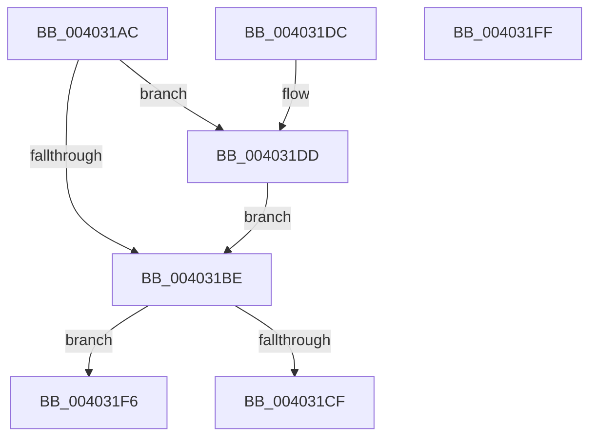

# CcGetNodeForLazyWrite

- RVA: `0x004031AC`–`0x00403200` (길이 `84` bytes)
- VA: `0x00000001404031AC`
- 실행 섹션: `.text`
- PDB 이름 있음: `예`; PDB Function 태그: `아니요`
- unwind 정보 RVA: `0x000DB714`
- 디코드: `19`개 명령, `84/84` bytes 표시
- 미해석 바이트: `0` (있으면 어셈블리에 `.byte`로 보존)

> 이 문서는 커널 이미지의 기계어와 PDB 기호를 분석해 생성했습니다. 4번과 5번은 함수 원형과 자료형을 바이너리 사용 방식에서 추정한 C 해석이며 원본 소스 복구 결과는 아닙니다.

## 1. Dependencies

- 직접 호출 지점: **0**; 고유 호출 대상: **0**
- 직접 호출자로 확인된 함수: **3**
- RIP 상대 이미지 참조: **2**

### Outgoing calls
- 직접 디코드된 call 명령이 없습니다.

### Direct callers
- [CcLazyWriteScanVolume](../38/CcLazyWriteScanVolume_function_00388DC0.md) at `0x0038903E`
- [CcLazyWriteScan](../3C/CcLazyWriteScan_function_003C9394.md) at `0x003C96D4`
- [CcNotifyOfMappedWrite](CcNotifyOfMappedWrite_function_0040338C.md) at `0x0040348B`

### Static image references
- `0x004031C0` → RVA `0x00E0A874` (`.data`; read)
- `0x004031C6` → RVA `0x00E65B88` (`.data`; read)

## 2. Other-region calls and transfers

- 다른 실행 섹션으로 향하는 call: **0**
- 별도 외부 분기/꼬리 이동을 확인하지 못했습니다.

## 3. Assembly (complete function range)

```asm
004031AC  8B 81 2C 02 00 00               mov eax, dword ptr [rcx + 0x22c]
004031B2  4C 8B 89 18 02 00 00            mov r9, qword ptr [rcx + 0x218]
004031B9  83 F8 FF                        cmp eax, -1
004031BC  74 1F                           je 0x1404031dd
004031BE  33 D2                           xor edx, edx
004031C0  F7 35 AE 76 A0 00               div dword ptr [rip + 0xa076ae]
004031C6  80 3D BB 29 A6 00 00            cmp byte ptr [rip + 0xa629bb], 0
004031CD  74 27                           je 0x1404031f6
004031CF  48 8B 81 58 02 00 00            mov rax, qword ptr [rcx + 0x258]
004031D6  48 8B 44 D0 40                  mov rax, qword ptr [rax + rdx*8 + 0x40]
004031DB  C3                              ret
004031DC  CC                              int3
004031DD  65 48 8B 04 25 20 00 00 00      mov rax, qword ptr gs:[0x20]
004031E6  48 8B 90 C0 00 00 00            mov rdx, qword ptr [rax + 0xc0]
004031ED  0F B7 82 8A 00 00 00            movzx eax, word ptr [rdx + 0x8a]
004031F4  EB C8                           jmp 0x1404031be
004031F6  49 8B 84 D1 80 00 00 00         mov rax, qword ptr [r9 + rdx*8 + 0x80]
004031FE  C3                              ret
004031FF  CC                              int3
```

## 4. C-style interpretation (structured pseudocode)

```c
__int64 __fastcall CcGetNodeForLazyWrite(__int64 a1, int a2)
{
    if (((unsigned int)((unsigned int)(*(unsigned int *)(a1 + 556)))) == -1) goto loc_004031DD;
loc_004031BE:
    a2 = 0;
    if ((*(unsigned __int8 *)(v_rip + 10889659)) == 0) goto loc_004031F6;
    return *(unsigned __int64 *)(*(unsigned __int64 *)(a1 + 600) + a2 * 8 + 64);
loc_004031DD:
    goto loc_004031BE;
loc_004031F6:
    return *(unsigned __int64 *)(*(unsigned __int64 *)(a1 + 536) + *(unsigned __int64 *)(*(unsigned __int64 *)(gs_base + (0 + 32)) + 192) * 8 + 128);
}
```

## 5. (Beta) C Style

```c
int64_t CcGetNodeForLazyWrite(void *Arg1, int32_t Arg2)
{
    uint8_t *arg1 = (uint8_t *)Arg1;

    if (((uint32_t)((uint32_t)(*(uint32_t *)(arg1 + 0x22C)))) == -1) goto loc_004031DD;
loc_004031BE:
    Arg2 = 0;
    if ((*(uint8_t *)(v_rip + 0xA629BB)) == 0) goto loc_004031F6;
    return *(uint64_t *)(*(uint64_t *)(arg1 + 0x258) + Arg2 * 8 + 0x40);
loc_004031DD:
    goto loc_004031BE;
loc_004031F6:
    return *(uint64_t *)(*(uint64_t *)(arg1 + 0x218) + *(uint64_t *)(*(uint64_t *)(gs_base + (0 + 0x20)) + 0xC0) * 8 + 0x80);
}
```

### 관측된 메모리 오프셋

구조체 형식이 확인되지 않은 접근은 인자 기준의 오프셋으로만 기록했습니다.

| 기준 인자 | 오프셋 표현 | 폭 (bit) | 접근 |
|---|---:|---:|---|
| `Arg1` | `+ 0x218` | `64` | `R` |
| `Arg1` | `+ 0x22C` | `32` | `R` |
| `Arg1` | `+ 0x258` | `64` | `R` |

## 6. Execution-region graph

[열기: 2D/3D 그래프와 함수 탐색 컨트롤 패널](../../../control-panel.html?section=text&rva=0x004031AC&view=graph)

- 2D 그래프는 위에서 아래로 흐르고, 3D 그래프는 빈 공간을 드래그해 회전합니다. Shift+드래그는 이동, 휠은 확대·축소, 함수 노드 선택은 대상 보고서 이동입니다.

### Static fallback


