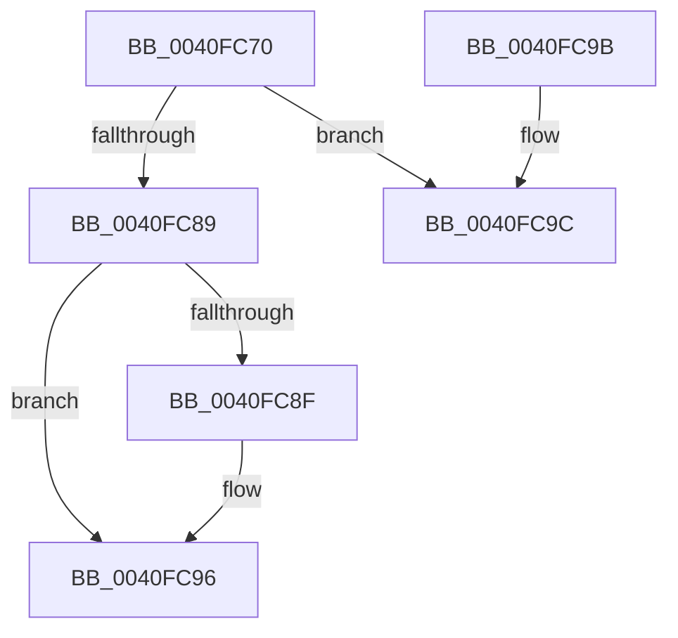

# CcIncrementVacbActiveCount

- RVA: `0x0040FC70`–`0x0040FCBE` (길이 `78` bytes)
- VA: `0x000000014040FC70`
- 실행 섹션: `.text`
- PDB 이름 있음: `예`; PDB Function 태그: `아니요`
- unwind 정보 RVA: `0x00065B0C`
- 디코드: `20`개 명령, `78/78` bytes 표시
- 미해석 바이트: `0` (있으면 어셈블리에 `.byte`로 보존)

> 이 문서는 커널 이미지의 기계어와 PDB 기호를 분석해 생성했습니다. 4번과 5번은 함수 원형과 자료형을 바이너리 사용 방식에서 추정한 C 해석이며 원본 소스 복구 결과는 아닙니다.

## 1. Dependencies

- 직접 호출 지점: **1**; 고유 호출 대상: **1**
- 직접 호출자로 확인된 함수: **2**
- RIP 상대 이미지 참조: **0**

### Outgoing calls
- `0x0040FCB8` → [KeBugCheckEx](../4F/KeBugCheckEx_function_004FD660.md) (function, `0x004FD660`)

### Direct callers
- [CcGetVirtualAddress](../34/CcGetVirtualAddress_function_00340C9C.md) at `0x00340DD8`
- [CcRemapBcb](CcRemapBcb_function_0040FBC0.md) at `0x0040FC04`

### Static image references
- 디코드된 RIP-relative 메모리 참조가 없습니다.

## 2. Other-region calls and transfers

- 다른 실행 섹션으로 향하는 call: **0**
- 별도 외부 분기/꼬리 이동을 확인하지 못했습니다.

## 3. Assembly (complete function range)

```asm
0040FC70  48 83 EC 38                     sub rsp, 0x38
0040FC74  48 8B 51 08                     mov rdx, qword ptr [rcx + 8]
0040FC78  B8 01 00 00 00                  mov eax, 1
0040FC7D  F0 0F C1 41 10                  lock xadd dword ptr [rcx + 0x10], eax
0040FC82  FF C0                           inc eax
0040FC84  66 85 C0                        test ax, ax
0040FC87  74 13                           je 0x14040fc9c
0040FC89  66 83 F8 01                     cmp ax, 1
0040FC8D  75 07                           jne 0x14040fc96
0040FC8F  F0 FF 82 28 02 00 00            lock inc dword ptr [rdx + 0x228]
0040FC96  48 83 C4 38                     add rsp, 0x38
0040FC9A  C3                              ret
0040FC9B  CC                              int3
0040FC9C  45 33 C9                        xor r9d, r9d
0040FC9F  48 C7 44 24 20 00 00 00 00      mov qword ptr [rsp + 0x20], 0
0040FCA8  BA AC 0B 00 00                  mov edx, 0xbac
0040FCAD  49 C7 C0 20 04 00 C0            mov r8, 0xffffffffc0000420
0040FCB4  41 8D 49 34                     lea ecx, [r9 + 0x34]
0040FCB8  E8 A3 D9 0E 00                  call 0x1404fd660
0040FCBD  CC                              int3
```

## 4. C-style interpretation (structured pseudocode)

```c
__int64 __fastcall CcIncrementVacbActiveCount(__int64 a1, __int64 a2, __int64 a3, int a4)
{
    __int64 result;
    __int64 v_rsp;
    unsigned __int64 v_stack_p20;

    v_rsp = (v_rsp) - (56);
    result = (unsigned int)((1) + 1);
    if ((unsigned __int16)(result) == 0) goto loc_0040FC9C;
    if (((unsigned __int16)(result)) == 1) {
    }
    v_rsp = (v_rsp) + (56);
    return result;
loc_0040FC9C:
    a4 = 0;
    v_stack_p20 = 0;
    result = KeBugCheckEx(a4 + 52, (unsigned int)(0xBACULL), 0xFFFFFFFFC0000420ULL, a4);
    return result;
}
```

## 5. (Beta) C Style

```c
int64_t CcIncrementVacbActiveCount(void *Arg1, int64_t Arg2, int64_t Arg3, int32_t Arg4)
{
    uint8_t *arg1 = (uint8_t *)Arg1;

    int64_t result;
    int64_t local_rsp;
    uint64_t v_stack_p20;

    local_rsp = (local_rsp) - (56);
    result = (uint32_t)((1) + 1);
    if ((uint16_t)(result) == 0) goto loc_0040FC9C;
    if (((uint16_t)(result)) == 1) {
    }
    local_rsp = (local_rsp) + (56);
    return result;
loc_0040FC9C:
    Arg4 = 0;
    v_stack_p20 = 0;
    result = KeBugCheckEx(Arg4 + 52, (uint32_t)(0xBACULL), 0xFFFFFFFFC0000420ULL, Arg4);
    return result;
}
```

### 관측된 메모리 오프셋

구조체 형식이 확인되지 않은 접근은 인자 기준의 오프셋으로만 기록했습니다.

| 기준 인자 | 오프셋 표현 | 폭 (bit) | 접근 |
|---|---:|---:|---|
| `Arg1` | `+ 0x8` | `64` | `R` |
| `Arg1` | `+ 0x10` | `32` | `R/W` |

## 6. Execution-region graph

[열기: 2D/3D 그래프와 함수 탐색 컨트롤 패널](../../../control-panel.html?section=text&rva=0x0040FC70&view=graph)

- 2D 그래프는 위에서 아래로 흐르고, 3D 그래프는 빈 공간을 드래그해 회전합니다. Shift+드래그는 이동, 휠은 확대·축소, 함수 노드 선택은 대상 보고서 이동입니다.

### Static fallback


