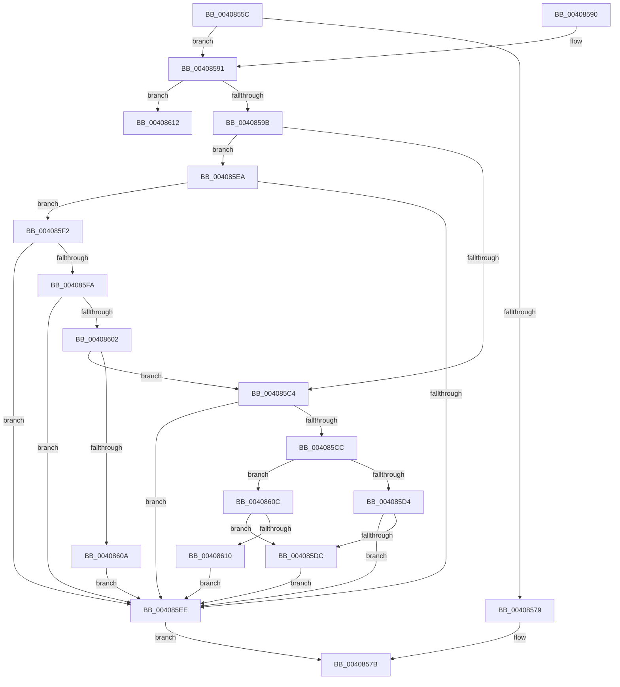

# CcIsFatalWriteError

- RVA: `0x0040855C`–`0x00408631` (길이 `213` bytes)
- VA: `0x000000014040855C`
- 실행 섹션: `.text`
- PDB 이름 있음: `예`; PDB Function 태그: `아니요`
- unwind 정보 RVA: `0x0009AB60`
- 디코드: `62`개 명령, `213/213` bytes 표시
- 미해석 바이트: `0` (있으면 어셈블리에 `.byte`로 보존)

> 이 문서는 커널 이미지의 기계어와 PDB 기호를 분석해 생성했습니다. 4번과 5번은 함수 원형과 자료형을 바이너리 사용 방식에서 추정한 C 해석이며 원본 소스 복구 결과는 아닙니다.

## 1. Dependencies

- 직접 호출 지점: **4**; 고유 호출 대상: **4**
- 직접 호출자로 확인된 함수: **4**
- RIP 상대 이미지 참조: **0**

### Outgoing calls
- `0x0040859B` → [CcReferenceSharedCacheMapFileObject](../23/CcReferenceSharedCacheMapFileObject_function_002379BC.md) (function, `0x002379BC`)
- `0x004085B7` → [ObFastDereferenceObjectDeferDelete](../23/ObFastDereferenceObjectDeferDelete_function_002378C0.md) (function, `0x002378C0`)
- `0x004085DE` → [FsRtlIsTotalDeviceFailure](FsRtlIsTotalDeviceFailure_function_00408710.md) (function, `0x00408710`)
- `0x0040862B` → [KeBugCheckEx](../4F/KeBugCheckEx_function_004FD660.md) (function, `0x004FD660`)

### Direct callers
- [CcWriteBehindPostProcess](../35/CcWriteBehindPostProcess_function_00357BB4.md) at `0x00357E30`
- [CcFlushCachePostProcessOneRange](../35/CcFlushCachePostProcessOneRange_function_00359710.md) at `0x00359AE6`
- [CcFlushCachePostProcessOneRange](../35/CcFlushCachePostProcessOneRange_function_00359710.md) at `0x00359B95`
- [CcNotifyOfMappedWriteComplete](CcNotifyOfMappedWriteComplete_function_0040873C.md) at `0x00408842`
- [CcUnpinRepinnedBcb](../49/CcUnpinRepinnedBcb_function_0049F560.md) at `0x0049F6EC`

### Static image references
- 디코드된 RIP-relative 메모리 참조가 없습니다.

## 2. Other-region calls and transfers

- 다른 실행 섹션으로 향하는 call: **0**
- 별도 외부 분기/꼬리 이동을 확인하지 못했습니다.

## 3. Assembly (complete function range)

```asm
0040855C  48 89 5C 24 08                  mov qword ptr [rsp + 8], rbx
00408561  48 89 6C 24 10                  mov qword ptr [rsp + 0x10], rbp
00408566  48 89 74 24 18                  mov qword ptr [rsp + 0x18], rsi
0040856B  57                              push rdi
0040856C  48 83 EC 30                     sub rsp, 0x30
00408570  8B FA                           mov edi, edx
00408572  48 8B E9                        mov rbp, rcx
00408575  85 D2                           test edx, edx
00408577  78 18                           js 0x140408591
00408579  32 C0                           xor al, al
0040857B  48 8B 5C 24 40                  mov rbx, qword ptr [rsp + 0x40]
00408580  48 8B 6C 24 48                  mov rbp, qword ptr [rsp + 0x48]
00408585  48 8B 74 24 50                  mov rsi, qword ptr [rsp + 0x50]
0040858A  48 83 C4 30                     add rsp, 0x30
0040858E  5F                              pop rdi
0040858F  C3                              ret
00408590  CC                              int3
00408591  BB 01 00 00 00                  mov ebx, 1
00408596  39 59 04                        cmp dword ptr [rcx + 4], ebx
00408599  72 77                           jb 0x140408612
0040859B  E8 1C F4 E2 FF                  call 0x1402379bc
004085A0  48 8B D0                        mov rdx, rax
004085A3  48 8D 4D 60                     lea rcx, [rbp + 0x60]
004085A7  41 B8 43 63 53 63               mov r8d, 0x63536343
004085AD  48 8B 40 08                     mov rax, qword ptr [rax + 8]
004085B1  8B 70 34                        mov esi, dword ptr [rax + 0x34]
004085B4  83 E6 10                        and esi, 0x10
004085B7  E8 04 F3 E2 FF                  call 0x1402378c0
004085BC  81 FF 54 00 00 C0               cmp edi, 0xc0000054
004085C2  75 26                           jne 0x1404085ea
004085C4  81 FF 0E 00 00 C0               cmp edi, 0xc000000e
004085CA  74 22                           je 0x1404085ee
004085CC  81 FF 9D 00 00 C0               cmp edi, 0xc000009d
004085D2  74 38                           je 0x14040860c
004085D4  81 FF A2 00 00 C0               cmp edi, 0xc00000a2
004085DA  74 12                           je 0x1404085ee
004085DC  8B CF                           mov ecx, edi
004085DE  E8 2D 01 00 00                  call 0x140408710
004085E3  84 C0                           test al, al
004085E5  0F 94 C3                        sete bl
004085E8  EB 04                           jmp 0x1404085ee
004085EA  85 F6                           test esi, esi
004085EC  74 04                           je 0x1404085f2
004085EE  8A C3                           mov al, bl
004085F0  EB 89                           jmp 0x14040857b
004085F2  81 FF 98 00 00 C0               cmp edi, 0xc0000098
004085F8  74 F4                           je 0x1404085ee
004085FA  81 FF 02 01 00 C0               cmp edi, 0xc0000102
00408600  74 EC                           je 0x1404085ee
00408602  81 FF 6E 02 00 C0               cmp edi, 0xc000026e
00408608  75 BA                           jne 0x1404085c4
0040860A  EB E2                           jmp 0x1404085ee
0040860C  85 F6                           test esi, esi
0040860E  75 CC                           jne 0x1404085dc
00408610  EB DC                           jmp 0x1404085ee
00408612  48 83 64 24 20 00               and qword ptr [rsp + 0x20], 0
00408618  45 33 C9                        xor r9d, r9d
0040861B  BA 8C 19 00 00                  mov edx, 0x198c
00408620  49 C7 C0 20 04 00 C0            mov r8, 0xffffffffc0000420
00408627  41 8D 49 34                     lea ecx, [r9 + 0x34]
0040862B  E8 30 50 0F 00                  call 0x1404fd660
00408630  CC                              int3
```

## 4. C-style interpretation (structured pseudocode)

```c
__int64 __fastcall CcIsFatalWriteError(__int64 a1, int a2, __int64 a3, int a4)
{
    __int64 result;
    __int64 v_rbx;
    __int64 v_rsi;
    __int64 v_rsp;
    unsigned __int64 v_stack_p10;
    unsigned __int64 v_stack_p18;
    unsigned __int64 v_stack_p20;
    unsigned __int64 v_stack_p8;

    v_stack_p8 = v_rbx;
    v_stack_p10 = v_rbp;
    v_stack_p18 = v_rsi;
    v_rsp = (v_rsp) - (48);
    if (sign_flag) goto loc_00408591;
    result = 0;
loc_0040857B:
    v_rsp = (v_rsp) + (48);
    return result;
loc_00408591:
    if ((*(unsigned int *)(a1 + 4)) < 1) goto loc_00408612;
    result = CcReferenceSharedCacheMapFileObject(a1, a2, a3, a4);
    v_rsi = (unsigned int)(((unsigned int)(*(unsigned int *)(*(unsigned __int64 *)(result + 8) + 52))) & (16));
    result = ObFastDereferenceObjectDeferDelete(v_stack_p10 + 96, result, (unsigned int)(0x63536343ULL), a4);
    if (((unsigned int)((unsigned int)(a2))) != 0xC0000054ULL) goto loc_004085EA;
loc_004085C4:
    if (((unsigned int)((unsigned int)(a2))) == 0xC000000EULL) goto loc_004085EE;
    if (((unsigned int)((unsigned int)(a2))) == 0xC000009DULL) goto loc_0040860C;
    if (((unsigned int)((unsigned int)(a2))) == 0xC00000A2ULL) goto loc_004085EE;
loc_004085DC:
    result = FsRtlIsTotalDeviceFailure((unsigned int)((unsigned int)((unsigned int)(a2))), result, (unsigned int)(0x63536343ULL), a4);
    v_rbx = ((unsigned __int8)(result) == 0) ? 1 : 0;
    goto loc_004085EE;
loc_004085EA:
    if ((unsigned int)(v_rsi) == 0) goto loc_004085F2;
loc_004085EE:
    goto loc_0040857B;
loc_004085F2:
    if (((unsigned int)((unsigned int)(a2))) == 0xC0000098ULL) goto loc_004085EE;
    if (((unsigned int)((unsigned int)(a2))) == 0xC0000102ULL) goto loc_004085EE;
    if (((unsigned int)((unsigned int)(a2))) != 0xC000026EULL) goto loc_004085C4;
    goto loc_004085EE;
loc_0040860C:
    if ((unsigned int)(v_rsi) != 0) goto loc_004085DC;
    goto loc_004085EE;
loc_00408612:
    a4 = 0;
    result = KeBugCheckEx(a4 + 52, (unsigned int)(0x198CULL), 0xFFFFFFFFC0000420ULL, a4);
    return result;
}
```

## 5. (Beta) C Style

```c
int64_t CcIsFatalWriteError(void *Arg1, int32_t Arg2, int64_t Arg3, int32_t Arg4)
{
    uint8_t *arg1 = (uint8_t *)Arg1;

    int64_t result;
    int64_t local_rbx;
    int64_t local_rsi;
    int64_t local_rsp;
    uint64_t v_stack_p10;
    uint64_t v_stack_p18;
    uint64_t v_stack_p20;
    uint64_t v_stack_p8;

    v_stack_p8 = local_rbx;
    v_stack_p10 = local_rbp;
    v_stack_p18 = local_rsi;
    local_rsp = (local_rsp) - (48);
    if (sign_flag) goto loc_00408591;
    result = 0;
loc_0040857B:
    local_rsp = (local_rsp) + (48);
    return result;
loc_00408591:
    if ((*(uint32_t *)(arg1 + 0x4)) < 1) goto loc_00408612;
    result = CcReferenceSharedCacheMapFileObject(Arg1, Arg2, Arg3, Arg4);
    local_rsi = (uint32_t)(((uint32_t)(*(uint32_t *)(*(uint64_t *)(result + 0x8) + 0x34))) & (16));
    result = ObFastDereferenceObjectDeferDelete(v_stack_p10 + 96, result, (uint32_t)(0x63536343ULL), Arg4);
    if (((uint32_t)((uint32_t)(Arg2))) != 0xC0000054ULL) goto loc_004085EA;
loc_004085C4:
    if (((uint32_t)((uint32_t)(Arg2))) == 0xC000000EULL) goto loc_004085EE;
    if (((uint32_t)((uint32_t)(Arg2))) == 0xC000009DULL) goto loc_0040860C;
    if (((uint32_t)((uint32_t)(Arg2))) == 0xC00000A2ULL) goto loc_004085EE;
loc_004085DC:
    result = FsRtlIsTotalDeviceFailure((uint32_t)((uint32_t)((uint32_t)(Arg2))), result, (uint32_t)(0x63536343ULL), Arg4);
    local_rbx = ((uint8_t)(result) == 0) ? 1 : 0;
    goto loc_004085EE;
loc_004085EA:
    if ((uint32_t)(local_rsi) == 0) goto loc_004085F2;
loc_004085EE:
    goto loc_0040857B;
loc_004085F2:
    if (((uint32_t)((uint32_t)(Arg2))) == 0xC0000098ULL) goto loc_004085EE;
    if (((uint32_t)((uint32_t)(Arg2))) == 0xC0000102ULL) goto loc_004085EE;
    if (((uint32_t)((uint32_t)(Arg2))) != 0xC000026EULL) goto loc_004085C4;
    goto loc_004085EE;
loc_0040860C:
    if ((uint32_t)(local_rsi) != 0) goto loc_004085DC;
    goto loc_004085EE;
loc_00408612:
    Arg4 = 0;
    result = KeBugCheckEx(Arg4 + 52, (uint32_t)(0x198CULL), 0xFFFFFFFFC0000420ULL, Arg4);
    return result;
}
```

### 관측된 메모리 오프셋

구조체 형식이 확인되지 않은 접근은 인자 기준의 오프셋으로만 기록했습니다.

| 기준 인자 | 오프셋 표현 | 폭 (bit) | 접근 |
|---|---:|---:|---|
| `Arg1` | `+ 0x4` | `32` | `R` |
| `Arg1` | `+ 0x60` | `64` | `R` |

## 6. Execution-region graph

[열기: 2D/3D 그래프와 함수 탐색 컨트롤 패널](../../../control-panel.html?section=text&rva=0x0040855C&view=graph)

- 2D 그래프는 위에서 아래로 흐르고, 3D 그래프는 빈 공간을 드래그해 회전합니다. Shift+드래그는 이동, 휠은 확대·축소, 함수 노드 선택은 대상 보고서 이동입니다.

### Static fallback


