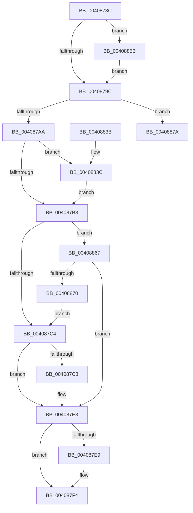

# CcNotifyOfMappedWriteComplete

- RVA: `0x0040873C`–`0x00408899` (길이 `349` bytes)
- VA: `0x000000014040873C`
- 실행 섹션: `.text`
- PDB 이름 있음: `예`; PDB Function 태그: `아니요`
- unwind 정보 RVA: `0x0009AB78`
- 디코드: `89`개 명령, `349/349` bytes 표시
- 미해석 바이트: `0` (있으면 어셈블리에 `.byte`로 보존)

> 이 문서는 커널 이미지의 기계어와 PDB 기호를 분석해 생성했습니다. 4번과 5번은 함수 원형과 자료형을 바이너리 사용 방식에서 추정한 C 해석이며 원본 소스 복구 결과는 아닙니다.

## 1. Dependencies

- 직접 호출 지점: **8**; 고유 호출 대상: **8**
- 직접 호출자로 확인된 함수: **1**
- RIP 상대 이미지 참조: **1**

### Outgoing calls
- `0x0040879C` → [CcGetPartitionForSectionObject](../38/CcGetPartitionForSectionObject_function_0038B740.md) (function, `0x0038B740`)
- `0x004087DE` → [CcReleaseByteRangeFromWrite](../35/CcReleaseByteRangeFromWrite_function_00359C90.md) (function, `0x00359C90`)
- `0x004087EF` → [CcPostDeferredWrites](../35/CcPostDeferredWrites_function_003590FC.md) (function, `0x003590FC`)
- `0x00408800` → [KeAcquireInStackQueuedSpinLock](../27/KeAcquireInStackQueuedSpinLock_function_002757A0.md) (function, `0x002757A0`)
- `0x0040880E` → [CcDecrementOpenCount](../38/CcDecrementOpenCount_function_0038B75C.md) (function, `0x0038B75C`)
- `0x00408818` → [KeReleaseInStackQueuedSpinLock](../34/KeReleaseInStackQueuedSpinLock_function_00342CE0.md) (function, `0x00342CE0`)
- `0x00408842` → [CcIsFatalWriteError](CcIsFatalWriteError_function_0040855C.md) (function, `0x0040855C`)
- `0x00408893` → [KeBugCheckEx](../4F/KeBugCheckEx_function_004FD660.md) (function, `0x004FD660`)

### Direct callers
- [sub_006EC582](../6E/Unknown_function_006EC582.md) at `0x006EC590`

### Static image references
- `0x00408775` → RVA `0x00E65B88` (`.data`; read)

## 2. Other-region calls and transfers

- 다른 실행 섹션으로 향하는 call: **0**
- 별도 외부 분기/꼬리 이동을 확인하지 못했습니다.

## 3. Assembly (complete function range)

```asm
0040873C  48 8B C4                        mov rax, rsp
0040873F  48 89 58 08                     mov qword ptr [rax + 8], rbx
00408743  48 89 68 18                     mov qword ptr [rax + 0x18], rbp
00408747  48 89 70 20                     mov qword ptr [rax + 0x20], rsi
0040874B  48 89 50 10                     mov qword ptr [rax + 0x10], rdx
0040874F  57                              push rdi
00408750  41 54                           push r12
00408752  41 55                           push r13
00408754  41 56                           push r14
00408756  41 57                           push r15
00408758  48 83 EC 50                     sub rsp, 0x50
0040875C  48 8B 79 08                     mov rdi, qword ptr [rcx + 8]
00408760  33 C0                           xor eax, eax
00408762  48 89 44 24 40                  mov qword ptr [rsp + 0x40], rax
00408767  0F 57 C0                        xorps xmm0, xmm0
0040876A  0F 11 44 24 30                  movups xmmword ptr [rsp + 0x30], xmm0
0040876F  45 32 FF                        xor r15b, r15b
00408772  41 8B F0                        mov esi, r8d
00408775  38 05 0D D4 A5 00               cmp byte ptr [rip + 0xa5d40d], al
0040877B  45 8B E1                        mov r12d, r9d
0040877E  4C 8B AF 58 02 00 00            mov r13, qword ptr [rdi + 0x258]
00408785  48 8B DA                        mov rbx, rdx
00408788  4C 8B B7 18 02 00 00            mov r14, qword ptr [rdi + 0x218]
0040878F  49 8D AD 50 04 00 00            lea rbp, [r13 + 0x450]
00408796  0F 84 BF 00 00 00               je 0x14040885b
0040879C  E8 9F 2F F8 FF                  call 0x14038b740
004087A1  4C 3B F0                        cmp r14, rax
004087A4  0F 85 D0 00 00 00               jne 0x14040887a
004087AA  45 85 E4                        test r12d, r12d
004087AD  0F 88 89 00 00 00               js 0x14040883c
004087B3  48 8B 4F 30                     mov rcx, qword ptr [rdi + 0x30]
004087B7  48 8D 04 33                     lea rax, [rbx + rsi]
004087BB  48 3B C1                        cmp rax, rcx
004087BE  0F 8F A3 00 00 00               jg 0x140408867
004087C4  85 F6                           test esi, esi
004087C6  74 1B                           je 0x1404087e3
004087C8  45 33 C9                        xor r9d, r9d
004087CB  44 88 7C 24 20                  mov byte ptr [rsp + 0x20], r15b
004087D0  44 8B C6                        mov r8d, esi
004087D3  48 8D 94 24 88 00 00 00         lea rdx, [rsp + 0x88]
004087DB  48 8B CF                        mov rcx, rdi
004087DE  E8 AD 14 F5 FF                  call 0x140359c90
004087E3  48 39 6D 00                     cmp qword ptr [rbp], rbp
004087E7  74 0B                           je 0x1404087f4
004087E9  49 8B D5                        mov rdx, r13
004087EC  49 8B CE                        mov rcx, r14
004087EF  E8 08 09 F5 FF                  call 0x1403590fc
004087F4  49 8D 8E 00 03 00 00            lea rcx, [r14 + 0x300]
004087FB  48 8D 54 24 30                  lea rdx, [rsp + 0x30]
00408800  E8 9B CF E6 FF                  call 0x1402757a0
00408805  FF 8F 0C 02 00 00               dec dword ptr [rdi + 0x20c]
0040880B  48 8B CF                        mov rcx, rdi
0040880E  E8 49 2F F8 FF                  call 0x14038b75c
00408813  48 8D 4C 24 30                  lea rcx, [rsp + 0x30]
00408818  E8 C3 A4 F3 FF                  call 0x140342ce0
0040881D  4C 8D 5C 24 50                  lea r11, [rsp + 0x50]
00408822  49 8B 5B 30                     mov rbx, qword ptr [r11 + 0x30]
00408826  49 8B 6B 40                     mov rbp, qword ptr [r11 + 0x40]
0040882A  49 8B 73 48                     mov rsi, qword ptr [r11 + 0x48]
0040882E  49 8B E3                        mov rsp, r11
00408831  41 5F                           pop r15
00408833  41 5E                           pop r14
00408835  41 5D                           pop r13
00408837  41 5C                           pop r12
00408839  5F                              pop rdi
0040883A  C3                              ret
0040883B  CC                              int3
0040883C  41 8B D4                        mov edx, r12d
0040883F  48 8B CF                        mov rcx, rdi
00408842  E8 15 FD FF FF                  call 0x14040855c
00408847  84 C0                           test al, al
00408849  45 0F B6 FF                     movzx r15d, r15b
0040884D  B9 01 00 00 00                  mov ecx, 1
00408852  44 0F 44 F9                     cmove r15d, ecx
00408856  E9 58 FF FF FF                  jmp 0x1404087b3
0040885B  49 8D AE 90 04 00 00            lea rbp, [r14 + 0x490]
00408862  E9 35 FF FF FF                  jmp 0x14040879c
00408867  48 3B D9                        cmp rbx, rcx
0040886A  0F 8F 73 FF FF FF               jg 0x1404087e3
00408870  8B 77 30                        mov esi, dword ptr [rdi + 0x30]
00408873  2B F3                           sub esi, ebx
00408875  E9 4A FF FF FF                  jmp 0x1404087c4
0040887A  48 83 64 24 20 00               and qword ptr [rsp + 0x20], 0
00408880  45 33 C9                        xor r9d, r9d
00408883  BA BC 14 00 00                  mov edx, 0x14bc
00408888  49 C7 C0 20 04 00 C0            mov r8, 0xffffffffc0000420
0040888F  41 8D 49 34                     lea ecx, [r9 + 0x34]
00408893  E8 C8 4D 0F 00                  call 0x1404fd660
00408898  CC                              int3
```

## 4. C-style interpretation (structured pseudocode)

```c
__int64 __fastcall CcNotifyOfMappedWriteComplete(__int64 a1, __int64 a2, int a3, int a4)
{
    __int64 result;
    __int64 v_r15;
    __int64 v_rsi;
    __int64 v_rsp;
    unsigned __int64 v_stack_m28;
    unsigned __int64 v_stack_m30;
    unsigned __int64 v_stack_m38;
    unsigned __int64 v_stack_m48;
    unsigned __int8 v_stack_m58;
    unsigned __int64 v_stack_p10;

    *(unsigned __int64 *)(v_rsp + 8) = v_rbx;
    *(unsigned __int64 *)(v_rsp + 24) = v_rbp;
    *(unsigned __int64 *)(v_rsp + 32) = v_rsi;
    *(unsigned __int64 *)(v_rsp + 16) = a2;
    v_rsp = (v_rsp) - (80);
    result = 0;
    v_stack_m38 = 0;
    v_stack_m48 = v_xmm0;
    v_r15 = 0;
    if ((*(unsigned __int8 *)(v_rip + 10867725)) == 0) goto loc_0040885B;
loc_0040879C:
    result = CcGetPartitionForSectionObject(a1, a2, a3, a4);
    if ((*(unsigned __int64 *)(*(unsigned __int64 *)(a1 + 8) + 536)) != result) goto loc_0040887A;
    if (sign_flag) goto loc_0040883C;
loc_004087B3:
    if ((a2 + (unsigned int)(a3) * 1) > (*(unsigned __int64 *)(*(unsigned __int64 *)(a1 + 8) + 48))) goto loc_00408867;
loc_004087C4:
    result = a2 + (unsigned int)(a3) * 1;
    if ((unsigned int)((unsigned int)(a3)) != 0) {
        a4 = 0;
        v_stack_m58 = 0;
        a3 = (unsigned int)((unsigned int)(a3));
        a2 = v_stack_p10;
        a1 = *(unsigned __int64 *)(a1 + 8);
        result = CcReleaseByteRangeFromWrite(a1, a2, a3, a4);
    }
    if ((*(unsigned __int64 *)(*(unsigned __int64 *)(*(unsigned __int64 *)(a1 + 8) + 600) + 1104)) != (*(unsigned __int64 *)(*(unsigned __int64 *)(a1 + 8) + 600) + 1104)) {
        a2 = *(unsigned __int64 *)(*(unsigned __int64 *)(a1 + 8) + 600);
        a1 = *(unsigned __int64 *)(*(unsigned __int64 *)(a1 + 8) + 536);
        result = CcPostDeferredWrites(a1, a2, a3, a4);
    }
    result = KeAcquireInStackQueuedSpinLock(*(unsigned __int64 *)(*(unsigned __int64 *)(a1 + 8) + 536) + 768, v_stack_m48, a3, a4);
    result = CcDecrementOpenCount(*(unsigned __int64 *)(a1 + 8), v_stack_m48, a3, a4);
    result = KeReleaseInStackQueuedSpinLock(v_stack_m48, v_stack_m48, a3, a4);
    return result;
loc_0040883C:
    result = CcIsFatalWriteError(*(unsigned __int64 *)(a1 + 8), (unsigned int)((unsigned int)((unsigned int)(a4))), a3, a4);
    v_r15 = 0;
    if ((unsigned __int8)(result) == 0) { v_r15 = 1; }
    goto loc_004087B3;
loc_0040885B:
    goto loc_0040879C;
loc_00408867:
    if ((*(unsigned __int64 *)(v_stack_m28 + 48)) > 1) goto loc_004087E3;
    v_rsi = (unsigned int)(((unsigned int)(*(unsigned int *)(*(unsigned __int64 *)(a1 + 8) + 48))) - ((unsigned int)(*(unsigned __int64 *)(v_stack_m28 + 48))));
    goto loc_004087C4;
loc_0040887A:
    a4 = 0;
    result = KeBugCheckEx(a4 + 52, (unsigned int)(0x14BCULL), 0xFFFFFFFFC0000420ULL, a4);
    return result;
}
```

## 5. (Beta) C Style

```c
int64_t CcNotifyOfMappedWriteComplete(void *Arg1, void *Arg2, int32_t Arg3, int32_t Arg4)
{
    uint8_t *arg1 = (uint8_t *)Arg1;
    uint8_t *arg2 = (uint8_t *)Arg2;

    int64_t result;
    int64_t local_r15;
    int64_t local_rsi;
    int64_t local_rsp;
    uint64_t v_stack_m28;
    uint64_t v_stack_m30;
    uint64_t v_stack_m38;
    uint64_t v_stack_m48;
    uint8_t v_stack_m58;
    uint64_t v_stack_p10;

    *(uint64_t *)(local_rsp + 0x8) = local_rbx;
    *(uint64_t *)(local_rsp + 0x18) = local_rbp;
    *(uint64_t *)(local_rsp + 0x20) = local_rsi;
    *(void **)(local_rsp + 0x10) = Arg2;
    local_rsp = (local_rsp) - (80);
    result = 0;
    v_stack_m38 = 0;
    v_stack_m48 = v_xmm0;
    local_r15 = 0;
    if ((*(uint8_t *)(v_rip + 0xA5D40D)) == 0) goto loc_0040885B;
loc_0040879C:
    result = CcGetPartitionForSectionObject(Arg1, Arg2, Arg3, Arg4);
    if ((*(uint64_t *)(*(uint64_t *)(arg1 + 0x8) + 0x218)) != result) goto loc_0040887A;
    if (sign_flag) goto loc_0040883C;
loc_004087B3:
    if ((Arg2 + (uint32_t)(Arg3) * 1) > (*(uint64_t *)(*(uint64_t *)(arg1 + 0x8) + 0x30))) goto loc_00408867;
loc_004087C4:
    result = Arg2 + (uint32_t)(Arg3) * 1;
    if ((uint32_t)((uint32_t)(Arg3)) != 0) {
        Arg4 = 0;
        v_stack_m58 = 0;
        Arg3 = (uint32_t)((uint32_t)(Arg3));
        Arg2 = v_stack_p10;
        Arg1 = *(uint64_t *)(arg1 + 0x8);
        result = CcReleaseByteRangeFromWrite(Arg1, Arg2, Arg3, Arg4);
    }
    if ((*(uint64_t *)(*(uint64_t *)(*(uint64_t *)(arg1 + 0x8) + 0x258) + 0x450)) != (*(uint64_t *)(*(uint64_t *)(arg1 + 0x8) + 0x258) + 1104)) {
        Arg2 = *(uint64_t *)(*(uint64_t *)(arg1 + 0x8) + 0x258);
        Arg1 = *(uint64_t *)(*(uint64_t *)(arg1 + 0x8) + 0x218);
        result = CcPostDeferredWrites(Arg1, Arg2, Arg3, Arg4);
    }
    result = KeAcquireInStackQueuedSpinLock(*(uint64_t *)(*(uint64_t *)(arg1 + 0x8) + 0x218) + 768, v_stack_m48, Arg3, Arg4);
    result = CcDecrementOpenCount(*(uint64_t *)(arg1 + 0x8), v_stack_m48, Arg3, Arg4);
    result = KeReleaseInStackQueuedSpinLock(v_stack_m48, v_stack_m48, Arg3, Arg4);
    return result;
loc_0040883C:
    result = CcIsFatalWriteError(*(uint64_t *)(arg1 + 0x8), (uint32_t)((uint32_t)((uint32_t)(Arg4))), Arg3, Arg4);
    local_r15 = 0;
    if ((uint8_t)(result) == 0) { local_r15 = 1; }
    goto loc_004087B3;
loc_0040885B:
    goto loc_0040879C;
loc_00408867:
    if ((*(uint64_t *)(v_stack_m28 + 0x30)) > 1) goto loc_004087E3;
    local_rsi = (uint32_t)(((uint32_t)(*(uint32_t *)(*(uint64_t *)(arg1 + 0x8) + 0x30))) - ((uint32_t)(*(uint64_t *)(v_stack_m28 + 0x30))));
    goto loc_004087C4;
loc_0040887A:
    Arg4 = 0;
    result = KeBugCheckEx(Arg4 + 52, (uint32_t)(0x14BCULL), 0xFFFFFFFFC0000420ULL, Arg4);
    return result;
}
```

### 관측된 메모리 오프셋

구조체 형식이 확인되지 않은 접근은 인자 기준의 오프셋으로만 기록했습니다.

| 기준 인자 | 오프셋 표현 | 폭 (bit) | 접근 |
|---|---:|---:|---|
| `Arg1` | `+ 0x8` | `64` | `R` |
| `Arg2` | `+ 0x0 + rsi*1` | `64` | `R` |

## 6. Execution-region graph

[열기: 2D/3D 그래프와 함수 탐색 컨트롤 패널](../../../control-panel.html?section=text&rva=0x0040873C&view=graph)

- 2D 그래프는 위에서 아래로 흐르고, 3D 그래프는 빈 공간을 드래그해 회전합니다. Shift+드래그는 이동, 휠은 확대·축소, 함수 노드 선택은 대상 보고서 이동입니다.

### Static fallback


