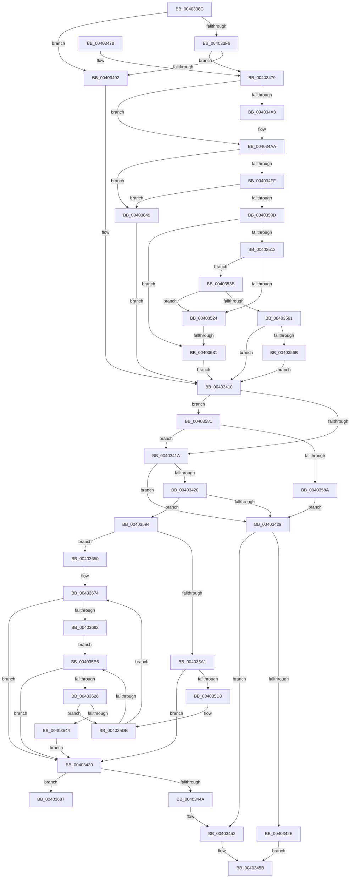

# CcNotifyOfMappedWrite

- RVA: `0x0040338C`–`0x004036A6` (길이 `794` bytes)
- VA: `0x000000014040338C`
- 실행 섹션: `.text`
- PDB 이름 있음: `예`; PDB Function 태그: `예`
- unwind 정보 RVA: `0x0009A720`
- 디코드: `196`개 명령, `794/794` bytes 표시
- 미해석 바이트: `0` (있으면 어셈블리에 `.byte`로 보존)

> 이 문서는 커널 이미지의 기계어와 PDB 기호를 분석해 생성했습니다. 4번과 5번은 함수 원형과 자료형을 바이너리 사용 방식에서 추정한 C 해석이며 원본 소스 복구 결과는 아닙니다.

## 1. Dependencies

- 직접 호출 지점: **18**; 고유 호출 대상: **9**
- 직접 호출자로 확인된 함수: **1**
- RIP 상대 이미지 참조: **2**

### Outgoing calls
- `0x004033E8` → [KeAcquireInStackQueuedSpinLock](../27/KeAcquireInStackQueuedSpinLock_function_002757A0.md) (function, `0x002757A0`)
- `0x0040340B` → [KeReleaseInStackQueuedSpinLock](../34/KeReleaseInStackQueuedSpinLock_function_00342CE0.md) (function, `0x00342CE0`)
- `0x0040343B` → [KeAcquireInStackQueuedSpinLock](../27/KeAcquireInStackQueuedSpinLock_function_002757A0.md) (function, `0x002757A0`)
- `0x00403456` → [KeReleaseInStackQueuedSpinLock](../34/KeReleaseInStackQueuedSpinLock_function_00342CE0.md) (function, `0x00342CE0`)
- `0x00403483` → [CcGetPrivateVolumeCacheMap](../38/CcGetPrivateVolumeCacheMap_function_0038B930.md) (function, `0x0038B930`)
- `0x0040348B` → [CcGetNodeForLazyWrite](CcGetNodeForLazyWrite_function_004031AC.md) (function, `0x004031AC`)
- `0x004034B8` → [KeAcquireInStackQueuedSpinLock](../27/KeAcquireInStackQueuedSpinLock_function_002757A0.md) (function, `0x002757A0`)
- `0x004034CF` → [KeReleaseInStackQueuedSpinLock](../34/KeReleaseInStackQueuedSpinLock_function_00342CE0.md) (function, `0x00342CE0`)
- `0x004034D8` → [KeReleaseInStackQueuedSpinLock](../34/KeReleaseInStackQueuedSpinLock_function_00342CE0.md) (function, `0x00342CE0`)
- `0x004034E4` → [KeAcquireInStackQueuedSpinLock](../27/KeAcquireInStackQueuedSpinLock_function_002757A0.md) (function, `0x002757A0`)
- `0x004034EC` → [CcDecrementOpenCount](../38/CcDecrementOpenCount_function_0038B75C.md) (function, `0x0038B75C`)
- `0x00403558` → [CcCanIWriteStreamEx](../38/CcCanIWriteStreamEx_function_0038993C.md) (function, `0x0038993C`)
- `0x00403577` → [CcScheduleLazyWriteScan](../3C/CcScheduleLazyWriteScan_function_003CBD20.md) (function, `0x003CBD20`)
- `0x004035BF` → [KeReleaseInStackQueuedSpinLock](../34/KeReleaseInStackQueuedSpinLock_function_00342CE0.md) (function, `0x00342CE0`)
- `0x00403619` → [CcAcquireByteRangeForWrite](CcAcquireByteRangeForWrite_function_00401E74.md) (function, `0x00401E74`)
- `0x00403650` → [KeReleaseInStackQueuedSpinLock](../34/KeReleaseInStackQueuedSpinLock_function_00342CE0.md) (function, `0x00342CE0`)
- `0x0040366E` → [KeBugCheckEx](../4F/KeBugCheckEx_function_004FD660.md) (function, `0x004FD660`)
- `0x004036A0` → [KeBugCheckEx](../4F/KeBugCheckEx_function_004FD660.md) (function, `0x004FD660`)

### Direct callers
- [MiGatherMappedPages](MiGatherMappedPages_function_00404E80.md) at `0x00405004`
- [MiGatherMappedPages](MiGatherMappedPages_function_00404E80.md) at `0x004050F2`

### Static image references
- `0x004033D6` → RVA `0x00E11CC0` (`.data`; read)
- `0x00403490` → RVA `0x00E65B88` (`.data`; read)

## 2. Other-region calls and transfers

- 다른 실행 섹션으로 향하는 call: **0**
- call이 아닌 외부 분기/꼬리 이동: **1**
  - `0x0040352B` → [sub_006EC29A](../6E/Unknown_function_006EC29A.md) (`tail-transfer`)

## 3. Assembly (complete function range)

```asm
0040338C  48 89 5C 24 10                  mov qword ptr [rsp + 0x10], rbx
00403391  44 89 44 24 18                  mov dword ptr [rsp + 0x18], r8d
00403396  55                              push rbp
00403397  56                              push rsi
00403398  57                              push rdi
00403399  41 54                           push r12
0040339B  41 55                           push r13
0040339D  41 56                           push r14
0040339F  41 57                           push r15
004033A1  48 8D 6C 24 D9                  lea rbp, [rsp - 0x27]
004033A6  48 81 EC A0 00 00 00            sub rsp, 0xa0
004033AD  48 83 65 D7 00                  and qword ptr [rbp - 0x29], 0
004033B2  33 C0                           xor eax, eax
004033B4  48 83 65 7F 00                  and qword ptr [rbp + 0x7f], 0
004033B9  48 8B DA                        mov rbx, rdx
004033BC  48 83 65 E7 00                  and qword ptr [rbp - 0x19], 0
004033C1  48 8D 55 07                     lea rdx, [rbp + 7]
004033C5  48 8B F9                        mov rdi, rcx
004033C8  48 89 45 17                     mov qword ptr [rbp + 0x17], rax
004033CC  0F 57 C0                        xorps xmm0, xmm0
004033CF  48 89 45 FF                     mov qword ptr [rbp - 1], rax
004033D3  0F 57 C9                        xorps xmm1, xmm1
004033D6  48 8D 0D E3 E8 A0 00            lea rcx, [rip + 0xa0e8e3]
004033DD  0F 11 45 07                     movups xmmword ptr [rbp + 7], xmm0
004033E1  45 33 F6                        xor r14d, r14d
004033E4  0F 11 4D EF                     movups xmmword ptr [rbp - 0x11], xmm1
004033E8  E8 B3 23 E7 FF                  call 0x1402757a0
004033ED  48 8B 77 08                     mov rsi, qword ptr [rdi + 8]
004033F1  48 85 F6                        test rsi, rsi
004033F4  74 0C                           je 0x140403402
004033F6  F7 86 98 00 00 00 00 01 00 00   test dword ptr [rsi + 0x98], 0x100
00403400  74 77                           je 0x140403479
00403402  48 8D 4D 07                     lea rcx, [rbp + 7]
00403406  BF 01 00 00 00                  mov edi, 1
0040340B  E8 D0 F8 F3 FF                  call 0x140342ce0
00403410  83 7D 77 00                     cmp dword ptr [rbp + 0x77], 0
00403414  0F 84 67 01 00 00               je 0x140403581
0040341A  8B CF                           mov ecx, edi
0040341C  85 FF                           test edi, edi
0040341E  74 09                           je 0x140403429
00403420  83 E9 01                        sub ecx, 1
00403423  0F 85 6B 01 00 00               jne 0x140403594
00403429  4D 85 F6                        test r14, r14
0040342C  75 24                           jne 0x140403452
0040342E  EB 2B                           jmp 0x14040345b
00403430  49 8D 8E 00 03 00 00            lea rcx, [r14 + 0x300]
00403437  48 8D 55 EF                     lea rdx, [rbp - 0x11]
0040343B  E8 60 23 E7 FF                  call 0x1402757a0
00403440  83 7E 04 00                     cmp dword ptr [rsi + 4], 0
00403444  0F 86 3D 02 00 00               jbe 0x140403687
0040344A  0F BA B6 98 00 00 00 16         btr dword ptr [rsi + 0x98], 0x16
00403452  48 8D 4D EF                     lea rcx, [rbp - 0x11]
00403456  E8 85 F8 F3 FF                  call 0x140342ce0
0040345B  48 8B 9C 24 E8 00 00 00         mov rbx, qword ptr [rsp + 0xe8]
00403463  8B C7                           mov eax, edi
00403465  48 81 C4 A0 00 00 00            add rsp, 0xa0
0040346C  41 5F                           pop r15
0040346E  41 5E                           pop r14
00403470  41 5D                           pop r13
00403472  41 5C                           pop r12
00403474  5F                              pop rdi
00403475  5E                              pop rsi
00403476  5D                              pop rbp
00403477  C3                              ret
00403478  CC                              int3
00403479  4C 8B B6 18 02 00 00            mov r14, qword ptr [rsi + 0x218]
00403480  48 8B CE                        mov rcx, rsi
00403483  E8 A8 84 F8 FF                  call 0x14038b930
00403488  4C 8B F8                        mov r15, rax
0040348B  E8 1C FD FF FF                  call 0x1404031ac
00403490  80 3D F1 26 A6 00 00            cmp byte ptr [rip + 0xa626f1], 0
00403497  4D 8D A7 94 04 00 00            lea r12, [r15 + 0x494]
0040349E  4C 8B E8                        mov r13, rax
004034A1  75 07                           jne 0x1404034aa
004034A3  4D 8D A6 0C 05 00 00            lea r12, [r14 + 0x50c]
004034AA  49 8D BE 00 03 00 00            lea rdi, [r14 + 0x300]
004034B1  48 8B CF                        mov rcx, rdi
004034B4  48 8D 55 EF                     lea rdx, [rbp - 0x11]
004034B8  E8 E3 22 E7 FF                  call 0x1402757a0
004034BD  8B 46 04                        mov eax, dword ptr [rsi + 4]
004034C0  48 8D 4D EF                     lea rcx, [rbp - 0x11]
004034C4  FF C0                           inc eax
004034C6  89 46 04                        mov dword ptr [rsi + 4], eax
004034C9  FF 86 20 02 00 00               inc dword ptr [rsi + 0x220]
004034CF  E8 0C F8 F3 FF                  call 0x140342ce0
004034D4  48 8D 4D 07                     lea rcx, [rbp + 7]
004034D8  E8 03 F8 F3 FF                  call 0x140342ce0
004034DD  48 8D 55 EF                     lea rdx, [rbp - 0x11]
004034E1  48 8B CF                        mov rcx, rdi
004034E4  E8 B7 22 E7 FF                  call 0x1402757a0
004034E9  48 8B CE                        mov rcx, rsi
004034EC  E8 6B 82 F8 FF                  call 0x14038b75c
004034F1  8B 86 98 00 00 00               mov eax, dword ptr [rsi + 0x98]
004034F7  A8 20                           test al, 0x20
004034F9  0F 85 4A 01 00 00               jne 0x140403649
004034FF  33 FF                           xor edi, edi
00403501  39 BE 0C 02 00 00               cmp dword ptr [rsi + 0x20c], edi
00403507  0F 85 3C 01 00 00               jne 0x140403649
0040350D  39 7E 70                        cmp dword ptr [rsi + 0x70], edi
00403510  74 1F                           je 0x140403531
00403512  4C 8B 46 60                     mov r8, qword ptr [rsi + 0x60]
00403516  49 83 E0 F0                     and r8, 0xfffffffffffffff0
0040351A  41 F7 40 50 00 80 00 00         test dword ptr [r8 + 0x50], 0x8000
00403522  74 17                           je 0x14040353b
00403524  48 8B 46 28                     mov rax, qword ptr [rsi + 0x28]
00403528  48 3B D8                        cmp rbx, rax
0040352B  0F 8F 69 8D 2E 00               jg 0x1406ec29a
00403531  BF 02 00 00 00                  mov edi, 2
00403536  E9 D5 FE FF FF                  jmp 0x140403410
0040353B  48 89 7C 24 30                  mov qword ptr [rsp + 0x30], rdi
00403540  41 B9 00 00 00 01               mov r9d, 0x1000000
00403546  C7 44 24 28 08 00 00 00         mov dword ptr [rsp + 0x28], 8
0040354E  49 8B D7                        mov rdx, r15
00403551  49 8B CE                        mov rcx, r14
00403554  89 7C 24 20                     mov dword ptr [rsp + 0x20], edi
00403558  E8 DF 63 F8 FF                  call 0x14038993c
0040355D  84 C0                           test al, al
0040355F  74 C3                           je 0x140403524
00403561  41 38 3C 24                     cmp byte ptr [r12], dil
00403565  0F 84 A5 FE FF FF               je 0x140403410
0040356B  45 33 C9                        xor r9d, r9d
0040356E  41 B0 01                        mov r8b, 1
00403571  49 8B D7                        mov rdx, r15
00403574  49 8B CE                        mov rcx, r14
00403577  E8 A4 87 FC FF                  call 0x1403cbd20
0040357C  E9 8F FE FF FF                  jmp 0x140403410
00403581  83 FF 02                        cmp edi, 2
00403584  0F 85 90 FE FF FF               jne 0x14040341a
0040358A  BF 01 00 00 00                  mov edi, 1
0040358F  E9 95 FE FF FF                  jmp 0x140403429
00403594  83 F9 01                        cmp ecx, 1
00403597  48 8D 4D EF                     lea rcx, [rbp - 0x11]
0040359B  0F 85 AF 00 00 00               jne 0x140403650
004035A1  81 8E 98 00 00 00 00 04 40 00   or dword ptr [rsi + 0x98], 0x400400
004035AB  8B 46 04                        mov eax, dword ptr [rsi + 4]
004035AE  FF C0                           inc eax
004035B0  89 46 04                        mov dword ptr [rsi + 4], eax
004035B3  FF 86 20 02 00 00               inc dword ptr [rsi + 0x220]
004035B9  FF 86 0C 02 00 00               inc dword ptr [rsi + 0x20c]
004035BF  E8 1C F7 F3 FF                  call 0x140342ce0
004035C4  8B 45 77                        mov eax, dword ptr [rbp + 0x77]
004035C7  8B C8                           mov ecx, eax
004035C9  48 89 5D DF                     mov qword ptr [rbp - 0x21], rbx
004035CD  89 45 67                        mov dword ptr [rbp + 0x67], eax
004035D0  85 C0                           test eax, eax
004035D2  0F 84 58 FE FF FF               je 0x140403430
004035D8  44 8B F8                        mov r15d, eax
004035DB  48 83 7E 08 00                  cmp qword ptr [rsi + 8], 0
004035E0  0F 84 8E 00 00 00               je 0x140403674
004035E6  48 83 64 24 40 00               and qword ptr [rsp + 0x40], 0
004035EC  48 8D 45 E7                     lea rax, [rbp - 0x19]
004035F0  C6 44 24 38 00                  mov byte ptr [rsp + 0x38], 0
004035F5  48 8D 55 DF                     lea rdx, [rbp - 0x21]
004035F9  48 89 44 24 30                  mov qword ptr [rsp + 0x30], rax
004035FE  44 8B C1                        mov r8d, ecx
00403601  48 8D 45 67                     lea rax, [rbp + 0x67]
00403605  45 33 C9                        xor r9d, r9d
00403608  48 89 44 24 28                  mov qword ptr [rsp + 0x28], rax
0040360D  48 8B CE                        mov rcx, rsi
00403610  48 8D 45 7F                     lea rax, [rbp + 0x7f]
00403614  48 89 44 24 20                  mov qword ptr [rsp + 0x20], rax
00403619  E8 56 E8 FF FF                  call 0x140401e74
0040361E  84 C0                           test al, al
00403620  0F 84 0A FE FF FF               je 0x140403430
00403626  8B 4D 67                        mov ecx, dword ptr [rbp + 0x67]
00403629  48 8B 45 7F                     mov rax, qword ptr [rbp + 0x7f]
0040362D  48 03 C1                        add rax, rcx
00403630  8B CB                           mov ecx, ebx
00403632  2B C8                           sub ecx, eax
00403634  48 89 45 7F                     mov qword ptr [rbp + 0x7f], rax
00403638  41 03 CF                        add ecx, r15d
0040363B  48 89 45 DF                     mov qword ptr [rbp - 0x21], rax
0040363F  89 4D 67                        mov dword ptr [rbp + 0x67], ecx
00403642  75 97                           jne 0x1404035db
00403644  E9 E7 FD FF FF                  jmp 0x140403430
00403649  33 FF                           xor edi, edi
0040364B  E9 C0 FD FF FF                  jmp 0x140403410
00403650  E8 8B F6 F3 FF                  call 0x140342ce0
00403655  48 83 64 24 20 00               and qword ptr [rsp + 0x20], 0
0040365B  45 33 C9                        xor r9d, r9d
0040365E  BA 79 14 00 00                  mov edx, 0x1479
00403663  49 C7 C0 20 04 00 C0            mov r8, 0xffffffffc0000420
0040366A  41 8D 49 34                     lea ecx, [r9 + 0x34]
0040366E  E8 ED 9F 0F 00                  call 0x1404fd660
00403673  CC                              int3
00403674  8B 86 98 00 00 00               mov eax, dword ptr [rsi + 0x98]
0040367A  A8 04                           test al, 4
0040367C  0F 84 AE FD FF FF               je 0x140403430
00403682  E9 5F FF FF FF                  jmp 0x1404035e6
00403687  48 83 64 24 20 00               and qword ptr [rsp + 0x20], 0
0040368D  45 33 C9                        xor r9d, r9d
00403690  BA 71 14 00 00                  mov edx, 0x1471
00403695  49 C7 C0 20 04 00 C0            mov r8, 0xffffffffc0000420
0040369C  41 8D 49 34                     lea ecx, [r9 + 0x34]
004036A0  E8 BB 9F 0F 00                  call 0x1404fd660
004036A5  CC                              int3
```

## 4. C-style interpretation (structured pseudocode)

```c
__int64 __fastcall CcNotifyOfMappedWrite(__int64 a1, __int64 a2, int a3)
{
    __int64 result;
    __int64 v_r12;
    __int64 v_r14;
    __int64 v_rdi;
    __int64 v_rsp;
    unsigned __int64 v_stack_m48;
    unsigned __int64 v_stack_m58;
    unsigned __int64 v_stack_m5F;
    unsigned __int64 v_stack_m60;
    unsigned __int64 v_stack_m70;
    unsigned __int64 v_stack_m78;
    unsigned __int64 v_stack_m80;
    unsigned __int64 v_stack_m88;
    unsigned __int64 v_stack_p10;
    unsigned int v_stack_p18;
    unsigned __int64 v_stack_p20;
    unsigned int v_stack_p28;
    unsigned __int64 v_stack_p30;
    unsigned __int8 v_stack_p38;
    unsigned __int64 v_stack_p40;
    unsigned int v_stack_p8;

    v_stack_p10 = v_rbx;
    v_stack_p18 = a3;
    v_rsp = (v_rsp) - (160);
    result = 0;
    v_stack_m48 = 0;
    v_stack_m60 = 0;
    v_stack_m58 = v_xmm0;
    v_r14 = 0;
    v_stack_m70 = v_xmm1;
    result = KeAcquireInStackQueuedSpinLock(v_rip + 10545379, v_stack_m58, a3, a4);
    if (*(unsigned __int64 *)(a1 + 8) == 0) goto loc_00403402;
    if (((*(unsigned int *)(*(unsigned __int64 *)(a1 + 8) + 152)) & (256)) == 0) goto loc_00403479;
loc_00403402:
    result = KeReleaseInStackQueuedSpinLock(v_stack_m58, v_stack_m58, a3, a4);
loc_00403410:
    if (v_stack_p18 == 0) goto loc_00403581;
loc_0040341A:
    if (1 == 0) goto loc_00403429;
    a1 = (unsigned int)((1) - (1));
    if (condition_is_not_equal) goto loc_00403594;
loc_00403429:
    if (0 != 0) goto loc_00403452;
    goto loc_0040345B;
loc_00403430:
    result = KeAcquireInStackQueuedSpinLock(v_r14 + 768, v_stack_m70, a3, a4);
    if ((*(unsigned int *)(*(unsigned __int64 *)(a1 + 8) + 4)) <= 0) goto loc_00403687;
loc_00403452:
    result = KeReleaseInStackQueuedSpinLock(v_stack_m70, v_stack_m70, a3, a4);
loc_0040345B:
    v_rsp = (v_rsp) + (160);
    return 1;
loc_00403479:
    result = CcGetPrivateVolumeCacheMap(*(unsigned __int64 *)(a1 + 8), v_stack_m70, a3, a4);
    result = CcGetNodeForLazyWrite(*(unsigned __int64 *)(a1 + 8), v_stack_m70, a3, a4);
    v_r12 = result + 1172;
    if ((*(unsigned __int8 *)(v_rip + 10888945)) == 0) {
        v_r12 = *(unsigned __int64 *)(*(unsigned __int64 *)(a1 + 8) + 536) + 1292;
    }
    result = KeAcquireInStackQueuedSpinLock(*(unsigned __int64 *)(*(unsigned __int64 *)(a1 + 8) + 536) + 768, v_stack_m70, a3, a4);
    result = (unsigned int)(((unsigned int)(*(unsigned int *)(*(unsigned __int64 *)(a1 + 8) + 4))) + 1);
    *(unsigned int *)(*(unsigned __int64 *)(a1 + 8) + 4) = (unsigned int)(result);
    result = KeReleaseInStackQueuedSpinLock(v_stack_m70, v_stack_m70, a3, a4);
    result = KeReleaseInStackQueuedSpinLock(v_stack_m58, v_stack_m70, a3, a4);
    result = KeAcquireInStackQueuedSpinLock(*(unsigned __int64 *)(*(unsigned __int64 *)(a1 + 8) + 536) + 768, v_stack_m70, a3, a4);
    result = CcDecrementOpenCount(*(unsigned __int64 *)(a1 + 8), v_stack_m70, a3, a4);
    if ((((unsigned __int8)((unsigned int)(*(unsigned int *)(*(unsigned __int64 *)(a1 + 8) + 152)))) & (32)) != 0) goto loc_00403649;
    v_rdi = 0;
    if ((*(unsigned int *)(*(unsigned __int64 *)(a1 + 8) + 524)) != 0) goto loc_00403649;
    if ((*(unsigned int *)(*(unsigned __int64 *)(a1 + 8) + 112)) == 0) goto loc_00403531;
    a3 = (*(unsigned __int64 *)(*(unsigned __int64 *)(a1 + 8) + 96)) & (-16);
    if (((*(unsigned int *)(a3 + 80)) & (0x8000ULL)) == 0) goto loc_0040353B;
loc_00403524:
loc_00403531:
    goto loc_00403410;
loc_0040353B:
    v_stack_p30 = 2;
    v_stack_p28 = 8;
    v_stack_p20 = 2;
    result = CcCanIWriteStreamEx(*(unsigned __int64 *)(*(unsigned __int64 *)(a1 + 8) + 536), result, a3, (unsigned int)(0x1000000ULL));
    if ((unsigned __int8)(result) == 0) goto loc_00403524;
    if ((*(unsigned __int8 *)(v_r12)) == 2) goto loc_00403410;
    a4 = 0;
    result = CcScheduleLazyWriteScan(*(unsigned __int64 *)(*(unsigned __int64 *)(a1 + 8) + 536), result, 1, a4);
    goto loc_00403410;
loc_00403581:
    if (2 != 2) goto loc_0040341A;
    goto loc_00403429;
loc_00403594:
    if (((unsigned int)(*(unsigned __int64 *)(*(unsigned __int64 *)(a1 + 8) + 536))) != 1) goto loc_00403650;
    result = (unsigned int)(((unsigned int)(*(unsigned int *)(*(unsigned __int64 *)(a1 + 8) + 4))) + 1);
    *(unsigned int *)(*(unsigned __int64 *)(a1 + 8) + 4) = (unsigned int)(result);
    result = KeReleaseInStackQueuedSpinLock(v_stack_m70, result, 1, a4);
    v_stack_m80 = v_stack_p10;
    v_stack_p8 = (unsigned int)((unsigned int)(v_stack_p18));
    if ((unsigned int)((unsigned int)(v_stack_p18)) == 0) goto loc_00403430;
loc_004035DB:
    if ((*(unsigned __int64 *)(*(unsigned __int64 *)(a1 + 8) + 8)) == 0) goto loc_00403674;
loc_004035E6:
    v_stack_p38 = 0;
    v_stack_p30 = v_stack_m78;
    a4 = 0;
    v_stack_p28 = v_stack_p8;
    v_stack_p20 = v_stack_p20;
    result = CcAcquireByteRangeForWrite(*(unsigned __int64 *)(a1 + 8), v_stack_m80, (unsigned int)((unsigned int)((unsigned int)((unsigned int)((unsigned int)(v_stack_p18))))), a4);
    if ((unsigned __int8)(result) == 0) goto loc_00403430;
    result = (v_stack_p20) + ((unsigned int)(v_stack_p8));
    a1 = (unsigned int)(((unsigned int)((unsigned int)(v_stack_p10))) - ((unsigned int)(result)));
    v_stack_p20 = result;
    a1 = (unsigned int)((a1) + ((unsigned int)((unsigned int)((unsigned int)((unsigned int)(v_stack_p18))))));
    v_stack_m80 = result;
    v_stack_p8 = (unsigned int)(a1);
    if (condition_is_not_equal) goto loc_004035DB;
    goto loc_00403430;
loc_00403649:
    v_rdi = 0;
    goto loc_00403410;
loc_00403650:
    result = KeReleaseInStackQueuedSpinLock(a1, v_stack_m80, (unsigned int)((unsigned int)((unsigned int)((unsigned int)((unsigned int)(v_stack_p18))))), a4);
    a4 = 0;
    result = KeBugCheckEx(a4 + 52, (unsigned int)(0x1479ULL), 0xFFFFFFFFC0000420ULL, a4);
loc_00403674:
    if ((((unsigned __int8)((unsigned int)(*(unsigned int *)(*(unsigned __int64 *)(a1 + 8) + 152)))) & (4)) == 0) goto loc_00403430;
    goto loc_004035E6;
loc_00403687:
    a4 = 0;
    result = KeBugCheckEx(a4 + 52, (unsigned int)(0x1471ULL), 0xFFFFFFFFC0000420ULL, a4);
    return result;
}
```

## 5. (Beta) C Style

```c
int64_t CcNotifyOfMappedWrite(void *Arg1, int64_t Arg2, int32_t Arg3)
{
    uint8_t *arg1 = (uint8_t *)Arg1;

    int64_t result;
    int64_t local_r12;
    int64_t local_r14;
    int64_t local_rdi;
    int64_t local_rsp;
    uint64_t v_stack_m48;
    uint64_t v_stack_m58;
    uint64_t v_stack_m5F;
    uint64_t v_stack_m60;
    uint64_t v_stack_m70;
    uint64_t v_stack_m78;
    uint64_t v_stack_m80;
    uint64_t v_stack_m88;
    uint64_t v_stack_p10;
    uint32_t v_stack_p18;
    uint64_t v_stack_p20;
    uint32_t v_stack_p28;
    uint64_t v_stack_p30;
    uint8_t v_stack_p38;
    uint64_t v_stack_p40;
    uint32_t v_stack_p8;

    v_stack_p10 = local_rbx;
    v_stack_p18 = Arg3;
    local_rsp = (local_rsp) - (160);
    result = 0;
    v_stack_m48 = 0;
    v_stack_m60 = 0;
    v_stack_m58 = v_xmm0;
    local_r14 = 0;
    v_stack_m70 = v_xmm1;
    result = KeAcquireInStackQueuedSpinLock(v_rip + 10545379, v_stack_m58, Arg3, a4);
    if (*(uint64_t *)(arg1 + 0x8) == 0) goto loc_00403402;
    if (((*(uint32_t *)(*(uint64_t *)(arg1 + 0x8) + 0x98)) & (256)) == 0) goto loc_00403479;
loc_00403402:
    result = KeReleaseInStackQueuedSpinLock(v_stack_m58, v_stack_m58, Arg3, a4);
loc_00403410:
    if (v_stack_p18 == 0) goto loc_00403581;
loc_0040341A:
    if (1 == 0) goto loc_00403429;
    Arg1 = (uint32_t)((1) - (1));
    if (condition_is_not_equal) goto loc_00403594;
loc_00403429:
    if (0 != 0) goto loc_00403452;
    goto loc_0040345B;
loc_00403430:
    result = KeAcquireInStackQueuedSpinLock(local_r14 + 768, v_stack_m70, Arg3, a4);
    if ((*(uint32_t *)(*(uint64_t *)(arg1 + 0x8) + 0x4)) <= 0) goto loc_00403687;
loc_00403452:
    result = KeReleaseInStackQueuedSpinLock(v_stack_m70, v_stack_m70, Arg3, a4);
loc_0040345B:
    local_rsp = (local_rsp) + (160);
    return 1;
loc_00403479:
    result = CcGetPrivateVolumeCacheMap(*(uint64_t *)(arg1 + 0x8), v_stack_m70, Arg3, a4);
    result = CcGetNodeForLazyWrite(*(uint64_t *)(arg1 + 0x8), v_stack_m70, Arg3, a4);
    local_r12 = result + 1172;
    if ((*(uint8_t *)(v_rip + 0xA626F1)) == 0) {
        local_r12 = *(uint64_t *)(*(uint64_t *)(arg1 + 0x8) + 0x218) + 1292;
    }
    result = KeAcquireInStackQueuedSpinLock(*(uint64_t *)(*(uint64_t *)(arg1 + 0x8) + 0x218) + 768, v_stack_m70, Arg3, a4);
    result = (uint32_t)(((uint32_t)(*(uint32_t *)(*(uint64_t *)(arg1 + 0x8) + 0x4))) + 1);
    *(uint32_t *)(*(uint64_t *)(arg1 + 0x8) + 0x4) = (uint32_t)(result);
    result = KeReleaseInStackQueuedSpinLock(v_stack_m70, v_stack_m70, Arg3, a4);
    result = KeReleaseInStackQueuedSpinLock(v_stack_m58, v_stack_m70, Arg3, a4);
    result = KeAcquireInStackQueuedSpinLock(*(uint64_t *)(*(uint64_t *)(arg1 + 0x8) + 0x218) + 768, v_stack_m70, Arg3, a4);
    result = CcDecrementOpenCount(*(uint64_t *)(arg1 + 0x8), v_stack_m70, Arg3, a4);
    if ((((uint8_t)((uint32_t)(*(uint32_t *)(*(uint64_t *)(arg1 + 0x8) + 0x98)))) & (32)) != 0) goto loc_00403649;
    local_rdi = 0;
    if ((*(uint32_t *)(*(uint64_t *)(arg1 + 0x8) + 0x20C)) != 0) goto loc_00403649;
    if ((*(uint32_t *)(*(uint64_t *)(arg1 + 0x8) + 0x70)) == 0) goto loc_00403531;
    Arg3 = (*(uint64_t *)(*(uint64_t *)(arg1 + 0x8) + 0x60)) & (-16);
    if (((*(uint32_t *)(Arg3 + 0x50)) & (0x8000ULL)) == 0) goto loc_0040353B;
loc_00403524:
loc_00403531:
    goto loc_00403410;
loc_0040353B:
    v_stack_p30 = 2;
    v_stack_p28 = 8;
    v_stack_p20 = 2;
    result = CcCanIWriteStreamEx(*(uint64_t *)(*(uint64_t *)(arg1 + 0x8) + 0x218), result, Arg3, (uint32_t)(0x1000000ULL));
    if ((uint8_t)(result) == 0) goto loc_00403524;
    if ((*(uint8_t *)(local_r12)) == 2) goto loc_00403410;
    a4 = 0;
    result = CcScheduleLazyWriteScan(*(uint64_t *)(*(uint64_t *)(arg1 + 0x8) + 0x218), result, 1, a4);
    goto loc_00403410;
loc_00403581:
    if (2 != 2) goto loc_0040341A;
    goto loc_00403429;
loc_00403594:
    if (((uint32_t)(*(uint64_t *)(*(uint64_t *)(arg1 + 0x8) + 0x218))) != 1) goto loc_00403650;
    result = (uint32_t)(((uint32_t)(*(uint32_t *)(*(uint64_t *)(arg1 + 0x8) + 0x4))) + 1);
    *(uint32_t *)(*(uint64_t *)(arg1 + 0x8) + 0x4) = (uint32_t)(result);
    result = KeReleaseInStackQueuedSpinLock(v_stack_m70, result, 1, a4);
    v_stack_m80 = v_stack_p10;
    v_stack_p8 = (uint32_t)((uint32_t)(v_stack_p18));
    if ((uint32_t)((uint32_t)(v_stack_p18)) == 0) goto loc_00403430;
loc_004035DB:
    if ((*(uint64_t *)(*(uint64_t *)(arg1 + 0x8) + 0x8)) == 0) goto loc_00403674;
loc_004035E6:
    v_stack_p38 = 0;
    v_stack_p30 = v_stack_m78;
    a4 = 0;
    v_stack_p28 = v_stack_p8;
    v_stack_p20 = v_stack_p20;
    result = CcAcquireByteRangeForWrite(*(uint64_t *)(arg1 + 0x8), v_stack_m80, (uint32_t)((uint32_t)((uint32_t)((uint32_t)((uint32_t)(v_stack_p18))))), a4);
    if ((uint8_t)(result) == 0) goto loc_00403430;
    result = (v_stack_p20) + ((uint32_t)(v_stack_p8));
    Arg1 = (uint32_t)(((uint32_t)((uint32_t)(v_stack_p10))) - ((uint32_t)(result)));
    v_stack_p20 = result;
    Arg1 = (uint32_t)((Arg1) + ((uint32_t)((uint32_t)((uint32_t)((uint32_t)(v_stack_p18))))));
    v_stack_m80 = result;
    v_stack_p8 = (uint32_t)(Arg1);
    if (condition_is_not_equal) goto loc_004035DB;
    goto loc_00403430;
loc_00403649:
    local_rdi = 0;
    goto loc_00403410;
loc_00403650:
    result = KeReleaseInStackQueuedSpinLock(Arg1, v_stack_m80, (uint32_t)((uint32_t)((uint32_t)((uint32_t)((uint32_t)(v_stack_p18))))), a4);
    a4 = 0;
    result = KeBugCheckEx(a4 + 52, (uint32_t)(0x1479ULL), 0xFFFFFFFFC0000420ULL, a4);
loc_00403674:
    if ((((uint8_t)((uint32_t)(*(uint32_t *)(*(uint64_t *)(arg1 + 0x8) + 0x98)))) & (4)) == 0) goto loc_00403430;
    goto loc_004035E6;
loc_00403687:
    a4 = 0;
    result = KeBugCheckEx(a4 + 52, (uint32_t)(0x1471ULL), 0xFFFFFFFFC0000420ULL, a4);
    return result;
}
```

### 관측된 메모리 오프셋

구조체 형식이 확인되지 않은 접근은 인자 기준의 오프셋으로만 기록했습니다.

| 기준 인자 | 오프셋 표현 | 폭 (bit) | 접근 |
|---|---:|---:|---|
| `Arg1` | `+ 0x8` | `64` | `R` |

## 6. Execution-region graph

[열기: 2D/3D 그래프와 함수 탐색 컨트롤 패널](../../../control-panel.html?section=text&rva=0x0040338C&view=graph)

- 2D 그래프는 위에서 아래로 흐르고, 3D 그래프는 빈 공간을 드래그해 회전합니다. Shift+드래그는 이동, 휠은 확대·축소, 함수 노드 선택은 대상 보고서 이동입니다.

### Static fallback


