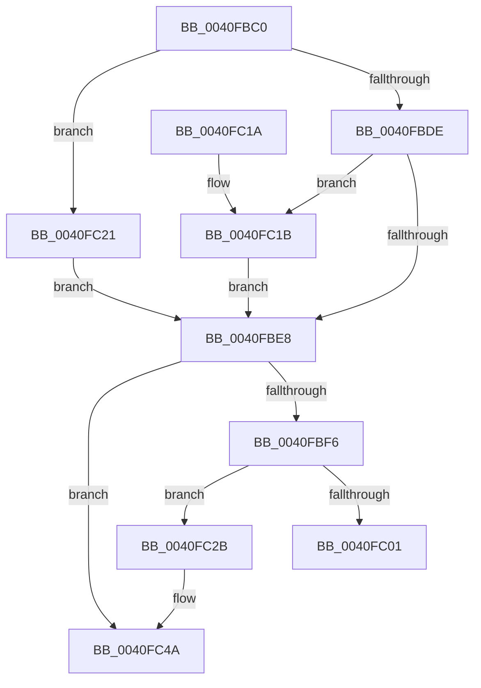

# CcRemapBcb

- RVA: `0x0040FBC0`–`0x0040FC69` (길이 `169` bytes)
- VA: `0x000000014040FBC0`
- 실행 섹션: `.text`
- PDB 이름 있음: `예`; PDB Function 태그: `아니요`
- unwind 정보 RVA: `0x0009BBB0`
- 디코드: `48`개 명령, `169/169` bytes 표시
- 미해석 바이트: `0` (있으면 어셈블리에 `.byte`로 보존)

> 이 문서는 커널 이미지의 기계어와 PDB 기호를 분석해 생성했습니다. 4번과 5번은 함수 원형과 자료형을 바이너리 사용 방식에서 추정한 C 해석이며 원본 소스 복구 결과는 아닙니다.

## 1. Dependencies

- 직접 호출 지점: **3**; 고유 호출 대상: **2**
- 직접 호출자로 확인된 함수: **0**
- RIP 상대 이미지 참조: **0**

### Outgoing calls
- `0x0040FC04` → [CcIncrementVacbActiveCount](CcIncrementVacbActiveCount_function_0040FC70.md) (function, `0x0040FC70`)
- `0x0040FC44` → [KeBugCheckEx](../4F/KeBugCheckEx_function_004FD660.md) (function, `0x004FD660`)
- `0x0040FC63` → [KeBugCheckEx](../4F/KeBugCheckEx_function_004FD660.md) (function, `0x004FD660`)

### Direct callers
- 이 함수 시작 RVA로 연결되는 직접 call은 확인되지 않았습니다. 간접 호출은 완전히 역산할 수 없습니다.

### Static image references
- 디코드된 RIP-relative 메모리 참조가 없습니다.

## 2. Other-region calls and transfers

- 다른 실행 섹션으로 향하는 call: **0**
- 별도 외부 분기/꼬리 이동을 확인하지 못했습니다.

## 3. Assembly (complete function range)

```asm
0040FBC0  48 89 5C 24 08                  mov qword ptr [rsp + 8], rbx
0040FBC5  57                              push rdi
0040FBC6  48 83 EC 30                     sub rsp, 0x30
0040FBCA  48 8B D9                        mov rbx, rcx
0040FBCD  B9 FA 02 00 00                  mov ecx, 0x2fa
0040FBD2  48 83 E3 FE                     and rbx, 0xfffffffffffffffe
0040FBD6  0F B7 03                        movzx eax, word ptr [rbx]
0040FBD9  66 3B C1                        cmp ax, cx
0040FBDC  74 43                           je 0x14040fc21
0040FBDE  B9 FD 02 00 00                  mov ecx, 0x2fd
0040FBE3  66 3B C1                        cmp ax, cx
0040FBE6  74 33                           je 0x14040fc1b
0040FBE8  0F B7 43 10                     movzx eax, word ptr [rbx + 0x10]
0040FBEC  BF 01 00 00 00                  mov edi, 1
0040FBF1  66 3B C7                        cmp ax, di
0040FBF4  72 54                           jb 0x14040fc4a
0040FBF6  48 8B 43 08                     mov rax, qword ptr [rbx + 8]
0040FBFA  8B 40 04                        mov eax, dword ptr [rax + 4]
0040FBFD  3B C7                           cmp eax, edi
0040FBFF  72 2A                           jb 0x14040fc2b
0040FC01  48 8B CB                        mov rcx, rbx
0040FC04  E8 67 00 00 00                  call 0x14040fc70
0040FC09  48 0B DF                        or rbx, rdi
0040FC0C  48 8B C3                        mov rax, rbx
0040FC0F  48 8B 5C 24 40                  mov rbx, qword ptr [rsp + 0x40]
0040FC14  48 83 C4 30                     add rsp, 0x30
0040FC18  5F                              pop rdi
0040FC19  C3                              ret
0040FC1A  CC                              int3
0040FC1B  48 8B 5B 38                     mov rbx, qword ptr [rbx + 0x38]
0040FC1F  EB C7                           jmp 0x14040fbe8
0040FC21  48 8B 43 10                     mov rax, qword ptr [rbx + 0x10]
0040FC25  48 8B 58 38                     mov rbx, qword ptr [rax + 0x38]
0040FC29  EB BD                           jmp 0x14040fbe8
0040FC2B  48 83 64 24 20 00               and qword ptr [rsp + 0x20], 0
0040FC31  45 33 C9                        xor r9d, r9d
0040FC34  BA F2 25 00 00                  mov edx, 0x25f2
0040FC39  49 C7 C0 20 04 00 C0            mov r8, 0xffffffffc0000420
0040FC40  41 8D 49 34                     lea ecx, [r9 + 0x34]
0040FC44  E8 17 DA 0E 00                  call 0x1404fd660
0040FC49  CC                              int3
0040FC4A  48 83 64 24 20 00               and qword ptr [rsp + 0x20], 0
0040FC50  45 33 C9                        xor r9d, r9d
0040FC53  BA F1 25 00 00                  mov edx, 0x25f1
0040FC58  49 C7 C0 20 04 00 C0            mov r8, 0xffffffffc0000420
0040FC5F  41 8D 49 34                     lea ecx, [r9 + 0x34]
0040FC63  E8 F8 D9 0E 00                  call 0x1404fd660
0040FC68  CC                              int3
```

## 4. C-style interpretation (structured pseudocode)

```c
__int64 __fastcall CcRemapBcb(__int64 a1, __int64 a2, __int64 a3, int a4)
{
    __int64 result;
    __int64 v_rbx;
    __int64 v_rsp;
    unsigned __int64 v_stack_p20;
    unsigned __int64 v_stack_p8;

    v_stack_p8 = v_rbx;
    v_rsp = (v_rsp) - (48);
    v_rbx = (a1) & (-2);
    if (((unsigned __int16)(*(unsigned __int16 *)(v_rbx))) == 762) goto loc_0040FC21;
    if (((unsigned __int16)(*(unsigned __int16 *)(v_rbx))) == 765) goto loc_0040FC1B;
loc_0040FBE8:
    if (((unsigned __int16)(*(unsigned __int16 *)(v_rbx + 16))) < 1) goto loc_0040FC4A;
    if (((unsigned int)((unsigned int)(*(unsigned int *)(*(unsigned __int64 *)(v_rbx + 8) + 4)))) < 1) goto loc_0040FC2B;
    result = CcIncrementVacbActiveCount(v_rbx, a2, a3, a4);
    v_rbx = (v_rbx) | (1);
    v_rsp = (v_rsp) + (48);
    return v_rbx;
loc_0040FC1B:
    goto loc_0040FBE8;
loc_0040FC21:
    goto loc_0040FBE8;
loc_0040FC2B:
    a4 = 0;
    result = KeBugCheckEx(a4 + 52, (unsigned int)(0x25F2ULL), 0xFFFFFFFFC0000420ULL, a4);
loc_0040FC4A:
    a4 = 0;
    result = KeBugCheckEx(a4 + 52, (unsigned int)(0x25F1ULL), 0xFFFFFFFFC0000420ULL, a4);
    return result;
}
```

## 5. (Beta) C Style

```c
int64_t CcRemapBcb(void *Arg1, int64_t Arg2, int64_t Arg3, int32_t Arg4)
{
    uint8_t *arg1 = (uint8_t *)Arg1;

    int64_t result;
    int64_t local_rbx;
    int64_t local_rsp;
    uint64_t v_stack_p20;
    uint64_t v_stack_p8;

    v_stack_p8 = local_rbx;
    local_rsp = (local_rsp) - (48);
    local_rbx = (Arg1) & (-2);
    if (((uint16_t)(*(uint16_t *)(local_rbx))) == 762) goto loc_0040FC21;
    if (((uint16_t)(*(uint16_t *)(local_rbx))) == 765) goto loc_0040FC1B;
loc_0040FBE8:
    if (((uint16_t)(*(uint16_t *)(local_rbx + 0x10))) < 1) goto loc_0040FC4A;
    if (((uint32_t)((uint32_t)(*(uint32_t *)(*(uint64_t *)(local_rbx + 0x8) + 0x4)))) < 1) goto loc_0040FC2B;
    result = CcIncrementVacbActiveCount(local_rbx, Arg2, Arg3, Arg4);
    local_rbx = (local_rbx) | (1);
    local_rsp = (local_rsp) + (48);
    return local_rbx;
loc_0040FC1B:
    goto loc_0040FBE8;
loc_0040FC21:
    goto loc_0040FBE8;
loc_0040FC2B:
    Arg4 = 0;
    result = KeBugCheckEx(Arg4 + 52, (uint32_t)(0x25F2ULL), 0xFFFFFFFFC0000420ULL, Arg4);
loc_0040FC4A:
    Arg4 = 0;
    result = KeBugCheckEx(Arg4 + 52, (uint32_t)(0x25F1ULL), 0xFFFFFFFFC0000420ULL, Arg4);
    return result;
}
```

### 관측된 메모리 오프셋

구조체 형식이 확인되지 않은 접근은 인자 기준의 오프셋으로만 기록했습니다.

| 기준 인자 | 오프셋 표현 | 폭 (bit) | 접근 |
|---|---:|---:|---|
| `Arg1` | `+ 0x0` | `16` | `R` |
| `Arg1` | `+ 0x10` | `64` | `R` |
| `Arg1` | `+ 0x38` | `64` | `R` |

## 6. Execution-region graph

[열기: 2D/3D 그래프와 함수 탐색 컨트롤 패널](../../../control-panel.html?section=text&rva=0x0040FBC0&view=graph)

- 2D 그래프는 위에서 아래로 흐르고, 3D 그래프는 빈 공간을 드래그해 회전합니다. Shift+드래그는 이동, 휠은 확대·축소, 함수 노드 선택은 대상 보고서 이동입니다.

### Static fallback


