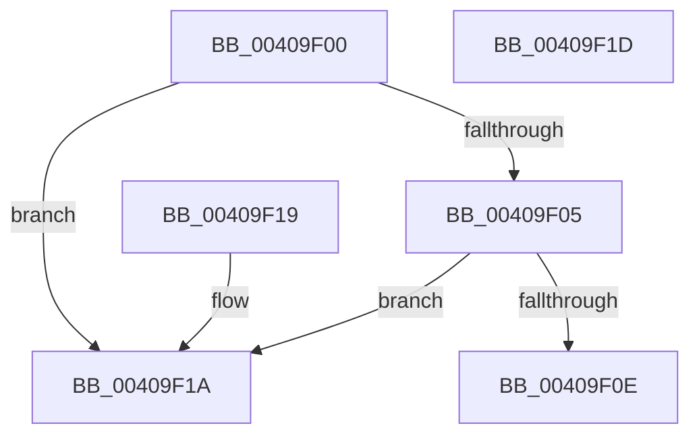

# ExAreApcsDisabledForThread

- RVA: `0x00409F00`–`0x00409F1E` (길이 `30` bytes)
- VA: `0x0000000140409F00`
- 실행 섹션: `.text`
- PDB 이름 있음: `예`; PDB Function 태그: `아니요`
- unwind 정보 RVA: `0x000DB714`
- 디코드: `11`개 명령, `30/30` bytes 표시
- 미해석 바이트: `0` (있으면 어셈블리에 `.byte`로 보존)

> 이 문서는 커널 이미지의 기계어와 PDB 기호를 분석해 생성했습니다. 4번과 5번은 함수 원형과 자료형을 바이너리 사용 방식에서 추정한 C 해석이며 원본 소스 복구 결과는 아닙니다.

## 1. Dependencies

- 직접 호출 지점: **0**; 고유 호출 대상: **0**
- 직접 호출자로 확인된 함수: **1**
- RIP 상대 이미지 참조: **0**

### Outgoing calls
- 직접 디코드된 call 명령이 없습니다.

### Direct callers
- [sub_00210F9D](../21/Unknown_function_00210F9D.md) at `0x00211002`

### Static image references
- 디코드된 RIP-relative 메모리 참조가 없습니다.

## 2. Other-region calls and transfers

- 다른 실행 섹션으로 향하는 call: **0**
- 별도 외부 분기/꼬리 이동을 확인하지 못했습니다.

## 3. Assembly (complete function range)

```asm
00409F00  80 F9 01                        cmp cl, 1
00409F03  73 15                           jae 0x140409f1a
00409F05  F7 42 74 00 04 00 00            test dword ptr [rdx + 0x74], 0x400
00409F0C  75 0C                           jne 0x140409f1a
00409F0E  83 BA E4 01 00 00 00            cmp dword ptr [rdx + 0x1e4], 0
00409F15  0F 95 C0                        setne al
00409F18  C3                              ret
00409F19  CC                              int3
00409F1A  B0 01                           mov al, 1
00409F1C  C3                              ret
00409F1D  CC                              int3
```

## 4. C-style interpretation (structured pseudocode)

```c
__int64 __fastcall ExAreApcsDisabledForThread(unsigned __int8 a1, __int64 a2)
{
    __int64 result;

    if (a1 >= 1) goto loc_00409F1A;
    if (((*(unsigned int *)(a2 + 116)) & (0x400ULL)) != 0) goto loc_00409F1A;
    result = ((*(unsigned int *)(a2 + 484)) != 0) ? 1 : 0;
    return result;
loc_00409F1A:
    return 1;
}
```

## 5. (Beta) C Style

```c
int64_t ExAreApcsDisabledForThread(uint8_t Arg1, void *Arg2)
{
    uint8_t *arg2 = (uint8_t *)Arg2;

    int64_t result;

    if (Arg1 >= 1) goto loc_00409F1A;
    if (((*(uint32_t *)(arg2 + 0x74)) & (0x400ULL)) != 0) goto loc_00409F1A;
    result = ((*(uint32_t *)(arg2 + 0x1E4)) != 0) ? 1 : 0;
    return result;
loc_00409F1A:
    return 1;
}
```

### 관측된 메모리 오프셋

구조체 형식이 확인되지 않은 접근은 인자 기준의 오프셋으로만 기록했습니다.

| 기준 인자 | 오프셋 표현 | 폭 (bit) | 접근 |
|---|---:|---:|---|
| `Arg2` | `+ 0x74` | `32` | `R` |
| `Arg2` | `+ 0x1E4` | `32` | `R` |

## 6. Execution-region graph

[열기: 2D/3D 그래프와 함수 탐색 컨트롤 패널](../../../control-panel.html?section=text&rva=0x00409F00&view=graph)

- 2D 그래프는 위에서 아래로 흐르고, 3D 그래프는 빈 공간을 드래그해 회전합니다. Shift+드래그는 이동, 휠은 확대·축소, 함수 노드 선택은 대상 보고서 이동입니다.

### Static fallback


