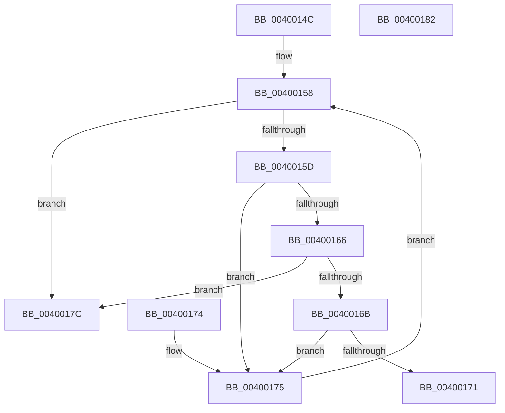

# ExCheckSingleFilter

- RVA: `0x0040014C`–`0x00400183` (길이 `55` bytes)
- VA: `0x000000014040014C`
- 실행 섹션: `.text`
- PDB 이름 있음: `예`; PDB Function 태그: `아니요`
- unwind 정보 RVA: `0x000DB714`
- 디코드: `22`개 명령, `55/55` bytes 표시
- 미해석 바이트: `0` (있으면 어셈블리에 `.byte`로 보존)

> 이 문서는 커널 이미지의 기계어와 PDB 기호를 분석해 생성했습니다. 4번과 5번은 함수 원형과 자료형을 바이너리 사용 방식에서 추정한 C 해석이며 원본 소스 복구 결과는 아닙니다.

## 1. Dependencies

- 직접 호출 지점: **0**; 고유 호출 대상: **0**
- 직접 호출자로 확인된 함수: **8**
- RIP 상대 이미지 참조: **0**

### Outgoing calls
- 직접 디코드된 call 명령이 없습니다.

### Direct callers
- [ExAllocateHeapPool](../35/ExAllocateHeapPool_function_0035BA30.md) at `0x0035E820`
- [EtwTraceObjectOperation](../3F/EtwTraceObjectOperation_function_003FFFD4.md) at `0x004000AB`
- [EtwpCheckPoolTagFilters](../64/EtwpCheckPoolTagFilters_function_0064E738.md) at `0x0064E76D`
- [EtwTraceObject](../../page/7B/EtwTraceObject_function_007B81A4.md) at `0x007B8265`
- [EtwpObjectHandleEnumCallback](../../page/7C/EtwpObjectHandleEnumCallback_function_007C0240.md) at `0x007C0319`
- [EtwTraceDuplicateHandle](../../page/A5/EtwTraceDuplicateHandle_function_00A56C5C.md) at `0x00A56D15`
- [VfFaultsInjectPoolAllocationFailure](../../pagevrfy/BA/VfFaultsInjectPoolAllocationFailure_function_00BA6480.md) at `0x00BA64D5`
- [VfFaultsInjectPoolAllocationFailure](../../pagevrfy/BA/VfFaultsInjectPoolAllocationFailure_function_00BA6480.md) at `0x00BA64E5`
- [ViFaultsIsTagPresentInList](../../pagevrfy/BA/ViFaultsIsTagPresentInList_function_00BA6DE4.md) at `0x00BA6E08`

### Static image references
- 디코드된 RIP-relative 메모리 참조가 없습니다.

## 2. Other-region calls and transfers

- 다른 실행 섹션으로 향하는 call: **0**
- 별도 외부 분기/꼬리 이동을 확인하지 못했습니다.

## 3. Assembly (complete function range)

```asm
0040014C  89 4C 24 08                     mov dword ptr [rsp + 8], ecx
00400150  33 C9                           xor ecx, ecx
00400152  8B C1                           mov eax, ecx
00400154  89 54 24 10                     mov dword ptr [rsp + 0x10], edx
00400158  83 F9 04                        cmp ecx, 4
0040015B  73 1F                           jae 0x14040017c
0040015D  8A 54 04 10                     mov dl, byte ptr [rsp + rax + 0x10]
00400161  80 FA 3F                        cmp dl, 0x3f
00400164  74 0F                           je 0x140400175
00400166  80 FA 2A                        cmp dl, 0x2a
00400169  74 11                           je 0x14040017c
0040016B  38 54 04 08                     cmp byte ptr [rsp + rax + 8], dl
0040016F  74 04                           je 0x140400175
00400171  33 C0                           xor eax, eax
00400173  C3                              ret
00400174  CC                              int3
00400175  FF C1                           inc ecx
00400177  48 FF C0                        inc rax
0040017A  EB DC                           jmp 0x140400158
0040017C  B8 01 00 00 00                  mov eax, 1
00400181  C3                              ret
00400182  CC                              int3
```

## 4. C-style interpretation (structured pseudocode)

```c
__int64 __fastcall ExCheckSingleFilter(int a1, int a2)
{
    __int64 result;
    unsigned int v_stack_p10;
    unsigned int v_stack_p8;

    v_stack_p8 = a1;
    a1 = 0;
    v_stack_p10 = a2;
loc_00400158:
    if (0 >= 4) goto loc_0040017C;
    if (((unsigned __int8)(*(unsigned __int8 *)(v_rsp + 0 * 1 + 16))) == 63) goto loc_00400175;
    if (((unsigned __int8)(*(unsigned __int8 *)(v_rsp + 0 * 1 + 16))) == 42) goto loc_0040017C;
    if ((*(unsigned __int8 *)(v_rsp + 0 * 1 + 8)) == ((unsigned __int8)(*(unsigned __int8 *)(v_rsp + 0 * 1 + 16)))) goto loc_00400175;
    result = 0;
    return result;
loc_00400175:
    a1 = (unsigned int)((a1) + 1);
    result = (result) + 1;
    goto loc_00400158;
loc_0040017C:
    return 1;
}
```

## 5. (Beta) C Style

```c
int64_t ExCheckSingleFilter(int32_t Arg1, int32_t Arg2)
{
    int64_t result;
    uint32_t v_stack_p10;
    uint32_t v_stack_p8;

    v_stack_p8 = Arg1;
    Arg1 = 0;
    v_stack_p10 = Arg2;
loc_00400158:
    if (0 >= 4) goto loc_0040017C;
    if (((uint8_t)(*(uint8_t *)(local_rsp + 0x0 * 1 + 0x10))) == 63) goto loc_00400175;
    if (((uint8_t)(*(uint8_t *)(local_rsp + 0x0 * 1 + 0x10))) == 42) goto loc_0040017C;
    if ((*(uint8_t *)(local_rsp + 0x0 * 1 + 0x8)) == ((uint8_t)(*(uint8_t *)(local_rsp + 0x0 * 1 + 0x10)))) goto loc_00400175;
    result = 0;
    return result;
loc_00400175:
    Arg1 = (uint32_t)((Arg1) + 1);
    result = (result) + 1;
    goto loc_00400158;
loc_0040017C:
    return 1;
}
```

## 6. Execution-region graph

[열기: 2D/3D 그래프와 함수 탐색 컨트롤 패널](../../../control-panel.html?section=text&rva=0x0040014C&view=graph)

- 2D 그래프는 위에서 아래로 흐르고, 3D 그래프는 빈 공간을 드래그해 회전합니다. Shift+드래그는 이동, 휠은 확대·축소, 함수 노드 선택은 대상 보고서 이동입니다.

### Static fallback


