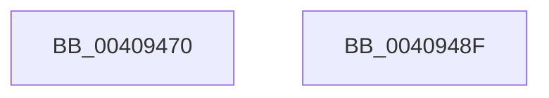

# ExGetHandleAttributes

- RVA: `0x00409470`–`0x00409490` (길이 `32` bytes)
- VA: `0x0000000140409470`
- 실행 섹션: `.text`
- PDB 이름 있음: `예`; PDB Function 태그: `아니요`
- unwind 정보 RVA: `0x000DB714`
- 디코드: `10`개 명령, `32/32` bytes 표시
- 미해석 바이트: `0` (있으면 어셈블리에 `.byte`로 보존)

> 이 문서는 커널 이미지의 기계어와 PDB 기호를 분석해 생성했습니다. 4번과 5번은 함수 원형과 자료형을 바이너리 사용 방식에서 추정한 C 해석이며 원본 소스 복구 결과는 아닙니다.

## 1. Dependencies

- 직접 호출 지점: **0**; 고유 호출 대상: **0**
- 직접 호출자로 확인된 함수: **1**
- RIP 상대 이미지 참조: **0**

### Outgoing calls
- 직접 디코드된 call 명령이 없습니다.

### Direct callers
- [ExpSnapShotHandleTables](../../page/8A/ExpSnapShotHandleTables_function_008A25C0.md) at `0x008A27C3`
- [ExpSnapShotHandleTables](../../page/8A/ExpSnapShotHandleTables_function_008A25C0.md) at `0x008A28D0`

### Static image references
- 디코드된 RIP-relative 메모리 참조가 없습니다.

## 2. Other-region calls and transfers

- 다른 실행 섹션으로 향하는 call: **0**
- 별도 외부 분기/꼬리 이동을 확인하지 못했습니다.

## 3. Assembly (complete function range)

```asm
00409470  44 8B 01                        mov r8d, dword ptr [rcx]
00409473  49 C1 F8 11                     sar r8, 0x11
00409477  41 83 E0 07                     and r8d, 7
0040947B  41 8B C0                        mov eax, r8d
0040947E  83 C8 08                        or eax, 8
00409481  F7 41 08 00 00 00 02            test dword ptr [rcx + 8], 0x2000000
00409488  41 0F 44 C0                     cmove eax, r8d
0040948C  23 C2                           and eax, edx
0040948E  C3                              ret
0040948F  CC                              int3
```

## 4. C-style interpretation (structured pseudocode)

```c
__int64 __fastcall ExGetHandleAttributes(__int64 a1, int a2)
{
    __int64 result;

    a3 = ((unsigned int)(*(unsigned int *)(a1))) >> (17);
    a3 = (unsigned int)((a3) & (7));
    result = (unsigned int)(((unsigned int)((unsigned int)(a3))) | (8));
    if (((*(unsigned int *)(a1 + 8)) & (0x2000000ULL)) == 0) { result = (unsigned int)(a3); }
    result = (unsigned int)((result) & (a2));
    return result;
}
```

## 5. (Beta) C Style

```c
int64_t ExGetHandleAttributes(void *Arg1, int32_t Arg2)
{
    uint8_t *arg1 = (uint8_t *)Arg1;

    int64_t result;

    a3 = ((uint32_t)(*(uint32_t *)(arg1))) >> (17);
    a3 = (uint32_t)((a3) & (7));
    result = (uint32_t)(((uint32_t)((uint32_t)(a3))) | (8));
    if (((*(uint32_t *)(arg1 + 0x8)) & (0x2000000ULL)) == 0) { result = (uint32_t)(a3); }
    result = (uint32_t)((result) & (Arg2));
    return result;
}
```

### 관측된 메모리 오프셋

구조체 형식이 확인되지 않은 접근은 인자 기준의 오프셋으로만 기록했습니다.

| 기준 인자 | 오프셋 표현 | 폭 (bit) | 접근 |
|---|---:|---:|---|
| `Arg1` | `+ 0x0` | `32` | `R` |
| `Arg1` | `+ 0x8` | `32` | `R` |

## 6. Execution-region graph

[열기: 2D/3D 그래프와 함수 탐색 컨트롤 패널](../../../control-panel.html?section=text&rva=0x00409470&view=graph)

- 2D 그래프는 위에서 아래로 흐르고, 3D 그래프는 빈 공간을 드래그해 회전합니다. Shift+드래그는 이동, 휠은 확대·축소, 함수 노드 선택은 대상 보고서 이동입니다.

### Static fallback


