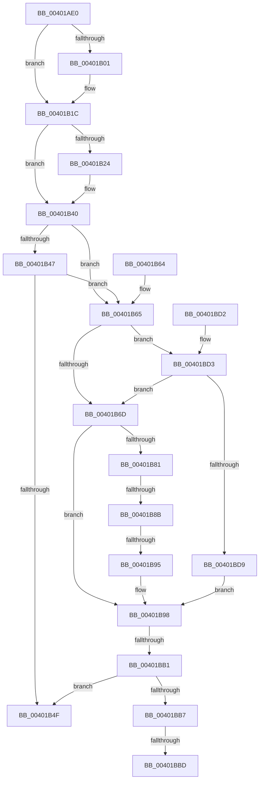

# ExIsFastResourceHeld

- RVA: `0x00401AE0`–`0x00401BDF` (길이 `255` bytes)
- VA: `0x0000000140401AE0`
- 실행 섹션: `.text`
- PDB 이름 있음: `예`; PDB Function 태그: `아니요`
- unwind 정보 RVA: `0x0009A590`
- 디코드: `76`개 명령, `255/255` bytes 표시
- 미해석 바이트: `0` (있으면 어셈블리에 `.byte`로 보존)

> 이 문서는 커널 이미지의 기계어와 PDB 기호를 분석해 생성했습니다. 4번과 5번은 함수 원형과 자료형을 바이너리 사용 방식에서 추정한 C 해석이며 원본 소스 복구 결과는 아닙니다.

## 1. Dependencies

- 직접 호출 지점: **2**; 고유 호출 대상: **1**
- 직접 호출자로 확인된 함수: **1**
- RIP 상대 이미지 참조: **0**

### Outgoing calls
- `0x00401B16` → [KeBugCheckEx](../4F/KeBugCheckEx_function_004FD660.md) (function, `0x004FD660`)
- `0x00401B3A` → [KeBugCheckEx](../4F/KeBugCheckEx_function_004FD660.md) (function, `0x004FD660`)

### Direct callers
- [DifExIsFastResourceHeldWrapper](../62/DifExIsFastResourceHeldWrapper_function_00621510.md) at `0x006215DD`

### Static image references
- 디코드된 RIP-relative 메모리 참조가 없습니다.

## 2. Other-region calls and transfers

- 다른 실행 섹션으로 향하는 call: **0**
- call이 아닌 외부 분기/꼬리 이동: **4**
  - `0x00401B85` → [sub_00401CA4](Unknown_function_00401CA4.md) (`tail-transfer`)
  - `0x00401B8F` → [sub_00401CA4](Unknown_function_00401CA4.md) (`tail-transfer`)
  - `0x00401BAB` → [sub_00401C5B](Unknown_function_00401C5B.md) (`tail-transfer`)
  - `0x00401BBB` → [sub_00401BDF](Unknown_function_00401BDF.md) (`tail-transfer`)

## 3. Assembly (complete function range)

```asm
00401AE0  48 89 5C 24 10                  mov qword ptr [rsp + 0x10], rbx
00401AE5  48 89 74 24 18                  mov qword ptr [rsp + 0x18], rsi
00401AEA  57                              push rdi
00401AEB  48 83 EC 30                     sub rsp, 0x30
00401AEF  65 48 8B 34 25 88 01 00 00      mov rsi, qword ptr gs:[0x188]
00401AF8  48 8B F9                        mov rdi, rcx
00401AFB  F6 41 1A 01                     test byte ptr [rcx + 0x1a], 1
00401AFF  75 1B                           jne 0x140401b1c
00401B01  33 DB                           xor ebx, ebx
00401B03  4C 8B C1                        mov r8, rcx
00401B06  45 33 C9                        xor r9d, r9d
00401B09  48 89 5C 24 20                  mov qword ptr [rsp + 0x20], rbx
00401B0E  B9 C6 01 00 00                  mov ecx, 0x1c6
00401B13  8D 53 03                        lea edx, [rbx + 3]
00401B16  E8 45 BB 0F 00                  call 0x1404fd660
00401B1B  CC                              int3
00401B1C  44 0F 20 C0                     mov rax, cr8
00401B20  3C 02                           cmp al, 2
00401B22  76 1C                           jbe 0x140401b40
00401B24  33 DB                           xor ebx, ebx
00401B26  44 0F B6 C0                     movzx r8d, al
00401B2A  33 D2                           xor edx, edx
00401B2C  48 89 5C 24 20                  mov qword ptr [rsp + 0x20], rbx
00401B31  B9 C6 01 00 00                  mov ecx, 0x1c6
00401B36  44 8D 4B 02                     lea r9d, [rbx + 2]
00401B3A  E8 21 BB 0F 00                  call 0x1404fd660
00401B3F  CC                              int3
00401B40  48 8B 01                        mov rax, qword ptr [rcx]
00401B43  A8 01                           test al, 1
00401B45  75 1E                           jne 0x140401b65
00401B47  48 A9 FC FF FF FF               test rax, -4
00401B4D  75 16                           jne 0x140401b65
00401B4F  32 DB                           xor bl, bl
00401B51  0F B6 C3                        movzx eax, bl
00401B54  48 8B 5C 24 48                  mov rbx, qword ptr [rsp + 0x48]
00401B59  48 8B 74 24 50                  mov rsi, qword ptr [rsp + 0x50]
00401B5E  48 83 C4 30                     add rsp, 0x30
00401B62  5F                              pop rdi
00401B63  C3                              ret
00401B64  CC                              int3
00401B65  FA                              cli
00401B66  48 8B 01                        mov rax, qword ptr [rcx]
00401B69  A8 01                           test al, 1
00401B6B  75 66                           jne 0x140401bd3
00401B6D  48 8D 96 B8 06 00 00            lea rdx, [rsi + 0x6b8]
00401B74  33 DB                           xor ebx, ebx
00401B76  48 8B 0A                        mov rcx, qword ptr [rdx]
00401B79  44 8B C3                        mov r8d, ebx
00401B7C  48 3B CA                        cmp rcx, rdx
00401B7F  74 17                           je 0x140401b98
00401B81  F6 41 25 02                     test byte ptr [rcx + 0x25], 2
00401B85  0F 85 19 01 00 00               jne 0x140401ca4
00401B8B  48 39 79 18                     cmp qword ptr [rcx + 0x18], rdi
00401B8F  0F 85 0F 01 00 00               jne 0x140401ca4
00401B95  48 8B D9                        mov rbx, rcx
00401B98  65 48 8B 0C 25 20 00 00 00      mov rcx, qword ptr gs:[0x20]
00401BA1  4C 8B 81 B8 8E 00 00            mov r8, qword ptr [rcx + 0x8eb8]
00401BA8  4D 85 C0                        test r8, r8
00401BAB  0F 85 AA 00 00 00               jne 0x140401c5b
00401BB1  FB                              sti
00401BB2  48 85 DB                        test rbx, rbx
00401BB5  74 98                           je 0x140401b4f
00401BB7  48 83 FB 01                     cmp rbx, 1
00401BBB  74 22                           je 0x140401bdf
00401BBD  B3 01                           mov bl, 1
00401BBF  48 8B 74 24 50                  mov rsi, qword ptr [rsp + 0x50]
00401BC4  0F B6 C3                        movzx eax, bl
00401BC7  48 8B 5C 24 48                  mov rbx, qword ptr [rsp + 0x48]
00401BCC  48 83 C4 30                     add rsp, 0x30
00401BD0  5F                              pop rdi
00401BD1  C3                              ret
00401BD2  CC                              int3
00401BD3  48 39 71 50                     cmp qword ptr [rcx + 0x50], rsi
00401BD7  75 94                           jne 0x140401b6d
00401BD9  48 8D 59 40                     lea rbx, [rcx + 0x40]
00401BDD  EB B9                           jmp 0x140401b98
```

## 4. C-style interpretation (structured pseudocode)

```c
__int64 __fastcall ExIsFastResourceHeld(__int64 a1, __int64 a2, __int64 a3, int a4)
{
    __int64 result;
    __int64 v_rbx;
    __int64 v_rsp;
    unsigned __int64 v_stack_m18;
    unsigned __int64 v_stack_p10;
    unsigned __int64 v_stack_p18;
    unsigned __int64 v_stack_p48;
    unsigned __int64 v_stack_p50;

    v_stack_p10 = v_rbx;
    v_stack_p18 = v_rsi;
    v_rsp = (v_rsp) - (48);
    if (((*(unsigned __int8 *)(a1 + 26)) & (1)) == 0) {
        v_rbx = 0;
        a3 = a1;
        a4 = 0;
        v_stack_m18 = 0;
        a1 = 454;
        a2 = v_rbx + 3;
        result = KeBugCheckEx(a1, a2, a3, a4);
    }
    result = v_cr8;
    if (((unsigned __int8)(v_cr8)) >= = 2) {
        v_rbx = 0;
        a3 = (unsigned __int8)(v_cr8);
        a2 = 0;
        v_stack_m18 = 0;
        a1 = 454;
        a4 = v_rbx + 2;
        result = KeBugCheckEx(a1, a2, a3, a4);
    }
    if ((((unsigned __int8)(*(unsigned __int64 *)(a1))) & (1)) != 0) goto loc_00401B65;
    if (((*(unsigned __int64 *)(a1)) & (-4)) != 0) goto loc_00401B65;
loc_00401B4F:
    v_rbx = 0;
    v_rsp = (v_rsp) + (48);
    return 0;
loc_00401B65:
    if ((((unsigned __int8)(*(unsigned __int64 *)(a1))) & (1)) != 0) goto loc_00401BD3;
loc_00401B6D:
    v_rbx = 0;
    if ((*(unsigned __int64 *)(v_stack_p18 + 1720)) == (v_stack_p18 + 1720)) goto loc_00401B98;
loc_00401B98:
    if (*(unsigned __int64 *)(v_stack_p18 + 1720) == 0) goto loc_00401B4F;
    v_rsp = (v_rsp) + (48);
    return 1;
loc_00401BD3:
    if ((*(unsigned __int64 *)(*(unsigned __int64 *)(gs_base + (0 + 32)) + 80)) != v_stack_p50) goto loc_00401B6D;
    goto loc_00401B98;
}
```

## 5. (Beta) C Style

```c
int64_t ExIsFastResourceHeld(void *Arg1, int64_t Arg2, int64_t Arg3, int32_t Arg4)
{
    uint8_t *arg1 = (uint8_t *)Arg1;

    int64_t result;
    int64_t local_rbx;
    int64_t local_rsp;
    uint64_t v_stack_m18;
    uint64_t v_stack_p10;
    uint64_t v_stack_p18;
    uint64_t v_stack_p48;
    uint64_t v_stack_p50;

    v_stack_p10 = local_rbx;
    v_stack_p18 = local_rsi;
    local_rsp = (local_rsp) - (48);
    if (((*(uint8_t *)(arg1 + 0x1A)) & (1)) == 0) {
        local_rbx = 0;
        Arg3 = Arg1;
        Arg4 = 0;
        v_stack_m18 = 0;
        Arg1 = 454;
        Arg2 = local_rbx + 3;
        result = KeBugCheckEx(Arg1, Arg2, Arg3, Arg4);
    }
    result = v_cr8;
    if (((uint8_t)(v_cr8)) >= = 2) {
        local_rbx = 0;
        Arg3 = (uint8_t)(v_cr8);
        Arg2 = 0;
        v_stack_m18 = 0;
        Arg1 = 454;
        Arg4 = local_rbx + 2;
        result = KeBugCheckEx(Arg1, Arg2, Arg3, Arg4);
    }
    if ((((uint8_t)(*(uint64_t *)(arg1))) & (1)) != 0) goto loc_00401B65;
    if (((*(uint64_t *)(arg1)) & (-4)) != 0) goto loc_00401B65;
loc_00401B4F:
    local_rbx = 0;
    local_rsp = (local_rsp) + (48);
    return 0;
loc_00401B65:
    if ((((uint8_t)(*(uint64_t *)(arg1))) & (1)) != 0) goto loc_00401BD3;
loc_00401B6D:
    local_rbx = 0;
    if ((*(uint64_t *)(v_stack_p18 + 0x6B8)) == (v_stack_p18 + 1720)) goto loc_00401B98;
loc_00401B98:
    if (*(uint64_t *)(v_stack_p18 + 0x6B8) == 0) goto loc_00401B4F;
    local_rsp = (local_rsp) + (48);
    return 1;
loc_00401BD3:
    if ((*(uint64_t *)(*(uint64_t *)(gs_base + (0 + 0x20)) + 0x50)) != v_stack_p50) goto loc_00401B6D;
    goto loc_00401B98;
}
```

### 관측된 메모리 오프셋

구조체 형식이 확인되지 않은 접근은 인자 기준의 오프셋으로만 기록했습니다.

| 기준 인자 | 오프셋 표현 | 폭 (bit) | 접근 |
|---|---:|---:|---|
| `Arg1` | `+ 0x1A` | `8` | `R` |

## 6. Execution-region graph

[열기: 2D/3D 그래프와 함수 탐색 컨트롤 패널](../../../control-panel.html?section=text&rva=0x00401AE0&view=graph)

- 2D 그래프는 위에서 아래로 흐르고, 3D 그래프는 빈 공간을 드래그해 회전합니다. Shift+드래그는 이동, 휠은 확대·축소, 함수 노드 선택은 대상 보고서 이동입니다.

### Static fallback


