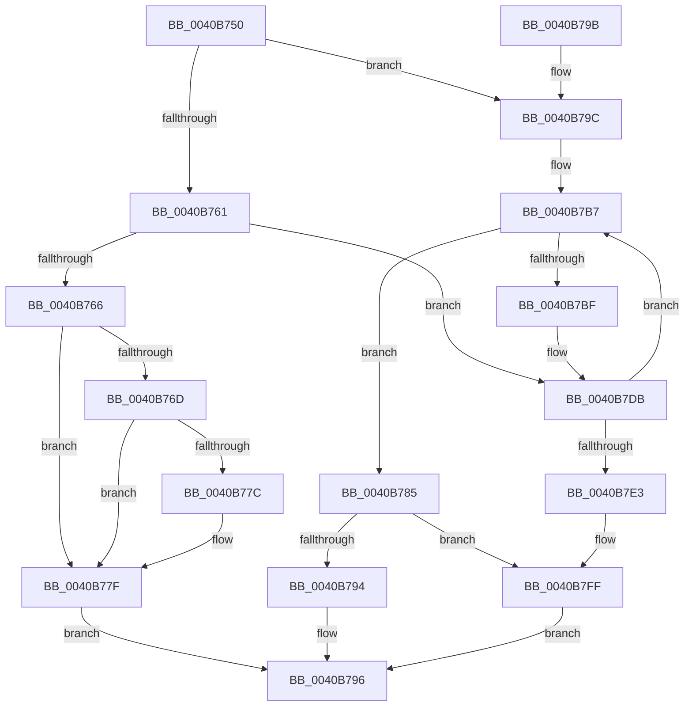

# ExIsResourceAcquiredExclusiveLite

- RVA: `0x0040B750`–`0x0040B803` (길이 `179` bytes)
- VA: `0x000000014040B750`
- 실행 섹션: `.text`
- PDB 이름 있음: `예`; PDB Function 태그: `아니요`
- unwind 정보 RVA: `0x0009AEAC`
- 디코드: `56`개 명령, `179/179` bytes 표시
- 미해석 바이트: `0` (있으면 어셈블리에 `.byte`로 보존)

> 이 문서는 커널 이미지의 기계어와 PDB 기호를 분석해 생성했습니다. 4번과 5번은 함수 원형과 자료형을 바이너리 사용 방식에서 추정한 C 해석이며 원본 소스 복구 결과는 아닙니다.

## 1. Dependencies

- 직접 호출 지점: **3**; 고유 호출 대상: **1**
- 직접 호출자로 확인된 함수: **3**
- RIP 상대 이미지 참조: **0**

### Outgoing calls
- `0x0040B7B1` → [KeBugCheckEx](../4F/KeBugCheckEx_function_004FD660.md) (function, `0x004FD660`)
- `0x0040B7D5` → [KeBugCheckEx](../4F/KeBugCheckEx_function_004FD660.md) (function, `0x004FD660`)
- `0x0040B7F9` → [KeBugCheckEx](../4F/KeBugCheckEx_function_004FD660.md) (function, `0x004FD660`)

### Direct callers
- [DifExIsResourceAcquiredExclusiveLiteWrapper](../62/DifExIsResourceAcquiredExclusiveLiteWrapper_function_006217E0.md) at `0x006218AD`
- [CmpTestRegistryLockExclusive](../66/CmpTestRegistryLockExclusive_function_0066ACC4.md) at `0x0066ACDB`
- [HvpTruncateBins](../../page/9B/HvpTruncateBins_function_009B64F0.md) at `0x009B65C0`

### Static image references
- 디코드된 RIP-relative 메모리 참조가 없습니다.

## 2. Other-region calls and transfers

- 다른 실행 섹션으로 향하는 call: **0**
- 별도 외부 분기/꼬리 이동을 확인하지 못했습니다.

## 3. Assembly (complete function range)

```asm
0040B750  48 83 EC 38                     sub rsp, 0x38
0040B754  0F B7 51 1A                     movzx edx, word ptr [rcx + 0x1a]
0040B758  0F B6 C2                        movzx eax, dl
0040B75B  24 41                           and al, 0x41
0040B75D  3C 01                           cmp al, 1
0040B75F  74 3B                           je 0x14040b79c
0040B761  F6 C2 01                        test dl, 1
0040B764  75 75                           jne 0x14040b7db
0040B766  45 32 C0                        xor r8b, r8b
0040B769  84 D2                           test dl, dl
0040B76B  79 12                           jns 0x14040b77f
0040B76D  65 48 8B 04 25 88 01 00 00      mov rax, qword ptr gs:[0x188]
0040B776  48 39 41 30                     cmp qword ptr [rcx + 0x30], rax
0040B77A  75 03                           jne 0x14040b77f
0040B77C  41 B0 01                        mov r8b, 1
0040B77F  41 0F B6 C0                     movzx eax, r8b
0040B783  EB 11                           jmp 0x14040b796
0040B785  65 48 8B 04 25 88 01 00 00      mov rax, qword ptr gs:[0x188]
0040B78E  48 39 41 50                     cmp qword ptr [rcx + 0x50], rax
0040B792  75 6B                           jne 0x14040b7ff
0040B794  B0 01                           mov al, 1
0040B796  48 83 C4 38                     add rsp, 0x38
0040B79A  C3                              ret
0040B79B  CC                              int3
0040B79C  33 C0                           xor eax, eax
0040B79E  4C 8B C1                        mov r8, rcx
0040B7A1  45 33 C9                        xor r9d, r9d
0040B7A4  48 89 44 24 20                  mov qword ptr [rsp + 0x20], rax
0040B7A9  B9 C6 01 00 00                  mov ecx, 0x1c6
0040B7AE  8D 50 0F                        lea edx, [rax + 0xf]
0040B7B1  E8 AA 1E 0F 00                  call 0x1404fd660
0040B7B6  CC                              int3
0040B7B7  44 0F 20 C0                     mov rax, cr8
0040B7BB  3C 02                           cmp al, 2
0040B7BD  76 C6                           jbe 0x14040b785
0040B7BF  44 0F B6 C0                     movzx r8d, al
0040B7C3  33 D2                           xor edx, edx
0040B7C5  33 C0                           xor eax, eax
0040B7C7  B9 C6 01 00 00                  mov ecx, 0x1c6
0040B7CC  48 89 44 24 20                  mov qword ptr [rsp + 0x20], rax
0040B7D1  44 8D 48 02                     lea r9d, [rax + 2]
0040B7D5  E8 86 1E 0F 00                  call 0x1404fd660
0040B7DA  CC                              int3
0040B7DB  44 0F 20 C0                     mov rax, cr8
0040B7DF  3C 02                           cmp al, 2
0040B7E1  76 D4                           jbe 0x14040b7b7
0040B7E3  44 0F B6 C0                     movzx r8d, al
0040B7E7  33 D2                           xor edx, edx
0040B7E9  33 C0                           xor eax, eax
0040B7EB  B9 C6 01 00 00                  mov ecx, 0x1c6
0040B7F0  48 89 44 24 20                  mov qword ptr [rsp + 0x20], rax
0040B7F5  44 8D 48 02                     lea r9d, [rax + 2]
0040B7F9  E8 62 1E 0F 00                  call 0x1404fd660
0040B7FE  CC                              int3
0040B7FF  32 C0                           xor al, al
0040B801  EB 93                           jmp 0x14040b796
```

## 4. C-style interpretation (structured pseudocode)

```c
__int64 __fastcall ExIsResourceAcquiredExclusiveLite(__int64 a1, __int64 a2, unsigned __int8 a3, int a4)
{
    __int64 result;
    __int64 v_rsp;
    unsigned __int64 v_stack_p20;

    v_rsp = (v_rsp) - (56);
    result = (unsigned __int8)(((unsigned __int8)(*(unsigned __int16 *)(a1 + 26))) & (65));
    if (((unsigned __int8)(result)) == 1) goto loc_0040B79C;
    if ((((unsigned __int8)(*(unsigned __int16 *)(a1 + 26))) & (1)) != 0) goto loc_0040B7DB;
    a3 = 0;
    if (!sign_flag) goto loc_0040B77F;
    if ((*(unsigned __int64 *)(a1 + 48)) == (*(unsigned __int64 *)(gs_base + (0 + 392)))) {
        a3 = 1;
    }
    goto loc_0040B796;
loc_0040B785:
    if ((*(unsigned __int64 *)(a1 + 80)) != (*(unsigned __int64 *)(gs_base + (0 + 392)))) goto loc_0040B7FF;
loc_0040B796:
    v_rsp = (v_rsp) + (56);
    return 1;
loc_0040B79C:
    result = 0;
    a4 = 0;
    v_stack_p20 = 0;
    result = KeBugCheckEx(454, result + 15, a1, a4);
loc_0040B7B7:
    if (((unsigned __int8)(v_cr8)) <= 2) goto loc_0040B785;
    a2 = 0;
    result = 0;
    v_stack_p20 = 0;
    result = KeBugCheckEx(454, a2, (unsigned __int8)(v_cr8), result + 2);
loc_0040B7DB:
    if (((unsigned __int8)(v_cr8)) <= 2) goto loc_0040B7B7;
    a2 = 0;
    result = 0;
    v_stack_p20 = 0;
    result = KeBugCheckEx(454, a2, (unsigned __int8)(v_cr8), result + 2);
loc_0040B7FF:
    result = 0;
    goto loc_0040B796;
}
```

## 5. (Beta) C Style

```c
int64_t ExIsResourceAcquiredExclusiveLite(void *Arg1, int64_t Arg2, uint8_t Arg3, int32_t Arg4)
{
    uint8_t *arg1 = (uint8_t *)Arg1;

    int64_t result;
    int64_t local_rsp;
    uint64_t v_stack_p20;

    local_rsp = (local_rsp) - (56);
    result = (uint8_t)(((uint8_t)(*(uint16_t *)(arg1 + 0x1A))) & (65));
    if (((uint8_t)(result)) == 1) goto loc_0040B79C;
    if ((((uint8_t)(*(uint16_t *)(arg1 + 0x1A))) & (1)) != 0) goto loc_0040B7DB;
    Arg3 = 0;
    if (!sign_flag) goto loc_0040B77F;
    if ((*(uint64_t *)(arg1 + 0x30)) == (*(uint64_t *)(gs_base + (0 + 0x188)))) {
        Arg3 = 1;
    }
    goto loc_0040B796;
loc_0040B785:
    if ((*(uint64_t *)(arg1 + 0x50)) != (*(uint64_t *)(gs_base + (0 + 0x188)))) goto loc_0040B7FF;
loc_0040B796:
    local_rsp = (local_rsp) + (56);
    return 1;
loc_0040B79C:
    result = 0;
    Arg4 = 0;
    v_stack_p20 = 0;
    result = KeBugCheckEx(454, result + 15, Arg1, Arg4);
loc_0040B7B7:
    if (((uint8_t)(v_cr8)) <= 2) goto loc_0040B785;
    Arg2 = 0;
    result = 0;
    v_stack_p20 = 0;
    result = KeBugCheckEx(454, Arg2, (uint8_t)(v_cr8), result + 2);
loc_0040B7DB:
    if (((uint8_t)(v_cr8)) <= 2) goto loc_0040B7B7;
    Arg2 = 0;
    result = 0;
    v_stack_p20 = 0;
    result = KeBugCheckEx(454, Arg2, (uint8_t)(v_cr8), result + 2);
loc_0040B7FF:
    result = 0;
    goto loc_0040B796;
}
```

### 관측된 메모리 오프셋

구조체 형식이 확인되지 않은 접근은 인자 기준의 오프셋으로만 기록했습니다.

| 기준 인자 | 오프셋 표현 | 폭 (bit) | 접근 |
|---|---:|---:|---|
| `Arg1` | `+ 0x1A` | `16` | `R` |
| `Arg1` | `+ 0x30` | `64` | `R` |

## 6. Execution-region graph

[열기: 2D/3D 그래프와 함수 탐색 컨트롤 패널](../../../control-panel.html?section=text&rva=0x0040B750&view=graph)

- 2D 그래프는 위에서 아래로 흐르고, 3D 그래프는 빈 공간을 드래그해 회전합니다. Shift+드래그는 이동, 휠은 확대·축소, 함수 노드 선택은 대상 보고서 이동입니다.

### Static fallback


