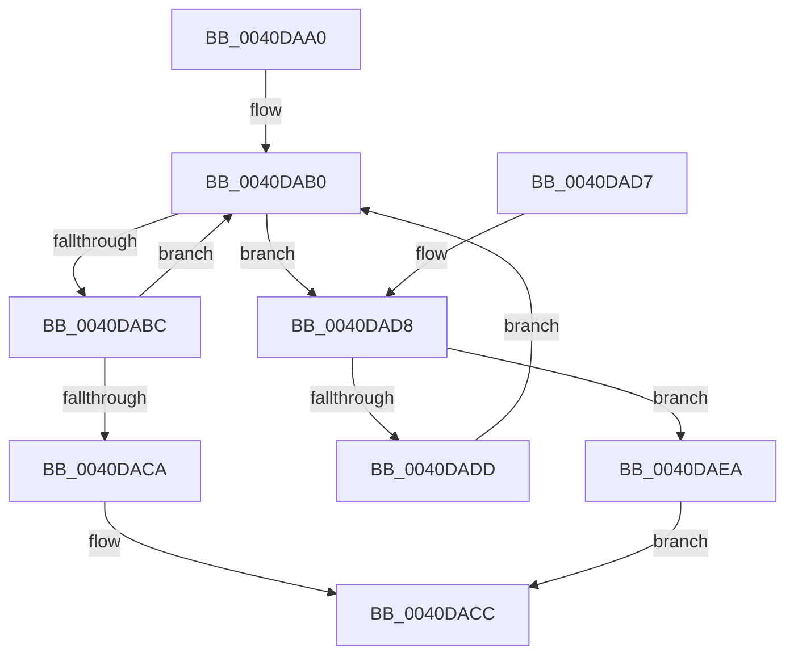

# ExLockHandleTableEntry

- RVA: `0x0040DAA0`–`0x0040DAEE` (길이 `78` bytes)
- VA: `0x000000014040DAA0`
- 실행 섹션: `.text`
- PDB 이름 있음: `예`; PDB Function 태그: `아니요`
- unwind 정보 RVA: `0x0006BDE4`
- 디코드: `27`개 명령, `78/78` bytes 표시
- 미해석 바이트: `0` (있으면 어셈블리에 `.byte`로 보존)

> 이 문서는 커널 이미지의 기계어와 PDB 기호를 분석해 생성했습니다. 4번과 5번은 함수 원형과 자료형을 바이너리 사용 방식에서 추정한 C 해석이며 원본 소스 복구 결과는 아닙니다.

## 1. Dependencies

- 직접 호출 지점: **1**; 고유 호출 대상: **1**
- 직접 호출자로 확인된 함수: **4**
- RIP 상대 이미지 참조: **0**

### Outgoing calls
- `0x0040DAE3` → [ExpBlockOnLockedHandleEntry](../../page/86/ExpBlockOnLockedHandleEntry_function_00868838.md) (function, `0x00868838`)

### Direct callers
- [ObpAuditObjectAccess](../../page/94/ObpAuditObjectAccess_function_0094C270.md) at `0x0094C2CD`
- [ExQueryProcessHandleInformation](../../page/94/ExQueryProcessHandleInformation_function_0094C3D8.md) at `0x0094C455`
- [sub_0094CD40](../../page/94/Unknown_function_0094CD40.md) at `0x0094CDEA`
- [ObSetHandleAttributes](../../page/A0/ObSetHandleAttributes_function_00A03730.md) at `0x00A037F3`

### Static image references
- 디코드된 RIP-relative 메모리 참조가 없습니다.

## 2. Other-region calls and transfers

- 다른 실행 섹션으로 향하는 call: **1**
  - `0x0040DAE3` → [ExpBlockOnLockedHandleEntry](../../page/86/ExpBlockOnLockedHandleEntry_function_00868838.md) (`.text` → `PAGE`)
- 별도 외부 분기/꼬리 이동을 확인하지 못했습니다.

## 3. Assembly (complete function range)

```asm
0040DAA0  48 89 5C 24 08                  mov qword ptr [rsp + 8], rbx
0040DAA5  57                              push rdi
0040DAA6  48 83 EC 20                     sub rsp, 0x20
0040DAAA  48 8B DA                        mov rbx, rdx
0040DAAD  48 8B F9                        mov rdi, rcx
0040DAB0  0F 0D 0B                        prefetchw byte ptr [rbx]
0040DAB3  4C 8B 03                        mov r8, qword ptr [rbx]
0040DAB6  41 F6 C0 01                     test r8b, 1
0040DABA  74 1C                           je 0x14040dad8
0040DABC  4D 8D 48 FF                     lea r9, [r8 - 1]
0040DAC0  49 8B C0                        mov rax, r8
0040DAC3  F0 4C 0F B1 0B                  lock cmpxchg qword ptr [rbx], r9
0040DAC8  75 E6                           jne 0x14040dab0
0040DACA  B0 01                           mov al, 1
0040DACC  48 8B 5C 24 30                  mov rbx, qword ptr [rsp + 0x30]
0040DAD1  48 83 C4 20                     add rsp, 0x20
0040DAD5  5F                              pop rdi
0040DAD6  C3                              ret
0040DAD7  CC                              int3
0040DAD8  4D 85 C0                        test r8, r8
0040DADB  74 0D                           je 0x14040daea
0040DADD  48 8B D3                        mov rdx, rbx
0040DAE0  48 8B CF                        mov rcx, rdi
0040DAE3  E8 50 AD 45 00                  call 0x140868838
0040DAE8  EB C6                           jmp 0x14040dab0
0040DAEA  32 C0                           xor al, al
0040DAEC  EB DE                           jmp 0x14040dacc
```

## 4. C-style interpretation (structured pseudocode)

```c
__int64 __fastcall ExLockHandleTableEntry(__int64 a1, __int64 a2)
{
    __int64 result;
    __int64 v_rsp;
    unsigned __int64 v_stack_p8;

    v_stack_p8 = v_rbx;
    v_rsp = (v_rsp) - (32);
loc_0040DAB0:
    if ((((unsigned __int8)(*(unsigned __int64 *)(a2))) & (1)) == 0) goto loc_0040DAD8;
    if ((((unsigned __int8)(*(unsigned __int64 *)(a2))) & (1)) != 0) goto loc_0040DAB0;
loc_0040DACC:
    v_rsp = (v_rsp) + (32);
    return 1;
loc_0040DAD8:
    if (*(unsigned __int64 *)(a2) == 0) goto loc_0040DAEA;
    result = ExpBlockOnLockedHandleEntry(a1, v_stack_p8, *(unsigned __int64 *)(a2), *(unsigned __int64 *)(a2) - 1);
    goto loc_0040DAB0;
loc_0040DAEA:
    result = 0;
    goto loc_0040DACC;
}
```

## 5. (Beta) C Style

```c
int64_t ExLockHandleTableEntry(int64_t Arg1, void *Arg2)
{
    uint8_t *arg2 = (uint8_t *)Arg2;

    int64_t result;
    int64_t local_rsp;
    uint64_t v_stack_p8;

    v_stack_p8 = local_rbx;
    local_rsp = (local_rsp) - (32);
loc_0040DAB0:
    if ((((uint8_t)(*(uint64_t *)(arg2))) & (1)) == 0) goto loc_0040DAD8;
    if ((((uint8_t)(*(uint64_t *)(arg2))) & (1)) != 0) goto loc_0040DAB0;
loc_0040DACC:
    local_rsp = (local_rsp) + (32);
    return 1;
loc_0040DAD8:
    if (*(uint64_t *)(arg2) == 0) goto loc_0040DAEA;
    result = ExpBlockOnLockedHandleEntry(Arg1, v_stack_p8, *(uint64_t *)(arg2), *(uint64_t *)(arg2) - 1);
    goto loc_0040DAB0;
loc_0040DAEA:
    result = 0;
    goto loc_0040DACC;
}
```

### 관측된 메모리 오프셋

구조체 형식이 확인되지 않은 접근은 인자 기준의 오프셋으로만 기록했습니다.

| 기준 인자 | 오프셋 표현 | 폭 (bit) | 접근 |
|---|---:|---:|---|
| `Arg2` | `+ 0x0` | `8` | `R` |
| `Arg2` | `+ 0x0` | `64` | `R` |

## 6. Execution-region graph

[열기: 2D/3D 그래프와 함수 탐색 컨트롤 패널](../../../control-panel.html?section=text&rva=0x0040DAA0&view=graph)

- 2D 그래프는 위에서 아래로 흐르고, 3D 그래프는 빈 공간을 드래그해 회전합니다. Shift+드래그는 이동, 휠은 확대·축소, 함수 노드 선택은 대상 보고서 이동입니다.

### Static fallback


