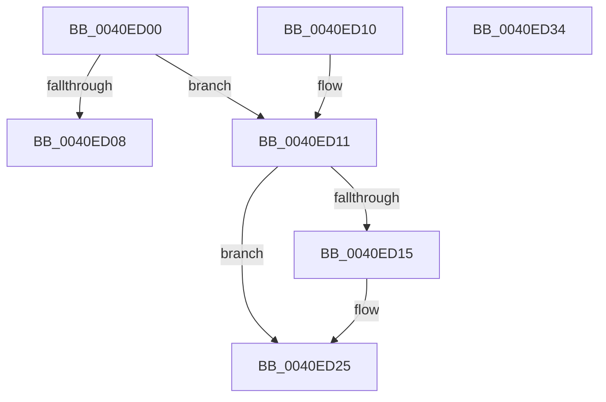

# ExpGetEntryBilledProcess

- RVA: `0x0040ED00`–`0x0040ED35` (길이 `53` bytes)
- VA: `0x000000014040ED00`
- 실행 섹션: `.text`
- PDB 이름 있음: `예`; PDB Function 태그: `아니요`
- unwind 정보 RVA: `0x000DB714`
- 디코드: `18`개 명령, `53/53` bytes 표시
- 미해석 바이트: `0` (있으면 어셈블리에 `.byte`로 보존)

> 이 문서는 커널 이미지의 기계어와 PDB 기호를 분석해 생성했습니다. 4번과 5번은 함수 원형과 자료형을 바이너리 사용 방식에서 추정한 C 해석이며 원본 소스 복구 결과는 아닙니다.

## 1. Dependencies

- 직접 호출 지점: **0**; 고유 호출 대상: **0**
- 직접 호출자로 확인된 함수: **1**
- RIP 상대 이미지 참조: **1**

### Outgoing calls
- 직접 디코드된 call 명령이 없습니다.

### Direct callers
- [ExQueryPoolBlockSize](../65/ExQueryPoolBlockSize_function_006566F0.md) at `0x0065679B`

### Static image references
- `0x0040ED29` → RVA `0x00FC7228` (`ALMOSTRO`; read)

## 2. Other-region calls and transfers

- 다른 실행 섹션으로 향하는 call: **0**
- 별도 외부 분기/꼬리 이동을 확인하지 못했습니다.

## 3. Assembly (complete function range)

```asm
0040ED00  0F B6 41 03                     movzx eax, byte ptr [rcx + 3]
0040ED04  A8 08                           test al, 8
0040ED06  75 09                           jne 0x14040ed11
0040ED08  48 C7 C0 FF FF FF FF            mov rax, 0xffffffffffffffff
0040ED0F  C3                              ret
0040ED10  CC                              int3
0040ED11  A8 04                           test al, 4
0040ED13  74 10                           je 0x14040ed25
0040ED15  0F B7 01                        movzx eax, word ptr [rcx]
0040ED18  0F B6 D0                        movzx edx, al
0040ED1B  48 F7 DA                        neg rdx
0040ED1E  48 C1 E2 04                     shl rdx, 4
0040ED22  48 03 CA                        add rcx, rdx
0040ED25  48 8B 41 08                     mov rax, qword ptr [rcx + 8]
0040ED29  48 33 05 F8 84 BB 00            xor rax, qword ptr [rip + 0xbb84f8]
0040ED30  48 33 C1                        xor rax, rcx
0040ED33  C3                              ret
0040ED34  CC                              int3
```

## 4. C-style interpretation (structured pseudocode)

```c
__int64 __fastcall ExpGetEntryBilledProcess(__int64 a1)
{
    __int64 result;

    if ((((unsigned __int8)(*(unsigned __int8 *)(a1 + 3))) & (8)) != 0) goto loc_0040ED11;
    return -1;
loc_0040ED11:
    result = -1;
    if (((-1) & (4)) != 0) {
        result = *(unsigned __int16 *)(a1);
        a2 = (unsigned __int8)(result);
        a2 = -(a2);
        a2 = (a2) << (4);
        a1 = (a1) + (a2);
    }
    result = (*(unsigned __int64 *)(a1 + 8)) ^ (*(unsigned __int64 *)(v_rip + 12289272));
    result = (result) ^ (a1);
    return result;
}
```

## 5. (Beta) C Style

```c
int64_t ExpGetEntryBilledProcess(void *Arg1)
{
    uint8_t *arg1 = (uint8_t *)Arg1;

    int64_t result;

    if ((((uint8_t)(*(uint8_t *)(arg1 + 0x3))) & (8)) != 0) goto loc_0040ED11;
    return -1;
loc_0040ED11:
    result = -1;
    if (((-1) & (4)) != 0) {
        result = *(uint16_t *)(arg1);
        a2 = (uint8_t)(result);
        a2 = -(a2);
        a2 = (a2) << (4);
        Arg1 = (Arg1) + (a2);
    }
    result = (*(uint64_t *)(arg1 + 0x8)) ^ (*(uint64_t *)(v_rip + 0xBB84F8));
    result = (result) ^ (Arg1);
    return result;
}
```

### 관측된 메모리 오프셋

구조체 형식이 확인되지 않은 접근은 인자 기준의 오프셋으로만 기록했습니다.

| 기준 인자 | 오프셋 표현 | 폭 (bit) | 접근 |
|---|---:|---:|---|
| `Arg1` | `+ 0x0` | `16` | `R` |
| `Arg1` | `+ 0x3` | `8` | `R` |
| `Arg1` | `+ 0x8` | `64` | `R` |

## 6. Execution-region graph

[열기: 2D/3D 그래프와 함수 탐색 컨트롤 패널](../../../control-panel.html?section=text&rva=0x0040ED00&view=graph)

- 2D 그래프는 위에서 아래로 흐르고, 3D 그래프는 빈 공간을 드래그해 회전합니다. Shift+드래그는 이동, 휠은 확대·축소, 함수 노드 선택은 대상 보고서 이동입니다.

### Static fallback


