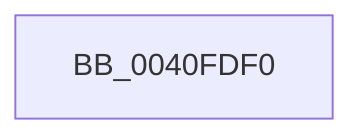

# ExpScanGeneralLookasideList

- RVA: `0x0040FDF0`–`0x0040FE14` (길이 `36` bytes)
- VA: `0x000000014040FDF0`
- 실행 섹션: `.text`
- PDB 이름 있음: `예`; PDB Function 태그: `아니요`
- unwind 정보 RVA: `0x0009BBDC`
- 디코드: `11`개 명령, `36/36` bytes 표시
- 미해석 바이트: `0` (있으면 어셈블리에 `.byte`로 보존)

> 이 문서는 커널 이미지의 기계어와 PDB 기호를 분석해 생성했습니다. 4번과 5번은 함수 원형과 자료형을 바이너리 사용 방식에서 추정한 C 해석이며 원본 소스 복구 결과는 아닙니다.

## 1. Dependencies

- 직접 호출 지점: **1**; 고유 호출 대상: **1**
- 직접 호출자로 확인된 함수: **1**
- RIP 상대 이미지 참조: **0**

### Outgoing calls
- `0x0040FE03` → [KeAcquireSpinLockRaiseToDpc](../20/KeAcquireSpinLockRaiseToDpc_function_00208470.md) (function, `0x00208470`)

### Direct callers
- [KeBalanceSetManager](../5C/KeBalanceSetManager_function_005C5B30.md) at `0x005C5CB7`

### Static image references
- 디코드된 RIP-relative 메모리 참조가 없습니다.

## 2. Other-region calls and transfers

- 다른 실행 섹션으로 향하는 call: **0**
- call이 아닌 외부 분기/꼬리 이동: **1**
  - `0x0040FE12` → [sub_0040FE88](Unknown_function_0040FE88.md) (`tail-transfer`)

## 3. Assembly (complete function range)

```asm
0040FDF0  48 89 5C 24 18                  mov qword ptr [rsp + 0x18], rbx
0040FDF5  57                              push rdi
0040FDF6  48 83 EC 20                     sub rsp, 0x20
0040FDFA  48 8B D9                        mov rbx, rcx
0040FDFD  48 8B FA                        mov rdi, rdx
0040FE00  48 8B CA                        mov rcx, rdx
0040FE03  E8 68 86 DF FF                  call 0x140208470
0040FE08  4C 8B 03                        mov r8, qword ptr [rbx]
0040FE0B  44 0F B6 D8                     movzx r11d, al
0040FE0F  4C 3B C3                        cmp r8, rbx
0040FE12  74 74                           je 0x14040fe88
```

## 4. C-style interpretation (structured pseudocode)

```c
__int64 __fastcall ExpScanGeneralLookasideList(__int64 a1, __int64 a2)
{
    __int64 result;
    __int64 v_rsp;
    unsigned __int64 v_stack_p18;

    v_stack_p18 = v_rbx;
    v_rsp = (v_rsp) - (32);
    result = KeAcquireSpinLockRaiseToDpc(a2, a2, a3, a4);
}
```

## 5. (Beta) C Style

```c
int64_t ExpScanGeneralLookasideList(void *Arg1, int64_t Arg2)
{
    uint8_t *arg1 = (uint8_t *)Arg1;

    int64_t result;
    int64_t local_rsp;
    uint64_t v_stack_p18;

    v_stack_p18 = local_rbx;
    local_rsp = (local_rsp) - (32);
    result = KeAcquireSpinLockRaiseToDpc(Arg2, Arg2, a3, a4);
}
```

### 관측된 메모리 오프셋

구조체 형식이 확인되지 않은 접근은 인자 기준의 오프셋으로만 기록했습니다.

| 기준 인자 | 오프셋 표현 | 폭 (bit) | 접근 |
|---|---:|---:|---|
| `Arg1` | `+ 0x0` | `64` | `R` |

## 6. Execution-region graph

[열기: 2D/3D 그래프와 함수 탐색 컨트롤 패널](../../../control-panel.html?section=text&rva=0x0040FDF0&view=graph)

- 2D 그래프는 위에서 아래로 흐르고, 3D 그래프는 빈 공간을 드래그해 회전합니다. Shift+드래그는 이동, 휠은 확대·축소, 함수 노드 선택은 대상 보고서 이동입니다.

### Static fallback


