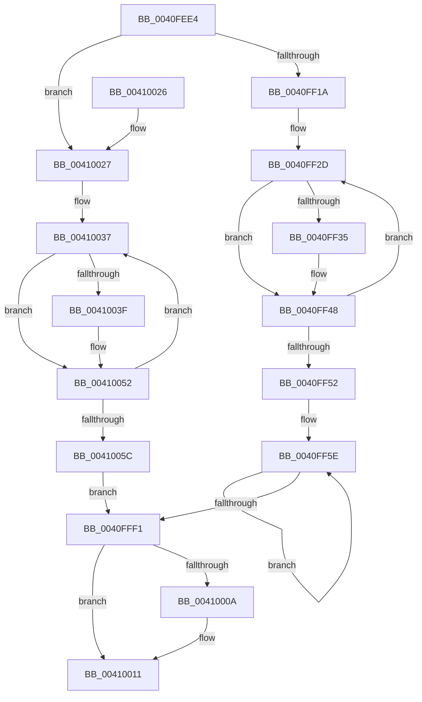

# ExpScanSystemLookasideList

- RVA: `0x0040FEE4`–`0x0041005E` (길이 `378` bytes)
- VA: `0x000000014040FEE4`
- 실행 섹션: `.text`
- PDB 이름 있음: `예`; PDB Function 태그: `아니요`
- unwind 정보 RVA: `0x0005FFCC`
- 디코드: `90`개 명령, `378/378` bytes 표시
- 미해석 바이트: `0` (있으면 어셈블리에 `.byte`로 보존)

> 이 문서는 커널 이미지의 기계어와 PDB 기호를 분석해 생성했습니다. 4번과 5번은 함수 원형과 자료형을 바이너리 사용 방식에서 추정한 C 해석이며 원본 소스 복구 결과는 아닙니다.

## 1. Dependencies

- 직접 호출 지점: **6**; 고유 호출 대상: **2**
- 직접 호출자로 확인된 함수: **1**
- RIP 상대 이미지 참조: **4**

### Outgoing calls
- `0x0040FF43` → [ExpComputeLookasideDepth](../41/ExpComputeLookasideDepth_function_00410070.md) (function, `0x00410070`)
- `0x0040FF76` → [ExpComputeLookasideDepth](../41/ExpComputeLookasideDepth_function_00410070.md) (function, `0x00410070`)
- `0x0040FFAA` → [ExpComputeLookasideDepth](../41/ExpComputeLookasideDepth_function_00410070.md) (function, `0x00410070`)
- `0x0040FFDE` → [ExpComputeLookasideDepth](../41/ExpComputeLookasideDepth_function_00410070.md) (function, `0x00410070`)
- `0x0040FFF1` → [ExHeapLookasideRebalance](../41/ExHeapLookasideRebalance_function_00410104.md) (function, `0x00410104`)
- `0x0041004D` → [ExpComputeLookasideDepth](../41/ExpComputeLookasideDepth_function_00410070.md) (function, `0x00410070`)

### Direct callers
- [KeBalanceSetManager](../5C/KeBalanceSetManager_function_005C5B30.md) at `0x005C5C92`

### Static image references
- `0x0040FEF8` → RVA `0x00FC6A80` (`ALMOSTRO`; read)
- `0x0040FF0C` → RVA `0x00E685B8` (`.data`; read)
- `0x0040FF1A` → RVA `0x00FC8C40` (`ALMOSTRO`; read)
- `0x0040FFF6` → RVA `0x00E685B8` (`.data`; read/write)

## 2. Other-region calls and transfers

- 다른 실행 섹션으로 향하는 call: **0**
- 별도 외부 분기/꼬리 이동을 확인하지 못했습니다.

## 3. Assembly (complete function range)

```asm
0040FEE4  48 89 5C 24 08                  mov qword ptr [rsp + 8], rbx
0040FEE9  48 89 6C 24 10                  mov qword ptr [rsp + 0x10], rbp
0040FEEE  48 89 74 24 18                  mov qword ptr [rsp + 0x18], rsi
0040FEF3  57                              push rdi
0040FEF4  48 83 EC 20                     sub rsp, 0x20
0040FEF8  8B 05 82 6B BB 00               mov eax, dword ptr [rip + 0xbb6b82]
0040FEFE  BB 0B 00 00 00                  mov ebx, 0xb
0040FF03  8D 34 40                        lea esi, [rax + rax*2]
0040FF06  8B 05 74 6B BB 00               mov eax, dword ptr [rip + 0xbb6b74]
0040FF0C  8B 0D A6 86 A5 00               mov ecx, dword ptr [rip + 0xa586a6]
0040FF12  3B C8                           cmp ecx, eax
0040FF14  0F 84 0D 01 00 00               je 0x140410027
0040FF1A  48 8D 2D 1F 8D BB 00            lea rbp, [rip + 0xbb8d1f]
0040FF21  48 8B 6C CD 00                  mov rbp, qword ptr [rbp + rcx*8]
0040FF26  48 8D BD 00 08 00 00            lea rdi, [rbp + 0x800]
0040FF2D  48 8B 0F                        mov rcx, qword ptr [rdi]
0040FF30  48 85 C9                        test rcx, rcx
0040FF33  74 13                           je 0x14040ff48
0040FF35  8B 41 18                        mov eax, dword ptr [rcx + 0x18]
0040FF38  44 8B C6                        mov r8d, esi
0040FF3B  8B D0                           mov edx, eax
0040FF3D  2B 51 54                        sub edx, dword ptr [rcx + 0x54]
0040FF40  89 41 54                        mov dword ptr [rcx + 0x54], eax
0040FF43  E8 28 01 00 00                  call 0x140410070
0040FF48  48 83 C7 10                     add rdi, 0x10
0040FF4C  48 83 EB 01                     sub rbx, 1
0040FF50  75 DB                           jne 0x14040ff2d
0040FF52  48 8D 9D 54 09 00 00            lea rbx, [rbp + 0x954]
0040FF59  BF 20 00 00 00                  mov edi, 0x20
0040FF5E  8B 43 C4                        mov eax, dword ptr [rbx - 0x3c]
0040FF61  44 8B C6                        mov r8d, esi
0040FF64  8B 53 C0                        mov edx, dword ptr [rbx - 0x40]
0040FF67  8B C8                           mov ecx, eax
0040FF69  2B 0B                           sub ecx, dword ptr [rbx]
0040FF6B  2B 53 FC                        sub edx, dword ptr [rbx - 4]
0040FF6E  2B D1                           sub edx, ecx
0040FF70  89 03                           mov dword ptr [rbx], eax
0040FF72  48 8D 4B AC                     lea rcx, [rbx - 0x54]
0040FF76  E8 F5 00 00 00                  call 0x140410070
0040FF7B  44 8B 83 C4 0B 00 00            mov r8d, dword ptr [rbx + 0xbc4]
0040FF82  41 8B C8                        mov ecx, r8d
0040FF85  2B 8B 00 0C 00 00               sub ecx, dword ptr [rbx + 0xc00]
0040FF8B  8B 93 C0 0B 00 00               mov edx, dword ptr [rbx + 0xbc0]
0040FF91  2B 93 FC 0B 00 00               sub edx, dword ptr [rbx + 0xbfc]
0040FF97  2B D1                           sub edx, ecx
0040FF99  44 89 83 00 0C 00 00            mov dword ptr [rbx + 0xc00], r8d
0040FFA0  48 8D 8B AC 0B 00 00            lea rcx, [rbx + 0xbac]
0040FFA7  44 8B C6                        mov r8d, esi
0040FFAA  E8 C1 00 00 00                  call 0x140410070
0040FFAF  44 8B 83 C4 17 00 00            mov r8d, dword ptr [rbx + 0x17c4]
0040FFB6  41 8B C8                        mov ecx, r8d
0040FFB9  2B 8B 00 18 00 00               sub ecx, dword ptr [rbx + 0x1800]
0040FFBF  8B 93 C0 17 00 00               mov edx, dword ptr [rbx + 0x17c0]
0040FFC5  2B 93 FC 17 00 00               sub edx, dword ptr [rbx + 0x17fc]
0040FFCB  2B D1                           sub edx, ecx
0040FFCD  44 89 83 00 18 00 00            mov dword ptr [rbx + 0x1800], r8d
0040FFD4  48 8D 8B AC 17 00 00            lea rcx, [rbx + 0x17ac]
0040FFDB  44 8B C6                        mov r8d, esi
0040FFDE  E8 8D 00 00 00                  call 0x140410070
0040FFE3  48 8D 5B 60                     lea rbx, [rbx + 0x60]
0040FFE7  48 83 EF 01                     sub rdi, 1
0040FFEB  0F 85 6D FF FF FF               jne 0x14040ff5e
0040FFF1  E8 0E 01 00 00                  call 0x140410104
0040FFF6  FF 05 BC 85 A5 00               inc dword ptr [rip + 0xa585bc]
0040FFFC  8B 05 7E 6A BB 00               mov eax, dword ptr [rip + 0xbb6a7e]
00410002  39 05 B0 85 A5 00               cmp dword ptr [rip + 0xa585b0], eax
00410008  76 07                           jbe 0x140410011
0041000A  83 25 A7 85 A5 00 00            and dword ptr [rip + 0xa585a7], 0
00410011  48 8B 5C 24 30                  mov rbx, qword ptr [rsp + 0x30]
00410016  48 8B 6C 24 38                  mov rbp, qword ptr [rsp + 0x38]
0041001B  48 8B 74 24 40                  mov rsi, qword ptr [rsp + 0x40]
00410020  48 83 C4 20                     add rsp, 0x20
00410024  5F                              pop rdi
00410025  C3                              ret
00410026  CC                              int3
00410027  65 48 8B 04 25 20 00 00 00      mov rax, qword ptr gs:[0x20]
00410030  48 8D B8 08 08 00 00            lea rdi, [rax + 0x808]
00410037  48 8B 0F                        mov rcx, qword ptr [rdi]
0041003A  48 85 C9                        test rcx, rcx
0041003D  74 13                           je 0x140410052
0041003F  8B 41 18                        mov eax, dword ptr [rcx + 0x18]
00410042  44 8B C6                        mov r8d, esi
00410045  8B D0                           mov edx, eax
00410047  2B 51 54                        sub edx, dword ptr [rcx + 0x54]
0041004A  89 41 54                        mov dword ptr [rcx + 0x54], eax
0041004D  E8 1E 00 00 00                  call 0x140410070
00410052  48 83 C7 10                     add rdi, 0x10
00410056  48 83 EB 01                     sub rbx, 1
0041005A  75 DB                           jne 0x140410037
0041005C  EB 93                           jmp 0x14040fff1
```

## 4. C-style interpretation (structured pseudocode)

```c
__int64 __fastcall ExpScanSystemLookasideList(void)
{
    __int64 result;
    __int64 v_rbx;
    __int64 v_rdi;
    __int64 v_rsp;
    unsigned __int64 v_stack_p10;
    unsigned __int64 v_stack_p18;
    unsigned __int64 v_stack_p8;

    v_stack_p8 = v_rbx;
    v_stack_p10 = v_rbp;
    v_stack_p18 = v_rsi;
    v_rsp = (v_rsp) - (32);
    if (((unsigned int)((unsigned int)(*(unsigned int *)(v_rip + 10847910)))) == ((unsigned int)((unsigned int)(*(unsigned int *)(v_rip + 12282740))))) goto loc_00410027;
loc_0040FF2D:
    result = (unsigned int)(*(unsigned int *)(v_rip + 12282740));
    if (*(unsigned __int64 *)(*(unsigned __int64 *)(v_rip + 12291359 + (unsigned int)(*(unsigned int *)(v_rip + 10847910)) * 8) + 2048) != 0) {
        result = *(unsigned int *)(*(unsigned __int64 *)(*(unsigned __int64 *)(v_rip + 12291359 + (unsigned int)(*(unsigned int *)(v_rip + 10847910)) * 8) + 2048) + 24);
        a3 = (unsigned int)((unsigned int)(*(unsigned int *)(v_rip + 12282754)) + (unsigned int)(*(unsigned int *)(v_rip + 12282754)) * 2);
        a2 = (unsigned int)(result);
        a2 = (unsigned int)((a2) - (*(unsigned int *)(*(unsigned __int64 *)(*(unsigned __int64 *)(v_rip + 12291359 + (unsigned int)(*(unsigned int *)(v_rip + 10847910)) * 8) + 2048) + 84)));
        *(unsigned int *)(*(unsigned __int64 *)(*(unsigned __int64 *)(v_rip + 12291359 + (unsigned int)(*(unsigned int *)(v_rip + 10847910)) * 8) + 2048) + 84) = (unsigned int)(result);
        result = ExpComputeLookasideDepth(*(unsigned __int64 *)(*(unsigned __int64 *)(v_rip + 12291359 + (unsigned int)(*(unsigned int *)(v_rip + 10847910)) * 8) + 2048), a2, a3, a4);
    }
    v_rdi = (*(unsigned __int64 *)(v_rip + 12291359 + (unsigned int)(*(unsigned int *)(v_rip + 10847910)) * 8) + 2048) + (16);
    v_rbx = (11) - (1);
    if (condition_is_not_equal) goto loc_0040FF2D;
loc_0040FF5E:
    a1 = (unsigned int)(((unsigned int)((unsigned int)((unsigned int)(*(unsigned int *)(*(unsigned __int64 *)(v_rip + 12291359 + (unsigned int)(*(unsigned int *)(v_rip + 10847910)) * 8) + 2388 - 60))))) - (*(unsigned int *)(*(unsigned __int64 *)(v_rip + 12291359 + (unsigned int)(*(unsigned int *)(v_rip + 10847910)) * 8) + 2388)));
    a2 = (unsigned int)(((unsigned int)(*(unsigned int *)(*(unsigned __int64 *)(v_rip + 12291359 + (unsigned int)(*(unsigned int *)(v_rip + 10847910)) * 8) + 2388 - 64))) - (*(unsigned int *)(*(unsigned __int64 *)(v_rip + 12291359 + (unsigned int)(*(unsigned int *)(v_rip + 10847910)) * 8) + 2388 - 4)));
    a2 = (unsigned int)((a2) - ((unsigned int)(a1)));
    *(unsigned int *)(*(unsigned __int64 *)(v_rip + 12291359 + (unsigned int)(*(unsigned int *)(v_rip + 10847910)) * 8) + 2388) = (unsigned int)((unsigned int)(*(unsigned int *)(*(unsigned __int64 *)(v_rip + 12291359 + (unsigned int)(*(unsigned int *)(v_rip + 10847910)) * 8) + 2388 - 60)));
    result = ExpComputeLookasideDepth(*(unsigned __int64 *)(v_rip + 12291359 + (unsigned int)(*(unsigned int *)(v_rip + 10847910)) * 8) + 2388 - 84, a2, (unsigned int)((unsigned int)((unsigned int)(*(unsigned int *)(v_rip + 12282754)) + (unsigned int)(*(unsigned int *)(v_rip + 12282754)) * 2)), a4);
    a1 = (unsigned int)(((unsigned int)((unsigned int)((unsigned int)(*(unsigned int *)(*(unsigned __int64 *)(v_rip + 12291359 + (unsigned int)(*(unsigned int *)(v_rip + 10847910)) * 8) + 2388 + 3012))))) - (*(unsigned int *)(*(unsigned __int64 *)(v_rip + 12291359 + (unsigned int)(*(unsigned int *)(v_rip + 10847910)) * 8) + 2388 + 3072)));
    a2 = (unsigned int)(((unsigned int)(*(unsigned int *)(*(unsigned __int64 *)(v_rip + 12291359 + (unsigned int)(*(unsigned int *)(v_rip + 10847910)) * 8) + 2388 + 3008))) - (*(unsigned int *)(*(unsigned __int64 *)(v_rip + 12291359 + (unsigned int)(*(unsigned int *)(v_rip + 10847910)) * 8) + 2388 + 3068)));
    a2 = (unsigned int)((a2) - ((unsigned int)(a1)));
    *(unsigned int *)(*(unsigned __int64 *)(v_rip + 12291359 + (unsigned int)(*(unsigned int *)(v_rip + 10847910)) * 8) + 2388 + 3072) = (unsigned int)((unsigned int)(*(unsigned int *)(*(unsigned __int64 *)(v_rip + 12291359 + (unsigned int)(*(unsigned int *)(v_rip + 10847910)) * 8) + 2388 + 3012)));
    result = ExpComputeLookasideDepth(*(unsigned __int64 *)(v_rip + 12291359 + (unsigned int)(*(unsigned int *)(v_rip + 10847910)) * 8) + 2388 + 2988, a2, (unsigned int)((unsigned int)((unsigned int)(*(unsigned int *)(v_rip + 12282754)) + (unsigned int)(*(unsigned int *)(v_rip + 12282754)) * 2)), a4);
    a1 = (unsigned int)(((unsigned int)((unsigned int)((unsigned int)(*(unsigned int *)(*(unsigned __int64 *)(v_rip + 12291359 + (unsigned int)(*(unsigned int *)(v_rip + 10847910)) * 8) + 2388 + 6084))))) - (*(unsigned int *)(*(unsigned __int64 *)(v_rip + 12291359 + (unsigned int)(*(unsigned int *)(v_rip + 10847910)) * 8) + 2388 + 6144)));
    a2 = (unsigned int)(((unsigned int)(*(unsigned int *)(*(unsigned __int64 *)(v_rip + 12291359 + (unsigned int)(*(unsigned int *)(v_rip + 10847910)) * 8) + 2388 + 6080))) - (*(unsigned int *)(*(unsigned __int64 *)(v_rip + 12291359 + (unsigned int)(*(unsigned int *)(v_rip + 10847910)) * 8) + 2388 + 6140)));
    a2 = (unsigned int)((a2) - ((unsigned int)(a1)));
    *(unsigned int *)(*(unsigned __int64 *)(v_rip + 12291359 + (unsigned int)(*(unsigned int *)(v_rip + 10847910)) * 8) + 2388 + 6144) = (unsigned int)((unsigned int)(*(unsigned int *)(*(unsigned __int64 *)(v_rip + 12291359 + (unsigned int)(*(unsigned int *)(v_rip + 10847910)) * 8) + 2388 + 6084)));
    result = ExpComputeLookasideDepth(*(unsigned __int64 *)(v_rip + 12291359 + (unsigned int)(*(unsigned int *)(v_rip + 10847910)) * 8) + 2388 + 6060, a2, (unsigned int)((unsigned int)((unsigned int)(*(unsigned int *)(v_rip + 12282754)) + (unsigned int)(*(unsigned int *)(v_rip + 12282754)) * 2)), a4);
    v_rdi = (32) - (1);
    if (condition_is_not_equal) goto loc_0040FF5E;
loc_0040FFF1:
    result = ExHeapLookasideRebalance(*(unsigned __int64 *)(v_rip + 12291359 + (unsigned int)(*(unsigned int *)(v_rip + 10847910)) * 8) + 2388 + 6060, a2, (unsigned int)((unsigned int)((unsigned int)(*(unsigned int *)(v_rip + 12282754)) + (unsigned int)(*(unsigned int *)(v_rip + 12282754)) * 2)), a4);
    if ((*(unsigned int *)(v_rip + 10847664)) >= = ((unsigned int)((unsigned int)(*(unsigned int *)(v_rip + 12282494))))) {
    }
    v_rsp = (v_rsp) + (32);
    return (unsigned int)(*(unsigned int *)(v_rip + 12282494));
loc_00410027:
loc_00410037:
    result = *(unsigned __int64 *)(gs_base + (0 + 32));
    if (*(unsigned __int64 *)(*(unsigned __int64 *)(gs_base + (0 + 32)) + 2056) != 0) {
        result = *(unsigned int *)(*(unsigned __int64 *)(*(unsigned __int64 *)(gs_base + (0 + 32)) + 2056) + 24);
        a3 = (unsigned int)(v_stack_p18);
        a2 = (unsigned int)(result);
        a2 = (unsigned int)((a2) - (*(unsigned int *)(*(unsigned __int64 *)(*(unsigned __int64 *)(gs_base + (0 + 32)) + 2056) + 84)));
        *(unsigned int *)(*(unsigned __int64 *)(*(unsigned __int64 *)(gs_base + (0 + 32)) + 2056) + 84) = (unsigned int)(result);
        result = ExpComputeLookasideDepth(*(unsigned __int64 *)(*(unsigned __int64 *)(gs_base + (0 + 32)) + 2056), a2, a3, a4);
    }
    v_rdi = (*(unsigned __int64 *)(gs_base + (0 + 32)) + 2056) + (16);
    v_rbx = (v_stack_p8) - (1);
    if (condition_is_not_equal) goto loc_00410037;
    goto loc_0040FFF1;
}
```

## 5. (Beta) C Style

```c
void ExpScanSystemLookasideList(void)
{
    int64_t result;
    int64_t local_rbx;
    int64_t local_rdi;
    int64_t local_rsp;
    uint64_t v_stack_p10;
    uint64_t v_stack_p18;
    uint64_t v_stack_p8;

    v_stack_p8 = local_rbx;
    v_stack_p10 = local_rbp;
    v_stack_p18 = local_rsi;
    local_rsp = (local_rsp) - (32);
    if (((uint32_t)((uint32_t)(*(uint32_t *)(v_rip + 0xA586A6)))) == ((uint32_t)((uint32_t)(*(uint32_t *)(v_rip + 0xBB6B74))))) goto loc_00410027;
loc_0040FF2D:
    result = (uint32_t)(*(uint32_t *)(v_rip + 0xBB6B74));
    if (*(uint64_t *)(*(uint64_t *)(v_rip + 0xBB8D1F + (uint32_t)(*(uint32_t *)(v_rip + 0xA586A6)) * 8) + 0x800) != 0) {
        result = *(uint32_t *)(*(uint64_t *)(*(uint64_t *)(v_rip + 0xBB8D1F + (uint32_t)(*(uint32_t *)(v_rip + 0xA586A6)) * 8) + 0x800) + 0x18);
        a3 = (uint32_t)((uint32_t)(*(uint32_t *)(v_rip + 0xBB6B82)) + (uint32_t)(*(uint32_t *)(v_rip + 0xBB6B82)) * 2);
        a2 = (uint32_t)(result);
        a2 = (uint32_t)((a2) - (*(uint32_t *)(*(uint64_t *)(*(uint64_t *)(v_rip + 0xBB8D1F + (uint32_t)(*(uint32_t *)(v_rip + 0xA586A6)) * 8) + 0x800) + 0x54)));
        *(uint32_t *)(*(uint64_t *)(*(uint64_t *)(v_rip + 0xBB8D1F + (uint32_t)(*(uint32_t *)(v_rip + 0xA586A6)) * 8) + 0x800) + 0x54) = (uint32_t)(result);
        result = ExpComputeLookasideDepth(*(uint64_t *)(*(uint64_t *)(v_rip + 0xBB8D1F + (uint32_t)(*(uint32_t *)(v_rip + 0xA586A6)) * 8) + 0x800), a2, a3, a4);
    }
    local_rdi = (*(uint64_t *)(v_rip + 0xBB8D1F + (uint32_t)(*(uint32_t *)(v_rip + 0xA586A6)) * 8) + 2048) + (16);
    local_rbx = (11) - (1);
    if (condition_is_not_equal) goto loc_0040FF2D;
loc_0040FF5E:
    a1 = (uint32_t)(((uint32_t)((uint32_t)((uint32_t)(*(uint32_t *)(*(uint64_t *)(v_rip + 0xBB8D1F + (uint32_t)(*(uint32_t *)(v_rip + 0xA586A6)) * 8) + 0x954 - 0x3C))))) - (*(uint32_t *)(*(uint64_t *)(v_rip + 0xBB8D1F + (uint32_t)(*(uint32_t *)(v_rip + 0xA586A6)) * 8) + 0x954)));
    a2 = (uint32_t)(((uint32_t)(*(uint32_t *)(*(uint64_t *)(v_rip + 0xBB8D1F + (uint32_t)(*(uint32_t *)(v_rip + 0xA586A6)) * 8) + 0x954 - 0x40))) - (*(uint32_t *)(*(uint64_t *)(v_rip + 0xBB8D1F + (uint32_t)(*(uint32_t *)(v_rip + 0xA586A6)) * 8) + 0x954 - 0x4)));
    a2 = (uint32_t)((a2) - ((uint32_t)(a1)));
    *(uint32_t *)(*(uint64_t *)(v_rip + 0xBB8D1F + (uint32_t)(*(uint32_t *)(v_rip + 0xA586A6)) * 8) + 0x954) = (uint32_t)((uint32_t)(*(uint32_t *)(*(uint64_t *)(v_rip + 0xBB8D1F + (uint32_t)(*(uint32_t *)(v_rip + 0xA586A6)) * 8) + 0x954 - 0x3C)));
    result = ExpComputeLookasideDepth(*(uint64_t *)(v_rip + 0xBB8D1F + (uint32_t)(*(uint32_t *)(v_rip + 0xA586A6)) * 8) + 2388 - 84, a2, (uint32_t)((uint32_t)((uint32_t)(*(uint32_t *)(v_rip + 0xBB6B82)) + (uint32_t)(*(uint32_t *)(v_rip + 0xBB6B82)) * 2)), a4);
    a1 = (uint32_t)(((uint32_t)((uint32_t)((uint32_t)(*(uint32_t *)(*(uint64_t *)(v_rip + 0xBB8D1F + (uint32_t)(*(uint32_t *)(v_rip + 0xA586A6)) * 8) + 0x954 + 0xBC4))))) - (*(uint32_t *)(*(uint64_t *)(v_rip + 0xBB8D1F + (uint32_t)(*(uint32_t *)(v_rip + 0xA586A6)) * 8) + 0x954 + 0xC00)));
    a2 = (uint32_t)(((uint32_t)(*(uint32_t *)(*(uint64_t *)(v_rip + 0xBB8D1F + (uint32_t)(*(uint32_t *)(v_rip + 0xA586A6)) * 8) + 0x954 + 0xBC0))) - (*(uint32_t *)(*(uint64_t *)(v_rip + 0xBB8D1F + (uint32_t)(*(uint32_t *)(v_rip + 0xA586A6)) * 8) + 0x954 + 0xBFC)));
    a2 = (uint32_t)((a2) - ((uint32_t)(a1)));
    *(uint32_t *)(*(uint64_t *)(v_rip + 0xBB8D1F + (uint32_t)(*(uint32_t *)(v_rip + 0xA586A6)) * 8) + 0x954 + 0xC00) = (uint32_t)((uint32_t)(*(uint32_t *)(*(uint64_t *)(v_rip + 0xBB8D1F + (uint32_t)(*(uint32_t *)(v_rip + 0xA586A6)) * 8) + 0x954 + 0xBC4)));
    result = ExpComputeLookasideDepth(*(uint64_t *)(v_rip + 0xBB8D1F + (uint32_t)(*(uint32_t *)(v_rip + 0xA586A6)) * 8) + 2388 + 2988, a2, (uint32_t)((uint32_t)((uint32_t)(*(uint32_t *)(v_rip + 0xBB6B82)) + (uint32_t)(*(uint32_t *)(v_rip + 0xBB6B82)) * 2)), a4);
    a1 = (uint32_t)(((uint32_t)((uint32_t)((uint32_t)(*(uint32_t *)(*(uint64_t *)(v_rip + 0xBB8D1F + (uint32_t)(*(uint32_t *)(v_rip + 0xA586A6)) * 8) + 0x954 + 0x17C4))))) - (*(uint32_t *)(*(uint64_t *)(v_rip + 0xBB8D1F + (uint32_t)(*(uint32_t *)(v_rip + 0xA586A6)) * 8) + 0x954 + 0x1800)));
    a2 = (uint32_t)(((uint32_t)(*(uint32_t *)(*(uint64_t *)(v_rip + 0xBB8D1F + (uint32_t)(*(uint32_t *)(v_rip + 0xA586A6)) * 8) + 0x954 + 0x17C0))) - (*(uint32_t *)(*(uint64_t *)(v_rip + 0xBB8D1F + (uint32_t)(*(uint32_t *)(v_rip + 0xA586A6)) * 8) + 0x954 + 0x17FC)));
    a2 = (uint32_t)((a2) - ((uint32_t)(a1)));
    *(uint32_t *)(*(uint64_t *)(v_rip + 0xBB8D1F + (uint32_t)(*(uint32_t *)(v_rip + 0xA586A6)) * 8) + 0x954 + 0x1800) = (uint32_t)((uint32_t)(*(uint32_t *)(*(uint64_t *)(v_rip + 0xBB8D1F + (uint32_t)(*(uint32_t *)(v_rip + 0xA586A6)) * 8) + 0x954 + 0x17C4)));
    result = ExpComputeLookasideDepth(*(uint64_t *)(v_rip + 0xBB8D1F + (uint32_t)(*(uint32_t *)(v_rip + 0xA586A6)) * 8) + 2388 + 6060, a2, (uint32_t)((uint32_t)((uint32_t)(*(uint32_t *)(v_rip + 0xBB6B82)) + (uint32_t)(*(uint32_t *)(v_rip + 0xBB6B82)) * 2)), a4);
    local_rdi = (32) - (1);
    if (condition_is_not_equal) goto loc_0040FF5E;
loc_0040FFF1:
    result = ExHeapLookasideRebalance(*(uint64_t *)(v_rip + 0xBB8D1F + (uint32_t)(*(uint32_t *)(v_rip + 0xA586A6)) * 8) + 2388 + 6060, a2, (uint32_t)((uint32_t)((uint32_t)(*(uint32_t *)(v_rip + 0xBB6B82)) + (uint32_t)(*(uint32_t *)(v_rip + 0xBB6B82)) * 2)), a4);
    if ((*(uint32_t *)(v_rip + 0xA585B0)) >= = ((uint32_t)((uint32_t)(*(uint32_t *)(v_rip + 0xBB6A7E))))) {
    }
    local_rsp = (local_rsp) + (32);
    return (uint32_t)(*(uint32_t *)(v_rip + 0xBB6A7E));
loc_00410027:
loc_00410037:
    result = *(uint64_t *)(gs_base + (0 + 0x20));
    if (*(uint64_t *)(*(uint64_t *)(gs_base + (0 + 0x20)) + 0x808) != 0) {
        result = *(uint32_t *)(*(uint64_t *)(*(uint64_t *)(gs_base + (0 + 0x20)) + 0x808) + 0x18);
        a3 = (uint32_t)(v_stack_p18);
        a2 = (uint32_t)(result);
        a2 = (uint32_t)((a2) - (*(uint32_t *)(*(uint64_t *)(*(uint64_t *)(gs_base + (0 + 0x20)) + 0x808) + 0x54)));
        *(uint32_t *)(*(uint64_t *)(*(uint64_t *)(gs_base + (0 + 0x20)) + 0x808) + 0x54) = (uint32_t)(result);
        result = ExpComputeLookasideDepth(*(uint64_t *)(*(uint64_t *)(gs_base + (0 + 0x20)) + 0x808), a2, a3, a4);
    }
    local_rdi = (*(uint64_t *)(gs_base + (0 + 0x20)) + 2056) + (16);
    local_rbx = (v_stack_p8) - (1);
    if (condition_is_not_equal) goto loc_00410037;
    goto loc_0040FFF1;
}
```

## 6. Execution-region graph

[열기: 2D/3D 그래프와 함수 탐색 컨트롤 패널](../../../control-panel.html?section=text&rva=0x0040FEE4&view=graph)

- 2D 그래프는 위에서 아래로 흐르고, 3D 그래프는 빈 공간을 드래그해 회전합니다. Shift+드래그는 이동, 휠은 확대·축소, 함수 노드 선택은 대상 보고서 이동입니다.

### Static fallback


