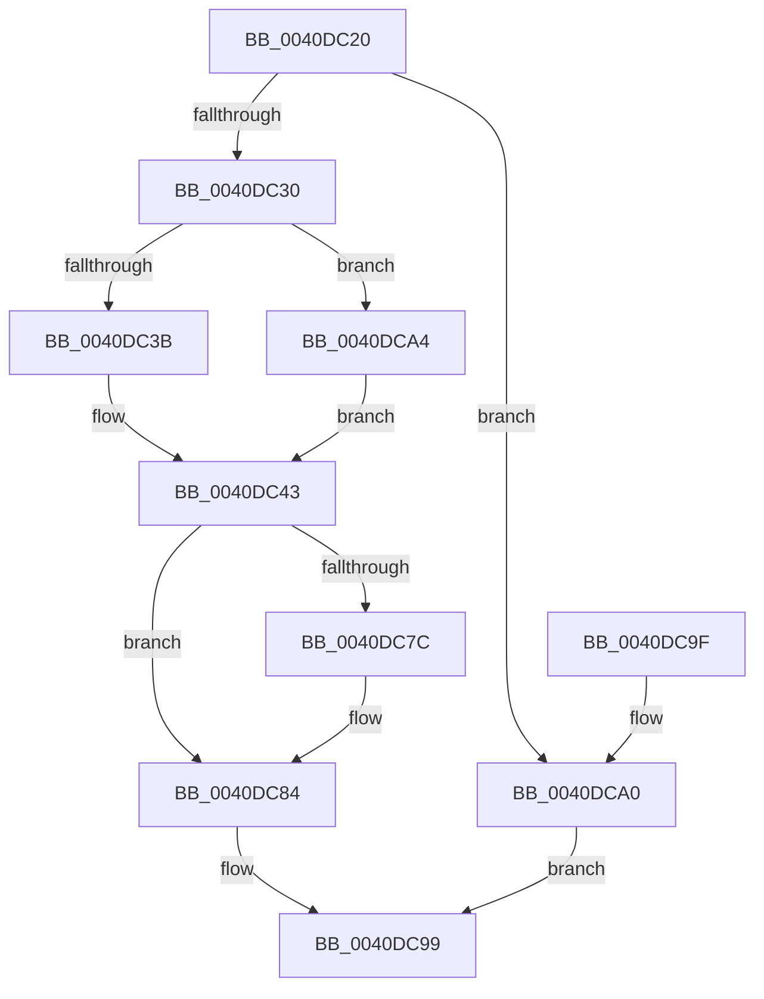

# FsRtlGetNextBaseMcbEntry

- RVA: `0x0040DC20`–`0x0040DCA9` (길이 `137` bytes)
- VA: `0x000000014040DC20`
- 실행 섹션: `.text`
- PDB 이름 있음: `예`; PDB Function 태그: `아니요`
- unwind 정보 RVA: `0x0009B288`
- 디코드: `44`개 명령, `137/137` bytes 표시
- 미해석 바이트: `0` (있으면 어셈블리에 `.byte`로 보존)

> 이 문서는 커널 이미지의 기계어와 PDB 기호를 분석해 생성했습니다. 4번과 5번은 함수 원형과 자료형을 바이너리 사용 방식에서 추정한 C 해석이며 원본 소스 복구 결과는 아닙니다.

## 1. Dependencies

- 직접 호출 지점: **0**; 고유 호출 대상: **0**
- 직접 호출자로 확인된 함수: **1**
- RIP 상대 이미지 참조: **0**

### Outgoing calls
- 직접 디코드된 call 명령이 없습니다.

### Direct callers
- [FsRtlGetNextLargeMcbEntry](FsRtlGetNextLargeMcbEntry_function_0040DBB0.md) at `0x0040DBEE`

### Static image references
- 디코드된 RIP-relative 메모리 참조가 없습니다.

## 2. Other-region calls and transfers

- 다른 실행 섹션으로 향하는 call: **0**
- 별도 외부 분기/꼬리 이동을 확인하지 못했습니다.

## 3. Assembly (complete function range)

```asm
0040DC20  48 89 5C 24 08                  mov qword ptr [rsp + 8], rbx
0040DC25  49 8B D9                        mov rbx, r9
0040DC28  4C 8B D1                        mov r10, rcx
0040DC2B  3B 51 04                        cmp edx, dword ptr [rcx + 4]
0040DC2E  73 70                           jae 0x14040dca0
0040DC30  45 33 DB                        xor r11d, r11d
0040DC33  44 8D 4A FF                     lea r9d, [rdx - 1]
0040DC37  85 D2                           test edx, edx
0040DC39  74 69                           je 0x14040dca4
0040DC3B  48 8B 41 10                     mov rax, qword ptr [rcx + 0x10]
0040DC3F  42 8B 0C C8                     mov ecx, dword ptr [rax + r9*8]
0040DC43  41 89 08                        mov dword ptr [r8], ecx
0040DC46  83 F9 FF                        cmp ecx, -1
0040DC49  41 8B C3                        mov eax, r11d
0040DC4C  0F 95 C0                        setne al
0040DC4F  FF C8                           dec eax
0040DC51  41 89 40 04                     mov dword ptr [r8 + 4], eax
0040DC55  8B C2                           mov eax, edx
0040DC57  4C 8D 04 C5 00 00 00 00         lea r8, [rax*8]
0040DC5F  49 8B 42 10                     mov rax, qword ptr [r10 + 0x10]
0040DC63  41 8B 4C 00 04                  mov ecx, dword ptr [r8 + rax + 4]
0040DC68  83 F9 FF                        cmp ecx, -1
0040DC6B  41 8B C3                        mov eax, r11d
0040DC6E  89 0B                           mov dword ptr [rbx], ecx
0040DC70  0F 95 C0                        setne al
0040DC73  FF C8                           dec eax
0040DC75  89 43 04                        mov dword ptr [rbx + 4], eax
0040DC78  85 D2                           test edx, edx
0040DC7A  74 08                           je 0x14040dc84
0040DC7C  49 8B 42 10                     mov rax, qword ptr [r10 + 0x10]
0040DC80  46 8B 1C C8                     mov r11d, dword ptr [rax + r9*8]
0040DC84  49 8B 42 10                     mov rax, qword ptr [r10 + 0x10]
0040DC88  42 8B 14 00                     mov edx, dword ptr [rax + r8]
0040DC8C  48 8B 44 24 28                  mov rax, qword ptr [rsp + 0x28]
0040DC91  41 2B D3                        sub edx, r11d
0040DC94  48 89 10                        mov qword ptr [rax], rdx
0040DC97  B0 01                           mov al, 1
0040DC99  48 8B 5C 24 08                  mov rbx, qword ptr [rsp + 8]
0040DC9E  C3                              ret
0040DC9F  CC                              int3
0040DCA0  32 C0                           xor al, al
0040DCA2  EB F5                           jmp 0x14040dc99
0040DCA4  41 8B CB                        mov ecx, r11d
0040DCA7  EB 9A                           jmp 0x14040dc43
```

## 4. C-style interpretation (structured pseudocode)

```c
__int64 __fastcall FsRtlGetNextBaseMcbEntry(__int64 a1, __int64 a2, __int64 a3, __int64 a4, __int64 a5)
{
    __int64 result;
    __int64 v_r11;
    unsigned __int64 v_stack_p8;

    v_stack_p8 = v_rbx;
    if (((unsigned int)(a2)) >= (*(unsigned int *)(a1 + 4))) goto loc_0040DCA0;
    v_r11 = 0;
    if ((unsigned int)(a2) == 0) goto loc_0040DCA4;
loc_0040DC43:
    *(unsigned int *)(a3) = (unsigned int)((unsigned int)(*(unsigned int *)(*(unsigned __int64 *)(a1 + 16) + a2 - 1 * 8)));
    result = (((unsigned int)((unsigned int)(*(unsigned int *)(*(unsigned __int64 *)(a1 + 16) + a2 - 1 * 8)))) != -1) ? 1 : 0;
    result = (unsigned int)((result) - 1);
    *(unsigned int *)(a3 + 4) = (unsigned int)(result);
    *(unsigned int *)(a4) = (unsigned int)((unsigned int)(*(unsigned int *)((unsigned int)((unsigned int)(a2)) * 8 + *(unsigned __int64 *)(a1 + 16) * 1 + 4)));
    result = (((unsigned int)((unsigned int)(*(unsigned int *)((unsigned int)((unsigned int)(a2)) * 8 + *(unsigned __int64 *)(a1 + 16) * 1 + 4)))) != -1) ? 1 : 0;
    result = (unsigned int)((result) - 1);
    *(unsigned int *)(a4 + 4) = (unsigned int)(result);
    if ((unsigned int)(a2) != 0) {
        result = *(unsigned __int64 *)(a1 + 16);
        v_r11 = *(unsigned int *)(result + a2 - 1 * 8);
    }
    a2 = (unsigned int)(((unsigned int)(*(unsigned int *)(*(unsigned __int64 *)(a1 + 16) + (unsigned int)((unsigned int)(a2)) * 8 * 1))) - ((unsigned int)(v_r11)));
    *(unsigned __int64 *)(a5) = a2;
loc_0040DC99:
    return 1;
loc_0040DCA0:
    result = 0;
    goto loc_0040DC99;
loc_0040DCA4:
    goto loc_0040DC43;
}
```

## 5. (Beta) C Style

```c
int64_t FsRtlGetNextBaseMcbEntry(void *Arg1, int64_t Arg2, void *Arg3, void *Arg4, void *Arg5)
{
    uint8_t *arg1 = (uint8_t *)Arg1;
    uint8_t *arg3 = (uint8_t *)Arg3;
    uint8_t *arg4 = (uint8_t *)Arg4;
    uint8_t *arg5 = (uint8_t *)Arg5;

    int64_t result;
    int64_t local_r11;
    uint64_t v_stack_p8;

    v_stack_p8 = local_rbx;
    if (((uint32_t)(Arg2)) >= (*(uint32_t *)(arg1 + 0x4))) goto loc_0040DCA0;
    local_r11 = 0;
    if ((uint32_t)(Arg2) == 0) goto loc_0040DCA4;
loc_0040DC43:
    *(uint32_t *)(arg3) = (uint32_t)((uint32_t)(*(uint32_t *)(*(uint64_t *)(arg1 + 0x10) + Arg2 - 0x1 * 8)));
    result = (((uint32_t)((uint32_t)(*(uint32_t *)(*(uint64_t *)(arg1 + 0x10) + Arg2 - 0x1 * 8)))) != -1) ? 1 : 0;
    result = (uint32_t)((result) - 1);
    *(uint32_t *)(arg3 + 0x4) = (uint32_t)(result);
    *(uint32_t *)(arg4) = (uint32_t)((uint32_t)(*(uint32_t *)((uint32_t)((uint32_t)(Arg2)) * 8 + *(uint64_t *)(arg1 + 0x10) * 1 + 0x4)));
    result = (((uint32_t)((uint32_t)(*(uint32_t *)((uint32_t)((uint32_t)(Arg2)) * 8 + *(uint64_t *)(arg1 + 0x10) * 1 + 0x4)))) != -1) ? 1 : 0;
    result = (uint32_t)((result) - 1);
    *(uint32_t *)(arg4 + 0x4) = (uint32_t)(result);
    if ((uint32_t)(Arg2) != 0) {
        result = *(uint64_t *)(arg1 + 0x10);
        local_r11 = *(uint32_t *)(result + Arg2 - 0x1 * 8);
    }
    Arg2 = (uint32_t)(((uint32_t)(*(uint32_t *)(*(uint64_t *)(arg1 + 0x10) + (uint32_t)((uint32_t)(Arg2)) * 8 * 1))) - ((uint32_t)(local_r11)));
    *(uint64_t *)(arg5) = Arg2;
loc_0040DC99:
    return 1;
loc_0040DCA0:
    result = 0;
    goto loc_0040DC99;
loc_0040DCA4:
    goto loc_0040DC43;
}
```

### 관측된 메모리 오프셋

구조체 형식이 확인되지 않은 접근은 인자 기준의 오프셋으로만 기록했습니다.

| 기준 인자 | 오프셋 표현 | 폭 (bit) | 접근 |
|---|---:|---:|---|
| `Arg1` | `+ 0x4` | `32` | `R` |
| `Arg1` | `+ 0x10` | `64` | `R` |
| `Arg3` | `+ 0x0` | `32` | `W` |
| `Arg3` | `+ 0x4` | `32` | `W` |
| `Arg4` | `+ 0x0` | `32` | `W` |
| `Arg4` | `+ 0x4` | `32` | `W` |
| `Arg5` | `+ 0x0` | `64` | `W` |

## 6. Execution-region graph

[열기: 2D/3D 그래프와 함수 탐색 컨트롤 패널](../../../control-panel.html?section=text&rva=0x0040DC20&view=graph)

- 2D 그래프는 위에서 아래로 흐르고, 3D 그래프는 빈 공간을 드래그해 회전합니다. Shift+드래그는 이동, 휠은 확대·축소, 함수 노드 선택은 대상 보고서 이동입니다.

### Static fallback


