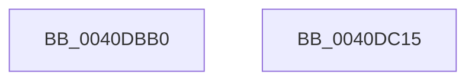

# FsRtlGetNextLargeMcbEntry

- RVA: `0x0040DBB0`–`0x0040DC16` (길이 `102` bytes)
- VA: `0x000000014040DBB0`
- 실행 섹션: `.text`
- PDB 이름 있음: `예`; PDB Function 태그: `아니요`
- unwind 정보 RVA: `0x0009B270`
- 디코드: `29`개 명령, `102/102` bytes 표시
- 미해석 바이트: `0` (있으면 어셈블리에 `.byte`로 보존)

> 이 문서는 커널 이미지의 기계어와 PDB 기호를 분석해 생성했습니다. 4번과 5번은 함수 원형과 자료형을 바이너리 사용 방식에서 추정한 C 해석이며 원본 소스 복구 결과는 아닙니다.

## 1. Dependencies

- 직접 호출 지점: **3**; 고유 호출 대상: **3**
- 직접 호출자로 확인된 함수: **1**
- RIP 상대 이미지 참조: **0**

### Outgoing calls
- `0x0040DBD3` → [ExAcquireFastMutex](../20/ExAcquireFastMutex_function_0020E5A0.md) (function, `0x0020E5A0`)
- `0x0040DBEE` → [FsRtlGetNextBaseMcbEntry](FsRtlGetNextBaseMcbEntry_function_0040DC20.md) (function, `0x0040DC20`)
- `0x0040DBF8` → [ExReleaseFastMutex](../25/ExReleaseFastMutex_function_002519C0.md) (function, `0x002519C0`)

### Direct callers
- [FsRtlGetNextMcbEntry](../58/FsRtlGetNextMcbEntry_function_005811B0.md) at `0x005811E4`

### Static image references
- 디코드된 RIP-relative 메모리 참조가 없습니다.

## 2. Other-region calls and transfers

- 다른 실행 섹션으로 향하는 call: **0**
- 별도 외부 분기/꼬리 이동을 확인하지 못했습니다.

## 3. Assembly (complete function range)

```asm
0040DBB0  48 89 5C 24 08                  mov qword ptr [rsp + 8], rbx
0040DBB5  48 89 74 24 10                  mov qword ptr [rsp + 0x10], rsi
0040DBBA  48 89 7C 24 18                  mov qword ptr [rsp + 0x18], rdi
0040DBBF  41 56                           push r14
0040DBC1  48 83 EC 30                     sub rsp, 0x30
0040DBC5  4C 8B F1                        mov r14, rcx
0040DBC8  49 8B D9                        mov rbx, r9
0040DBCB  48 8B 09                        mov rcx, qword ptr [rcx]
0040DBCE  49 8B F8                        mov rdi, r8
0040DBD1  8B F2                           mov esi, edx
0040DBD3  E8 C8 09 E0 FF                  call 0x14020e5a0
0040DBD8  48 8B 44 24 60                  mov rax, qword ptr [rsp + 0x60]
0040DBDD  49 8D 4E 08                     lea rcx, [r14 + 8]
0040DBE1  4C 8B CB                        mov r9, rbx
0040DBE4  48 89 44 24 20                  mov qword ptr [rsp + 0x20], rax
0040DBE9  4C 8B C7                        mov r8, rdi
0040DBEC  8B D6                           mov edx, esi
0040DBEE  E8 2D 00 00 00                  call 0x14040dc20
0040DBF3  49 8B 0E                        mov rcx, qword ptr [r14]
0040DBF6  8A D8                           mov bl, al
0040DBF8  E8 C3 3D E4 FF                  call 0x1402519c0
0040DBFD  48 8B 74 24 48                  mov rsi, qword ptr [rsp + 0x48]
0040DC02  8A C3                           mov al, bl
0040DC04  48 8B 5C 24 40                  mov rbx, qword ptr [rsp + 0x40]
0040DC09  48 8B 7C 24 50                  mov rdi, qword ptr [rsp + 0x50]
0040DC0E  48 83 C4 30                     add rsp, 0x30
0040DC12  41 5E                           pop r14
0040DC14  C3                              ret
0040DC15  CC                              int3
```

## 4. C-style interpretation (structured pseudocode)

```c
__int64 __fastcall FsRtlGetNextLargeMcbEntry(__int64 a1, int a2, __int64 a3, __int64 a4, __int64 a5)
{
    __int64 result;
    __int64 v_rsp;
    unsigned __int64 v_stack_m18;
    unsigned __int64 v_stack_p10;
    unsigned __int64 v_stack_p18;
    unsigned __int64 v_stack_p8;

    v_stack_p8 = v_rbx;
    v_stack_p10 = v_rsi;
    v_stack_p18 = v_rdi;
    v_rsp = (v_rsp) - (48);
    result = ExAcquireFastMutex(*(unsigned __int64 *)(a1), a2, a3, a4);
    v_stack_m18 = a5;
    result = FsRtlGetNextBaseMcbEntry(a1 + 8, (unsigned int)((unsigned int)((unsigned int)(a2))), a3, a4);
    result = ExReleaseFastMutex(*(unsigned __int64 *)(a1), (unsigned int)((unsigned int)((unsigned int)(a2))), a3, a4);
    v_rsp = (v_rsp) + (48);
    return (unsigned __int8)((unsigned __int8)(result));
}
```

## 5. (Beta) C Style

```c
int64_t FsRtlGetNextLargeMcbEntry(void *Arg1, int32_t Arg2, int64_t Arg3, int64_t Arg4, int64_t Arg5)
{
    uint8_t *arg1 = (uint8_t *)Arg1;

    int64_t result;
    int64_t local_rsp;
    uint64_t v_stack_m18;
    uint64_t v_stack_p10;
    uint64_t v_stack_p18;
    uint64_t v_stack_p8;

    v_stack_p8 = local_rbx;
    v_stack_p10 = local_rsi;
    v_stack_p18 = local_rdi;
    local_rsp = (local_rsp) - (48);
    result = ExAcquireFastMutex(*(uint64_t *)(arg1), Arg2, Arg3, Arg4);
    v_stack_m18 = Arg5;
    result = FsRtlGetNextBaseMcbEntry(Arg1 + 8, (uint32_t)((uint32_t)((uint32_t)(Arg2))), Arg3, Arg4);
    result = ExReleaseFastMutex(*(uint64_t *)(arg1), (uint32_t)((uint32_t)((uint32_t)(Arg2))), Arg3, Arg4);
    local_rsp = (local_rsp) + (48);
    return (uint8_t)((uint8_t)(result));
}
```

### 관측된 메모리 오프셋

구조체 형식이 확인되지 않은 접근은 인자 기준의 오프셋으로만 기록했습니다.

| 기준 인자 | 오프셋 표현 | 폭 (bit) | 접근 |
|---|---:|---:|---|
| `Arg1` | `+ 0x0` | `64` | `R` |
| `Arg1` | `+ 0x8` | `64` | `R` |

## 6. Execution-region graph

[열기: 2D/3D 그래프와 함수 탐색 컨트롤 패널](../../../control-panel.html?section=text&rva=0x0040DBB0&view=graph)

- 2D 그래프는 위에서 아래로 흐르고, 3D 그래프는 빈 공간을 드래그해 회전합니다. Shift+드래그는 이동, 휠은 확대·축소, 함수 노드 선택은 대상 보고서 이동입니다.

### Static fallback


