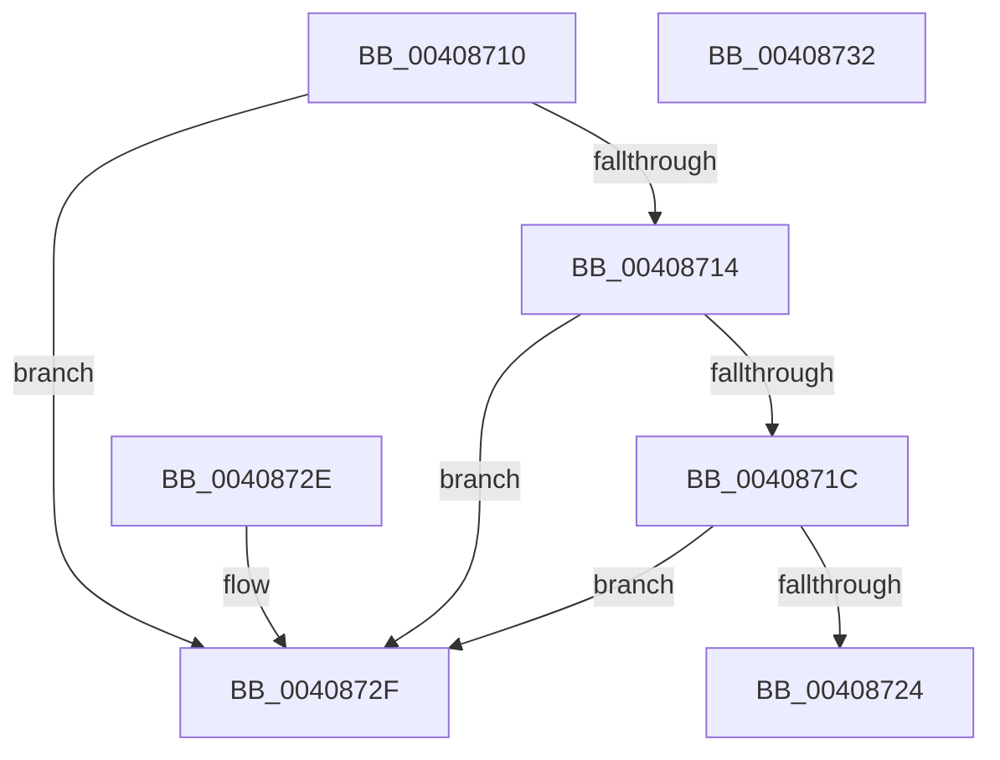

# FsRtlIsTotalDeviceFailure

- RVA: `0x00408710`–`0x00408733` (길이 `35` bytes)
- VA: `0x0000000140408710`
- 실행 섹션: `.text`
- PDB 이름 있음: `예`; PDB Function 태그: `아니요`
- unwind 정보 RVA: `0x000DB714`
- 디코드: `13`개 명령, `35/35` bytes 표시
- 미해석 바이트: `0` (있으면 어셈블리에 `.byte`로 보존)

> 이 문서는 커널 이미지의 기계어와 PDB 기호를 분석해 생성했습니다. 4번과 5번은 함수 원형과 자료형을 바이너리 사용 방식에서 추정한 C 해석이며 원본 소스 복구 결과는 아닙니다.

## 1. Dependencies

- 직접 호출 지점: **0**; 고유 호출 대상: **0**
- 직접 호출자로 확인된 함수: **5**
- RIP 상대 이미지 참조: **0**

### Outgoing calls
- 직접 디코드된 call 명령이 없습니다.

### Direct callers
- [MiConvertFaultStatus](../2A/MiConvertFaultStatus_function_002A2CC0.md) at `0x002A2D56`
- [CcIsFatalWriteError](CcIsFatalWriteError_function_0040855C.md) at `0x004085DE`
- [MiIsRetryIoStatus](MiIsRetryIoStatus_function_00408640.md) at `0x00408674`
- [MmIsWriteErrorFatal](MmIsWriteErrorFatal_function_00408688.md) at `0x004086B3`
- [IopMountVolume](../../page/A3/IopMountVolume_function_00A329D0.md) at `0x00A32E23`

### Static image references
- 디코드된 RIP-relative 메모리 참조가 없습니다.

## 2. Other-region calls and transfers

- 다른 실행 섹션으로 향하는 call: **0**
- 별도 외부 분기/꼬리 이동을 확인하지 못했습니다.

## 3. Assembly (complete function range)

```asm
00408710  85 C9                           test ecx, ecx
00408712  79 1B                           jns 0x14040872f
00408714  81 F9 3F 00 00 C0               cmp ecx, 0xc000003f
0040871A  74 13                           je 0x14040872f
0040871C  81 F9 9C 00 00 C0               cmp ecx, 0xc000009c
00408722  74 0B                           je 0x14040872f
00408724  81 F9 70 04 00 C0               cmp ecx, 0xc0000470
0040872A  0F 95 C0                        setne al
0040872D  C3                              ret
0040872E  CC                              int3
0040872F  32 C0                           xor al, al
00408731  C3                              ret
00408732  CC                              int3
```

## 4. C-style interpretation (structured pseudocode)

```c
__int64 __fastcall FsRtlIsTotalDeviceFailure(int a1)
{
    __int64 result;

    if (!sign_flag) goto loc_0040872F;
    if (a1 == 0xC000003FULL) goto loc_0040872F;
    if (a1 == 0xC000009CULL) goto loc_0040872F;
    result = (a1 != 0xC0000470ULL) ? 1 : 0;
    return result;
loc_0040872F:
    result = 0;
    return result;
}
```

## 5. (Beta) C Style

```c
int64_t FsRtlIsTotalDeviceFailure(int32_t Arg1)
{
    int64_t result;

    if (!sign_flag) goto loc_0040872F;
    if (Arg1 == 0xC000003FULL) goto loc_0040872F;
    if (Arg1 == 0xC000009CULL) goto loc_0040872F;
    result = (Arg1 != 0xC0000470ULL) ? 1 : 0;
    return result;
loc_0040872F:
    result = 0;
    return result;
}
```

## 6. Execution-region graph

[열기: 2D/3D 그래프와 함수 탐색 컨트롤 패널](../../../control-panel.html?section=text&rva=0x00408710&view=graph)

- 2D 그래프는 위에서 아래로 흐르고, 3D 그래프는 빈 공간을 드래그해 회전합니다. Shift+드래그는 이동, 휠은 확대·축소, 함수 노드 선택은 대상 보고서 이동입니다.

### Static fallback


