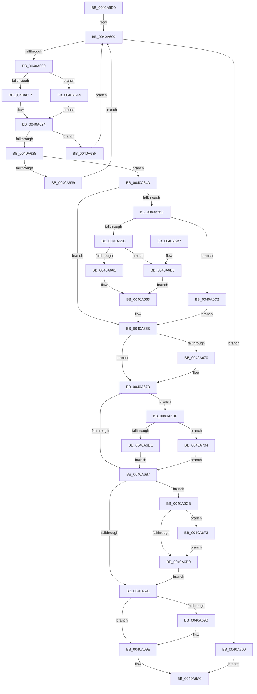

# FsRtlLookupBaseMcbEntry

- RVA: `0x0040A5D0`–`0x0040A710` (길이 `320` bytes)
- VA: `0x000000014040A5D0`
- 실행 섹션: `.text`
- PDB 이름 있음: `예`; PDB Function 태그: `아니요`
- unwind 정보 RVA: `0x0009AD0C`
- 디코드: `102`개 명령, `320/320` bytes 표시
- 미해석 바이트: `0` (있으면 어셈블리에 `.byte`로 보존)

> 이 문서는 커널 이미지의 기계어와 PDB 기호를 분석해 생성했습니다. 4번과 5번은 함수 원형과 자료형을 바이너리 사용 방식에서 추정한 C 해석이며 원본 소스 복구 결과는 아닙니다.

## 1. Dependencies

- 직접 호출 지점: **0**; 고유 호출 대상: **0**
- 직접 호출자로 확인된 함수: **1**
- RIP 상대 이미지 참조: **0**

### Outgoing calls
- 직접 디코드된 call 명령이 없습니다.

### Direct callers
- [FsRtlLookupLargeMcbEntry](FsRtlLookupLargeMcbEntry_function_0040A540.md) at `0x0040A59C`

### Static image references
- 디코드된 RIP-relative 메모리 참조가 없습니다.

## 2. Other-region calls and transfers

- 다른 실행 섹션으로 향하는 call: **0**
- 별도 외부 분기/꼬리 이동을 확인하지 못했습니다.

## 3. Assembly (complete function range)

```asm
0040A5D0  48 89 5C 24 08                  mov qword ptr [rsp + 8], rbx
0040A5D5  48 89 6C 24 10                  mov qword ptr [rsp + 0x10], rbp
0040A5DA  48 89 74 24 18                  mov qword ptr [rsp + 0x18], rsi
0040A5DF  48 89 7C 24 20                  mov qword ptr [rsp + 0x20], rdi
0040A5E4  41 56                           push r14
0040A5E6  44 8B 51 04                     mov r10d, dword ptr [rcx + 4]
0040A5EA  33 ED                           xor ebp, ebp
0040A5EC  44 8B DD                        mov r11d, ebp
0040A5EF  41 FF CA                        dec r10d
0040A5F2  49 8B F1                        mov rsi, r9
0040A5F5  4D 8B F0                        mov r14, r8
0040A5F8  48 8B DA                        mov rbx, rdx
0040A5FB  48 8B F9                        mov rdi, rcx
0040A5FE  66 90                           nop
0040A600  45 3B DA                        cmp r11d, r10d
0040A603  0F 8F F7 00 00 00               jg 0x14040a700
0040A609  43 8D 04 1A                     lea eax, [r10 + r11]
0040A60D  99                              cdq
0040A60E  2B C2                           sub eax, edx
0040A610  D1 F8                           sar eax, 1
0040A612  44 8B C0                        mov r8d, eax
0040A615  74 2D                           je 0x14040a644
0040A617  8D 50 FF                        lea edx, [rax - 1]
0040A61A  48 8B 47 10                     mov rax, qword ptr [rdi + 0x10]
0040A61E  48 63 CA                        movsxd rcx, edx
0040A621  8B 04 C8                        mov eax, dword ptr [rax + rcx*8]
0040A624  3B D8                           cmp ebx, eax
0040A626  72 17                           jb 0x14040a63f
0040A628  4C 8B 4F 10                     mov r9, qword ptr [rdi + 0x10]
0040A62C  49 63 C0                        movsxd rax, r8d
0040A62F  41 8B 0C C1                     mov ecx, dword ptr [r9 + rax*8]
0040A633  FF C9                           dec ecx
0040A635  3B D9                           cmp ebx, ecx
0040A637  76 14                           jbe 0x14040a64d
0040A639  45 8D 58 01                     lea r11d, [r8 + 1]
0040A63D  EB C1                           jmp 0x14040a600
0040A63F  44 8B D2                        mov r10d, edx
0040A642  EB BC                           jmp 0x14040a600
0040A644  8B C5                           mov eax, ebp
0040A646  BA FF FF FF FF                  mov edx, 0xffffffff
0040A64B  EB D7                           jmp 0x14040a624
0040A64D  4D 85 F6                        test r14, r14
0040A650  74 19                           je 0x14040a66b
0040A652  43 8B 54 C1 04                  mov edx, dword ptr [r9 + r8*8 + 4]
0040A657  83 FA FF                        cmp edx, -1
0040A65A  74 66                           je 0x14040a6c2
0040A65C  45 85 C0                        test r8d, r8d
0040A65F  75 57                           jne 0x14040a6b8
0040A661  8B C5                           mov eax, ebp
0040A663  2B D0                           sub edx, eax
0040A665  8D 04 13                        lea eax, [rbx + rdx]
0040A668  49 89 06                        mov qword ptr [r14], rax
0040A66B  48 85 F6                        test rsi, rsi
0040A66E  74 0D                           je 0x14040a67d
0040A670  48 8B 47 10                     mov rax, qword ptr [rdi + 0x10]
0040A674  42 8B 04 C0                     mov eax, dword ptr [rax + r8*8]
0040A678  2B C3                           sub eax, ebx
0040A67A  48 89 06                        mov qword ptr [rsi], rax
0040A67D  48 8B 54 24 30                  mov rdx, qword ptr [rsp + 0x30]
0040A682  48 85 D2                        test rdx, rdx
0040A685  75 58                           jne 0x14040a6df
0040A687  4C 8B 4C 24 38                  mov r9, qword ptr [rsp + 0x38]
0040A68C  4D 85 C9                        test r9, r9
0040A68F  75 3A                           jne 0x14040a6cb
0040A691  48 8B 44 24 40                  mov rax, qword ptr [rsp + 0x40]
0040A696  48 85 C0                        test rax, rax
0040A699  74 03                           je 0x14040a69e
0040A69B  44 89 00                        mov dword ptr [rax], r8d
0040A69E  B0 01                           mov al, 1
0040A6A0  48 8B 5C 24 10                  mov rbx, qword ptr [rsp + 0x10]
0040A6A5  48 8B 6C 24 18                  mov rbp, qword ptr [rsp + 0x18]
0040A6AA  48 8B 74 24 20                  mov rsi, qword ptr [rsp + 0x20]
0040A6AF  48 8B 7C 24 28                  mov rdi, qword ptr [rsp + 0x28]
0040A6B4  41 5E                           pop r14
0040A6B6  C3                              ret
0040A6B7  CC                              int3
0040A6B8  41 8D 40 FF                     lea eax, [r8 - 1]
0040A6BC  41 8B 04 C1                     mov eax, dword ptr [r9 + rax*8]
0040A6C0  EB A1                           jmp 0x14040a663
0040A6C2  49 C7 06 FF FF FF FF            mov qword ptr [r14], 0xffffffffffffffff
0040A6C9  EB A0                           jmp 0x14040a66b
0040A6CB  45 85 C0                        test r8d, r8d
0040A6CE  75 23                           jne 0x14040a6f3
0040A6D0  48 8B 47 10                     mov rax, qword ptr [rdi + 0x10]
0040A6D4  42 8B 04 C0                     mov eax, dword ptr [rax + r8*8]
0040A6D8  2B C5                           sub eax, ebp
0040A6DA  49 89 01                        mov qword ptr [r9], rax
0040A6DD  EB B2                           jmp 0x14040a691
0040A6DF  48 8B 47 10                     mov rax, qword ptr [rdi + 0x10]
0040A6E3  46 8B 4C C0 04                  mov r9d, dword ptr [rax + r8*8 + 4]
0040A6E8  41 83 F9 FF                     cmp r9d, -1
0040A6EC  74 16                           je 0x14040a704
0040A6EE  4C 89 0A                        mov qword ptr [rdx], r9
0040A6F1  EB 94                           jmp 0x14040a687
0040A6F3  48 8B 47 10                     mov rax, qword ptr [rdi + 0x10]
0040A6F7  41 8D 48 FF                     lea ecx, [r8 - 1]
0040A6FB  8B 2C C8                        mov ebp, dword ptr [rax + rcx*8]
0040A6FE  EB D0                           jmp 0x14040a6d0
0040A700  32 C0                           xor al, al
0040A702  EB 9C                           jmp 0x14040a6a0
0040A704  48 C7 02 FF FF FF FF            mov qword ptr [rdx], 0xffffffffffffffff
0040A70B  E9 77 FF FF FF                  jmp 0x14040a687
```

## 4. C-style interpretation (structured pseudocode)

```c
__int64 __fastcall FsRtlLookupBaseMcbEntry(__int64 a1, __int64 a2, __int64 a3, __int64 a4, __int64 a5, __int64 a6, __int64 a7)
{
    __int64 result;
    __int64 v_r10;
    __int64 v_rbp;
    unsigned __int64 v_stack_p10;
    unsigned __int64 v_stack_p18;
    unsigned __int64 v_stack_p20;
    unsigned __int64 v_stack_p8;

    v_stack_p8 = v_rbx;
    v_stack_p10 = v_rbp;
    v_stack_p18 = v_rsi;
    v_stack_p20 = v_rdi;
    v_rbp = 0;
    v_r10 = (unsigned int)(((unsigned int)(*(unsigned int *)(a1 + 4))) - 1);
loc_0040A600:
    if (0 > ((unsigned int)(v_r10))) goto loc_0040A700;
    result = (unsigned int)((v_r10 + 0 * 1) - ((unsigned int)(a2)));
    result = (unsigned int)((result) >> (1));
    if (condition_is_equal) goto loc_0040A644;
loc_0040A624:
    if (((unsigned int)(a2)) < ((unsigned int)((unsigned int)(*(unsigned int *)(*(unsigned __int64 *)(a1 + 16) + (int)((unsigned int)(result - 1)) * 8))))) goto loc_0040A63F;
    a1 = (unsigned int)(((unsigned int)(*(unsigned int *)(*(unsigned __int64 *)(a1 + 16) + (int)((unsigned int)((unsigned int)((unsigned int)(result)))) * 8))) - 1);
    if (((unsigned int)(a2)) <= ((unsigned int)(a1))) goto loc_0040A64D;
    goto loc_0040A600;
loc_0040A63F:
    goto loc_0040A600;
loc_0040A644:
    goto loc_0040A624;
loc_0040A64D:
    if (a3 == 0) goto loc_0040A66B;
    if (((unsigned int)((unsigned int)(*(unsigned int *)(*(unsigned __int64 *)(a1 + 16) + (unsigned int)((unsigned int)(result)) * 8 + 4)))) == -1) goto loc_0040A6C2;
    if ((unsigned int)((unsigned int)((unsigned int)(result))) != 0) goto loc_0040A6B8;
loc_0040A663:
    a2 = (unsigned int)(((unsigned int)(*(unsigned int *)(*(unsigned __int64 *)(a1 + 16) + (unsigned int)((unsigned int)(result)) * 8 + 4))) - (0));
    *(unsigned __int64 *)(a3) = a2 + a2 * 1;
loc_0040A66B:
    result = a2 + a2 * 1;
    if (a4 != 0) {
        result = *(unsigned __int64 *)(a1 + 16);
        result = *(unsigned int *)(result + (unsigned int)((unsigned int)(result)) * 8);
        result = (unsigned int)((result) - ((unsigned int)(a2)));
        *(unsigned __int64 *)(a4) = result;
    }
    if (a5 != 0) goto loc_0040A6DF;
loc_0040A687:
    if (a6 != 0) goto loc_0040A6CB;
loc_0040A691:
    if (a7 != 0) {
        *(unsigned int *)(a7) = (unsigned int)((unsigned int)((unsigned int)(result)));
    }
loc_0040A6A0:
    return 1;
loc_0040A6B8:
    goto loc_0040A663;
loc_0040A6C2:
    *(unsigned __int64 *)(a3) = -1;
    goto loc_0040A66B;
loc_0040A6CB:
    if ((unsigned int)((unsigned int)((unsigned int)(result))) != 0) goto loc_0040A6F3;
loc_0040A6D0:
    result = (unsigned int)(((unsigned int)(*(unsigned int *)(*(unsigned __int64 *)(v_stack_p20 + 16) + (unsigned int)((unsigned int)(result)) * 8))) - ((unsigned int)(v_stack_p10)));
    *(unsigned __int64 *)(a6) = result;
    goto loc_0040A691;
loc_0040A6DF:
    if (((unsigned int)((unsigned int)(*(unsigned int *)(*(unsigned __int64 *)(v_stack_p20 + 16) + (unsigned int)((unsigned int)(result)) * 8 + 4)))) == -1) goto loc_0040A704;
    *(unsigned __int64 *)(a5) = (unsigned int)(*(unsigned int *)(*(unsigned __int64 *)(v_stack_p20 + 16) + (unsigned int)((unsigned int)(result)) * 8 + 4));
    goto loc_0040A687;
loc_0040A6F3:
    goto loc_0040A6D0;
loc_0040A700:
    result = 0;
    goto loc_0040A6A0;
loc_0040A704:
    *(unsigned __int64 *)(a5) = -1;
    goto loc_0040A687;
}
```

## 5. (Beta) C Style

```c
int64_t FsRtlLookupBaseMcbEntry(void *Arg1, int64_t Arg2, int64_t Arg3, int64_t Arg4, int64_t Arg5, int64_t Arg6, int64_t Arg7)
{
    uint8_t *arg1 = (uint8_t *)Arg1;

    int64_t result;
    int64_t local_r10;
    int64_t local_rbp;
    uint64_t v_stack_p10;
    uint64_t v_stack_p18;
    uint64_t v_stack_p20;
    uint64_t v_stack_p8;

    v_stack_p8 = local_rbx;
    v_stack_p10 = local_rbp;
    v_stack_p18 = local_rsi;
    v_stack_p20 = local_rdi;
    local_rbp = 0;
    local_r10 = (uint32_t)(((uint32_t)(*(uint32_t *)(arg1 + 0x4))) - 1);
loc_0040A600:
    if (0 > ((uint32_t)(local_r10))) goto loc_0040A700;
    result = (uint32_t)((local_r10 + 0 * 1) - ((uint32_t)(Arg2)));
    result = (uint32_t)((result) >> (1));
    if (condition_is_equal) goto loc_0040A644;
loc_0040A624:
    if (((uint32_t)(Arg2)) < ((uint32_t)((uint32_t)(*(uint32_t *)(*(uint64_t *)(arg1 + 0x10) + (int32_t)((uint32_t)(result - 0x1)) * 8))))) goto loc_0040A63F;
    Arg1 = (uint32_t)(((uint32_t)(*(uint32_t *)(*(uint64_t *)(arg1 + 0x10) + (int32_t)((uint32_t)((uint32_t)((uint32_t)(result)))) * 8))) - 1);
    if (((uint32_t)(Arg2)) <= ((uint32_t)(Arg1))) goto loc_0040A64D;
    goto loc_0040A600;
loc_0040A63F:
    goto loc_0040A600;
loc_0040A644:
    goto loc_0040A624;
loc_0040A64D:
    if (Arg3 == 0) goto loc_0040A66B;
    if (((uint32_t)((uint32_t)(*(uint32_t *)(*(uint64_t *)(arg1 + 0x10) + (uint32_t)((uint32_t)(result)) * 8 + 0x4)))) == -1) goto loc_0040A6C2;
    if ((uint32_t)((uint32_t)((uint32_t)(result))) != 0) goto loc_0040A6B8;
loc_0040A663:
    Arg2 = (uint32_t)(((uint32_t)(*(uint32_t *)(*(uint64_t *)(arg1 + 0x10) + (uint32_t)((uint32_t)(result)) * 8 + 0x4))) - (0));
    *(uint64_t *)(Arg3) = Arg2 + Arg2 * 1;
loc_0040A66B:
    result = Arg2 + Arg2 * 1;
    if (Arg4 != 0) {
        result = *(uint64_t *)(arg1 + 0x10);
        result = *(uint32_t *)(result + (uint32_t)((uint32_t)(result)) * 8);
        result = (uint32_t)((result) - ((uint32_t)(Arg2)));
        *(uint64_t *)(Arg4) = result;
    }
    if (Arg5 != 0) goto loc_0040A6DF;
loc_0040A687:
    if (Arg6 != 0) goto loc_0040A6CB;
loc_0040A691:
    if (Arg7 != 0) {
        *(uint32_t *)(Arg7) = (uint32_t)((uint32_t)((uint32_t)(result)));
    }
loc_0040A6A0:
    return 1;
loc_0040A6B8:
    goto loc_0040A663;
loc_0040A6C2:
    *(uint64_t *)(Arg3) = -1;
    goto loc_0040A66B;
loc_0040A6CB:
    if ((uint32_t)((uint32_t)((uint32_t)(result))) != 0) goto loc_0040A6F3;
loc_0040A6D0:
    result = (uint32_t)(((uint32_t)(*(uint32_t *)(*(uint64_t *)(v_stack_p20 + 0x10) + (uint32_t)((uint32_t)(result)) * 8))) - ((uint32_t)(v_stack_p10)));
    *(uint64_t *)(Arg6) = result;
    goto loc_0040A691;
loc_0040A6DF:
    if (((uint32_t)((uint32_t)(*(uint32_t *)(*(uint64_t *)(v_stack_p20 + 0x10) + (uint32_t)((uint32_t)(result)) * 8 + 0x4)))) == -1) goto loc_0040A704;
    *(uint64_t *)(Arg5) = (uint32_t)(*(uint32_t *)(*(uint64_t *)(v_stack_p20 + 0x10) + (uint32_t)((uint32_t)(result)) * 8 + 0x4));
    goto loc_0040A687;
loc_0040A6F3:
    goto loc_0040A6D0;
loc_0040A700:
    result = 0;
    goto loc_0040A6A0;
loc_0040A704:
    *(uint64_t *)(Arg5) = -1;
    goto loc_0040A687;
}
```

### 관측된 메모리 오프셋

구조체 형식이 확인되지 않은 접근은 인자 기준의 오프셋으로만 기록했습니다.

| 기준 인자 | 오프셋 표현 | 폭 (bit) | 접근 |
|---|---:|---:|---|
| `Arg1` | `+ 0x4` | `32` | `R` |
| `Arg1` | `+ 0x10` | `64` | `R` |

## 6. Execution-region graph

[열기: 2D/3D 그래프와 함수 탐색 컨트롤 패널](../../../control-panel.html?section=text&rva=0x0040A5D0&view=graph)

- 2D 그래프는 위에서 아래로 흐르고, 3D 그래프는 빈 공간을 드래그해 회전합니다. Shift+드래그는 이동, 휠은 확대·축소, 함수 노드 선택은 대상 보고서 이동입니다.

### Static fallback


