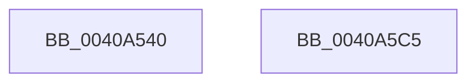

# FsRtlLookupLargeMcbEntry

- RVA: `0x0040A540`–`0x0040A5C6` (길이 `134` bytes)
- VA: `0x000000014040A540`
- 실행 섹션: `.text`
- PDB 이름 있음: `예`; PDB Function 태그: `아니요`
- unwind 정보 RVA: `0x0009ACD0`
- 디코드: `36`개 명령, `134/134` bytes 표시
- 미해석 바이트: `0` (있으면 어셈블리에 `.byte`로 보존)

> 이 문서는 커널 이미지의 기계어와 PDB 기호를 분석해 생성했습니다. 4번과 5번은 함수 원형과 자료형을 바이너리 사용 방식에서 추정한 C 해석이며 원본 소스 복구 결과는 아닙니다.

## 1. Dependencies

- 직접 호출 지점: **3**; 고유 호출 대상: **3**
- 직접 호출자로 확인된 함수: **1**
- RIP 상대 이미지 참조: **0**

### Outgoing calls
- `0x0040A568` → [ExAcquireFastMutex](../20/ExAcquireFastMutex_function_0020E5A0.md) (function, `0x0020E5A0`)
- `0x0040A59C` → [FsRtlLookupBaseMcbEntry](FsRtlLookupBaseMcbEntry_function_0040A5D0.md) (function, `0x0040A5D0`)
- `0x0040A5A7` → [ExReleaseFastMutex](../25/ExReleaseFastMutex_function_002519C0.md) (function, `0x002519C0`)

### Direct callers
- [FsRtlLookupMcbEntry](../58/FsRtlLookupMcbEntry_function_00581310.md) at `0x0058135A`

### Static image references
- 디코드된 RIP-relative 메모리 참조가 없습니다.

## 2. Other-region calls and transfers

- 다른 실행 섹션으로 향하는 call: **0**
- 별도 외부 분기/꼬리 이동을 확인하지 못했습니다.

## 3. Assembly (complete function range)

```asm
0040A540  48 8B C4                        mov rax, rsp
0040A543  48 89 58 10                     mov qword ptr [rax + 0x10], rbx
0040A547  48 89 70 18                     mov qword ptr [rax + 0x18], rsi
0040A54B  48 89 78 20                     mov qword ptr [rax + 0x20], rdi
0040A54F  48 89 48 08                     mov qword ptr [rax + 8], rcx
0040A553  41 56                           push r14
0040A555  48 83 EC 40                     sub rsp, 0x40
0040A559  49 8B F9                        mov rdi, r9
0040A55C  49 8B F0                        mov rsi, r8
0040A55F  4C 8B F2                        mov r14, rdx
0040A562  48 8B D9                        mov rbx, rcx
0040A565  48 8B 09                        mov rcx, qword ptr [rcx]
0040A568  E8 33 40 E0 FF                  call 0x14020e5a0
0040A56D  90                              nop
0040A56E  48 8D 4B 08                     lea rcx, [rbx + 8]
0040A572  48 8B 84 24 80 00 00 00         mov rax, qword ptr [rsp + 0x80]
0040A57A  48 89 44 24 30                  mov qword ptr [rsp + 0x30], rax
0040A57F  48 8B 44 24 78                  mov rax, qword ptr [rsp + 0x78]
0040A584  48 89 44 24 28                  mov qword ptr [rsp + 0x28], rax
0040A589  48 8B 44 24 70                  mov rax, qword ptr [rsp + 0x70]
0040A58E  48 89 44 24 20                  mov qword ptr [rsp + 0x20], rax
0040A593  4C 8B CF                        mov r9, rdi
0040A596  4C 8B C6                        mov r8, rsi
0040A599  49 8B D6                        mov rdx, r14
0040A59C  E8 2F 00 00 00                  call 0x14040a5d0
0040A5A1  40 8A F8                        mov dil, al
0040A5A4  48 8B 0B                        mov rcx, qword ptr [rbx]
0040A5A7  E8 14 74 E4 FF                  call 0x1402519c0
0040A5AC  40 8A C7                        mov al, dil
0040A5AF  48 8B 5C 24 58                  mov rbx, qword ptr [rsp + 0x58]
0040A5B4  48 8B 74 24 60                  mov rsi, qword ptr [rsp + 0x60]
0040A5B9  48 8B 7C 24 68                  mov rdi, qword ptr [rsp + 0x68]
0040A5BE  48 83 C4 40                     add rsp, 0x40
0040A5C2  41 5E                           pop r14
0040A5C4  C3                              ret
0040A5C5  CC                              int3
```

## 4. C-style interpretation (structured pseudocode)

```c
__int64 __fastcall FsRtlLookupLargeMcbEntry(__int64 a1, __int64 a2, __int64 a3, __int64 a4, __int64 a5, __int64 a6, __int64 a7)
{
    __int64 result;
    __int64 v_rsp;
    unsigned __int64 v_stack_m18;
    unsigned __int64 v_stack_m20;
    unsigned __int64 v_stack_m28;
    unsigned __int64 v_stack_p10;
    unsigned __int64 v_stack_p18;
    unsigned __int64 v_stack_p20;

    *(unsigned __int64 *)(v_rsp + 16) = v_rbx;
    *(unsigned __int64 *)(v_rsp + 24) = v_rsi;
    *(unsigned __int64 *)(v_rsp + 32) = v_rdi;
    *(unsigned __int64 *)(v_rsp + 8) = a1;
    v_rsp = (v_rsp) - (64);
    result = ExAcquireFastMutex(*(unsigned __int64 *)(a1), a2, a3, a4);
    v_stack_m18 = a7;
    v_stack_m20 = a6;
    v_stack_m28 = a5;
    result = FsRtlLookupBaseMcbEntry(a1 + 8, a2, a3, a4);
    result = ExReleaseFastMutex(*(unsigned __int64 *)(a1), a2, a3, a4);
    v_rsp = (v_rsp) + (64);
    return (unsigned __int8)((unsigned __int8)(result));
}
```

## 5. (Beta) C Style

```c
int64_t FsRtlLookupLargeMcbEntry(void *Arg1, int64_t Arg2, int64_t Arg3, int64_t Arg4, int64_t Arg5, int64_t Arg6, int64_t Arg7)
{
    uint8_t *arg1 = (uint8_t *)Arg1;

    int64_t result;
    int64_t local_rsp;
    uint64_t v_stack_m18;
    uint64_t v_stack_m20;
    uint64_t v_stack_m28;
    uint64_t v_stack_p10;
    uint64_t v_stack_p18;
    uint64_t v_stack_p20;

    *(uint64_t *)(local_rsp + 0x10) = local_rbx;
    *(uint64_t *)(local_rsp + 0x18) = local_rsi;
    *(uint64_t *)(local_rsp + 0x20) = local_rdi;
    *(void **)(local_rsp + 0x8) = Arg1;
    local_rsp = (local_rsp) - (64);
    result = ExAcquireFastMutex(*(uint64_t *)(arg1), Arg2, Arg3, Arg4);
    v_stack_m18 = Arg7;
    v_stack_m20 = Arg6;
    v_stack_m28 = Arg5;
    result = FsRtlLookupBaseMcbEntry(Arg1 + 8, Arg2, Arg3, Arg4);
    result = ExReleaseFastMutex(*(uint64_t *)(arg1), Arg2, Arg3, Arg4);
    local_rsp = (local_rsp) + (64);
    return (uint8_t)((uint8_t)(result));
}
```

### 관측된 메모리 오프셋

구조체 형식이 확인되지 않은 접근은 인자 기준의 오프셋으로만 기록했습니다.

| 기준 인자 | 오프셋 표현 | 폭 (bit) | 접근 |
|---|---:|---:|---|
| `Arg1` | `+ 0x0` | `64` | `R` |
| `Arg1` | `+ 0x8` | `64` | `R` |

## 6. Execution-region graph

[열기: 2D/3D 그래프와 함수 탐색 컨트롤 패널](../../../control-panel.html?section=text&rva=0x0040A540&view=graph)

- 2D 그래프는 위에서 아래로 흐르고, 3D 그래프는 빈 공간을 드래그해 회전합니다. Shift+드래그는 이동, 휠은 확대·축소, 함수 노드 선택은 대상 보고서 이동입니다.

### Static fallback


